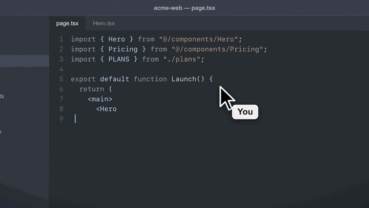

# Sidescreen

Give each AI agent its own Mac screen. Claude Code or Codex opens apps, clicks and types on a virtual display, while your cursor, keyboard and windows stay yours.



<sub>A scripted replay: [rust/tests/demo/record.ts](rust/tests/demo/record.ts) makes the same calls the MCP tools make, and draws the user's notes and pointer.</sub>

Built-in computer use drives your real mouse and keyboard, so you stop working while the agent works. Sidescreen moves the agent onto a display of its own. You watch it from the menu bar, step in when it asks, and hand the screen back with one click.

## What you get

- **A display per agent session.** Run three agents at once and each gets its own screen. Subagents of one session share theirs. Your windows never move.
- **Peek.** Hover the menu bar icon to see every agent's screen live.
- **Takeover.** Click into an agent's screen to take the wheel. The agent pauses until you press Let … Continue.
- **Help Request.** An agent stuck on a login or a captcha asks for you with a card under the menu bar icon and a notification, then waits.
- **Menus and controls through accessibility.** Agents press buttons and pick menu items by name, so a button still gets pressed after its window moves or resizes.
- **Handover.** Drag one of your windows onto an agent's screen to give it the window, and take it back with Take Back.

| | Sidescreen | Built-in computer use | A virtual machine |
| --- | --- | --- | --- |
| You keep your mouse and keyboard | Yes | No | Yes |
| Works with your real apps and logins | Yes | Yes | No, set them up again |
| Several agents at once | Yes, one display each | No | One VM each |
| Watch and step in | Menu bar, one click | Watch your own screen | VM window |

## Install

1. Install with Homebrew. It needs macOS 15 or later.

   ```sh
   brew tap fanzzzd/sidescreen
   brew install --cask sidescreen
   ```

   Or download the DMG from the [latest release](../../releases/latest) and drag Sidescreen into Applications. Sidescreen is signed with a Developer ID but not notarized, so the first time you open the downloaded app, macOS says it can't check it: go to System Settings ▸ Privacy & Security and press **Open Anyway**, or run `xattr -dr com.apple.quarantine /Applications/Sidescreen.app`. Homebrew does that for you.

2. Open Sidescreen. The setup window asks for Screen & System Audio Recording and Accessibility. Both stay on this Mac.
3. Connect your agents. Press **Connect…** in the setup window, or right-click the menu bar icon and choose **Connect Claude Code and Codex**, or run:

   ```sh
   /Applications/Sidescreen.app/Contents/MacOS/Sidescreen mcp install
   ```

   This registers the MCP server with Claude Code for all projects and adds it to `~/.codex/config.toml`. Running it again is safe. For any other MCP client, add a stdio server with the command `/Applications/Sidescreen.app/Contents/MacOS/Sidescreen` and the argument `mcp`.

Then ask your agent something like "Use Sidescreen to open Calculator on your own display and work out 12 × 34." Start a new session after connecting, so the agent loads the tools. Once it has, the setup window and the menu name the agent. If Sidescreen isn't running, the first tool call starts it.

## Agent tools

| Tool | What it does |
| --- | --- |
| `create_display`, `end_display` | Get the session's display, one per session, or finish with it. |
| `launch_app`, `place_window`, `list_windows` | Open apps on the display and list its windows. `list_windows` with `strays: true` lists windows of the agent's apps that opened elsewhere, for `place_window`. |
| `computer` | Anthropic-style actions on the whole display. Every action except `wait` and `cursor_position` returns a screenshot. |
| `get_window_state`, `act_on_element` | One window's screenshot and accessibility tree, and actions on its numbered elements: press, click, set or insert text, read text. Numbers stay put while the element stays in the window. |
| `set_disposition` | Keep or close a window when the user closes the display. |
| `wait_for_control`, `request_help` | Wait out a Takeover, or ask the user to step in. |

A session can only see and drive its own display. [docs/agents/AGENTS.md](docs/agents/AGENTS.md) is a convention you can paste into a project's `AGENTS.md` or `CLAUDE.md`.

## Your side

- **Peek.** Hover the menu bar icon, or click it to keep Peek up. Right-click it for the menu. Displays in use come first, then those waiting for review. The narrow + creates a display of your own.
- **Takeover.** Your first click, scroll or key press in the Viewer, or Take Over, pauses the agent. Its input tools fail until you press Let … Continue. Collapsing the Viewer keeps the Takeover.
- **Help Request.** `request_help` drops a card from the menu bar icon with the display's picture and the agent's reason, and posts a notification. Take Over, on the card or the notification, opens the display in Takeover. Clicking the picture or the notification only opens it. Later puts the card away; the icon stays orange.
- **Notifications.** Besides Help Requests, Sidescreen tells you when an agent leaves windows on its display, by finishing or by disconnecting. Allow them in the setup window.
- **Agent Pointer.** The Viewer and Peek draw an arrow where the agent last acted. It is not on the display, so agent screenshots don't contain it.
- **Handover.** Drag one of your windows onto the Viewer, or pick it under Give in the Viewer's header. Take Back brings any window back. A handed-over window returns to where it was. ⋯ has Close Display….
- **Review.** When the agent stops using a display, the display closes by itself if it is empty, and otherwise shows Needs Review until you press Review Windows…. See [ADR 0004](docs/adr/0004-display-lifecycle.md).
- **Closing a display** lists its windows with what the agent suggested for each, keep or close, and you can change any of them. Esc cancels, ⌘Return confirms. Quitting Sidescreen applies the same plan without asking.

The app follows your Mac's language: Chinese when it comes first in your preferred languages, English otherwise.

## Privacy

Sidescreen runs on your Mac and sends nothing anywhere. Screen & System Audio Recording lets it show agent displays and take the screenshots agents ask for. Accessibility lets it click, type and place windows on them. Agents reach it through a socket only your user account can open.

## Known limits

- It uses private macOS APIs, so it can't be in the App Store, and a future macOS may break it.
- The menu bar strip in the Viewer mirrors your own front app. A click on it opens the menus of the app in front on the agent's display; status items there take no clicks.
- The first click on a window only activates it, the same as a real click on an inactive window.
- Clicks on an empty part of a display reach nothing.
- `launch_app` on a running single-window app such as Calculator gets no new window, and says so at once. Quit it first, or hand its window over.
- When an agent opens a new window in an app that is already running, the window shows on your screen for about 30 ms before it moves, 140 ms at most in tests.
- A new window of an app the agent started goes to the agent's display if the display was driven in the last 3 seconds, by the agent or by you through its Viewer, and you didn't click or type in that app, Finder, the Dock or a launcher such as Spotlight meanwhile. For an app the agent starts, this holds for 30 seconds from the launch, so a slow app's windows still arrive. A window you open stays on your screen. One that opens while you both act, or with nobody acting, stays where it opened; the agent's next screenshot or window state names it, and the agent can move it with `place_window`. Take back one of the app's windows and the whole app is yours; hand a window over again and the agent can use it.
- A window that refuses to close, such as one with unsaved changes, is left to macOS, which moves it to your main display.
- Canvas apps and games that filter per-process events may ignore forwarded input.
- With the menu bar icon hidden, for example behind the notch, Peek and the Viewer drop from the top center of the screen under the pointer.
- Copy, paste and undo shortcuts need a focused app, so they do nothing in an app on an agent's display. Agents copy and paste with `act_on_element`'s `read_text` and `insert_text` instead; Command-A still selects all.
- Window managers move windows too. With AeroSpace, see [docs/aerospace.md](docs/aerospace.md). Others, such as yabai, are untested.
- The Viewer shows a display at one pixel per point, scaled up, so small text in it looks soft. Agents' screenshots are unaffected.

## Troubleshooting

- **The agent has no Sidescreen tools.** Start a new session after connecting; a running session doesn't load new MCP servers. `claude mcp get sidescreen` shows whether Claude Code has it.
- **Tools fail with a permissions error after an update.** macOS ties the grants to the app's signature. The menu, which opens when you right-click the menu bar icon, then shows **Finish Setup: Allow …**. Choose it, and in each list it opens switch Sidescreen off and on.
- **Tools say Sidescreen isn't running.** The first tool call starts it. If that fails, open `/Applications/Sidescreen.app` once yourself.
- **The agent says you closed its display.** Closing a display from Peek or the Viewer tells its agent to stop and ask you before it makes another. Tell it to go on, and it creates a new one.
- **Tools fail with "locked".** macOS blocks input and screenshots on every display while the screen is locked. Unlock and retry.

## Develop

To build and install from source instead of the DMG, with Rust installed: `rust/sidescreen/scripts/install.sh`. See [docs/DEVELOPMENT.md](docs/DEVELOPMENT.md) for testing and how it works. Sidescreen is MIT licensed. Its background input recipe is ported from [trycua/cua](https://github.com/trycua/cua); see [THIRD_PARTY_NOTICES.md](THIRD_PARTY_NOTICES.md).
