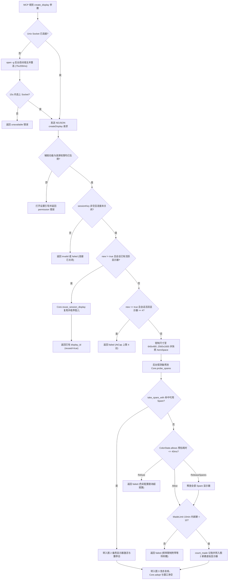
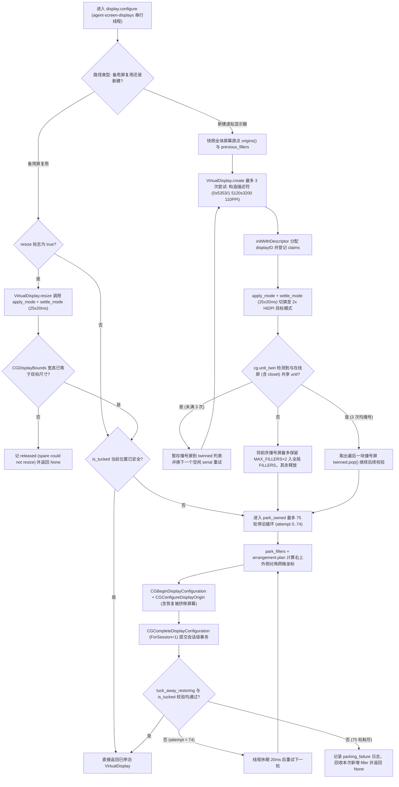
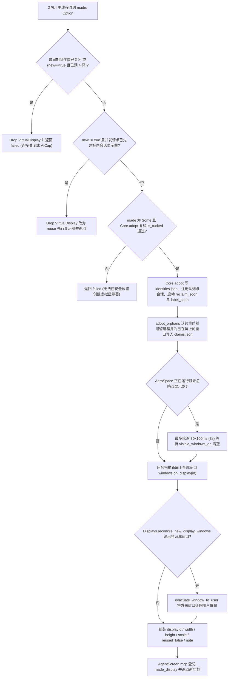

# 01. `create_display` 与虚拟显示器分配及停泊流水线

`create_display` 是 Agent Screen 唯一预加载的 MCP 工具 (`always_load`, `crates/mcp/src/tools.rs:115-118, 135-137`)。它通过 Unix 域套接字向宿主应用请求一块隔离的 Agent Display (`CGVirtualDisplay`)，并将其停泊在用户显示器右上角外侧的对角网格中，防止真实鼠标指针跨边滑入。为减少新建虚拟显示器引发的 `WindowServer` 与 `ColorSync` 全系统重配置，流水线按三级顺序决策：先复用同会话已有活跃显示器，再从备用池 (`SPARES = 3`) 取出显示器，最后在通过 ColorSync 耗时预算与新建频率门控后创建 `CGVirtualDisplay` 并执行停泊校验。

## 线程与队列分工

1. **`AgentScreen mcp` 进程 (`tokio` 运行时)**：解析工具参数并识别 `sessionKey` (`crates/mcp/src/session.rs:18-51`)，按需通过 `/usr/bin/open -g` 后台拉起宿主应用并连接 `control[-<instance>].sock` (`crates/mcp/src/control.rs:306-387`, `crates/mcp/src/endpoint.rs:37-53`)。
2. **宿主控制套接字线程 (`agent-screen-control` 专用 OS 线程)**：`control::server::start` 在独立单线程 `tokio` 运行时中运行 `serve` (`apps/macos/src/control/server.rs:96-199`)，解析单行 NDJSON 并向主线程发送 `Event::Request` 或 `Event::Closed`。
3. **GPUI 主线程 (`AsyncApp` / `Entity<Core>`)**：执行权限检查 `permitted`、会话 `MAX_LIVE = 4` 上限检查、`ColorState` 预算与 `MadeLimit` 门控、备用池挑选 `take_spare_with`、`Core::adopt` 收养登记及 UI 通知 (`apps/macos/src/control/agent.rs:2627-2961`)。
4. **显示器配置工作线程 (`agent-screen-displays` 专用串行 OS 线程)**：`display::configure` (`apps/macos/src/mac/display.rs:343-365`) 串行执行 `CGVirtualDisplay` 创建、模式切换、`CGBeginDisplayConfiguration` 原点停泊与 `unit_twin` 填洞占位，避免并发重配置互相覆盖并避免阻塞主线程绘制。
5. **虚拟显示器回调队列 (`app.agentscreen.virtual-displays` GCD 串行队列)**：绑定到 `CGVirtualDisplayDescriptor.setQueue:` (`apps/macos/src/mac/display.rs:228, 279-287`)，隔离系统显示器回调与主线程。

---

## 图 1：会话建连、复用判定与预算门控总览

### 图 1 节点明细表

| 节点 | 线程与队列 | 我方代码与常量 | macOS 组件与内部行为 | 限制与关联缺陷 | Agent 侧返回 | 用户侧表现 | 验证证据 |
| :--- | :--- | :--- | :--- | :--- | :--- | :--- | :--- |
| `M1` | `mcp` 进程 `tokio` | `tools::run` (`crates/mcp/src/tools.rs:774-809`), `session::identify` (`crates/mcp/src/session.rs:18-51`) | 读取环境变量或 `_meta` 生成稳定 `sessionKey`，调用 `control.orphans(&session.key)` 提取宿主重启遗留进程组 | 宿主重启后旧 `displayId` 失效，靠 `adoptGroups` / `adopt` 传递孤儿 `pid` | 进入工具调用 | 无界面变化 | 已验证：`crates/mcp/src/session.rs:18` `pub fn identify(meta: &Map<String, Value>, client_name: Option<&str>) -> Session`；`crates/mcp/src/tools.rs:780` `let orphans = control.orphans(&session.key);` |
| `M2` | `mcp` 进程 `tokio` | `Control::open` (`crates/mcp/src/control.rs:306-332`), `endpoint::socket_path` (`crates/mcp/src/endpoint.rs:37-53`) | 调用 `UnixStream::connect` 连接 `~/Library/Application Support/Agent Screen/control[-<instance>].sock` | 连接未建立或已断开时走 `start_app` 自启动分支 | 内部连接判断 | 无界面变化 | 已验证：`crates/mcp/src/endpoint.rs:50-51` `Some(instance) => base.join(format!("control-{instance}.sock")), None => base.join("control.sock"),` |
| `M3` | `mcp` 进程 `tokio` | `start_app` (`crates/mcp/src/control.rs:354-387`) | 执行 `/usr/bin/open -g <bundle>`（无外包 `.app` 时传 `-b app.agentscreen.AgentScreen`），后台拉起宿主不抢焦点，每 `200ms` 重试连接共 `75` 次 | 无禁止自启动环境变量；若 `open` 退出码非零立即失败 | 最长等待 `15s` | 菜单栏出现图标，不夺取当前前台焦点 | 已验证：`crates/mcp/src/control.rs:369-372` `open.arg("-g"); match &bundle { Some(app) => open.arg(app), None => open.args(["-b", "app.agentscreen.AgentScreen"]), };`；`crates/mcp/src/control.rs:380-381` `for _ in 0..75 { tokio::time::sleep(std::time::Duration::from_millis(200)).await;` |
| `M4` | `mcp` 进程 `tokio` | `start_app` (`crates/mcp/src/control.rs:380-386`) | 检查 `75 * 200ms` 轮询期内 `endpoint::connect().await` 是否成功，连上后补发 `send_greeting` (`agentReady`) | 宿主未安装或初始化卡死满 `15s` 超时 | 成功走 `M5`，超时走 `E1` | 无额外弹窗 | 已验证：`crates/mcp/src/control.rs:329` `self.send_greeting(&connection).await;`；`crates/mcp/src/control.rs:386` `Err(unavailable("it did not answer within 15 s".into()))` |
| `E1` | `mcp` 进程 `tokio` | `start_app` (`crates/mcp/src/control.rs:355-362, 375-386`) | `open` 失败或 `15s` 未监听套接字时构造 `ControlError` | 不创建任何虚拟显示器 | 错误码 `unavailable`：`The Agent Screen app is not running and could not be started (...)` | 无变化 | 已验证：`crates/mcp/src/control.rs:356-360` `ControlError::new( "unavailable", format!( "The Agent Screen app is not running and could not be started ({detail}). Ask the user to open Agent Screen." ),` |
| `M5` | `mcp` -> `agent-screen-control` 线程 | `Control::call` / `call_on` (`crates/mcp/src/control.rs:204-207, 222-241`), `server::serve` (`apps/macos/src/control/server.rs:118-199`) | 写入单行 NDJSON，宿主分配递增 `connection: u64`，主线程 `CallGuard` 记录 `begin_session_call` (`agent.rs:37-109`) | 客户端断开时 `serve` 发送 `Event::Closed { connection }` (`server.rs:196`) | 请求挂起等待应答 | 无变化 | 已验证：`crates/mcp/src/control.rs:204-206` `pub async fn call(&self, method: &str, params: Value)`；`apps/macos/src/control/server.rs:196` `let _ = events.unbounded_send(Event::Closed { connection });` |
| `M6` | GPUI 主线程 + 后台执行器 | `needs_permissions` / `permitted` (`apps/macos/src/control/agent.rs:2608-2679`), `permissions::status` (`apps/macos/src/mac/permissions.rs:82-120`) | 检查 `CGPreflightScreenCaptureAccess()`（辅以窗口标题可见性探测）与 `AXIsProcessTrusted()` (`AXUIElement.h:74`)，并验证录屏重开状态 `NEEDS_REOPEN` | 任一权限缺失或录屏刚开启尚未重开应用时拦截调用 | 通过走 `M7`，缺失走 `E2` | 缺失权限时调 `shell.setup_for_agent` 弹出设置窗口 | 已验证：`apps/macos/src/mac/ax.rs:38` `unsafe { objc2_application_services::AXIsProcessTrusted() }`；`/Library/Developer/CommandLineTools/SDKs/MacOSX.sdk/System/Library/Frameworks/ApplicationServices.framework/Versions/A/Frameworks/HIServices.framework/Versions/A/Headers/AXUIElement.h:74` `extern Boolean AXIsProcessTrusted (void)`；`apps/macos/src/mac/permissions.rs:115` `if CGPreflightScreenCaptureAccess()` |
| `E2` | GPUI 主线程 | `permitted` (`apps/macos/src/control/agent.rs:2658-2678`) | 调用 `shell.setup_for_agent(state, cx)` 展示权限引导页并返回 `permission` 错误 | 首次打开录屏权限后需重开 Agent Screen 生效 (`agent.rs:2663-2666`) | 错误码 `permission`：`Agent Screen is missing the macOS ... permission...` 或提示 `Reopen Agent Screen` | 打开双语权限设置窗口 | 已验证：`apps/macos/src/control/agent.rs:2660` `let _ = shell.update(cx, \|shell, cx\| shell.setup_for_agent(state, cx));`；`apps/macos/src/control/agent.rs:2670` `code: "permission",` |
| `M7` | GPUI 主线程 | `create_display` (`apps/macos/src/control/agent.rs:2730-2739`) | 校验 `sessionKey` 非空且 `!c.closed.contains(&connection)`，将 `(connection, session_key)` 写入 `Core.sessions` | 连接若在排队期间已关闭则拒绝造屏 | 失败走 `E3`，通过走 `M8` | 无变化 | 已验证：`apps/macos/src/control/agent.rs:2733-2735` `.ok_or_else(\|\| ControlError::invalid("sessionKey is required"))?; if core.read_with(cx, \|c, _\| c.closed.contains(&connection))` |
| `E3` | GPUI 主线程 | `ControlError::invalid` / `ControlError::failed` (`apps/macos/src/control/agent.rs:2733-2736`, `server.rs:28-33`) | 纯内存校验，不触发 `WindowServer` 调用 | 无 | 错误码 `invalid` (`sessionKey is required`) 或 `failed` (`the connection closed`) | 无变化 | 已验证：`apps/macos/src/control/server.rs:28-33` `pub fn invalid(m: impl Into<String>) -> Self { Self { code: "invalid", message: m.into(), } }` |
| `M8` | GPUI 主线程 | `create_display` (`apps/macos/src/control/agent.rs:2742-2746`) | 检查 `new` 是否显式为 `true`，默认为 `false` 时调用 `reuse` 尝试复用同会话最新活跃显示器 (`ADR 0016`) | 传入不同宽高时复用不改变既有显示器分辨率，仅写入 `note` (`agent.rs:3049-3053`) | 命中走 `M9`，否则走 `M10` | 无变化 | 已验证：`apps/macos/src/control/agent.rs:2742-2744` `let new = p.0.get("new") == Some(&Value::Bool(true)); ... if !new && let Some(existing) = reuse(...)` |
| `M9` | GPUI 主线程 | `reuse` (`apps/macos/src/control/agent.rs:3032-3063`), `Core::reuse_session_display` (`apps/macos/src/core.rs:679-709`) | 取 `Displays::for_session(key)` 最新活跃屏，调用 `rebind_session_in` 续绑连接与 `InputQueue` 所有者，并执行 `adopt_orphans` | 零 `WindowServer` 调用 | 转入 `R1` | Peek 卡片保持在线 | 已验证：`apps/macos/src/core.rs:706-707` `let id = displays.for_session(key)?.id; Self::rebind_session_in(displays, input_queue, closed, key, connection, now_ms);` |
| `R1` | GPUI 主线程 -> `mcp` | `describe(d, true)` (`apps/macos/src/control/agent.rs:3092-3104`), `tools::run` (`crates/mcp/src/tools.rs:817-839`) | 宿主返回 `displayId` 等字段，`mcp` 转换为下划线命名 `display_id`、`width`、`height`、`scale`、`reused: true` 及多屏 `displays` 列表 | 若 `reply` 无 `note` 且本次携带了 `orphans`，`out["note"]` 填入 `RESTARTED` (`tools.rs:836-838`) | 返回 `{"display_id": N, "width": W, "height": H, "scale": S, "reused": true}` | 无屏幕重排 | 已验证：`crates/mcp/src/tools.rs:817-823` `let mut out = json!({ "display_id": reply.get("displayId"), ... "reused": reply.get("reused") });`；`tools.rs:836-837` `else if orphans.is_some() { out["note"] = json!(RESTARTED); }` |
| `M10` | GPUI 主线程 | `Sessions::may_add` (`crates/model/src/session.rs:21, 136-145`), `agent.rs:2747-2749` | 检查该 `sessionKey` 当前活跃显示器数是否 `>= MAX_LIVE` (`4`)；待查看显示器不计入 | 单会话同时最多持有 `4` 台活跃显示器 | 超限走 `E4`，未超走 `M11` | 无变化 | 已验证：`crates/model/src/session.rs:21` `pub const MAX_LIVE: usize = 4;`；`crates/model/src/session.rs:138-141` `if live.len() >= MAX_LIVE { Err(AtCap { live: live.to_vec(), })` |
| `E4` | GPUI 主线程 | `AtCap::message` (`crates/model/src/session.rs:110-119`), `agent.rs:2748` | 返回已持有句柄列表并提示复用或先 `end_display` | 防止单会话循环传 `new: true` 耗尽显示槽位 | 错误码 `failed`：`this session already uses 4 displays (...), the most one session may have at once...` | 无变化 | 已验证：`crates/model/src/session.rs:114` `"this session already uses {} displays ({}), the most one session may have at once..."` |
| `M11` | GPUI 主线程 + 后台执行器 | `DEFAULT_SIZE` (`apps/macos/src/control/agent.rs:2750-2761, 2775-2783`), `AeroSpace::remember_before_first` (`apps/macos/src/mac/aerospace.rs:209-214`) | 宽高默认 `1280x800`，执行 `clamp(640.0, 2560.0)` 与 `clamp(480.0, 1600.0)`；若 `!aerospace::ignores_now()`，后台保存用户当前工作区布局 | 超界尺寸自动钳制并在响应中附带 `note` (`agent.rs:2863-2867`) | 继续探测备用池 | 无变化 | 已验证：`apps/macos/src/control/agent.rs:2753,2758` `.clamp(640.0, 2560.0)` / `.clamp(480.0, 1600.0)`；`apps/macos/src/mac/aerospace.rs:209` `pub fn remember_before_first(&self)` |
| `M12` | 后台执行器 | `Core::probe_spares` (`apps/macos/src/core.rs:334-348`) | 在后台线程调用 `cg::active_displays`、`windows::counts_and_physical` 与 `cg::unit_twin` 采集备用池快照 | 脱离 UI 线程查询 `WindowServer` | 产出 `SpareSnapshot` | 无变化 | 已验证：`apps/macos/src/core.rs:334-337` `pub fn probe_spares(ids: &[DisplayId]) -> SpareSnapshot { let online = crate::mac::cg::active_displays(); let (counts, physically_occupied) = windows::counts_and_physical(ids);` |
| `M13` | GPUI 主线程 | `Core::take_spare_with` (`apps/macos/src/core.rs:355-387`), `spares::pick_spare` (`crates/model/src/spares.rs:31-42, 53-67`) | 排除含残留窗口 (`has_windows`) 或被其他显示器窗口中心/过半面积覆盖 (`physically_covered`) 的备用屏，优先选同尺寸最小 `unit` 号，次选任意尺寸最小 `unit` 号；离线或带 `unit_twin` 的备用屏直接丢弃 | 防止 `#189` / `#204` 跨会话继承残留窗口并避免制造低 `unit` 空洞 | 命中走 `M14`，未命中走 `M15` | 无变化 | 已验证：`crates/model/src/spares.rs:57` `.filter(\|(_, s)\| !s.has_windows && !s.physically_covered && s.size == wanted)`；`apps/macos/src/core.rs:371,385` `if snap.untwinned.contains(&id) ... crate::lifecycle::note("released", id, "spare unusable");` |
| `M14` | 后台 -> `agent-screen-displays` 线程 | `display::reuse_parked` (`apps/macos/src/mac/display.rs:405-426`), `agent.rs:2792-2797` | 衔接图 2 备用屏激活路径，按需调整分辨率并校验停泊安全；若失败返回 `None` 并继续走 `M15` 新建分支 (`agent.rs:2800-2802`) | 备用屏失效不会直接报错，会自动回退到新建流程 | 成功入 `M20`，失败退回 `M15` | 无变化 | 已验证：`apps/macos/src/control/agent.rs:2800-2802` `let (made, name) = match spare { Some((handle, name)) => (Some(handle), name), None => {` |
| `M15` | GPUI 主线程 | `Core::budget_allows` (`apps/macos/src/core.rs:268-286`), `ColorState::allows` (`crates/model/src/budget.rs:13, 69-91`) | 按 `online * (1.0 + records * per_record)`（已装 helper 为 `0.05`，未装为 `0.2`）估算 `WindowServer` 色彩配置查询耗时是否 `<= BUDGET_MS` (`40.0 ms`，对照 `50 ms` 上限，`ADR 0009`)；`SkyLight` 含符号 `CAWSManager::restore_color_preferences` (`0x1870e15b4`) | 首次统计完成前 (`records == None`) 默认放行 (`budget.rs:79-81`) | `Allow` 走 `M18`，`ReleaseSpares` 走 `M16`，`Refuse` 走 `E5` | 无变化 | 已验证：`SkyLight` `0x1870e15b4` `__ZN2WS8Displays11CAWSManager25restore_color_preferencesEv`；`crates/model/src/budget.rs:13` `pub const BUDGET_MS: f64 = 40.0;`；`crates/model/src/budget.rs:70-72` `let per_record = if self.helper_ready { 0.05 } else { 0.2 }; ... online as f64 * (1.0 + records * per_record)` |
| `M16` | GPUI 主线程 | `Core::budget_allows` (`apps/macos/src/core.rs:276-281`) | 当减去现有备用屏数量后 `request_ms <= 40.0 ms` 时 (`budget.rs:86-88`)，清空 `self.spares` 释放全部备用屏并直接返回 `Ok(())` | 释放备用屏会触发底层 `VirtualDisplay::drop` | 转入 `M18` | 无变化 | 已验证：`crates/model/src/budget.rs:86-87` `if spares > 0 && self.request_ms(with_one_more.saturating_sub(spares)) <= BUDGET_MS { return Budget::ReleaseSpares; }`；`core.rs:277-280` `for spare in std::mem::take(&mut self.spares) { ... } Ok(())` |
| `E5` | GPUI 主线程 | `Core::budget_allows` (`apps/macos/src/core.rs:282-285`), `agent.rs:2803-2805` | 当释放全部备用屏后预估耗时仍超 `40.0 ms` 时拒绝新建虚拟显示器 | 防止在线显示器与 ColorSync 记录过多时每次重配置卡顿全机窗口绘制 | 错误码 `failed`：`This Mac has {online} displays online, and with another, macOS would take longer than it allows to look up their color profiles...` | 无新增显示器 | 已验证：`apps/macos/src/core.rs:282-284` `Budget::Refuse => Err(format!("This Mac has {online} displays online, and with another, macOS would take longer than it allows..."))` |
| `M18` | GPUI 主线程 | `Core::may_make` (`apps/macos/src/core.rs:26, 39, 391-401`), `MadeLimit::allows` (`crates/model/src/budget.rs:34-50`) | 滑动窗口限流：`MADE_WINDOW = 600s` (`10 min`) 内最多新建 `MADE = 10` 台；仅调试构建 (`cfg!(debug_assertions)`) 读取 `AGENTSCREEN_NEW_DISPLAYS` 覆盖上限 | 备用屏复用不计入 `MadeLimit` | 通过走 `M19`，超限走 `E6` | 无变化 | 已验证：`apps/macos/src/core.rs:26,39` `const MADE: usize = 10;` / `const MADE_WINDOW: Duration = Duration::from_secs(10 * 60);`；`core.rs:393-394` `let limit = if cfg!(debug_assertions) { std::env::var("AGENTSCREEN_NEW_DISPLAYS")` |
| `E6` | GPUI 主线程 | `create_display` (`apps/macos/src/control/agent.rs:2806-2811`) | 计算最早一条新建记录滑出窗口的剩余秒数 `wait.as_secs().max(1)` 并拒绝本次新建 | 阻止高频循环创建虚拟显示器 | 错误码 `failed`：`Agent Screen made many displays in the last minutes... call create_display again in {} s.` | 无变化 | 已验证：`apps/macos/src/control/agent.rs:2807-2810` `return Err(ControlError::failed(format!("Agent Screen made many displays in the last minutes... call create_display again in {} s.", wait.as_secs().max(1))));` |
| `M19` | GPUI 主线程 -> `agent-screen-displays` 线程 | `Core::count_made` / `Core::next_name` (`apps/macos/src/core.rs:404-406, 558-568`), `display::create_parked` (`apps/macos/src/mac/display.rs:371-401`) | 租赁最小空闲序列号 `Serial::lease`（主实例从 `1` 起，测试实例从 `10_001` 起），派发到 `agent-screen-displays` 线程创建并停泊 | 造屏脱离主线程，Peek 与 Viewer 保持绘制 (`agent.rs:2813-2827`) | 进入图 2 新建分支 | 无变化 | 已验证：`apps/macos/src/core.rs:560-561` `let first = if instance.is_some() { 10_001 } else { 1 }; let serial = display::Serial::lease(first);`；`agent.rs:2819` `.spawn(crate::mac::display::create_parked(` |
| `M20` | GPUI 主线程 | `create_display` (`apps/macos/src/control/agent.rs:2833-2960`) | 汇总备用屏激活或新建虚拟显示器结果，进入并发竞态复核与收养阶段 | 若底层返回 `None`，在图 3 统一返回安全位置校验失败 | 转入图 3 | 转入图 3 | 已验证：`apps/macos/src/control/agent.rs:2859-2874` `let id = c.adopt(made?, name, (width, height), Some(owner), cx)?; ... ControlError::failed( "macOS could not create a virtual display at a verified safe position. No Agent Display was assigned; retry create_display later.", )` |

---

## 图 2：`agent-screen-displays` 线程底层创建、`unit_twin` 填洞与对角停泊子流程

### 图 2 节点明细表

| 节点 | 线程与队列 | 我方代码与常量 | macOS 组件与内部行为 | 限制与关联缺陷 | Agent 侧返回 | 用户侧表现 | 验证证据 |
| :--- | :--- | :--- | :--- | :--- | :--- | :--- | :--- |
| `P1` | `agent-screen-displays` 串行线程 | `display::configure` (`apps/macos/src/mac/display.rs:343-365`) | 懒启动名为 `agent-screen-displays` 的单线程工作队列，通过 `mpsc` 串行执行闭包 | 防止并发 `CGBeginDisplayConfiguration` 事务基于未定型的原点排布互相覆盖 | 异步等待 `oneshot` | 不阻塞主线程渲染 | 已验证：`apps/macos/src/mac/display.rs:349-351` `std::thread::Builder::new().name("agent-screen-displays".into()).spawn(...)` |
| `P2` | `agent-screen-displays` 串行线程 | `reuse_parked` vs `create_parked` (`apps/macos/src/mac/display.rs:371-426`) | 区分备用显示器句柄重配置与全新 `CGVirtualDisplay` 创建 | 无 | 内部路由 | 无变化 | 已验证：`apps/macos/src/mac/display.rs:371,405` `pub async fn create_parked(...)` / `pub async fn reuse_parked(...)` |
| `P3` | `agent-screen-displays` 串行线程 | `reuse_parked` (`apps/macos/src/mac/display.rs:413-417`) | 先快照全体显示器原点 `before = origins()`，再检查 `resize` 标志是否需要改模式 | 同尺寸备用屏跳过模式切换 | 分支判断 | 无变化 | 已验证：`apps/macos/src/mac/display.rs:413-414` `let before = origins(); if resize && !handle.resize(width, height)` |
| `P4` | `agent-screen-displays` 串行线程 | `VirtualDisplay::resize` / `apply_mode` / `settle_mode` (`apps/macos/src/mac/display.rs:208-219, 291-323`) | 构造单条目标尺寸 `CGVirtualDisplayMode` (`60Hz`) 与 `CGVirtualDisplaySettings` (`hiDPI = 1`) 调 `applySettings:`，随后 `for _ in 0..25` 每 `20ms` 调 `use_mode` 切换至 `2x` HiDPI 模式 | 最多轮询 `25 * 20ms = 500ms`；若测试实例复用曾跑在 `800x500` 的 `serial`，需靠 `settle_mode` 与后续 `Core::hold_modes` 切回目标分辨率 (`displays-e2e.log:306`) | 最长等待约 `500ms` | 无变化 | 已验证：`~/Library/Logs/Agent Screen/displays-e2e.log:306` `mode display=570 unit=9 at=8576,-800 size=1280x800 ran at 800x500, wants 1280x800, back: true`；`apps/macos/src/mac/display.rs:317-321` `for _ in 0..25 { if scale == 1 \|\| use_mode(id, width, height, 2) { break; } std::thread::sleep(std::time::Duration::from_millis(20)); }` |
| `P5` | `agent-screen-displays` 串行线程 | `VirtualDisplay::resize` (`apps/macos/src/mac/display.rs:216-218`) | 读取 `cg::display_bounds(self.id)` 校验 `(now.width as u32, now.height as u32) == (width, height)` | 超出描述符 `maxPixels` 或模式切换被拒时返回 `false` | 成功走 `P6`，失败走 `PX1` | 无变化 | 已验证：`apps/macos/src/mac/display.rs:216-218` `let now = cg::display_bounds(self.id); self.size = (width, height); (now.width as u32, now.height as u32) == (width, height)` |
| `PX1` | `agent-screen-displays` 串行线程 | `reuse_parked` / `VirtualDisplay::drop` (`apps/macos/src/mac/display.rs:45-64, 414-417`) | 写 `released ... spare could not resize` 日志并析构句柄；`Drop` 后台线程按 `100ms..5s` 指数退避等屏幕下线后归还 `Serial` | 回退到图 1 `M15` 尝试新建虚拟显示器 | 触发回退新建 | 失效备用屏销毁 | 已验证：`apps/macos/src/mac/display.rs:415-416` `crate::lifecycle::note("released", handle.id, "spare could not resize"); return None;`；`apps/macos/src/mac/display.rs:56-59` `let mut wait = std::time::Duration::from_millis(100); while cg::is_online(id) { ... wait = (wait * 2).min(std::time::Duration::from_secs(5)); }` |
| `P6` | `agent-screen-displays` 串行线程 | `reuse_parked` (`apps/macos/src/mac/display.rs:418-423`) | 调用 `is_tucked(handle.id, &ids)` 检查重用或改尺寸后的原点是否仍处于安全停泊区 | 已安全停泊的备用屏免去 `CGConfigureDisplayOrigin` 重排 | 已安全走 `P21`，否则走 `P15` | 无变化 | 已验证：`apps/macos/src/mac/display.rs:420-423` `if is_tucked(handle.id, &ids) { return Some(handle); } park_owned(handle, ids, &before)` |
| `P7` | `agent-screen-displays` 串行线程 | `create_parked` / `origins` (`apps/macos/src/mac/display.rs:380-383, 527-535`) | 在创建前快照全体活动显示器原点 `before = origins()` 与已有占位屏 `previous_fillers = filler_ids()` | 必须在 `initWithDescriptor:` 前快照，因为新建瞬间 macOS 会挤移相邻显示器 | 进入 `P8` | 无变化 | 已验证：`apps/macos/src/mac/display.rs:381-383` `let before = origins(); let previous_fillers = filler_ids(); let made = VirtualDisplay::create(&name, width, height, serial)?;` |
| `P8` | `agent-screen-displays` 串行线程 | `VirtualDisplay::create` / `create_once` (`apps/macos/src/mac/display.rs:171, 221-246, 276`) | 最多循环 `0..3` 次构造 `CGVirtualDisplayDescriptor`：`vendorID=0x5353`、`productID=1`、`serialNum`、`maxPixelsWide=5120`、`maxPixelsHigh=3200` (`LARGEST=2560x1600` 的 2 倍)、按 `110 PPI` (`25.4 / 110.0`) 计算毫米尺寸，绑定 `app.agentscreen.virtual-displays` 队列 | 调试构建设 `AGENTSCREEN_MAX_PIXELS=fit` 时按当前尺寸设像素上限 (`display.rs:232-236, 662-666`) | 描述符就绪 | 无变化 | 已验证：`apps/macos/src/mac/display.rs:237-245` `let _: () = msg_send![&descriptor, setMaxPixelsWide: largest.0.max(width) * scale]; ... let mm = 25.4 / 110.0; ... let _: () = msg_send![&descriptor, setVendorID: 0x5353u32]; let _: () = msg_send![&descriptor, setProductID: 0x0001u32];`；`apps/macos/src/mac/display.rs:282` `DispatchQueue::new("app.agentscreen.virtual-displays", None)` |
| `P9` | `agent-screen-displays` 串行线程 | `create_once` (`apps/macos/src/mac/display.rs:247-265, 176`) | 调用 `-[CGVirtualDisplay initWithDescriptor:]` 分配 `displayID` (`> 0`)，调 `claims::add_display(id)` 并写 `created` 日志 (`displays-e2e.log:37`)；`SkyLight` 含导出符号 `_WSVirtualDisplayCreate` (`0x186e6d154`) | 若 `id == 0`（如在线序列号冲突被 `WindowServer` 拒绝）返回 `None` | 获得 `id > 0` | 后台广播显示器重配置通知 | 已验证：`SkyLight` `0x186e6d154` `_WSVirtualDisplayCreate`；`~/Library/Logs/Agent Screen/displays-e2e.log:37` `created display=544 unit=8 at=6848,-800 size=1280x800 serial=10001`；`apps/macos/src/mac/display.rs:247-264` `initWithDescriptor: &*descriptor ... let id: u32 = msg_send![&handle, displayID]; ... super::claims::add_display(id);` |
| `P10` | `agent-screen-displays` 串行线程 | `apply_mode` / `settle_mode` / `use_mode` (`apps/macos/src/mac/display.rs:250, 263, 291-323, 671-741`) | 注入请求宽高单模式，再经 `25 * 20ms` 轮询 `CGDisplayCopyAllDisplayModes`（含 `kCGDisplayShowDuplicateLowResolutionModes`）找到 `2x` 模式，以 `CGCompleteDisplayConfiguration(config, 2)` (`kCGConfigurePermanently = 2`) 写入该 `serial` 默认模式 | 仅调试构建 (`cfg!(debug_assertions)`) 支持 `AGENTSCREEN_DISPLAY_HZ` 与 `AGENTSCREEN_DISPLAY_SCALE` (`display.rs:671-685`) | 模式就绪 | 无变化 | 已验证：`apps/macos/src/mac/display.rs:673,680` `cfg!(debug_assertions).then(\|\| std::env::var(name).ok()) ... read("AGENTSCREEN_DISPLAY_SCALE")`；`apps/macos/src/mac/display.rs:734` `let done = CGCompleteDisplayConfiguration(config, 2);`；`/Library/Developer/CommandLineTools/SDKs/MacOSX.sdk/System/Library/Frameworks/CoreGraphics.framework/Versions/A/Headers/CGDisplayConfiguration.h:173` `kCGConfigurePermanently = 2` |
| `P11` | `agent-screen-displays` 串行线程 | `cg::unit_twin` (`apps/macos/src/mac/cg.rs:75-85`), `display.rs:177` | 调 `CGGetOnlineDisplayList` 与 `CGDisplayUnitNumber` 检查在线屏幕（含 AeroSpace `0x4145/1` closet 屏）是否与新屏共享同一 `unit` 号 | `ScreenCaptureKit` 按 `unit` 号区分屏幕，撞号会导致双屏串流或拒捕 | 无撞号走 `P12`，撞号走 `P14` 或 `P13` | 无变化 | 已验证：`apps/macos/src/mac/cg.rs:70-83` `/// Another online display with the same unit number as` ... `/// included.` ... `.find(\|&other\| other != id && unsafe { CGDisplayUnitNumber(other) } == unit)` |
| `P14` | `agent-screen-displays` 串行线程 | `VirtualDisplay::create` (`apps/macos/src/mac/display.rs:171-175, 189-194`) | 将撞号屏暂存入 `twinned` 以占住冲突 `unit` 槽位，租赁下一个空闲 `Serial` 进入下一轮 `create_once` | 每次重试多触发一次显示器创建 | 回到 `P8`（最多 `3` 次） | 无变化 | 已验证：`apps/macos/src/mac/display.rs:171-172,193` `for _ in 0..3u32 { let lease = serial.take().unwrap_or_else(\|\| Serial::lease(first)); ... twinned.push(display);` |
| `P12` | `agent-screen-displays` 串行线程 | `MAX_FILLERS = 2` (`apps/macos/src/mac/display.rs:115, 178-187`) | 拿到无撞号新屏后，将本轮 `twinned` 中未与我方屏幕成对 (`!twins_ours`) 的撞号屏最多保留 `2` 台入全局 `FILLERS` 常驻填洞（记 `kept ... filler`），超出或与我方撞号者立即释放（记 `released ... unit twin`，见 `displays-e2e.log:1`） | 保留 filler 避免后续每次造屏重复撞上同一 `unit` 空洞 | 进入 `P15` | 无变化 | 已验证：`~/Library/Logs/Agent Screen/displays-e2e.log:1` `released display=539 unit=10 at=-3840,0 size=1280x800 unit twin`；`apps/macos/src/mac/display.rs:115` `const MAX_FILLERS: usize = 2;`；`apps/macos/src/mac/display.rs:180-185` `if fillers.len() < MAX_FILLERS && !twins_ours(twinned.id) { crate::lifecycle::note("kept", twinned.id, "filler"); fillers.push(twinned); } else { crate::lifecycle::note("released", twinned.id, "unit twin"); }` |
| `P13` | `agent-screen-displays` 串行线程 | `VirtualDisplay::create` (`apps/macos/src/mac/display.rs:195-197`) | 若连续 `3` 次尝试均遭遇 `unit_twin`，弹出最后一块 `twinned.pop()`（前两块随局部 `Vec` 析构释放）继续停泊流程 | 若该屏仍处于 twin 状态，后续 `capture` 与 `probe_spares` 会拒绝采集或复用 (`cg.rs:71-73`, `capture.rs`) | 进入 `P15` | 无变化 | 已验证：`apps/macos/src/mac/display.rs:195-196` `// Still twinned: capture refuses it, rather than show the other. twinned.pop()` |
| `P15` | `agent-screen-displays` 串行线程 | `park_owned` (`apps/macos/src/mac/display.rs:429-456`) | 合并我方虚拟屏与 `filler_ids()`，执行 `for attempt in 0..75` 停泊与校验循环 | 仅调试构建且 `AGENTSCREEN_INSTANCE=e2e` 时，`AGENTSCREEN_TEST_PARK_REFUSED` 可强制模拟停泊校验失败 (`display.rs:598-601`) | 进入 `P16` | 无变化 | 已验证：`apps/macos/src/mac/display.rs:442` `for attempt in 0..75 {`；`apps/macos/src/mac/display.rs:598-600` `fn parking_refused() -> bool { knob("AGENTSCREEN_TEST_PARK_REFUSED").is_some() && std::env::var("AGENTSCREEN_INSTANCE").as_deref() == Ok("e2e") }` |
| `P16` | `agent-screen-displays` 串行线程 | `core::park_fillers` (`apps/macos/src/core.rs:1469-1476`), `arrangement::plan` (`crates/model/src/arrangement.rs:82-193`) | 先清理与我方撞号的 filler 并停泊其余 filler；`arrangement::plan` 在最右侧用户显示器右上角外侧 (`x >= right`, `max_y <= top`) 规划网格，钉住已停泊且连通的既有虚拟屏 (`#204`) | 仅允许角点接触，禁止与用户屏共享正长度边 (`shares_edge`)，防止真实指针跨入 | 产出原点变更表 `moves` | 无变化 | 已验证：`crates/model/src/arrangement.rs:82-83,112` `pub fn plan(screens: &[Screen]) ... let mut pinned_allowed`；`crates/model/src/arrangement.rs:658-659` `rect.x >= right && rect.max_y() <= top` |
| `P17` | `agent-screen-displays` 串行线程 | `tuck_away_restoring` (`apps/macos/src/mac/display.rs:542-584`) | 调 `CGBeginDisplayConfiguration` 开启事务，将 `before` 中被 macOS 挤歪的其它显示器原位写回，并对需移动的虚拟屏调用 `CGConfigureDisplayOrigin` | `SkyLight` 含内部符号 `WS::Displays::Display::set_origin` (`0x186e6b304`) | 配置事务组装完成 | 恢复被挤动的用户显示器位置 | 已验证：`SkyLight` `0x186e6b304` `__ZN2WS8Displays7Display10set_originERK7CGPoint`；`apps/macos/src/mac/display.rs:574-576` `if CGBeginDisplayConfiguration(&mut config) == 0 { for &(d, (x, y)) in &moves { CGConfigureDisplayOrigin(config, d, x as i32, y as i32); }`；`/Library/Developer/CommandLineTools/SDKs/MacOSX.sdk/System/Library/Frameworks/CoreGraphics.framework/Versions/A/Headers/CGDisplayConfiguration.h:52` `CG_EXTERN CGError CGConfigureDisplayOrigin(` |
| `P18` | `agent-screen-displays` 串行线程 | `CGCompleteDisplayConfiguration(config, 1)` (`apps/macos/src/mac/display.rs:31, 581`) | 以 `kCGConfigureForSession = 1` 调用 `CGCompleteDisplayConfiguration` 提交当前登录会话级原点配置；`SkyLight` 含导出符号 `_SLSCompleteDisplayConfiguration` (`0x186e51008`) | 会话级提交比永久提交快约 `1s` (`1.3s` vs `2.3s`，见 `display.rs:578-580` 注释) | 进入 `P19` 校验 | 不污染永久显示器排列偏好 | 已验证：`SkyLight` `0x186e51008` `_SLSCompleteDisplayConfiguration`；`apps/macos/src/mac/display.rs:581` `CGCompleteDisplayConfiguration(config, 1);`；`/Library/Developer/CommandLineTools/SDKs/MacOSX.sdk/System/Library/Frameworks/CoreGraphics.framework/Versions/A/Headers/CGDisplayConfiguration.h:172` `kCGConfigureForSession = 1,` |
| `P19` | `agent-screen-displays` 串行线程 | `tuck_away_restoring` / `is_tucked` (`apps/macos/src/mac/display.rs:447-455, 585-593, 634-647`), `arrangement::parked_safely` (`crates/model/src/arrangement.rs:643-664`) | 复查被移动屏幕已还原 (`restored`)，且目标屏及所有在线 filler 均满足 `out_of_the_way`（位于最右用户屏右侧且不低于其顶边、零交集、零共享边） | 拦截刚添加瞬间 `WindowServer` 忽略原点配置的情况 | 通过走 `P21`（记 `parked ... tries=N`），未通过走 `P20` 或 `PX3` | 确保鼠标无法滑入虚拟屏 | 已验证：`apps/macos/src/mac/display.rs:447-453` `if tuck_away_restoring(id, &ids, before) && is_tucked(id, &ids) && fillers.iter().all(...) { crate::lifecycle::note("parked", id, &format!("tries={}", attempt + 1));`；`crates/model/src/arrangement.rs:643` `pub fn parked_safely(id: u32, screens: &[Screen]) -> bool` |
| `P20` | `agent-screen-displays` 串行线程 | `park_owned` (`apps/macos/src/mac/display.rs:442-445`) | 第 `1..74` 轮每次重试前 `std::thread::sleep(Duration::from_millis(20))` | 75 轮休眠累计约 `74 * 20ms = 1.48s` | 回到 `P16` | 无变化 | 已验证：`apps/macos/src/mac/display.rs:442-445` `for attempt in 0..75 { if attempt > 0 { std::thread::sleep(std::time::Duration::from_millis(20)); }` |
| `PX3` | `agent-screen-displays` 串行线程 | `parking_failure` / `create_parked` (`apps/macos/src/mac/display.rs:385-397, 457-509`) | 格式化未还原屏幕与全体在线屏幕矩形写入 `displays[-e2e].log` (`parking failed: ...`)，释放本次新建期间新留下的 filler (`filler from failed creation`) 并丢弃目标屏句柄 | 绝不把停泊位置未验证的虚拟屏交给会话 | 返回 `None` 至图 3 | 销毁异常虚拟屏及本次新增 filler | 已验证：`apps/macos/src/mac/display.rs:459-460` `crate::lifecycle::note("released", id, &format!("parking failed: {why}")); None`；`display.rs:395` `crate::lifecycle::note("released", filler.id, "filler from failed creation");` |
| `P21` | `agent-screen-displays` 串行线程 | `create_parked` / `reuse_parked` (`apps/macos/src/mac/display.rs:398, 421, 454`) | 保留有效全局 `FILLERS` 在线填洞，将通过停泊校验的 `VirtualDisplay` 返回调用方 | 句柄随 `Serial` 租约移交主线程收养 | 返回 `Some(VirtualDisplay)` | 无变化 | 已验证：`apps/macos/src/mac/display.rs:398,454` `parked` / `return Some(made);` |

---

## 图 3：并发竞态复核、`Core::adopt`、AeroSpace 净空与外来窗口疏散

### 图 3 节点明细表

| 节点 | 线程与队列 | 我方代码与常量 | macOS 组件与内部行为 | 限制与关联缺陷 | Agent 侧返回 | 用户侧表现 | 验证证据 |
| :--- | :--- | :--- | :--- | :--- | :--- | :--- | :--- |
| `A1` | GPUI 主线程 | `create_display` (`apps/macos/src/control/agent.rs:2817-2833`) | `create_parked` 或 `reuse_parked` `.await` 完成后回到主线程 | 异步造屏数百毫秒窗口内会话与连接状态可能已变 | 进入二次校验 | 无变化 | 已验证：`apps/macos/src/control/agent.rs:2826-2834` `.await; (made, name) ... let raced = core.read_with(cx, \|c, _\| {` |
| `A2` | GPUI 主线程 | `create_display` (`apps/macos/src/control/agent.rs:2834-2846`) | 重检 `c.closed.contains(&connection)` 及 `new == true` 时的 `c.displays.sessions.may_add(&key)` | 拦截造屏期间连接断开或并发 `new: true` 触顶 | 命中走 `AX1`，未命中走 `A3` | 无变化 | 已验证：`apps/macos/src/control/agent.rs:2835-2840` `if c.closed.contains(&connection) { ... } else if new { c.displays.sessions.may_add(&key)` |
| `AX1` | GPUI 主线程 | `drop(made)` (`apps/macos/src/control/agent.rs:2847-2850`) | 析构刚创建的 `VirtualDisplay`，不留无主屏幕 | 若走过新建分支则已消耗一次 `MadeLimit` 配额 | 错误码 `failed` (`the connection closed` 或 `AtCap` 文案) | 无新增 Peek 卡片 | 已验证：`apps/macos/src/control/agent.rs:2847-2849` `if let Some(answer) = raced { drop(made); return answer; }` |
| `A3` | GPUI 主线程 | `create_display` (`apps/macos/src/control/agent.rs:2853-2856`) | 当 `!new` 时再次调用 `reuse(core, connection, &key, &orphans, asked, cx)` 检查并行请求是否已先一步建屏 | 保证同一会话并发无 `new` 请求收敛到同一 `displayId` | 命中走 `AX2`，未命中走 `A4` | 无变化 | 已验证：`apps/macos/src/control/agent.rs:2853` `if !new && let Some(existing) = reuse(core, connection, &key, &orphans, asked, cx)` |
| `AX2` | GPUI 主线程 | `drop(made)` + `Ok(existing)` (`apps/macos/src/control/agent.rs:2854-2855`) | 丢弃多余句柄，直接返回先行屏幕描述 (`reused: true`) | 无 | 返回先行显示器 JSON | 仅显示一块显示器卡片 | 已验证：`apps/macos/src/control/agent.rs:2854-2855` `drop(made); return Ok(existing);` |
| `A4` | GPUI 主线程 | `create_display` / `Core::adopt` (`apps/macos/src/control/agent.rs:2857-2875`, `apps/macos/src/core.rs:583-587`) | 解包 `made?`，并在 `Core::adopt` 内再次调 `display::is_tucked(id, &virtual_ids)` 复核停泊位 | 兜底拦截备用屏或新屏在移交主线程间隙偏离安全区 | 失败走 `AX3`，成功走 `A5` | 无变化 | 已验证：`apps/macos/src/core.rs:583-586` `if !display::is_tucked(id, &virtual_ids) { ... crate::lifecycle::note("released", id, "unsafe at adoption"); return None; }` |
| `AX3` | GPUI 主线程 | `ControlError::failed` (`apps/macos/src/control/agent.rs:2871-2875`) | 汇总图 2 造屏/停泊失败或 `adopt` 复检失败，返回明确错误 | 绝不分配未验证安全停泊的虚拟显示器 | 错误码 `failed`：`macOS could not create a virtual display at a verified safe position. No Agent Display was assigned; retry create_display later.` | 无新增显示器 | 已验证：`apps/macos/src/control/agent.rs:2872-2874` `ControlError::failed( "macOS could not create a virtual display at a verified safe position. No Agent Display was assigned; retry create_display later.", )` |
| `A5` | GPUI 主线程 | `Core::adopt` (`apps/macos/src/core.rs:572-604`), `colorsync::remember` (`apps/macos/src/mac/colorsync.rs:300-334`) | 若槽位 `slot <= KEPT_SLOTS` (`16`)，调 `CGDisplayCreateUUIDFromDisplayID` 将 UUID 记入 `identities.json`；注册 `input_queue` 与 `displays.add`；调度 `reclaim_soon` (`3s` 后跑 `colorsync reclaim`) 与 `label_soon` (`10 * 300ms` 设桌面壁纸)；记录 `tucked` 与 `repark_state.note_adopted` 并 `cx.notify()` | 后续若发生拓扑变化，由屏幕变更回调触发 `Core::repark` 与 `Core::hold_modes` | 获得正式 `displayId` | 菜单栏图标点亮，Peek 新增缩略图卡片 | 已验证：`apps/macos/src/core.rs:588-602` `colorsync::remember(serial, slot, id); ... self.displays.add(id, name, size, owner, handle); ... self.reclaim_soon(cx); label_soon(id, cx); self.tucked.insert(id); self.repark_state .note_adopted(`；`apps/macos/src/mac/colorsync.rs:302` `identities.json` |
| `A6` | GPUI 主线程 + 后台执行器 | `adopt_orphans` (`apps/macos/src/control/agent.rs:2860, 2882-2897, 3009-3027`), `claims::claim` (`apps/macos/src/mac/claims.rs:138-140`) | 通过 `libc::kill(pid, 0)` 过滤仍在运行的孤儿进程记入 `Display.started`，后台枚举 `windows::on_display(id)` 为其窗口立即写入 `claims.json` | 抢在 AeroSpace 周期刷新前声明窗口归属 | 宿主重启前的进程恢复纳管 | 无变化 | 已验证：`apps/macos/src/control/agent.rs:3018` `\|\| unsafe { libc::kill(pid, 0) } != 0`；`agent.rs:2891-2893` `if started.contains(&w.target.pid) { crate::mac::claims::claim(w.target.window_id, id); }` |
| `A7` | GPUI 主线程 + 后台执行器 | `app::screen_name` (`apps/macos/src/mac/app.rs:528-536`), `aerospace::ignoring_with_display` (`apps/macos/src/mac/aerospace.rs:391-393`), `agent.rs:2904-2914` | 主线程读取 `NSScreen.localizedName`，后台执行 `ignoring_with_display()` 检测 AeroSpace 是否已加载 `ignored-monitors` 忽略该屏 (`ADR 0006`) | 已配置忽略时缓存 `IGNORES = true`，跳过等待 | 未忽略走 `A8`，已忽略或未运行走 `A9` | 未配置忽略时界面可引导一键配置 | 已验证：`apps/macos/src/control/agent.rs:2904,2911` `let screen = MainThreadMarker::new().and_then(\|mtm\| app::screen_name(id, mtm)); ... aerospace::ignoring_with_display().is_some_and(\|i\| i != aerospace::Ignoring::Yes)` |
| `A8` | 后台执行器 | `create_display` (`apps/macos/src/control/agent.rs:2914-2938`) | 最多循环 `30` 次、每次间隔 `100ms` 调用 `aerospace.visible_windows_on(&screen)`，等待 Shell 显示器守卫迁走误落入新屏的用户工作区 | 最长等待 `3.0 s`，避免首张截图拍到用户窗口 | 清空或满 `3s` 后走 `A9` | 用户工作区迁回物理屏 | 已验证：`apps/macos/src/control/agent.rs:2915,2925,2935` `for _ in 0..30 { ... aerospace.visible_windows_on(&screen) ... .timer(Duration::from_millis(100))` |
| `A9` | 后台执行器 | `windows::on_display` (`apps/macos/src/control/agent.rs:2939`) | 调用 `CGWindowListCopyWindowInfo` 列出当前落在该显示器上的全部窗口 | 捕获重启恢复或旧序列号坐标遗留窗口 (`#204`) | 得到 `on_new` 列表 | 无变化 | 已验证：`apps/macos/src/control/agent.rs:2939` `let on_new = off(cx, move \|\| windows::on_display(id)).await;` |
| `A10` | GPUI 主线程 | `Displays::reconcile_new_display_windows` (`crates/model/src/model.rs:920-945`), `agent.rs:2940-2944` | 跳过已有 `recorded_owners` 记录的窗口；将 `d.started` 认领进程的窗口登记为 `Origin::Launched`；其余无主外来窗口归入 `unowned` | 防止新显示器把非本会话窗口隐藏在屏外 (`#204`) | `unowned` 非空走 `A11`，为空走 `A12` | 无变化 | 已验证：`crates/model/src/model.rs:920,938,940` `pub fn reconcile_new_display_windows(...) { ... d.claim(target, Origin::Launched, None); } else { unowned.push(target); }` |
| `A11` | 后台执行器 | `core::evacuate_window_to_user` (`apps/macos/src/core.rs:1375-1402`), `agent.rs:2945-2954` | 调用 `dismissal::give_back(target, None, None)`（调试 `user_stage` 下迁往替身舞台）通过 AX 将外来窗口迁回用户主屏幕 | 若目标进程无障碍接口卡死未响应，窗口迁移会失败并返回 `false` | 疏散执行完毕 | 外来窗口回到用户主屏幕 | 已验证：`apps/macos/src/core.rs:1375,1394` `pub(crate) fn evacuate_window_to_user(...) -> bool { ... if crate::dismissal::give_back(target, None, None)` |
| `A12` | GPUI 主线程 | `describe` (`apps/macos/src/control/agent.rs:2861-2869, 3092-3104`) | 构造含 `displayId`、`width`、`height`、`scale` (`shot_scale`)、`label`、`reused: false`、`multiDisplay: true` 及可选钳制 `note` 的响应 | 大分辨率屏幕 `shot_scale < 1.0`（长边上限 `1568`、总像素上限 `1_150_000`，`model.rs:667-673`） | 宿主返回 JSON | Peek 按需订阅实时流 | 已验证：`apps/macos/src/control/agent.rs:3092-3103` `fn describe<H>(...) -> Value { json!({ "displayId": d.id, ... "scale": shot_scale((d.width, d.height)), ... "multiDisplay": true }) }` |
| `R2` | 宿主 -> `mcp` 进程 | `tools::run` (`crates/mcp/src/tools.rs:810-839`), `Control::made_display` (`crates/mcp/src/control.rs:147-157`) | `mcp` 记录 `(id, connection) -> Made { session }` 供后续宿主退出时推导孤儿，输出工具结果对象 | 无 | 返回 `{"display_id": N, "width": W, "height": H, "scale": S, "reused": false}` | 新 Agent Display 投入使用 | 已验证：`crates/mcp/src/tools.rs:811-812` `if let Some(id) = reply.get("displayId").and_then(Value::as_u64) { control.made_display(id, &session.key, reused); }` |

---

## 关键时间参数与门控常量汇总

| 常量 / 参数 | 数值 | 定义位置 | 作用机制 | 验证证据 |
| :--- | :--- | :--- | :--- | :--- |
| Socket 自启动重连 | `75 * 200 ms` (`15 s`) | `crates/mcp/src/control.rs:380-386` | `/usr/bin/open -g` 拉起宿主后轮询 `endpoint::connect()` 的最大等待时间 | 已验证：`crates/mcp/src/control.rs:380-381,386` `for _ in 0..75 { tokio::time::sleep(std::time::Duration::from_millis(200)).await; ... "it did not answer within 15 s"` |
| `MAX_LIVE` | `4` 台活跃显示器 / 会话 | `crates/model/src/session.rs:21` | 单个 `sessionKey` 同时持有的活跃 Agent Display 上限（待查看显示器不计入） | 已验证：`crates/model/src/session.rs:21` `pub const MAX_LIVE: usize = 4;` |
| 默认与合法分辨率 | 默认 `1280x800`，范围 `640x480..2560x1600` | `apps/macos/src/control/agent.rs:2750-2759`, `apps/macos/src/mac/display.rs:276` | 超界自动 `clamp` 并写入 `note`；`LARGEST = (2560, 1600)`，2x 描述符最大像素 `5120x3200` | 已验证：`apps/macos/src/mac/display.rs:276` `const LARGEST: (u32, u32) = (2560, 1600);`；`agent.rs:2753,2758` `.clamp(640.0, 2560.0)` / `.clamp(480.0, 1600.0)` |
| `SPARES` / `SPARE_LIFE` | 最多 `3` 台备用屏，存活 `600 s` (`10 min`) | `apps/macos/src/core.rs:24-25` | 净空结束的显示器保留在线供快速复用，满 10 分钟在用户空闲 `tidy` 时回收 | 已验证：`apps/macos/src/core.rs:24-25` `const SPARES: usize = 3;` / `const SPARE_LIFE: Duration = Duration::from_secs(10 * 60);` |
| `BUDGET_MS` | `40.0 ms` | `crates/model/src/budget.rs:13` | 对照 `WindowServer` `50 ms` 色彩配置查询时限设定的安全预算；超限时先释放全部备用屏，仍超则拒绝新建 | 已验证：`crates/model/src/budget.rs:13` `pub const BUDGET_MS: f64 = 40.0;` |
| `MADE` / `MADE_WINDOW` | `10` 次 / `600 s` (`10 min`) | `apps/macos/src/core.rs:26, 39` | 新建 `CGVirtualDisplay` 的全局滑动窗口上限；仅调试构建支持 `AGENTSCREEN_NEW_DISPLAYS` 覆盖 (`core.rs:393-399`) | 已验证：`apps/macos/src/core.rs:26,39` `const MADE: usize = 10;` / `const MADE_WINDOW: Duration = Duration::from_secs(10 * 60);` |
| `KEPT_SLOTS` / `RECLAIM_DELAY` | `16` 个槽位 / 延迟 `3 s` | `apps/macos/src/mac/colorsync.rs:23`, `apps/macos/src/core.rs:149` | `identities.json` 记忆前 16 个复用序列号的 UUID，`reclaim_soon` 合并 `3 s` 内的清理请求 (`displays-e2e.log:9`) | 已验证：`~/Library/Logs/Agent Screen/displays-e2e.log:9` `colorsync {"records_before":26,"records_after":26,"online":8,"removed":0,"bytes_before":5841,"bytes_after":5841,"wrote":false,"kept":null}`；`apps/macos/src/mac/colorsync.rs:23` `pub const KEPT_SLOTS: u32 = 16;`；`apps/macos/src/core.rs:149` `const RECLAIM_DELAY: Duration = Duration::from_secs(3);` |
| `MAX_FILLERS` | `2` 台填洞屏 | `apps/macos/src/mac/display.rs:115` | 遭遇 `unit_twin` 时最多常驻保留 2 台未与我方成对的撞号屏填补 `WindowServer` `unit` 空洞 | 已验证：`apps/macos/src/mac/display.rs:115` `const MAX_FILLERS: usize = 2;` |
| `settle_mode` / `restore_mode` | `25 * 20 ms` (`500 ms`) | `apps/macos/src/mac/display.rs:315-337` | 轮询等待 `CGDisplayCopyAllDisplayModes` 切换并稳定在目标 `2x` 分辨率 | 已验证：`apps/macos/src/mac/display.rs:317,321` `for _ in 0..25 { ... std::thread::sleep(std::time::Duration::from_millis(20)); }` |
| `park_owned` 重试 | `75` 轮，间隔 `20 ms` (约 `1.48 s`) | `apps/macos/src/mac/display.rs:442-456` | 提交 `CGConfigureDisplayOrigin` 后校验 `tuck_away_restoring` 与 `is_tucked` 的有界循环 | 已验证：`apps/macos/src/mac/display.rs:442-444` `for attempt in 0..75 { if attempt > 0 { std::thread::sleep(std::time::Duration::from_millis(20)); }` |
| AeroSpace 净空等待 | `30 * 100 ms` (`3.0 s`) | `apps/macos/src/control/agent.rs:2915-2937` | 未配置 `ignored-monitors` 时等待 `visible_windows_on(&screen)` 清空用户工作区窗口 | 已验证：`apps/macos/src/control/agent.rs:2915,2935` `for _ in 0..30 { ... .timer(Duration::from_millis(100))` |
| `CAWSManager::restore_color_preferences` 卡顿归因 | `> 50 ms` (`ADR 0009`) | `docs/adr/0009-colorsync-registry-reclaim.md`, `SkyLight` `0x1870e15b4` | `SkyLight` 符号存在且 `budget.rs` 实现了 `40.0 ms` 预算门控，但该函数在显示重排中直接导致 `WindowServer` 超 `50 ms` 卡顿属于架构记录推断 | 未验证：符号 `0x1870e15b4` 与 `ADR 0009` 文本已核实，但该函数直接引发 `WindowServer` 卡顿需在多虚拟屏重排时对 `WindowServer` 运行 Instruments Time Profiler 采样验证 |
| 主线程 `273 ms` 卡顿采样归因 | `273 ms` (`18/20` 样本) | `~/Library/Logs/Agent Screen/hang 2026-11-15-11-08-52.015.txt` | 日志文件记录主线程 `CA::Transaction::commit` 与 `NSStatusBarButtonCell` 繁忙 `273 ms`，但是否由 `Core::adopt` 重绘直接引发无法仅凭采样栈证明 | 未验证：日志文件存在且含 `"main thread busy 273 ms"`，但与 `Core::adopt` 的因果关联需结合 `create_display` 时间戳打点对照验证 |
