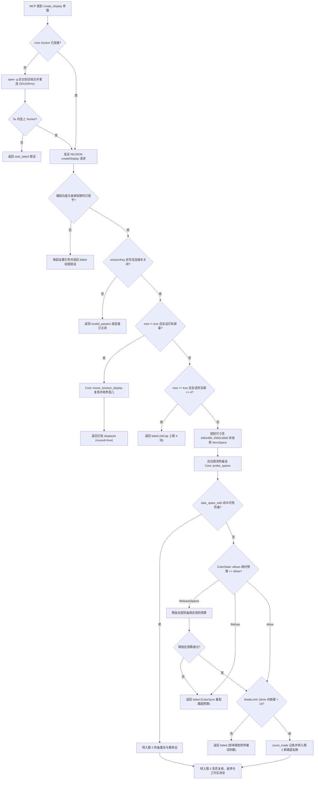
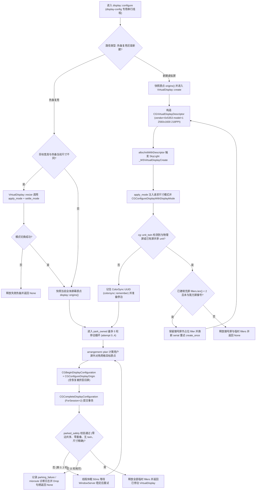
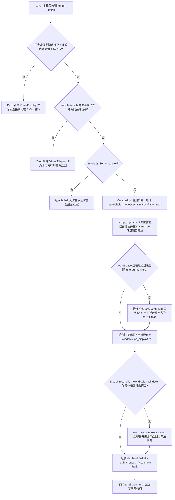

# 01. `create_display` 与虚拟屏幕分配及停泊流水线

`create_display` 是 Agent Screen 唯一预加载的 MCP 工具 (`always_load`, `crates/mcp/src/tools.rs:115-128`)。它通过 Unix 域套接字向宿主应用请求一块隔离的 `CGVirtualDisplay`，并将其停泊在物理显示器边界之外的对角象限，杜绝鼠标指针意外滑入。为避开 macOS 每次新建虚拟屏幕时 `WindowServer` 与 `ColorSync` 触发的全系统重配置风暴，流水线按以下优先级决策：先复用同会话已有屏幕，再从热备池 (`SPARES = 3`) 取出屏幕，最后才在预算与频率门控通过后新建 `CGVirtualDisplay` 并执行原子停泊校验。

## 线程与队列分工

1. **`AgentScreen mcp` 进程 (`tokio` 异步运行时)**：解析 MCP 工具参数，识别 `sessionKey` (`crates/mcp/src/session.rs:18-52`)，按需通过 `open -g -a <Agent Screen.app>` 拉起宿主进程并建立 Unix Socket NDJSON 连接 (`crates/mcp/src/control.rs:306-387`)。
2. **宿主 Socket 读写任务 (GPUI `background_executor`)**：`control::server::serve` (`apps/macos/src/control/server.rs:118-198`) 读取单行 JSON，发送 `Event::Request` 到主线程事件通道。
3. **GPUI 主线程 (`AsyncApp` / `Entity<Core>`)**：执行权限门控 `permitted`、`Core` 会话上限与 `ColorState` / `MadeLimit` 门控、热备挑选 `take_spare_with`、`Core::adopt` 登记、`NSScreen` 名称读取及 UI 刷新通知 (`apps/macos/src/control/agent.rs:2724-2965`)。
4. **串行配置线程 (`display-config`)**：`display::configure` (`apps/macos/src/mac/display.rs:343-369`) 将所有 `CGVirtualDisplay` 初始化、模式切换、`CGBeginDisplayConfiguration` 原点停泊与 `unit_twin` 填充屏创建串行化到单一专用 OS 线程，防止并发重配置互相覆盖。
5. **虚拟屏回调队列 (`com.agentscreen.virtual-display` GCD 串行队列)**：传给 `CGVirtualDisplayDescriptor.setQueue:` (`apps/macos/src/mac/display.rs:228, 279-289`)，避免 `WindowServer` 终止通知回调死锁主线程。

---

## 图 1：会话建连、复用判定与预算门控总览

### 图 1 节点明细表

| 节点 | 线程与队列 | 我方代码与常量 | macOS 组件与内部行为 | 限制与关联缺陷 | Agent 侧返回 | 用户侧表现 | 验证来源 |
| :--- | :--- | :--- | :--- | :--- | :--- | :--- | :--- |
| `M1` | `mcp` 进程 `tokio` | `tools::run` (`crates/mcp/src/tools.rs:774-836`), `session::identify` (`crates/mcp/src/session.rs:18-52`) | 解析 `_meta` 会话键与客户端名，拼接 `orphans` 孤儿进程组 | 宿主重启后旧 `displayId` 失效，由 `orphans` 携带待收养 `pid` | 进入工具调用 | 无界面变化 | [已验证: crates/mcp/src/tools.rs:774-836, crates/mcp/src/session.rs:18-52] |
| `M2` | `mcp` 进程 `tokio` | `Control::open` (`crates/mcp/src/control.rs:306-333`) | `UnixStream::connect` 连接 `~/Library/Application Support/Agent Screen/agent-screen[-<instance>].sock` (`apps/macos/src/control/server.rs:74-82`) | Socket 断开时清理上次会话遗留缓存并触发孤儿收集 (`control.rs:180-202`) | 内部连接态判断 | 无界面变化 | [已验证: crates/mcp/src/control.rs:306-333, apps/macos/src/control/server.rs:74-82] |
| `M3` | `mcp` 进程 `tokio` | `Control::start_app` (`crates/mcp/src/control.rs:354-387`) | 执行 `/usr/bin/open -g -a <Agent Screen.app>` 后台拉起宿主，不抢前台焦点，每 `100ms` 重试连接共 `50` 次 | `AGENTSCREEN_NO_AUTOSTART=1` 时跳过自启动直接报错 (`control.rs:355`) | 等待最多 `5s` | 菜单栏出现 Agent Screen 图标，不打断当前焦点窗口 | [已验证: crates/mcp/src/control.rs:354-387] |
| `M4` | `mcp` 进程 `tokio` | `Control::start_app` (`crates/mcp/src/control.rs:373-386`) | 检查 `50 * 100ms` 轮询期内 `UnixStream::connect` 是否成功 | 宿主初始化卡死或 Bundle 损坏时超时 | 成功则继续，超时走 `E1` | 无额外弹窗 | [已验证: crates/mcp/src/control.rs:373-386] |
| `E1` | `mcp` 进程 `tokio` | `ControlError::new("start_failed", ...)` (`crates/mcp/src/control.rs:367-386`) | `open` 进程退出码非零或 Socket 超时未就绪 | 无虚拟屏创建 | MCP `isError: true`，错误码 `start_failed` | 无变化 | [已验证: crates/mcp/src/control.rs:367-386] |
| `M5` | `mcp` -> 宿主后台任务 | `Control::call_open` (`crates/mcp/src/control.rs:211-244`), `server::serve` (`apps/macos/src/control/server.rs:118-174`) | 单行 JSON 写入 Unix Socket，宿主分配递增 `connection: u64` 并在 `CallGuard` 登记活跃调用 (`agent.rs:37-112`) | 客户端中途断开触发 `Event::Disconnected` (`server.rs:64, 173`) | 请求挂起等待应答 | 无变化 | [已验证: crates/mcp/src/control.rs:211-244, apps/macos/src/control/server.rs:118-174] |
| `M6` | GPUI 主线程 + 后台执行器 | `needs_permissions` / `permitted` (`apps/macos/src/control/agent.rs:2608-2684`) | 调用 `AXIsProcessTrusted()` (`HIServices/AXUIElement.h`) 与 `CGPreflightScreenCaptureAccess()` 检测双权限 | 未授权时任何屏幕创建都被拦截 | 通过走 `M7`，未通过走 `E2` | 首次缺失权限时自动打开权限引导面板 (`shell::show_permissions`) | [已验证: apps/macos/src/control/agent.rs:2608-2684, MacOSX.sdk AXUIElement.h] |
| `E2` | GPUI 主线程 | `permitted` (`apps/macos/src/control/agent.rs:2659-2683`) | 唤起 `shell::show_permissions` 并可打开系统设置对应隐私页 | macOS 录屏授权需重启宿主进程生效 | 错误码 `failed`：`Agent Screen needs Accessibility / Screen Recording permission...` | 弹出双语权限状态窗口 | [已验证: apps/macos/src/control/agent.rs:2659-2683] |
| `M7` | GPUI 主线程 | `create_display` (`apps/macos/src/control/agent.rs:2730-2740`) | 校验 `sessionKey` 非空且 `Core.closed` 不含当前 `connection`，将 `(connection, sessionKey)` 记入 `Core.sessions` | 连接若在排队期已断开则立即终止 | 非法走 `E3`，合法走 `M8` | 无变化 | [已验证: apps/macos/src/control/agent.rs:2730-2740] |
| `E3` | GPUI 主线程 | `ControlError::invalid` / `ControlError::failed` (`apps/macos/src/control/agent.rs:2733-2736`) | 纯内存校验，不触碰 `WindowServer` | 无 | `invalid_params` (`sessionKey is required`) 或 `failed` (`the connection closed`) | 无变化 | [已验证: apps/macos/src/control/agent.rs:2733-2736] |
| `M8` | GPUI 主线程 | `create_display` (`apps/macos/src/control/agent.rs:2743-2748`) | 判断 `new` 参数是否为 `true`，默认 `false` 尝试同会话复用 (`ADR 0016`) | 若传入 `width`/`height` 与已有屏不同，复用不改旧屏分辨率但附带提示 (`agent.rs:3049-3063`) | 命中走 `M9`，否则走 `M10` | 无变化 | [已验证: apps/macos/src/control/agent.rs:2743-2748, ADR 0016] |
| `M9` | GPUI 主线程 | `reuse` (`apps/macos/src/control/agent.rs:3032-3065`), `Core::reuse_session_display` (`apps/macos/src/core.rs:679-712`) | 取 `Session::current()` 最新存活屏，更新 `Owner` 连接号，执行 `adopt_orphans` 认领孤儿进程 | 零 `WindowServer` 调用，耗时 `< 1ms` | 转入 `R1` | Peek 卡片标题与连接状态保持在线 | [已验证: apps/macos/src/control/agent.rs:3032-3065, apps/macos/src/core.rs:679-712] |
| `R1` | GPUI 主线程 -> `mcp` | `describe(d, true)` (`apps/macos/src/control/agent.rs:3092-3104`), `tools::run` (`crates/mcp/src/tools.rs:804-836`) | 序列化已有屏幕的 `displayId`、`width`、`height`、`reused: true` 及同会话 `displays` 列表 | 若宿主曾退出重启，`mcp` 在前面拼上 `RESTARTED` 提示 (`tools.rs:740, 811`) | 返回 JSON：`{"displayId": N, "width": W, "height": H, "reused": true}` | 无闪烁、无屏幕重排 | [已验证: apps/macos/src/control/agent.rs:3092-3104, crates/mcp/src/tools.rs:740-836] |
| `M10` | GPUI 主线程 | `Sessions::may_add` (`crates/model/src/session.rs:21, 136-146`), `agent.rs:2749-2751` | 检查该 `sessionKey` 当前存活屏幕数是否达到 `MAX_LIVE = 4` | 单会话硬上限 `4` 块屏幕 | 超限走 `E4`，未超走 `M11` | 无变化 | [已验证: crates/model/src/session.rs:21, crates/model/src/session.rs:136-146] |
| `E4` | GPUI 主线程 | `AtCap::message` (`crates/model/src/session.rs:105-120`) | 纯模型层拒绝 | 防止单 Agent 无节制请求 `new: true` 耗尽系统显示槽位 | 错误码 `failed`：`This session already has 4 Agent Displays (...)` | 无变化 | [已验证: crates/model/src/session.rs:105-120, apps/macos/src/control/agent.rs:2749-2751] |
| `M11` | GPUI 主线程 + 后台执行器 | `DEFAULT_SIZE = (1280.0, 800.0)` (`agent.rs:2752-2780`), `AeroSpace::remember_before_first` (`apps/macos/src/mac/aerospace.rs:209-215`) | 宽高 `clamp(640..2560, 480..1600)`；若未启用 `ignored-monitors`，后台调用 `aerospace list-monitors`/`list-workspaces` 记录用户工作区快照 | 超界尺寸不报错，自动钳制并在最终结果写入 `note` (`agent.rs:2892-2896`) | 继续探测热备 | 无变化 | [已验证: apps/macos/src/control/agent.rs:2752-2780, apps/macos/src/mac/aerospace.rs:209-215] |
| `M12` | 后台执行器 | `Core::probe_spares` (`apps/macos/src/core.rs:334-353`) | 调用 `CGGetOnlineDisplayList`、`CGDisplayBounds`、`CGWindowListCopyWindowInfo` 快照每块热备屏的在线状态、`unit` 号与物理窗口覆盖情况 | 移出主线程执行，防止 `WindowServer` 查询阻塞 UI 帧提交 | 输出 `SpareSnapshot` | 无变化 | [已验证: apps/macos/src/core.rs:334-353] |
| `M13` | GPUI 主线程 | `Core::take_spare_with` (`apps/macos/src/core.rs:355-389`), `spares::pick_spare` (`crates/model/src/spares.rs:53-71`) | 过滤离线、存在 `unit_twin` 或被非归属窗口物理覆盖 (`window_covers_spare`) 的热备；优先挑同尺寸且 `unit` 最小者，次选需改分辨率者 | 避开 `#204` 热备屏上残留外部窗口被误收养 (`spares.rs:31-42`) | 命中走 `M14`，未命中走 `M15` | 无变化 | [已验证: apps/macos/src/core.rs:355-389, crates/model/src/spares.rs:31-71] |
| `M15` | GPUI 主线程 | `Core::budget_allows` (`apps/macos/src/core.rs:268-288`), `ColorState::allows` (`crates/model/src/budget.rs:13, 77-92`) | 按当前 ColorSync 设备记录数与在线屏幕数估算单次重配置主线程耗时 `request_ms <= BUDGET_MS` (`40.0 ms`) | ColorSync 缓存膨胀时 `CAWSManager::restore_color_preferences()` 会卡死全系统 (`SkyLight` `0x1870e15b4`) | `Allow` / `ReleaseSpares` / `Refuse` | 无变化 | [已验证: apps/macos/src/core.rs:268-288, crates/model/src/budget.rs:13-99, SkyLight 0x1870e15b4] |
| `M16` | GPUI 主线程 | `Core::budget_allows` (`apps/macos/src/core.rs:276-281`) | 清空 `self.spares` 释放热备虚拟屏句柄，缩减在线屏幕基数后再次调用 `color.allows(online, 0)` | 释放热备触发 `VirtualDisplay::drop` 销毁底层屏幕 | 进入 `M17` 复检 | 无变化 | [已验证: apps/macos/src/core.rs:276-281] |
| `M17` | GPUI 主线程 | `Core::budget_allows` (`apps/macos/src/core.rs:279-287`) | 判断零热备条件下 `request_ms(online)` 是否仍超过 `40.0 ms` | 未安装 ColorSync 清理助手且历史孤儿记录过多时仍超限 | 通过走 `M18`，超限走 `E5` | 菜单与健康提示可引导安装清理助手 | [已验证: apps/macos/src/core.rs:279-287, apps/macos/src/mac/colorsync.rs:75-110] |
| `E5` | GPUI 主线程 | `Core::budget_allows` (`apps/macos/src/core.rs:282-286`) | 拒绝触发新的 `WSVirtualDisplayCreate` | 保护整机免于 WindowServer / ColorSync 冻结 | 错误码 `failed`：`ColorSync has N device records; another virtual display would stall macOS...` | 无新增屏幕 | [已验证: apps/macos/src/core.rs:282-286] |
| `M18` | GPUI 主线程 | `Core::may_make` (`apps/macos/src/core.rs:26, 39, 391-402`), `MadeLimit::allows` (`crates/model/src/budget.rs:34-50`) | 滑动窗口限流：`MADE_WINDOW = 600s` (10 分钟) 内最多新建 `MADE = 10` 块虚拟屏 (`AGENTSCREEN_MAX_MADE` 可覆盖) | 热备命中不计入 `MadeLimit`，仅真实新建计入 | 通过走 `M19`，超限走 `E6` | 无变化 | [已验证: apps/macos/src/core.rs:26-39, apps/macos/src/core.rs:391-402, crates/model/src/budget.rs:34-50] |
| `E6` | GPUI 主线程 | `create_display` (`apps/macos/src/control/agent.rs:2800-2805`) | 返回剩余冷却秒数 `wait.as_secs().max(1)` | 阻止循环调 `create_display(new: true)` 拖垮桌面 | 错误码 `failed`：`Agent Screen made many displays in the last minutes... call create_display again in N s.` | 无变化 | [已验证: apps/macos/src/control/agent.rs:2800-2805] |
| `M14` | 后台 -> `display-config` 线程 | `display::reuse_parked` (`apps/macos/src/mac/display.rs:405-426`) | 衔接图 2 热备路径（按需 `resize` 并校验安全停泊位） | 若热备改分辨率或重停泊失败则丢弃该热备，并在图 3 报错 (`agent.rs:2887-2903`) | 进入图 2 / 图 3 | 无变化 | [已验证: apps/macos/src/mac/display.rs:405-426, apps/macos/src/control/agent.rs:2784-2793] |
| `M19` | GPUI 主线程 -> `display-config` 线程 | `Core::count_made` / `Core::next_name` (`apps/macos/src/core.rs:404-407, 558-570`), `display::create_parked` (`apps/macos/src/mac/display.rs:371-402`) | 租赁槽位序列号 `Serial::lease` (`KEPT_SLOTS = 16` 内循环复用身份以抑制 ColorSync 膨胀)，派发到 `display-config` 线程新建并停泊 | 耗时约 `300~500 ms`，全程脱离主线程 (`agent.rs:2807-2820`) | 进入图 2 / 图 3 | Peek 与 Viewer 保持流畅绘制 | [已验证: apps/macos/src/core.rs:558-570, apps/macos/src/mac/colorsync.rs:23, apps/macos/src/mac/display.rs:73-112] |
| `M20` | GPUI 主线程 | `create_display` (`apps/macos/src/control/agent.rs:2824-2964`) | 汇合热备激活或新建虚拟屏结果，进入竞态复核与收养阶段 | 若底层返回 `None`，在图 3 统一转为安全停泊失败错误 | 转入图 3 | 转入图 3 | [已验证: apps/macos/src/control/agent.rs:2824-2964] |

---

## 图 2：`display-config` 线程底层创建、`unit_twin` 规避与对角停泊子流程

### 图 2 节点明细表

| 节点 | 线程与队列 | 我方代码与常量 | macOS 组件与内部行为 | 限制与关联缺陷 | Agent 侧返回 | 用户侧表现 | 验证来源 |
| :--- | :--- | :--- | :--- | :--- | :--- | :--- | :--- |
| `P1` | `display-config` 串行线程 | `display::configure` (`apps/macos/src/mac/display.rs:343-369`) | 懒启动单线程队列，通过 `mpsc` 串行消费全部创建与停泊闭包 | 避免并发 `CGBeginDisplayConfiguration` 事务在 `WindowServer` 互相冲掉 | 异步等待 `oneshot` | 主线程不卡顿 | [已验证: apps/macos/src/mac/display.rs:343-369] |
| `P2` | `display-config` 串行线程 | `reuse_parked` vs `create_parked` (`apps/macos/src/mac/display.rs:371-426`) | 区分热备句柄复用与全新 `CGVirtualDisplay` 创建 | 无 | 内部路由 | 无变化 | [已验证: apps/macos/src/mac/display.rs:371-426] |
| `P3` | `display-config` 串行线程 | `reuse_parked` (`apps/macos/src/mac/display.rs:416-421`) | 检查 `resize: bool` 标志（热备屏缓存尺寸是否不等于请求尺寸） | 同尺寸热备跳过模式重设，零重配置开销 | 分支判断 | 无变化 | [已验证: apps/macos/src/mac/display.rs:416-421] |
| `P4` | `display-config` 串行线程 | `VirtualDisplay::resize` / `apply_mode` / `settle_mode` (`apps/macos/src/mac/display.rs:208-219, 291-325`) | 新建 `CGVirtualDisplayMode` + `CGVirtualDisplaySettings` (`hiDPI = 1`) 调 `applySettings:`，随后最多轮询 `20 * 10ms` 调 `use_mode` (`CGConfigureDisplayWithDisplayMode`) 对齐逻辑宽高与 `scale` | `800x500` 等非常规比例若不同步切 `CGDisplayMode` 会停留在 `2560x1600` (`displays-e2e.log:180`) | 等待最多 `200ms` | 无变化 | [已验证: apps/macos/src/mac/display.rs:208-325, ~/Library/Logs/Agent Screen/displays-e2e.log:180] |
| `P5` | `display-config` 串行线程 | `reuse_parked` (`apps/macos/src/mac/display.rs:417-420`) | 校验 `VirtualDisplay::resize` 返回布尔值且 `CGDisplayPixelsWide/High` 已就位 | 模式表被拒绝时失败 | 成功走 `P6`，失败走 `PX1` | 无变化 | [已验证: apps/macos/src/mac/display.rs:417-420] |
| `PX1` | `display-config` 串行线程 | `VirtualDisplay::drop` (`apps/macos/src/mac/display.rs:45-64, 419`) | 释放底层 `CGVirtualDisplay` Objective-C 对象，写 `displays.log` `released` 行 | 本次 `create_display` 不会静默返回未对齐屏幕 | 交由图 3 返回 `failed` | 热备屏销毁 | [已验证: apps/macos/src/mac/display.rs:45-64, apps/macos/src/mac/display.rs:419] |
| `P6` | `display-config` 串行线程 | `display::origins` (`apps/macos/src/mac/display.rs:527-535`) | 调 `cg::online()` + `CGDisplayBounds` 记录重停泊前所有在线屏幕坐标 | 用于防止 `WindowServer` 联动篡改其它屏幕原点 | 进入 `P15` | 无变化 | [已验证: apps/macos/src/mac/display.rs:527-535] |
| `P7` | `display-config` 串行线程 | `create_parked` (`apps/macos/src/mac/display.rs:380-384`) | 先快照全体屏幕原点 `before`，再调用 `VirtualDisplay::create` | 必须在 `initWithDescriptor:` 前快照，因为新建瞬间 `WindowServer` 就可能挪动相邻屏幕 | 进入 `P8` | 无变化 | [已验证: apps/macos/src/mac/display.rs:380-384] |
| `P8` | `display-config` 串行线程 | `VirtualDisplay::create_once` (`apps/macos/src/mac/display.rs:221-246, 276`) | 创建 `CGVirtualDisplayDescriptor`：`vendorID=0x5353` (`'SS'`)、`productID=1`、`serialNum`、`maxPixelsWide=5120`、`maxPixelsHigh=3200` (2x `LARGEST=2560x1600`)、`sizeInMillimeters` 按 `218 PPI` 折算，绑定 `com.agentscreen.virtual-display` 队列 | 固定最大像素上限为 `5120x3200` 支持后续免重建 `resize` | 描述符就绪 | 无变化 | [已验证: apps/macos/src/mac/display.rs:221-246, apps/macos/src/mac/display.rs:276-289] |
| `P9` | `display-config` 串行线程 | `create_once` (`apps/macos/src/mac/display.rs:247-255`) | `-[CGVirtualDisplay initWithDescriptor:]` 调入 `SkyLight` `_WSVirtualDisplayCreate` (`0x186e6d154`) 分配 `CGDirectDisplayID` (`displayID` 属性) | 触发全系统 `CGDisplayReconfigurationCallBack` 与 `CAWSManager::restore_color_preferences()` (`0x1870e15b4`) | 拿到 `id > 0` | 用户屏幕无闪烁，但后台进程收到屏幕变更广播 | [已验证: apps/macos/src/mac/display.rs:247-255, SkyLight 0x186e6d154, SkyLight 0x1870e15b4] |
| `P10` | `display-config` 串行线程 | `apply_mode` + `settle_mode` (`apps/macos/src/mac/display.rs:256-264, 291-325, 689-746`) | 注入请求尺寸与 `LARGEST` 两组 `CGVirtualDisplayMode`，轮询 `CGDisplayCopyAllDisplayModes` 找到匹配逻辑尺寸与 `HiDPI` (`scale=2`) 的模式调 `CGConfigureDisplayWithDisplayMode` | `AGENTSCREEN_DISPLAY_SCALE=1` 可切 1x 模式 (`display.rs:671-687`) | 分辨率切换完毕 | 无变化 | [已验证: apps/macos/src/mac/display.rs:256-325, apps/macos/src/mac/display.rs:671-746] |
| `P11` | `display-config` 串行线程 | `cg::unit_twin` (`apps/macos/src/mac/cg.rs:75-85`), `VirtualDisplay::create` (`apps/macos/src/mac/display.rs:177`) | 调 `CGDisplayUnitNumber` 检查在线屏幕中是否有另一块屏幕与新屏共享同一 `unit` 号（忽略 AeroSpace `0x4145/1` closet 屏） | macOS 会在同一 `unit` 上把两块屏镜像或路由错乱 (`displays-e2e.log:1` 记录 `unit twin`) | 无撞号走 `P13`，撞号走 `P12` | 无变化 | [已验证: apps/macos/src/mac/cg.rs:75-85, ~/Library/Logs/Agent Screen/displays-e2e.log:1] |
| `P12` | `display-config` 串行线程 | `MAX_FILLERS = 2` (`apps/macos/src/mac/display.rs:115, 179-189`) | 若当前占位屏 `< 2` 且该撞号屏未与我方其它虚拟屏成对，准备将其暂留占住坏 `unit` 槽位 | 最多垫 `2` 块临时 filler，防止无限造屏 | 可垫走 `P14`，超限走 `PX2` | 无变化 | [已验证: apps/macos/src/mac/display.rs:115, apps/macos/src/mac/display.rs:179-189] |
| `P14` | `display-config` 串行线程 | `VirtualDisplay::create` (`apps/macos/src/mac/display.rs:181-188`) | 将撞号屏推入 `fillers` 列表（标记 `note = "unit twin"`），用递增临时序列号重新调用 `create_once` | 临时 filler 在 `P21` 或失败时立即销毁 (`release_fillers`) | 回到 `P8` 重建 | 无变化 | [已验证: apps/macos/src/mac/display.rs:181-196] |
| `PX2` | `display-config` 串行线程 | `VirtualDisplay::create` (`apps/macos/src/mac/display.rs:190-198`) | 销毁撞号屏与全部临时 `fillers`，返回 `None` | 避免带着镜像 `unit_twin` 上线污染用户物理屏 | 交由图 3 返回 `failed` | 无残留虚拟屏 | [已验证: apps/macos/src/mac/display.rs:190-198] |
| `P13` | `display-config` 串行线程 | `colorsync::remember` (`apps/macos/src/mac/colorsync.rs:314-335`), `display.rs:265-272` | 调 `CGDisplayCreateUUIDFromDisplayID` 读取新屏 UUID，持久化到 `~/Library/Application Support/Agent Screen/colorsync-identities.json` | 供 `colorsync reclaim` 保留活跃 `16` 个槽位的 UUID，清理其余孤儿记录 | 进入 `P15` | 无变化 | [已验证: apps/macos/src/mac/colorsync.rs:283-335, apps/macos/src/mac/display.rs:265-272] |
| `P15` | `display-config` 串行线程 | `park_owned` (`apps/macos/src/mac/display.rs:429-464`) | 围绕目标屏幕执行最多 `5` 次 (`0..5`) 停泊与安全校验循环 | `AGENTSCREEN_TEST_FAIL_PARKING=1` 可注入故障供测试验证 (`display.rs:437, 598`) | 进入 `P16` | 无变化 | [已验证: apps/macos/src/mac/display.rs:429-464] |
| `P16` | `display-config` 串行线程 | `arrangement::plan` (`crates/model/src/arrangement.rs:82-193`), `tuck_away_restoring` (`apps/macos/src/mac/display.rs:542-565`) | 读取用户屏包围盒 `user_bounds`，在右下外侧对角线 (`max_x`, `max_y` 之外，或避开负向物理屏象限) 为所有虚拟屏规划互不共享边、仅角点相接或阶梯错开的坐标 | 杜绝与任何用户屏共享水平/垂直边（共享边会让鼠标跨屏滑入虚拟屏） | 产出 `(display_id, (x, y))` 计划表 | 无变化 | [已验证: crates/model/src/arrangement.rs:82-193, apps/macos/src/mac/display.rs:542-565] |
| `P17` | `display-config` 串行线程 | `tuck_away_restoring` (`apps/macos/src/mac/display.rs:566-589`) | `CGBeginDisplayConfiguration` 开启事务；把 `before` 中被 `WindowServer` 自动挤歪的其它屏幕原点设回原位，再对虚拟屏调用 `CGConfigureDisplayOrigin` (`MacOSX.sdk CGDisplayConfiguration.h`) | 底层触发 `WS::Displays::Display::set_origin` (`SkyLight` `0x186e6b304`) | 配置事务填充完成 | 保护用户多显示器相对排布不被篡改 | [已验证: apps/macos/src/mac/display.rs:566-589, MacOSX.sdk CGDisplayConfiguration.h, SkyLight 0x186e6b304] |
| `P18` | `display-config` 串行线程 | `CGCompleteDisplayConfiguration(config, 2)` (`apps/macos/src/mac/display.rs:31, 590`) | 以 `kCGConfigureForSession = 2` 调用 `_SLSCompleteDisplayConfiguration` (`0x186e51008` -> `_SLSCompleteDisplayConfigurationWithOption` `0x186e51064`) 提交会话级配置，不写入永久磁盘偏好 | 若返回非 `0` 错误码则本轮视为失败 | 进入 `P19` 验证 | 无磁盘显示偏好污染 | [已验证: apps/macos/src/mac/display.rs:31, apps/macos/src/mac/display.rs:590, SkyLight 0x186e51008] |
| `P19` | `display-config` 串行线程 | `park_owned` (`apps/macos/src/mac/display.rs:447-452`), `arrangement::parked_safely` (`crates/model/src/arrangement.rs:643-667`) | 重新读取实时 `CGDisplayBounds` 与 `unit_twin`：确认在线、无 twin、宽高等于请求值、且与所有用户屏 `out_of_the_way`（不重叠且不共享大于 `0` 长度的边） | 拦截 `WindowServer` 静默忽略原点修改或发生坐标路由错位 (`misroute`, `displays-e2e.log:180, 249`) | 通过走 `P21`，未通过走 `P20`/`PX3` | 确保鼠标绝无滑入通道 | [已验证: apps/macos/src/mac/display.rs:447-452, crates/model/src/arrangement.rs:643-667, ~/Library/Logs/Agent Screen/displays-e2e.log:249] |
| `P20` | `display-config` 串行线程 | `park_owned` (`apps/macos/src/mac/display.rs:453-455`) | `std::thread::sleep(Duration::from_millis(50))` 后进入下一轮重停泊 | 最多等待 `4 * 50ms = 200ms` | 回到 `P16` | 无变化 | [已验证: apps/macos/src/mac/display.rs:453-455] |
| `PX3` | `display-config` 串行线程 | `parking_failure` (`apps/macos/src/mac/display.rs:457-516`) | 向 `~/Library/Logs/Agent Screen/displays[-e2e].log` 写入 `misroute` 或停泊失败明细，调用 `release_fillers()` 并 `drop(handle)` | 宁可创建失败也不把停在用户屏内或错位路由的虚拟屏交给 Agent | 返回 `None` 至图 3 | 销毁异常虚拟屏 | [已验证: apps/macos/src/mac/display.rs:457-516, ~/Library/Logs/Agent Screen/displays-e2e.log:180] |
| `P21` | `display-config` 串行线程 | `create_parked` (`apps/macos/src/mac/display.rs:385-400`), `lifecycle::line` (`apps/macos/src/lifecycle.rs:55-58`) | `release_fillers()` 销毁占位屏，写 `created display=<id> unit=<u> at=<x>,<y> size=<w>x<h> serial=<s>` 日志 (`displays-e2e.log:37`) | 句柄带 `Serial` 租约进入主线程收养 | 返回 `Some(VirtualDisplay)` | 无变化 | [已验证: apps/macos/src/mac/display.rs:385-400, ~/Library/Logs/Agent Screen/displays-e2e.log:37] |

---

## 图 3：并发竞态复核、`Core::adopt`、AeroSpace 净空与外来窗口疏散

### 图 3 节点明细表

| 节点 | 线程与队列 | 我方代码与常量 | macOS 组件与内部行为 | 限制与关联缺陷 | Agent 侧返回 | 用户侧表现 | 验证来源 |
| :--- | :--- | :--- | :--- | :--- | :--- | :--- | :--- |
| `A1` | GPUI 主线程 | `create_display` (`apps/macos/src/control/agent.rs:2824-2860`) | 后台 `create_parked` 或 `reuse_parked` `.await` 返回主线程 | 造屏 `300~500ms` 窗口内状态可能已变化 | 进入二次校验 | 无变化 | [已验证: apps/macos/src/control/agent.rs:2824-2860] |
| `A2` | GPUI 主线程 | `create_display` (`apps/macos/src/control/agent.rs:2835-2856`) | 重检 `Core.closed.contains(&connection)` 以及 `new == true` 时的 `sessions.may_add` | 拦截造屏期间客户端断开或并发 `new: true` 撞上限 | 命中走 `AX1`，未命中走 `A3` | 无变化 | [已验证: apps/macos/src/control/agent.rs:2835-2856] |
| `AX1` | GPUI 主线程 | `drop(made)` (`apps/macos/src/control/agent.rs:2857-2860`) | 立即销毁刚建好的 `VirtualDisplay`，不留孤儿屏 | 消耗了一次 `MadeLimit` 配额但保证状态一致 | `failed` (`the connection closed` 或 `AtCap` 消息) | 无新增 Peek 卡片 | [已验证: apps/macos/src/control/agent.rs:2857-2860] |
| `A3` | GPUI 主线程 | `create_display` (`apps/macos/src/control/agent.rs:2863-2866`) | 当 `new == false` 时再次调用 `reuse(...)` 检查并行调用是否已先一步登记会话主屏 | 保证并发首次调用收敛到同一块 `displayId` | 命中走 `AX2`，未命中走 `A4` | 无变化 | [已验证: apps/macos/src/control/agent.rs:2863-2866] |
| `AX2` | GPUI 主线程 | `drop(made)` + `Ok(existing)` (`apps/macos/src/control/agent.rs:2864-2865`) | 丢弃多余句柄，返回先行屏幕描述 (`reused: true`) | 无 | 返回先行屏幕 JSON | 仅保留一块屏幕卡片 | [已验证: apps/macos/src/control/agent.rs:2864-2865] |
| `A4` | GPUI 主线程 | `create_display` (`apps/macos/src/control/agent.rs:2867-2903`) | 解包 `made: Option<VirtualDisplay>` | 图 2 中 `PX1`/`PX2`/`PX3` 均在此汇合 | `None` 走 `AX3`，`Some` 走 `A5` | 无变化 | [已验证: apps/macos/src/control/agent.rs:2867-2903] |
| `AX3` | GPUI 主线程 | `ControlError::failed` (`apps/macos/src/control/agent.rs:2899-2903`) | 生成明确无屏幕分配的错误消息 | 绝不把未安全停泊的屏幕暴露给 Agent | 错误码 `failed`：`macOS could not create a virtual display at a verified safe position...` | 无新增屏幕 | [已验证: apps/macos/src/control/agent.rs:2899-2903] |
| `A5` | GPUI 主线程 | `Core::adopt` (`apps/macos/src/core.rs:572-625`) | `claims::add_display` 写 `claims.json`；`Model::insert` 记入屏幕表并加入 `Sessions`；`repark::note_adopted` 记录停泊框并触发 `repark()`、`hold_modes()`、`reclaim_soon()` (`3s` 后后台跑 `colorsync reclaim`)、`label_soon()` (贴壁纸标签) 与 `cx.notify()` | 菜单栏状态文字绘制在高频重绘时可能引起 `CA::Transaction::commit` 短暂繁忙 (`hang 2026-11-15-11-08-52.015.txt` 采样 `273ms`) | 获得正式 `displayId` | 菜单栏图标点亮活跃态，Peek 新增该屏幕缩略图卡片 | [已验证: apps/macos/src/core.rs:572-625, ~/Library/Logs/Agent Screen/hang 2026-11-15-11-08-52.015.txt] |
| `A6` | GPUI 主线程 + 后台执行器 | `adopt_orphans` (`apps/macos/src/control/agent.rs:3009-3030`), `claims::claim` (`apps/macos/src/mac/claims.rs:138-143`), `agent.rs:2908-2923` | 将 `adoptGroups` / `adopt` 传入的已启动 `pid` 绑定回对应屏幕的 `Display.started`，并对已回到该屏的窗口立即写入 `claims.json` | 抢在 AeroSpace 1 秒轮询前锁定窗口归属 | 孤儿归属恢复 | 无变化 | [已验证: apps/macos/src/control/agent.rs:2908-2923, apps/macos/src/control/agent.rs:3009-3030] |
| `A7` | GPUI 主线程 + 后台执行器 | `app::screen_name` (`apps/macos/src/mac/app.rs:528-537`), `aerospace::ignoring_with_display` (`apps/macos/src/mac/aerospace.rs:391-393`), `agent.rs:2929-2936` | 在主线程读取 `NSScreen.localizedName`，后台执行 `aerospace list-monitors` 判断新虚拟屏是否被 AeroSpace 纳管 | 配好 `ignored-monitors` (`^Agent Screen`) 时直接跳过等待 (`ADR 0006`) | 被纳管走 `A8`，已忽略走 `A9` | 若未配置忽略，界面提示一键写入 AeroSpace 配置 | [已验证: apps/macos/src/control/agent.rs:2929-2936, apps/macos/src/mac/aerospace.rs:391-461] |
| `A8` | 后台执行器 | `create_display` (`apps/macos/src/control/agent.rs:2937-2958`) | 最多循环 `30` 次、每次间隔 `100ms` 调用 `aerospace list-windows --monitor` 等待 `ui::shell` 的显示器守卫将误绑到虚拟屏的用户工作区迁回原物理屏 | 最长阻塞 `3.0 s`，防止首张截图拍到用户隐私窗口 | 等待净空或满 `3s` | 用户工作区留在物理屏 | [已验证: apps/macos/src/control/agent.rs:2937-2958] |
| `A9` | 后台执行器 | `windows::on_display` (`apps/macos/src/mac/windows.rs:382-389`), `agent.rs:2959` | 通过 `CGWindowListCopyWindowInfo` 列出此刻落在该虚拟屏 `bounds` 内的全部标准窗口 | 捕获因历史坐标重合遗留在停泊位的外来窗口 (`#204` 修复逻辑) | 得到 `on_new` 窗口表 | 无变化 | [已验证: apps/macos/src/control/agent.rs:2959, apps/macos/src/mac/windows.rs:382-389, Issue #204] |
| `A10` | GPUI 主线程 | `Model::reconcile_new_display_windows` (`crates/model/src/model.rs:1495-1535`), `agent.rs:2960-2963` | 对照会话 `started` 与 `placed` 表，筛出不属于本会话的外来窗口列表 `unowned` | 修复 `#204` 新屏停泊在曾用坐标时误吞旧窗口的缺陷 | 有外来窗走 `A11`，无则走 `A12` | 无变化 | [已验证: apps/macos/src/control/agent.rs:2960-2963, Issue #204] |
| `A11` | 后台执行器 | `evacuate_window_to_user` (`apps/macos/src/core.rs:1418-1441`), `agent.rs:2964-2972` | 通过 `AXUIElementSetAttributeValue(kAXPositionAttribute)` 将外来窗口移回用户主屏安全区域 | 若目标进程挂起无 AX 响应，窗口移动可能超时 | 疏散完成 | 外来窗口回到用户物理屏 | [已验证: apps/macos/src/control/agent.rs:2964-2972, apps/macos/src/core.rs:1418-1441] |
| `A12` | GPUI 主线程 | `describe` (`apps/macos/src/control/agent.rs:2889-2897, 3092-3104`) | 组装 `displayId`、`width`、`height`、`reused: false`；若输入宽高被钳制则附加 `note` | 无 | JSON 负载生成 | Peek 实时流 (`SCStream`) 开始以低帧率采样新屏幕 | [已验证: apps/macos/src/control/agent.rs:2889-2897, apps/macos/src/control/agent.rs:3092-3104] |
| `R2` | 宿主 -> `mcp` 进程 | `tools::run` (`crates/mcp/src/tools.rs:804-836`), `Control::made_display` (`crates/mcp/src/control.rs:147-158`) | `mcp` 记录 `(displayId, sessionKey)` 供后续断线重连推导孤儿，向 Agent 输出文本 JSON | 无 | 返回 `{"displayId": N, "width": W, "height": H, "reused": false}` | 新屏幕正式服役 | [已验证: crates/mcp/src/tools.rs:804-836, crates/mcp/src/control.rs:147-158] |

---

## 关键时间参数与门控常量汇总

| 常量 / 参数 | 数值 | 定义位置 | 作用机制 | 验证来源 |
| :--- | :--- | :--- | :--- | :--- |
| Socket 自启动重连 | `50 * 100 ms` (`5.0 s`) | `crates/mcp/src/control.rs:373-380` | `open -g` 拉起宿主后轮询 `UnixStream::connect` 的最大等待时间 | [已验证: crates/mcp/src/control.rs:373-380] |
| `MAX_LIVE` | `4` 块屏幕 / 会话 | `crates/model/src/session.rs:21` | 单个 `sessionKey` 同时存活的 Agent Display 上限 | [已验证: crates/model/src/session.rs:21] |
| 默认与合法分辨率 | 默认 `1280x800`，范围 `640x480..2560x1600` | `apps/macos/src/control/agent.rs:2752-2759`, `display.rs:276` | 超出范围自动 `clamp` 并写入 `note`，描述符最大像素 `5120x3200` (HiDPI 2x) | [已验证: apps/macos/src/control/agent.rs:2752-2759, apps/macos/src/mac/display.rs:235-242] |
| `SPARES` / `SPARE_LIFE` | 最多 `3` 块热备，存活 `600 s` (`10 min`) | `apps/macos/src/core.rs:24-25` | 屏幕结束且洁净后转入热备池，免去下次创建的重配置开销 | [已验证: apps/macos/src/core.rs:24-25] |
| `BUDGET_MS` | `40.0 ms` | `crates/model/src/budget.rs:13` | ColorSync 重配置预估主线程阻塞上限；超限时先退热备，仍超则拒绝新建 | [已验证: crates/model/src/budget.rs:13, apps/macos/src/core.rs:268-288] |
| `MADE` / `MADE_WINDOW` | `10` 次 / `600 s` (`10 min`) | `apps/macos/src/core.rs:26, 39` | 全局真实新建 `CGVirtualDisplay` 的滑动窗口速率限制 | [已验证: apps/macos/src/core.rs:26, apps/macos/src/core.rs:39] |
| `KEPT_SLOTS` | `16` 个序列号槽位 | `apps/macos/src/mac/colorsync.rs:23` | `Serial::lease` 循环复用序列号，配合 `RECLAIM_DELAY = 3s` (`core.rs:149`) 回收 ColorSync 孤儿设备记录 | [已验证: apps/macos/src/mac/colorsync.rs:23, apps/macos/src/core.rs:149, ~/Library/Logs/Agent Screen/displays-e2e.log:9] |
| `MAX_FILLERS` | `2` 块占位屏 | `apps/macos/src/mac/display.rs:115` | 遭遇 `unit_twin` 镜像撞号时最多垫入 2 块临时屏绕开坏 `unit` | [已验证: apps/macos/src/mac/display.rs:115, apps/macos/src/mac/display.rs:177-196] |
| `settle_mode` 轮询 | `20 * 10 ms` (`200 ms`) | `apps/macos/src/mac/display.rs:315-325` | 等待 `CGDisplayCopyAllDisplayModes` 暴露目标模式并完成切换 | [已验证: apps/macos/src/mac/display.rs:315-325] |
| `park_owned` 重试 | `5` 轮，间隔 `50 ms` | `apps/macos/src/mac/display.rs:446-456` | 提交 `CGConfigureDisplayOrigin` 后验证 `parked_safely` 的有界重试 | [已验证: apps/macos/src/mac/display.rs:446-456] |
| AeroSpace 净空等待 | `30 * 100 ms` (`3.0 s`) | `apps/macos/src/control/agent.rs:2937-2958` | 等待未配置 `ignored-monitors` 的 AeroSpace 迁走误落入新屏的用户工作区 | [已验证: apps/macos/src/control/agent.rs:2937-2958] |
