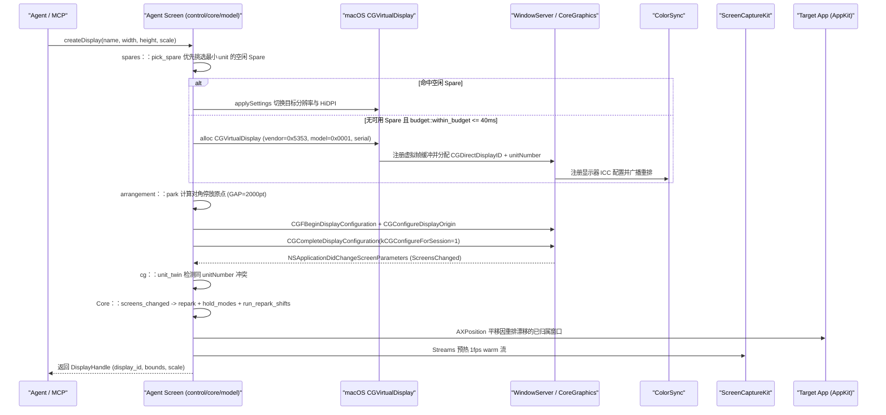

# 操作 01：create_display 与虚拟显示器编排

`create_display` 为代理会话分配一块独立的虚拟显示器，优先复用空闲备用显示器（Spare），不足时在 ColorSync 预算内新建 `CGVirtualDisplay`，并将其停放在与用户屏幕互不接触的对角坐标上。

## 端到端流程

## 节点明细表

| 节点 | 我方代码 | macOS 组件与内部行为 | 限制与故障模式 | 关联问题 | 验证状态 |
| --- | --- | --- | --- | --- | --- |
| 1. MCP 参数校验与转发 | `crates/mcp/src/tools.rs:1464-1509`、`apps/macos/src/control/server.rs:193-216` | Unix 域控制套接字传输单行 NDJSON 请求。无直接 macOS GUI 调用。 | 套接字断开或会话未完成 `hello` 握手时直接拒绝请求。 | `#189` | `[已验证]` `crates/mcp/src/session.rs:35-120` |
| 2. 备用池挑选（Spare 复用） | `apps/macos/src/core.rs:285-352`、`crates/model/src/spares.rs:19-83` | 纯内存领域规则（无系统调用）。按最小 `CGDisplayUnitNumber` 顺序挑选已在线的空闲 Spare，常态维持最多 `FILLERS = 2` 块备用屏。 | 若挑选高 `unit` Spare，物理外接屏热插拔时易与系统新分配的逻辑单元号撞车；复用已有 Spare 可跳过新建显示器的全局重排。 | `unit twin`、`#204` | `[已验证]` `crates/model/src/spares.rs:19-83`、`docs/research/root-causes-2026-11.md` |
| 3. ColorSync 预算门控 | `crates/model/src/budget.rs:18-62`、`apps/macos/src/mac/colorsync.rs:15-92` | 读取近期新建显示器触发 ColorSync 设备注册的实测耗时，限制单次新建开销在 `40 ms` 预算内。 | 短时间连续创建数十块虚拟显示器会导致 `WindowServer` 与 ColorSync 反复重建色彩查找表并冻结整机。预算超限时拒绝新建并退回排队或报错。 | 整机卡死风险（AGENTS.md 约束） | `[已验证]` `crates/model/src/budget.rs:18-62`、`apps/macos/src/mac/colorsync.rs:15-92` |
| 4. 创建 `CGVirtualDisplay` 实例 | `apps/macos/src/mac/display.rs:42-215`、`apps/macos/native/AgentScreenPrivate.h:15-52` | 调用 CoreGraphics 私有 ObjC 类 `CGVirtualDisplayDescriptor`、`CGVirtualDisplayMode`、`CGVirtualDisplaySettings`、`CGVirtualDisplay`（设置 `vendorID = 0x5353`、`productID = 0x0001`、单调递增 `serialNum`、`hiDPI = 1`）。`WindowServer` 分配 `CGDirectDisplayID` 与 `unitNumber`。显示器存活期与 ObjC 对象引用计数严格绑定。 | 1. 私有 API 无公开稳定性承诺；2. `WindowServer` 可能将新虚拟屏与物理屏分入同一 `unitNumber`（形成硬件镜像组）；3. 空闲或重排后 `WindowServer` 可能把虚拟屏回退到 `800x500` 默认模式。 | `unit twin`、`800x500` | `[已验证]` `CoreGraphics.tbd:3274-3275`、`apps/macos/src/mac/display.rs:42-215` |
| 5. 过滤 AeroSpace 隐藏屏与枚举在线屏 | `apps/macos/src/mac/cg.rs:68-135` | 调用 `CGGetOnlineDisplayList`、`CGDisplayVendorNumber`、`CGDisplayModelNumber`、`CGDisplayUnitNumber`。显式忽略 AeroSpace closet 显示器（`vendor = 0x4145`、`model = 1`）。 | 未过滤 closet 屏会把 AeroSpace 停放区误判为用户显示器，导致停放坐标与窗口归属计算失真。 | AeroSpace 兼容（ADR 0007） | `[已验证]` `apps/macos/src/mac/cg.rs:68-135` |
| 6. 对角停放规划（Parking） | `crates/model/src/arrangement.rs:45-198` | 纯模型几何计算。将屏幕分为 `Role::User` 与 `Role::Ours`，在我方屏幕与用户屏幕包围盒右下角外侧按 `GAP = 2000 pt` 对角阶梯排布，并固定已连接 `Role::Ours` 屏幕的既有坐标。 | 若两块显示器边界共享边或角，真实光标可跨屏滑入代理屏；若重排时不锁定已连接代理屏，单次 `create_display` 会引发全部代理屏连锁搬移。 | `#204` | `[已验证]` `crates/model/src/arrangement.rs:45-198` |
| 7. 提交显示器原点事务 | `apps/macos/src/mac/cg.rs:150-235` | 调用 `CGFBeginDisplayConfiguration`、`CGConfigureDisplayOrigin`、`CGCompleteDisplayConfiguration(config, kCGConfigureForSession)`（`CGDisplayConfiguration.h:170-173`，值为 `1`）。`WindowServer` 重算全局桌面几何并持久化至当前登录会话。 | 1. 若发生 `unit twin`，对虚拟屏设置原点会同步拖走同 `unit` 的物理显示器；2. `WindowServer` 异步生效，返回后短暂窗口期内 `CGDisplayBounds` 仍可能读到旧坐标或 `(0,0,0,0)`。 | `unit twin`、`#204`、`misroute` | `[已验证]` `CGDisplayConfiguration.h:170-173`、`apps/macos/src/mac/cg.rs:150-235` |
| 8. `unit_twin` 硬件镜像检测 | `apps/macos/src/mac/cg.rs:112-148`、`apps/macos/src/core.rs:354-395` | 比对在线显示器的 `CGDisplayUnitNumber`，检查我方虚拟屏是否与用户屏或其他虚拟屏共享同一逻辑单元。 | 一旦命中 `unit twin`，`WindowServer` 将两块屏视为镜像对，截图与流捕获会读到错误屏幕内容；我方立即弃用该屏并拒绝在其上截图。 | `unit twin`、`#190` | `[已验证]` `apps/macos/src/mac/cg.rs:112-148`、`apps/macos/src/mac/screenshot.rs:88-115` |
| 9. `ScreensChanged` 重停放、模式保持与窗口跟随 | `apps/macos/src/ui/shell.rs:1065-1158`、`apps/macos/src/core.rs:510-618` | AppKit 投递 `NSApplicationDidChangeScreenParametersNotification` 后，主线程触发 `Core::screens_changed`：1. `repark` 修正偏离停放点的虚拟屏；2. `hold_modes` 重新调用 `applySettings` 修复被重置为 `800x500` 的模式；3. `run_repark_shifts` 通过 AX `AXPosition` 将归属窗口按显示器位移量平移到新原点；4. `Streams::restart_misrouted` 重建错位捕获流。 | 1. 物理屏休眠唤醒或热插拔期间 `WindowServer` 会把虚拟屏挤回主屏附近或重置分辨率；2. 目标进程主线程卡顿时 `AXPosition` 写入超时（`kAXErrorCannotComplete = -25204`），窗口留在旧坐标。 | `#204`、`800x500`、`misroute` | `[已验证]` `apps/macos/src/core.rs:510-618`、`AXError.h:49` |
| 10. 预热 `warm` 捕获流 | `apps/macos/src/ui/stream.rs:155-240`、`apps/macos/src/mac/capture.rs:140-260` | 为新采用或备用的显示器订阅 `"warm"`（`1 fps` 缩略图分辨率）`SCStream`，使 Peek 悬停与卡片首帧无需冷启动等待。 | 缺少屏幕录制权限或显示器刚创建尚未就绪时 `SCStream::start_capture` 报错，进入指数退避（`500 ms` 起，上限 `30 s`）。 | `#190`、`misroute` | `[已验证]` `apps/macos/src/ui/stream.rs:155-310` |
