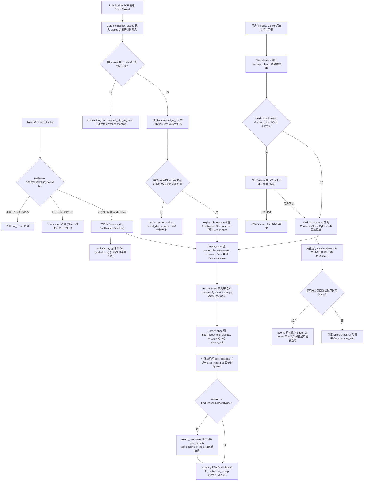
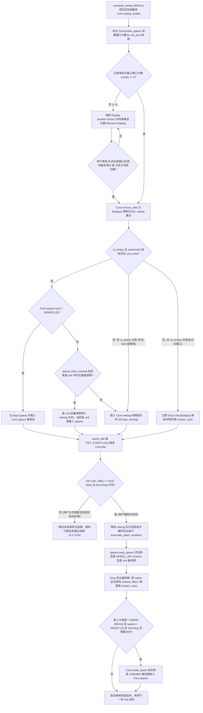

# 02. `end_display`、断线宽限、窗口归还与备用屏回收流水线

Agent Display 的结束不等同于立即销毁底层 `CGVirtualDisplay` (`ADR 0004`)。一块显示器可通过三条主路径进入结束流水线：Agent 调用 `end_display`、MCP 客户端断开 Unix 套接字且宽限期届满、用户在 Peek 或 Viewer 中点击关闭。显示器结束时，`Displays::end` 与 `Core::finished` 先停止输入转发、清空排队输入、结束挂起请求、封尾后台录屏，并在非用户主动关闭时把借出窗口 (`Origin::HandedOver`) 迁回原位 `Home`。若显示器上仍留有 Agent 启动的窗口，显示器转为待查看显示器 (`Review Display`) 供用户审阅；净空后才由 `Core::remove_with` 转入备用池 (`SPARES = 3`) 或进入 `retiring` 队列等待用户键鼠空闲后释放。

## 线程与队列分工

1. **套接字监听线程 (`agent-screen-control`)**：在连接读到 EOF 时向主线程发送 `Event::Closed { connection }` (`apps/macos/src/control/server.rs:196`)。
2. **GPUI 主线程 (`Core` / `Shell`)**：执行 `DISCONNECT_GRACE` (`2000ms`) 断线宽限、`Core::end`、`Core::finished`、`Shell::dismiss` 关闭确认、`sweep_ended` (`600ms` 延迟清扫) 与 `watch_idle` (`15s` 周期巡检用户键鼠空闲以执行 `Core::tidy`) (`apps/macos/src/core.rs:24-51, 412-535, 952-1370`)。
3. **后台执行器 (`background_executor`)**：运行 `return_handovers`、`dismissal::execute` 与 `evacuate_spare_windows`，通过 Accessibility API 与 `AeroSpace` CLI 迁回或关闭窗口 (`apps/macos/src/core.rs:1003-1044`, `apps/macos/src/dismissal.rs:107-145`)。
4. **`agent-screen-displays` 串行线程 (`display.rs`)**：在备用屏复用重停泊、`Core::make_spare` 空闲补造备用屏或 `VirtualDisplay::drop` 释放句柄时串行访问 `CGVirtualDisplay` 与 `CoreGraphics` 配置事务 (`apps/macos/src/mac/display.rs:45-64, 343-426`)。

---

## 图 1：三类结束触发源、`Core::end` 清理与 `HandedOver` 归还

### 图 1 节点明细表

| 节点 | 线程与队列 | 我方代码与常量 | macOS 组件与内部行为 | 限制与关联缺陷 | Agent 侧返回 | 用户侧表现 | 验证证据 |
| :--- | :--- | :--- | :--- | :--- | :--- | :--- | :--- |
| `T1` | `mcp` -> GPUI 主线程 | `tools::run("end_display")` (`crates/mcp/src/tools.rs:855-863`), `agent.rs:347-351, 2608-2623` | 发送 NDJSON `endDisplay`；`needs_permissions` 豁免 `endDisplay` 权限检查，权限被撤后仍可收尾 | 无 | 进入 `G1` | 无变化 | 已验证：`crates/mcp/src/tools.rs:855-862` `"end_display" => { control.call("endDisplay", ...).await?; Ok(Output::Object(json!({ "ended": true }))) }`；`agent.rs:2611` `"endDisplay"` |
| `G1` | GPUI 主线程 | `usable` / `display(&core, &p, false, cx)` (`apps/macos/src/control/agent.rs:2686-2712, 7242-7263`) | `usable` 校验 `owner == mine` 并对 `"endDisplay"` 放行已结束显示器；`display` 区分在表、已进 `retired` 与从未存在三种状态 | 跨会话调用返回 `not_found` | 未曾存在或他方持有走 `EX1`，已移除走 `EX2`，在表走 `E1` | 无变化 | 已验证：`apps/macos/src/control/agent.rs:2707` `if d.is_ended() && !matches!(method, "endDisplay" \| "waitForControl")`；`agent.rs:7251-7262` `match c.displays.get(id)` |
| `EX1` | GPUI 主线程 | `usable` / `display` (`apps/macos/src/control/agent.rs:2703-2705, 7255-7257`) | 纯内存表查找未命中或会话不匹配 | 从未分配过的 `displayId` 命中此分支 | 错误码 `not_found`：`display {id} does not exist...` 或 `belongs to another session...` | 无变化 | 已验证：`apps/macos/src/control/agent.rs:7255-7257` `None => Err(ControlError::not_found(format!("display {id} does not exist; call create_display again")))` |
| `EX2` | GPUI 主线程 | `display` (`apps/macos/src/control/agent.rs:7252-7254`), `Displays::remove` (`crates/model/src/model.rs:798-803`) | 显示器经 `remove_with` 移出列表后其 ID 仍保存在 `retired`（及 `closed_by_user`）中，不会误报 `not_found` | 若该 ID 后来被备用屏重新领用，`add` 会将其从 `retired` 移除 (`model.rs:753-754`) | 错误码 `ended`：由 `ended_error` 生成明确原因 | 无变化 | 已验证：`apps/macos/src/control/agent.rs:7252-7254` `None if c.displays.retired.contains(&id) => { Err(ended_error(id, c.displays.closed_by_user.contains(&id))) }` |
| `E1` | GPUI 主线程 | `Core::end(id, EndReason::Finished, cx)` (`apps/macos/src/core.rs:952-956`) | 调用 `self.displays.end(id, reason)`；首次结束返回 `true` 并执行 `self.finished(&[id], cx)` | 若屏上留有 Agent 启动窗口，显示器留在列表中供用户审阅 (`ADR 0004`) | 转入 `R1` | Peek 卡片切换为待查看状态 | 已验证：`apps/macos/src/core.rs:952-955` `pub fn end(&mut self, id: DisplayId, reason: EndReason, cx: &mut Context<Self>) { if self.displays.end(id, reason) { self.finished(&[id], cx); } }` |
| `R1` | GPUI 主线程 -> `mcp` | `handle("endDisplay")` (`apps/macos/src/control/agent.rs:347-351`), `tools.rs:862` | 宿主返回空对象 `{}`，`mcp` 包装为 `{"ended": true}`；对仍在表内的已结束显示器重复调用时 `displays.end` 返回 `false`，幂等成功 | 幂等操作 | 返回 `{"ended": true}` | 无变化 | 已验证：`apps/macos/src/control/agent.rs:350` `Ok(json!({}))`；`crates/mcp/src/tools.rs:862` `Ok(Output::Object(json!({ "ended": true })))` |
| `T2` | `agent-screen-control` 线程 | `server::serve` (`apps/macos/src/control/server.rs:195-197`) | `lines()` 读到客户端 EOF 退出循环，向主线程无界通道发送 `Event::Closed { connection }` | 关联 `#189`：若上层编排器未关闭 `AgentScreen mcp` 的 `stdin`，连接不会关闭 | 客户端已离线 | 无即时变化 | 已验证：`apps/macos/src/control/server.rs:196` `let _ = events.unbounded_send(Event::Closed { connection });` |
| `D1` | GPUI 主线程 | `Core::connection_closed` / `disconnect_connection_in` (`apps/macos/src/core.rs:1135-1195`) | 先调用 `drain_dropped_calls()`，把 `connection` 记入 `closed`（FIFO 上限 `MAX_CLOSED_CONNECTIONS = 1024`），并调用 `input_queue.disconnect(connection)` | 先标记队列断线而非显示器结束 (`core.rs:1188-1190`) | 无客户端接收 | 无变化 | 已验证：`crates/model/src/session.rs:22` `pub const MAX_CLOSED_CONNECTIONS: usize = 1024;`；`apps/macos/src/core.rs:1190` `input_queue.disconnect(connection);` |
| `D2` | GPUI 主线程 | `Displays::connection_disconnected_with_migrated` (`crates/model/src/model.rs:1094-1124`) | 查询该会话 `open_connections` 中是否已存在另一条存活连接（重叠重启场景） | 存在备用连接时无需进入宽限倒计时 | 有备用连接走 `D3`，否则走 `D4` | 无变化 | 已验证：`crates/model/src/model.rs:1109-1115` `let fallback = self.sessions.get(&owner.session_key).and_then(\|s\| s.open_connections.iter().next().copied()); if let Some(other_conn) = fallback { owner.connection = other_conn;` |
| `D3` | GPUI 主线程 | `disconnect_connection_in` (`apps/macos/src/core.rs:1192-1194`) | 直接把 `owner.connection` 切到现存连接并同步更新 `input_queue` 所有者 | 零中断切换 | 现存连接继续控制显示器 | 无变化 | 已验证：`apps/macos/src/core.rs:1192-1193` `let (marked, migrated) = displays.connection_disconnected_with_migrated(connection, now_ms); displays.register_queue_owners(&mut input_queue.queue, &migrated);` |
| `D4` | GPUI 主线程 | `DISCONNECT_GRACE = 2000ms` (`apps/macos/src/core.rs:40-51, 1155-1168`) | 将受影响显示器的 `disconnected_at_ms` 设为 `Some(now_ms)`，启动 `2000ms` 定时器；仅调试构建 (`cfg!(debug_assertions)`) 读取 `AGENTSCREEN_DISCONNECT_GRACE_MS` 覆盖时长 | 给 `mcp` 瞬断重连留出缓冲 | 无 | 宽限期内显示器保持不变 | 已验证：`apps/macos/src/core.rs:40,43-44` `const DISCONNECT_GRACE: Duration = Duration::from_millis(2000);` / `if cfg!(debug_assertions) && let Some(ms) = std::env::var("AGENTSCREEN_DISCONNECT_GRACE_MS")` |
| `D5` | GPUI 主线程 | `agent::handle` -> `Core::begin_session_call` (`apps/macos/src/control/agent.rs:89-108`, `core.rs:627-675`) | 宽限期内同一 `sessionKey` 在新连接上发起**任意**非 `debug` 请求时，`begin_session_call_in` 自动调用 `rebind_session_in` | 不必重新调用 `create_display`，普通工具调用同样触发重绑 | 命中走 `D6`，超时走 `E2` | 无变化 | 已验证：`apps/macos/src/core.rs:661-665` `if let Some(k) = named_key { sessions.insert(connection, k.to_string()); rebound = !Self::rebind_session_in(displays, input_queue, closed, k, connection, now_ms).is_empty(); }` |
| `D6` | GPUI 主线程 | `Displays::rebind_disconnected` (`crates/model/src/model.rs:1148-1175`) | 更新 `owner.connection = connection`，清空 `disconnected_at_ms = None`，刷新 `last_active_ms` 并重绑 `InputQueue`；旧定时器到期后空转退出 | 拒绝已进入 `closed_connections` 的连接 (`model.rs:1154`) | 新连接继续正常执行本次请求 | 无变化 | 已验证：`crates/model/src/model.rs:1164-1166` `owner.connection = connection; d.disconnected_at_ms = None; rebound.push(d.id);` |
| `E2` | GPUI 主线程 | `Displays::expire_disconnected` (`crates/model/src/model.rs:1180-1197`), `core.rs:1161-1165` | 宽限期满仍未重绑时，将超时显示器按 `EndReason::Disconnected` 结束并统一调用 `core.finished(&ended, cx)` | 自动归还借出窗口 (`#189`) | 连接已断 | 若留有 Agent 窗口则发断线待查看通知 (`shell.rs:938`) | 已验证：`apps/macos/src/core.rs:1161-1164` `let ended = core.displays.expire_disconnected(core.elapsed_ms(), grace_ms); core.finished(&ended, cx);` |
| `T3` | GPUI 主线程 | `Shell::dismiss` (`apps/macos/src/ui/shell.rs:3243-3281`) | 用户在 Peek、Viewer 或菜单栏触发关闭；若该显示器的关闭询问 `Sheet` 已打开则直接聚焦 Viewer | 用户关闭操作优先级最高 | 确认前暂不中断运行中调用 | 准备关闭检查 | 已验证：`apps/macos/src/ui/shell.rs:3243` `pub fn dismiss(&mut self, id: DisplayId, cx: &mut Context<Self>)` |
| `U1` | GPUI 主线程 | `dismissal::plan` (`apps/macos/src/dismissal.rs:40-94`) | 枚举屏上实时窗口 `windows::on_display(display.id)`，读取 `display.records` 中的 `Origin` (`Launched \| Placed \| HandedOver \| Found`) 与 `Disposition` 生成默认去向 (`GiveBack` 或 `Close`) | `Origin::HandedOver` 条目 `locked = true`，强制归还用户 | 无 | 汇总待处置窗口 | 已验证：`apps/macos/src/dismissal.rs:58-59` `fate: default_fate(origin, disposition, of_launched_app), locked: origin == Some(Origin::HandedOver),` |
| `U2` | GPUI 主线程 | `dismissal::needs_confirmation` (`apps/macos/src/dismissal.rs:97-99`) | 判定 `!items.is_empty() \|\| display.is_live()`：只要屏上有窗口或显示器仍活跃就需确认；仅无窗口的已结束显示器直接静默移除 | 防止误关仍在工作的活跃 Agent 显示器 | 无 | 需确认走 `U3`，否则直达 `U4` | 已验证：`apps/macos/src/dismissal.rs:97-99` `pub fn needs_confirmation(items: &[Item], display: &Display<VirtualDisplay>) -> bool { !items.is_empty() \|\| display.is_live() }` |
| `U3` | GPUI 主线程 | `Shell::dismiss` (`apps/macos/src/ui/shell.rs:3263-3280`) | 打开 Viewer 并调用 `native::make_key(&window)`，挂载双语 `Sheet` 供用户逐窗选择保留或关闭 | 此处是用户本人点关闭后的主动弹窗，允许聚焦 Viewer | 显示器仍存活 | Viewer 展示双语关闭确认单 | 已验证：`apps/macos/src/ui/shell.rs:3271-3277` `self.open_viewer(id, cx); ... native::make_key(&window); ... viewer.sheet = Some(sheet);` |
| `UX1` | GPUI 主线程 | `Shell::answer_dismiss(None)` (`apps/macos/src/ui/shell.rs:3284-3303`) | 用户取消关闭，播放 `SHEET_OUT` 退场动画，不调用 `dismiss_now` | 无 | Agent 无感知继续运行 | 弹层收起 | 已验证：`apps/macos/src/ui/shell.rs:3300-3302` `if let (Ok(Some(sheet)), Some(items)) = (sheet, items) { self.dismiss_now(sheet.display, items, cx); }` |
| `U4` | GPUI 主线程 | `Shell::dismiss_now` (`apps/macos/src/ui/shell.rs:3305-3322`) | 先调用 `core.end(id, EndReason::ClosedByUser, cx)` 冻结 Agent 输入，再重跑一次 `dismissal::plan` 合并弹窗期间新开的窗口并保留用户已选 `fate` | 先停输入再关窗，杜绝弹窗确认瞬间新开窗口漏网 | 后续工具调用将收到被用户关闭错误 | 进入窗口处置 | 已验证：`apps/macos/src/ui/shell.rs:3306-3312` `self.core.update(cx, \|core, cx\| core.end(id, EndReason::ClosedByUser, cx)); ... Some(display) => dismissal::plan(display)` |
| `U5` | 后台执行器 | `dismissal::execute` (`apps/macos/src/dismissal.rs:107-139`) | 对 `Fate::Close` 窗口调 `ax::close(target)`，对 `Fate::GiveBack` 窗口调 `give_back` 迁回 `Home` 或主屏，随后最多轮询 `15 * 100ms` (`1.5s`) 等待关闭落地 | 无关闭按钮的窗口记日志跳过 | 无 | 保留窗口回到物理屏，关闭窗口退出 | 已验证：`apps/macos/src/dismissal.rs:125-131` `for _ in 0..15 { open.retain(\|t\| windows::find(t.window_id).is_some()); ... std::thread::sleep(std::time::Duration::from_millis(100)); }` |
| `U6` | GPUI 主线程 + 后台 | `Shell::dismiss_now` (`apps/macos/src/ui/shell.rs:3329-3355`) | 检查 `1.5s` 后是否仍有未退出的 `Close` 窗口（如弹出未保存文档询问 Sheet） | 若此时直接销毁虚拟屏，macOS 会把保存询问窗甩到用户主屏 | 无 | 有未退窗口走 `U7`，全退走 `U8` | 已验证：`apps/macos/src/ui/shell.rs:3334-3335` `if !asking.is_empty() { let _ = this.update(cx, \|shell, cx\| shell.open_viewer(id, cx));` |
| `U7` | 后台执行器 + 主线程 | `Shell::dismiss_now` (`apps/macos/src/ui/shell.rs:3336-3363`) | 打开 Viewer 展示未关闭窗口，每 `500ms` 检查 `ax::has_sheet(t)`；若窗口无 Sheet 连续满 `6` 次 (`calm >= 6`，约 `3s`，如用户在保存框点了取消)，保留该待查看显示器并中止移除 | 尊重用户在应用内点取消关闭的决定 | 显示器保持 `Ended(ClosedByUser)` | 用户在 Viewer 内处理保存弹窗 | 已验证：`apps/macos/src/ui/shell.rs:3339,3356-3361` `.timer(Duration::from_millis(500)).await; ... calm = if sheets { 0 } else { calm + 1 }; if calm >= 6 { ... return; }` |
| `U8` | 后台执行器 -> 主线程 | `Shell::dismiss_now` (`apps/macos/src/ui/shell.rs:3365-3386`) | 在后台运行 `Core::probe_spares(&probe_ids)`，回到主线程执行 `core.remove_with(id, &snap, cx)` | 衔接图 2 `S6` | 显示器记入 `retired` 与 `closed_by_user` | 显示器卡片移除 | 已验证：`apps/macos/src/ui/shell.rs:3377,3385` `let snap = crate::core::Core::probe_spares(&probe_ids);` / `core.remove_with(id, &snap, cx)` |
| `C1` | GPUI 主线程 | `Displays::end` (`crates/model/src/model.rs:962-976`), `Sessions::leave` (`crates/model/src/session.rs:158-171`) | 置 `ended = Some(reason)`、`takeover = false`、`disconnected_at_ms = None`，调用 `sessions.leave` 从会话活跃表摘除；若为该会话最后一台活跃显示器则一并清空 `session.access` | 不再占用单会话 `MAX_LIVE = 4` 配额 | 除 `endDisplay`/`waitForControl` 外后续调用均报 `ended` | 脱离活跃工作态 | 已验证：`crates/model/src/model.rs:971-975` `display.ended = Some(reason); display.takeover = false; ... self.sessions.leave(&key, id);`；`crates/model/src/session.rs:165-166` `if left && session.displays.is_empty() { session.access.clear();` |
| `C2` | GPUI 主线程 | `Displays::end` / `hand_on_apps` (`crates/model/src/model.rs:978-1018`), `end_requests` (`crates/model/src/request.rs:750-754`) | 若 `reason == EndReason::Finished` 且同会话仍有其它活跃显示器，将 `started` 等进程集合移交给最新活跃屏；调用 `end_requests` 唤醒所有挂起的 `wait_for_control` 与窗口请求 | 用户关闭 (`ClosedByUser`) 不移交应用 (`model.rs:976-978`) | 挂起的 `wait_for_control` 收到结束唤醒 | 无变化 | 已验证：`crates/model/src/model.rs:978-983` `if reason == EndReason::Finished { self.hand_on_apps(id, &key); } ... self.end_requests(id);` |
| `C3` | GPUI 主线程 | `Core::finished` (`apps/macos/src/core.rs:962-974`), `InputQueue::end_display` (`apps/macos/src/input_queue.rs:425-429`) | 调用 `input_queue.end_display(id)` 终止该屏真实输入排队并刷新红框，调用 `forwarder.stop_agent(true)` 阻断后台键鼠合成，调用 `agent::release_hold(id)` 释放未松开的拖拽 | 立即切断残留后台输入 | 排队的真实输入收到显示器结束结果 | 虚拟光标与该屏红框熄灭 | 已验证：`apps/macos/src/core.rs:969-973` `self.input_queue.end_display(id); if let Some(forwarder) = self.forwarders.get(&id) { forwarder.stop_agent(true); } crate::control::agent::release_hold(id);` |
| `C4` | GPUI 主线程 -> 后台 | `Core::finished` (`apps/macos/src/core.rs:977-989, 1324-1330`) | 将已移交进程的 `kept_catches` 重挂到接棒活跃屏 (`catch_again`)，移除其余 `Catch`，并在后台调用 `recording::stop(id)` 封尾 MP4 | 已结束显示器不再捕获新弹窗 | 无 | 录屏指示灯熄灭 | 已验证：`apps/macos/src/core.rs:985-989` `self.kept_catches.retain(\|(display, _)\| *display != id); ... stop_recording(id, cx);` |
| `C5` | GPUI 主线程 | `EndReason::returns_handovers` (`crates/model/src/model.rs:148-150`), `Displays::handovers_at_end` (`model.rs:1035-1040`) | 判定 `self != Self::ClosedByUser`：`Finished` 与 `Disconnected` 均自动归还借出窗口；用户关闭由 `dismissal::execute` 按处置单执行 | 遵守 `ADR 0004` 与 `#161`：会话结束时借出窗口不得滞留在待查看屏上 | 内部路由 | 无变化 | 已验证：`crates/model/src/model.rs:148-150` `pub fn returns_handovers(self) -> bool { self != Self::ClosedByUser }` |
| `C6` | GPUI 主线程 -> 后台执行器 | `Core::return_handovers` (`apps/macos/src/core.rs:1003-1044`), `windows::return_home` (`apps/macos/src/mac/windows.rs:579-635`) | 逐个取出仍登记为 `HandedOver` 的窗口，调用 `give_back` 与 `shell.send_home_if_there`（经 `LANES.home` 递增归还计数屏障阻断在途 Agent 写帧），迁回 `Home` 后立即触发一次 `sweep_ended` | 迁回失败的窗口恢复 `Handover` 记录留待后续关闭流程处理 (`core.rs:1038`) | 无 | 用户借出的窗口自动回到原物理屏与原工作区 | 已验证：`apps/macos/src/core.rs:1031,1041` `shell.update(cx, \|shell, cx\| shell.send_home_if_there(target, id, given, cx))` / `core.sweep_ended(cx)`；`windows.rs:583` `*state.count.entry(window).or_default() += 1;` |
| `C7` | GPUI 主线程 | `Core::finished` (`apps/macos/src/core.rs:992-994`), `Shell` 同步 (`apps/macos/src/ui/shell.rs:889-933`), `schedule_sweep` (`core.rs:1312-1320`) | `cx.notify()` 触发 `Shell` 调用 `notify::withdraw_input` / `withdraw_help` / `withdraw_window` / `withdraw_control` 撤回系统通知并收起 Help Card；`schedule_sweep` 在 `600ms` 后启动图 2 清扫 | 给窗口移出留出 `600ms` 落地窗口期 | 本次结束处理完成 | 系统通知与 Help Card 收起 | 已验证：`apps/macos/src/ui/shell.rs:911,923,932` `notify::withdraw_help(display.id)` / `withdraw_window` / `withdraw_control`；`core.rs:1315-1317` `.timer(Duration::from_millis(600)).await; ... core.sweep_ended(cx)` |

---

## 图 2：待查看滞留、`sweep_ended` 清扫、备用池 (`SPARES = 3`) 与用户空闲释放流水线

### 图 2 节点明细表

| 节点 | 线程与队列 | 我方代码与常量 | macOS 组件与内部行为 | 限制与关联缺陷 | Agent 侧返回 | 用户侧表现 | 验证证据 |
| :--- | :--- | :--- | :--- | :--- | :--- | :--- | :--- |
| `S1` | GPUI 主线程 | `schedule_sweep` / `sweep_ended` (`apps/macos/src/core.rs:1274-1320`) | 在 `finished` 后延迟 `600ms` 或在 `return_handovers` 完成后扫描所有 `d.is_ended()` 的显示器 | 无已结束显示器时直接返回 (`core.rs:1282-1284`) | 无 | 无变化 | 已验证：`apps/macos/src/core.rs:1274-1281` `pub fn sweep_ended(&mut self, cx: &mut Context<Self>) { let ended: Vec<DisplayId> = self.displays.list.iter().filter(\|d\| d.is_ended()).map(\|d\| d.id).collect();` |
| `S2` | 后台执行器 | `Core::probe_spares` (`apps/macos/src/core.rs:334-348, 1291-1295`) | 在后台线程调用 `cg::active_displays()`、`windows::counts_and_physical` 与 `cg::unit_twin` 采集窗口计数与孪生状态 | 不阻塞 UI 主线程 | 无 | 无变化 | 已验证：`apps/macos/src/core.rs:1292-1295` `let snap = cx.background_executor().spawn(async move { Self::probe_spares(&probe_ids) }).await;` |
| `S3` | GPUI 主线程 | `sweep_ended` (`apps/macos/src/core.rs:1299-1303`) | 检查 `snap.counts.get(&id).copied().unwrap_or(0) == 0` 且显示器仍处于 `is_ended()` | 留有 Agent 成果窗口的显示器保留供用户审阅 (`ADR 0004`) | 调用操作工具报 `ended` | 有窗口走 `S4`，净空走 `S6` | 已验证：`apps/macos/src/core.rs:1299-1302` `if snap.counts.get(&id).copied().unwrap_or(0) == 0 && core.displays.get(id).is_some_and(\|d\| d.is_ended()) { core.remove_with(id, &snap, cx); }` |
| `S4` | GPUI 主线程 | `Display.ended: Option<EndReason>` (`crates/model/src/model.rs:286`), `shell.rs:935-944` | 显示器留在 `Core.displays.list` 作待查看显示器 (`Review Display`)；若非用户关闭则发送一次系统审阅通知 (`Note::Review` 或 `Note::Disconnected`) | 不计入会话 `MAX_LIVE = 4` 活跃上限 (`session.rs:20`) | `end_display` 幂等成功，操作工具报 `ended` | Peek 显示待查看卡片，用户可打开 Viewer 检查或拖回窗口 | 已验证：`apps/macos/src/ui/shell.rs:938-942` `Some(EndReason::Disconnected) => Note::Disconnected { windows }, _ => Note::Review { windows } ... notify::update(...)` |
| `S5` | GPUI 主线程 | `Shell` 窗口变化监听 / `Shell::dismiss` (`apps/macos/src/ui/shell.rs:3243`) | 当用户拖走/关闭最后窗口触发 `sweep_ended` 或用户主动点击关闭时进入移除阶段 | 注意：`Core::tidy` 只巡检 `spares` 与 `retiring`，不主动扫描待查看屏 (`core.rs:422-489`) | 无 | 最后窗口离开后自动收起卡片 | 已验证：`apps/macos/src/core.rs:1041,1302` `core.sweep_ended(cx)` -> `core.remove_with(id, &snap, cx)` |
| `S6` | GPUI 主线程 | `Core::remove_with` (`apps/macos/src/core.rs:1200-1270`), `Displays::remove` (`crates/model/src/model.rs:792-807`) | 从 `Displays.list` 移除该项，将 ID 记入 `retired`（若为 `ClosedByUser` 同步记入 `closed_by_user`），清理 `forwarders`、`elements`、`tucked`、`repark_state`、`kept_catches`、`returning`、`pending_returns`，并通过 `Shell` 撤回通知 (`shell.rs:946-949`) | 保留 `retired` 墓碑使旧句柄继续返回 `ended` 而非 `not_found` | 后续一切调用（含 `end_display`）均返回 `ended` (`agent.rs:7252-7253`) | Peek 卡片消失；若无其它活跃屏菜单栏图标变暗 | 已验证：`crates/model/src/model.rs:798-803` `if display.is_ended() { self.retired.insert(id); } if display.ended == Some(EndReason::ClosedByUser) { self.closed_by_user.insert(id); }` |
| `S7` | GPUI 主线程 | `Core::remove_with` (`apps/macos/src/core.rs:1207-1209`) | 计算 `is_empty = snap.counts.get(&id).copied().unwrap_or(0) == 0` 与 `empty_untwinned = is_empty && snap.untwinned.contains(&id)` | 带 `unit_twin` 或残留窗口的屏幕绝不入备用池 | 内部回收分流 | 无变化 | 已验证：`apps/macos/src/core.rs:1207-1208` `let is_empty = snap.counts.get(&id).copied().unwrap_or(0) == 0; let empty_untwinned = is_empty && snap.untwinned.contains(&id);` |
| `S8` | GPUI 主线程 | `SPARES = 3` (`apps/macos/src/core.rs:24, 1209`) | 检查当前备用池数量是否小于上限 `3` 台 | 限制常驻虚拟屏总数以控制 ColorSync 查询开销 | 未满走 `S9`，已满走 `S10` | 无变化 | 已验证：`apps/macos/src/core.rs:24,1209` `const SPARES: usize = 3;` / `if empty_untwinned && self.spares.len() < SPARES` |
| `S9` | GPUI 主线程 | `Core::remove_with` (`apps/macos/src/core.rs:1210-1216`) | 写 `displays.log` `kept ... spare` 并压入 `self.spares`，保留底层 `VirtualDisplay` 连接 | 零 `WindowServer` 重配置即留存备用屏 | 下次 `create_display` 可在 `take_spare_with` 复用 | 用户不可见 | 已验证：`apps/macos/src/core.rs:1210-1211` `crate::lifecycle::note("kept", id, "spare"); self.spares.push(Spare {` |
| `S10` | GPUI 主线程 | `spares::retire_instead` (`crates/model/src/spares.rs:73-90`), `core.rs:1217-1236` | 当备用池已满 `3` 台时，仅按 `unit` 编号比较（不比较尺寸）：查找池中无窗、无物理遮挡且 `unit > incoming` 的最高 `unit` 备用屏 | 收敛低 `unit` 号以消除编号空洞 | 命中走 `S11`，未命中走 `S12` | 无变化 | 已验证：`crates/model/src/spares.rs:86-88` `!s.has_windows && !s.physically_covered && s.unit.is_none_or(\|u\| u > incoming) ... .max_by_key(\|&(i, s)\| unit_key(s.unit, i))` |
| `S11` | GPUI 主线程 | `Core::remove_with` (`apps/macos/src/core.rs:1237-1246`) | 将被置换出的高 `unit` 旧备用屏推入 `self.retiring`（等待用户空闲再销毁），将当前低 `unit` 屏幕推入 `self.spares` | 置换当下不触发销毁卡顿 | 无 | 无变化 | 已验证：`apps/macos/src/core.rs:1237-1241` `let higher = self.spares.remove(evict); crate::lifecycle::note("kept", higher.handle.id, "retiring"); self.retiring.push(higher.handle);` |
| `S12` | GPUI 主线程 | `Core::remove_with` (`apps/macos/src/core.rs:1247-1252`) | 对所有净空但不入备用池的显示器（池满落选或含 `unit_twin`），推入 `self.retiring` 延迟到用户键鼠空闲时再释放 | 防止用户正在看屏幕时因释放虚拟屏触发全机 `0.2~0.9s` 停绘 (`core.rs:27-32`) | 无 | 避免用户操作中途画面顿挫 | 已验证：`apps/macos/src/core.rs:1247-1251` `} else if is_empty { ... crate::lifecycle::note("kept", id, "retiring"); self.retiring.push(display.handle);` |
| `SX1` | GPUI 主线程 -> 析构 | `Core::remove_with` (`apps/macos/src/core.rs:1253-1256`), `VirtualDisplay::drop` (`apps/macos/src/mac/display.rs:45-64`) | 仅当 `!is_empty`（例如用户强关时仍有无法通过 AX 移走的残留窗）时立即析构 `display.handle`，让 macOS 当场把残留窗口收回用户物理屏，并调度 `reclaim_soon` | 触发一次即時显示重配置 | 无 | 无法经 AX 移动的窗口由 macOS 收回主屏 | 已验证：`apps/macos/src/core.rs:1252-1256` `} else { ... crate::lifecycle::note("released", id, ""); self.reclaim_soon(cx); }` |
| `T0` | 后台定时器 -> 主线程 | `watch_idle` (`apps/macos/src/core.rs:34, 1362-1370`) | 后台循环每 `TIDY_EVERY = 15s` 唤醒主线程调用 `core.tidy(cx)`；该函数仅驱动空闲整理，**不会退出宿主进程** | 宿主作为常驻菜单栏应用持续运行 | 无 | 无变化 | 已验证：`apps/macos/src/core.rs:34` `const TIDY_EVERY: Duration = Duration::from_secs(15);`；`apps/macos/src/core.rs:1364-1367` `loop { cx.background_executor().timer(TIDY_EVERY).await; ... core.update(cx, \|core, cx\| core.tidy(cx)); }` |
| `T1` | GPUI 主线程 | `Core::tidy` / `idle()` (`apps/macos/src/core.rs:33, 412-421, 1350-1359`), `ime::user_idle` | 检查 `ime::user_idle() >= IDLE` (`60s` 键鼠无输入；仅调试构建支持 `AGENTSCREEN_IDLE_SECS` 覆盖) 且 `self.launching.is_empty()`（防止应用冷启动期重配置导致窗口落主屏，`#123`） | 任一条件不满足立即返回 | 无 | 满足走 `T3`，不满足走 `T2` | 已验证：`apps/macos/src/core.rs:413-420` `if crate::mac::ime::user_idle() < idle().as_secs_f64() { return; } ... if !self.launching.is_empty() { return; }`；`apps/macos/src/core.rs:1351-1352` `if cfg!(debug_assertions) && let Some(secs) = std::env::var("AGENTSCREEN_IDLE_SECS")` |
| `T2` | GPUI 主线程 | `Core::tidy` (`apps/macos/src/core.rs:413-421`) | 提前返回，将 `retiring` 释放与备用屏调整顺延到后续 `15s` 周期 | 保护用户前台交互流畅度 | 无 | 零卡顿 | 已验证：`apps/macos/src/core.rs:414,420` `return;` |
| `T3` | GPUI 主线程 + 后台 | `Core::tidy` (`apps/macos/src/core.rs:422-438`), `evacuate_spare_windows` (`core.rs:1404-1416`) | 清空 `self.retiring` 析构全部待退句柄（记 `ended, released while idle`），随后在后台线程把误落到备用屏上的窗口迁回用户屏并统计窗口数 | 先疏散误落窗口再评估备用屏去留 | 无 | 无变化 | 已验证：`apps/macos/src/core.rs:423-433` `for display in std::mem::take(&mut self.retiring) { crate::lifecycle::note("released", display.id, "ended, released while idle"); ... evacuate_spare_windows(&spare_ids);` |
| `T4` | GPUI 主线程 | `spares::keep_spares` (`crates/model/src/spares.rs:107-170`), `SPARE_LIFE = 600s` (`apps/macos/src/core.rs:25, 446-463`) | 淘汰仍残留未记录窗口 (`has_windows`) 或存活满 `10 min` 的高 `unit` 备用屏；保留未过期备用屏、`warm` 期内最多 `READY = 2` 台低 `unit` 屏、被活跃屏窗口物理覆盖的屏及低位防空洞屏 | 防止因 `physically_covered` 导致每 `15s` 反复销毁重建 (`spares.rs:99-101`) | 纯内存计算 | 无变化 | 已验证：`apps/macos/src/core.rs:25` `const SPARE_LIFE: Duration = Duration::from_secs(10 * 60);`；`apps/macos/src/core.rs:457-463` `let keep = agent_screen_model::spares::keep_spares( &infos, warm, READY, SPARES, &live_units, );` |
| `T5` | GPUI 主线程 | `Core::tidy` (`apps/macos/src/core.rs:464-480`) | 析构 `stay == false` 的备用屏（记 `spare unused`）；若 `!warm`（距上次用屏已超 `60 min`）且无任何显示器与备用屏，调用 `display::release_fillers()` 释放填洞屏；有任何释放则调 `reclaim_soon` | 长时间不用后彻底释放全部虚拟显示器 | 无 | 无变化 | 已验证：`apps/macos/src/core.rs:474-479` `if !warm && core.displays.list.is_empty() && core.spares.is_empty() { ... display::release_fillers(); } if released { core.reclaim_soon(cx); }` |
| `T6` | GPUI 主线程 | `WARM = 3600s` / `READY = 2` (`apps/macos/src/core.rs:37-38, 446, 482-488`) | 检查 `warm`（`last_used < 60 min`）、`core.spares.len() < 2`、`!core.warming` 且 `core.budget_allows().is_ok()`（不要求活跃屏数为 0，也不检查或消耗 `MadeLimit`） | 每轮 `tidy` 最多启动 1 台预热造屏 | 满足走 `T7`，否则走 `T8` | 无变化 | 已验证：`apps/macos/src/core.rs:482-487` `if warm && core.spares.len() < READY && !core.warming && core.budget_allows().is_ok() { core.make_spare(cx); }` |
| `T7` | 后台 -> `agent-screen-displays` 线程 | `Core::make_spare` (`apps/macos/src/core.rs:500-535`) | 置 `self.warming = true`，在后台调用 `display::create_parked` 创建 `1280x800` (`DEFAULT_SIZE`) 备用屏，推入 `core.spares` 并调度 `reclaim_soon` | 在用户空闲期提前承担造屏开销，使后续点击 `+` 或 `create_display` 直接复用 | 下次造屏直接命中备用池 | 用户无感知 | 已验证：`apps/macos/src/core.rs:500-505,521` `fn make_spare(&mut self, cx: &mut Context<Self>) { self.warming = true; ... let size = crate::model::DEFAULT_SIZE; ... crate::lifecycle::note("kept", handle.id, "spare made while idle");` |
| `T8` | GPUI 主线程 | `watch_idle` (`apps/macos/src/core.rs:1362-1370`) | 本轮空闲整理结束，等待下一个 `15s` 周期 | 无 | 无 | 菜单栏常驻 | 已验证：`apps/macos/src/core.rs:1365-1367` `cx.background_executor().timer(TIDY_EVERY).await;` |

---

## 结束态对 Agent 各工具的返回码矩阵

| 显示器状态 | 调用工具 | 错误码 (`ControlError.code`) | 返回结构 / 错误消息 | 验证证据 |
| :--- | :--- | :--- | :--- | :--- |
| 仍在 `Core.displays` 且 `ended == Some(_)` | `end_display` | 无错误 (`Ok`) | `{"ended": true}` | 已验证：`apps/macos/src/control/agent.rs:2707, 347-351`；`crates/mcp/src/tools.rs:862` `Ok(Output::Object(json!({ "ended": true })))` |
| 仍在 `Core.displays` 且 `ended == Some(Finished \| Disconnected)` | `wait_for_control` | 无错误 (`Ok`) | `{"control": "none", "note": "The display has ended."}`（控制面 `resolution: "ended"`） | 已验证：`crates/mcp/src/tools.rs:1622` `_ => json!({ "control": "none", "note": "The display has ended." })` |
| 仍在 `Core.displays` 且 `ended == Some(ClosedByUser)` | `wait_for_control` | 无错误 (`Ok`) | `{"control": "none", "note": "The user closed the display, so stop working on screen. Ask the user before you call create_display again."}` | 已验证：`crates/mcp/src/tools.rs:1619-1620` `("closedByUser", _) => { json!({ "control": "none", "note": "The user closed the display, so stop working on screen..." }) }` |
| `ended == Some(Finished \| Disconnected)` 或已进 `retired`（非用户关闭） | 其余指定该 `display_id` 的工具（含移除后的 `end_display`） | `ended` | `"display {id} has ended; call create_display for a new one"` | 已验证：`apps/macos/src/control/server.rs:40-43` `code: "ended"`；`agent.rs:7252-7253, 7545` `format!("display {id} has ended; call create_display for a new one")` |
| `ended == Some(ClosedByUser)` 或已进 `closed_by_user` | 其余指定该 `display_id` 的工具（含移除后的 `end_display`） | `ended` | `"the user closed display {id}, so stop working on screen; ask the user before you call create_display again"` | 已验证：`apps/macos/src/control/agent.rs:7541-7543` `"the user closed display {id}, so stop working on screen; ask the user before you call create_display again"` |
| 从未创建过的 `display_id` | 任何指定该 `display_id` 的工具 | `not_found` | `"display {id} does not exist; call create_display again"` | 已验证：`apps/macos/src/control/agent.rs:7255-7257` `None => Err(ControlError::not_found(format!("display {id} does not exist; call create_display again")))` |
| 属于另一会话的 `display_id` | 任何指定该 `display_id` 的工具 | `not_found` | `"display {id} belongs to another session; call create_display to get yours"` | 已验证：`apps/macos/src/control/agent.rs:2703-2705` `Err(ControlError::not_found(format!("display {id} belongs to another session; call create_display to get yours")))` |
| 宿主进程曾退出并重启（`mcp` 识别旧 `display_id`） | 旧 `display_id` 上的工具调用 | `ended` | `"display {id} ended when the Agent Screen app quit; it has restarted. macOS moved the display's windows to the user's screen..."` | 已验证：`crates/mcp/src/tools.rs:743-749` `pub fn ended_with_app(id: i64) -> ControlError { ControlError::new( "ended", format!( "display {id} ended when the Agent Screen app quit; it has restarted.` |
