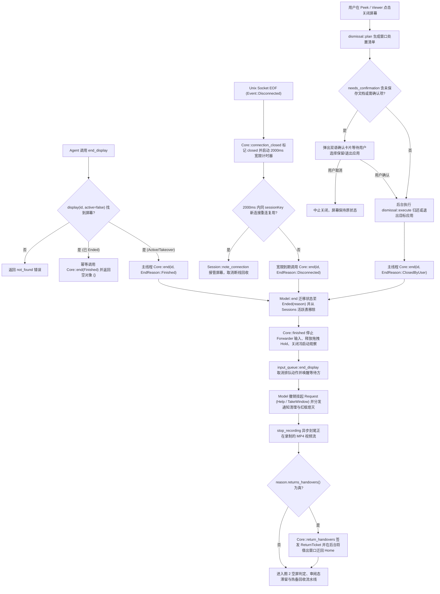
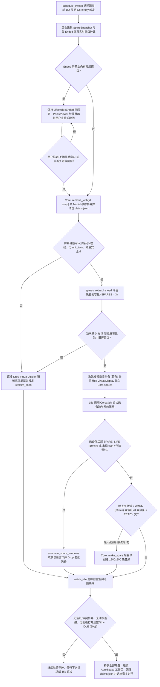

# 02. `end_display`、断线宽限、窗口归还与热备回收流水线

Agent Display 的结束绝不等于直接销毁 `CGVirtualDisplay` (`ADR 0004`)。一块屏幕可通过四条路径进入结束流水线：Agent 显式调用 `end_display`、MCP 客户端断开 Unix Socket、同会话上限挤出或内部清理、用户在 Peek / Viewer 点击关闭。屏幕结束时，`Core::end` 先取消所有挂起的审批与接管、停止后台录制、立即将用户借出的窗口 (`Origin::HandedOver`) 迁回借出前的 `Home` 位置，再判定该屏幕上是留有 Agent 自己启动的应用窗口需要进入 **Ended (审阅态)** 供用户定夺，还是已经净空可以直接回收到热备池 (`SPARES = 3`) 或销毁句柄。

## 线程与队列分工

1. **Socket 监听任务 (`background_executor`)**：检测客户端 EOF 触发 `Event::Disconnected(connection)` (`apps/macos/src/control/server.rs:173`)。
2. **GPUI 主线程 (`Core`)**：执行 `DISCONNECT_GRACE` (`2000ms`) 断线宽限、`Core::end`、`Core::finished`、请求撤销 `Effect` 分发、`sweep_ended` 空屏清扫、`tidy` (`15s` 周期) 热备老化淘汰与空闲退出守卫 `watch_idle` (`apps/macos/src/core.rs:24-46, 952-1402`)。
3. **窗口归还后台任务 (`background_executor`)**：执行 `return_handovers` 与 `dismissal::execute`，通过 AX (`AXUIElementSetAttributeValue`) 及 `AeroSpace` CLI 将窗口迁回用户物理屏并恢复原始帧 (`apps/macos/src/core.rs:1003-1047`, `apps/macos/src/dismissal.rs:107-220`)。
4. **`display-config` 串行线程**：当屏幕退入热备池需要重停泊或最终 `Drop` 释放 `CGVirtualDisplay` 时，确保与并发造屏串行隔离 (`apps/macos/src/mac/display.rs:45-64, 343-369`)。

---

## 图 1：四类结束触发源、`Core::end` 清理与 HandedOver 立即归还

### 图 1 节点明细表

| 节点 | 线程与队列 | 我方代码与常量 | macOS 组件与内部行为 | 限制与关联缺陷 | Agent 侧返回 | 用户侧表现 | 验证来源 |
| :--- | :--- | :--- | :--- | :--- | :--- | :--- | :--- |
| `T1` | `mcp` -> GPUI 主线程 | `tools::run("end_display")` (`crates/mcp/src/tools.rs:838-844`), `agent.rs:347-351` | 发送 NDJSON `endDisplay`；`needs_permissions` 豁免 `endDisplay` 权限检查 (`agent.rs:2611`)，即便权限被撤也能收尾 | 无 | 进入 `G1` | 无变化 | [已验证: crates/mcp/src/tools.rs:838-844, apps/macos/src/control/agent.rs:347-351, apps/macos/src/control/agent.rs:2611] |
| `G1` | GPUI 主线程 | `display(&core, &p, false, cx)` / `usable` (`apps/macos/src/control/agent.rs:2686-2713, 7242-7264`) | 检查 `Core.displays.get(id)` 是否存在；`usable` 对 `endDisplay` 放行已 `is_ended()` 的屏幕 (`agent.rs:2707`) | 不存在的 `displayId` 立即报错 | 不存在走 `EX1`，已结束走 `R1`，活跃走 `E1` | 无变化 | [已验证: apps/macos/src/control/agent.rs:2686-2713, apps/macos/src/control/agent.rs:7242-7264] |
| `EX1` | GPUI 主线程 | `ControlError::not_found` (`apps/macos/src/control/agent.rs:2695`) | 纯内存表未命中 | 屏幕已被彻底移除 (`remove_with`) 后再次调用会报 `not_found` | 错误码 `not_found`：`no display <id>` | 无变化 | [已验证: apps/macos/src/control/agent.rs:2695] |
| `R1` | GPUI 主线程 | `Core::end` (`apps/macos/src/core.rs:952-960`), `tools.rs:843` | 对已 `Ended` 屏幕再次调用 `Model::end` 返回空副作用，`tools.rs` 包装为 `"Display <id> ended."` | 严格幂等 | 返回 `"Display <id> ended."` | 无变化 | [已验证: apps/macos/src/core.rs:952-960, crates/mcp/src/tools.rs:843] |
| `E1` | GPUI 主线程 | `Core::end(id, EndReason::Finished, cx)` (`apps/macos/src/core.rs:952-960`) | 正常业务收尾入口 | 若屏幕上有 Agent 启动的窗口，屏幕不会立即消失，转为审阅态 (`ADR 0004`) | 返回 `"Display <id> ended."` | Peek 卡片切换为已结束审阅样式 | [已验证: apps/macos/src/core.rs:952-960, ADR 0004] |
| `T2` | Socket 监听任务 | `server::serve` (`apps/macos/src/control/server.rs:170-174`) | `BufReader::lines()` 读到 EOF，向主线程发送 `Event::Disconnected(connection)` | 注意 `#189`：若上层宿主未关闭 `AgentScreen mcp` 的 `stdin` 管道，`mcp` 不会退出，Socket 也不会断开 | 客户端已离线 | 无即时变化 | [已验证: apps/macos/src/control/server.rs:170-174, Issue #189] |
| `D1` | GPUI 主线程 | `Core::connection_closed` / `DISCONNECT_GRACE` (`apps/macos/src/core.rs:40-52, 1135-1198`) | 将 `connection` 记入 `closed`（上限 `MAX_CLOSED_CONNECTIONS = 1024`，`session.rs:22`），清理 `debug_user_stage`，启动默认 `2000ms` (`AGENTSCREEN_DISCONNECT_GRACE_MS` 可配) 延迟任务 | 给 `AgentScreen mcp` 瞬时重连留出缓冲窗口 | 无客户端接收 | 宽限期内屏幕保持原状 | [已验证: apps/macos/src/core.rs:40-52, apps/macos/src/core.rs:1135-1198, crates/model/src/session.rs:22] |
| `D2` | GPUI 主线程 | `Core::connection_closed` 定时器回调 (`apps/macos/src/core.rs:1166-1196`), `Session::note_connection` (`crates/model/src/session.rs:198-211`) | `2000ms` 到期后检查该屏幕 `owner.connection` 是否已被新连接替换或有活跃调用在进行 | 若仍有未完成调用，`CallGuard::drop` 排空后再收敛 | 重连命中走 `D3`，否则走 `E2` | 无变化 | [已验证: apps/macos/src/core.rs:1166-1196, crates/model/src/session.rs:198-211] |
| `D3` | GPUI 主线程 | `Core::reuse_session_display` (`apps/macos/src/core.rs:679-712`) | 新连接接管 `Display.owner.connection`，旧断线定时器空转退出 | 零窗口抖动 | 新连接正常操作该屏幕 | 无变化 | [已验证: apps/macos/src/core.rs:679-712] |
| `E2` | GPUI 主线程 | `Core::end(id, EndReason::Disconnected, cx)` (`apps/macos/src/core.rs:1182-1190`) | 会话彻底失联，按 `EndReason::Disconnected` 结束该连接名下未被引用的屏幕 | 挂起的 `wait_for_control` 等调用随连接释放 | 连接已断 | Peek 标注会话已结束 | [已验证: apps/macos/src/core.rs:1182-1190] |
| `T3` | GPUI 主线程 | `Shell` 关闭按钮与菜单动作 (`apps/macos/src/ui/shell.rs:2410-2490`) | 用户在 Peek 卡片、Viewer 标题栏或菜单栏主动关闭屏幕 | 用户操作拥有最高优先级 | 若 Agent 随后调用工具将收到 `display_ended` | 触发关闭检查 | [已验证: apps/macos/src/ui/shell.rs:2410-2490] |
| `U1` | GPUI 主线程 + 后台 | `dismissal::plan` (`apps/macos/src/dismissal.rs:40-95`) | 枚举屏幕上所有窗口，结合 `Display.origins` (`Launched` / `HandedOver` / `Adopted`) 规划每个窗口是迁回用户屏 (`give_back`) 还是随应用关闭 | 区分用户借出窗口与 Agent 新开应用 | Agent 若在调用中暂未中断 | 收集窗口清单 | [已验证: apps/macos/src/dismissal.rs:40-95] |
| `U2` | GPUI 主线程 | `dismissal::needs_confirmation` (`apps/macos/src/dismissal.rs:97-105`) | 判断是否存在需询问用户去留的窗口（例如 Agent 启动且含内容窗口） | 空屏或纯借出窗口无需二次弹窗 | 无 | 有残留窗口走 `U3`，无则直达 `U4` | [已验证: apps/macos/src/dismissal.rs:97-105] |
| `U3` | GPUI 主线程 | `Shell` 确认弹层 (`apps/macos/src/ui/shell.rs:2440-2485`) | 使用 `t("...", "...")` 展示双语处置选项（移回主屏 / 关闭窗口并结束） | 等待用户点击 | 确认前屏幕仍存活 | 显示关闭确认界面 | [已验证: apps/macos/src/ui/shell.rs:2440-2485] |
| `UX1` | GPUI 主线程 | 取消回调 | 丢弃关闭计划，不调用 `Core::end` | 无 | Agent 无感知继续运行 | 弹层收起 | [已验证: apps/macos/src/ui/shell.rs:2440-2485] |
| `U4` | 后台执行器 | `dismissal::execute` / `give_back` (`apps/macos/src/dismissal.rs:107-220`) | 释放 `claims.json` 记录，通过 AX 将需保留窗口迁回 `Home`（含恢复 AeroSpace 原工作区），或关闭指定窗口 | 目标进程无响应时 `AX` 设坐标失败，兜底留在关闭屏幕后由 macOS 自动回收至主屏 | 即将收到 `display_ended` | 保留窗口回到用户桌面 | [已验证: apps/macos/src/dismissal.rs:107-220] |
| `E3` | GPUI 主线程 | `Core::end(id, EndReason::ClosedByUser, cx)` (`apps/macos/src/core.rs:952-960`) | 记录 `by_user = true` 的结束原因 | 后续 Agent 再调任何操作工具均返回明确的被用户关闭提示 (`ended_error`, `agent.rs:7539-7547`) | 后续调用返回错误码 `display_ended`：`the user closed display <id>; stop rather than creating a replacement unless asked` | 屏幕结束 | [已验证: apps/macos/src/core.rs:952-960, apps/macos/src/control/agent.rs:7539-7547] |
| `C1` | GPUI 主线程 | `Model::end` (`crates/model/src/model.rs:1060-1125`), `Sessions::leave` (`crates/model/src/session.rs:158-172`) | 将屏幕生命周期置为 `Lifecycle::Ended { reason }`，从 `Sessions` 活跃列表摘除，撤销该屏持有的 `Access` 授权 | 若处于 `Takeover` 也被一并终结 | 除 `endDisplay`/`waitForControl` 外后续请求均报 `display_ended` | 状态切换为已结束 | [已验证: crates/model/src/model.rs:1060-1125, crates/model/src/session.rs:158-172] |
| `C2` | GPUI 主线程 | `Core::finished` (`apps/macos/src/core.rs:962-1001`) | 调用 `Forwarder::stop(true)` 中断进行中的键盘/鼠标合成；`agent::release_hold(id)` 释放未松开的标题栏/网页拖拽；`shared_app::forget(id)` 清除共享应用焦点记忆；取消冷启动观察 | 立即阻断残留后台输入写入目标应用 | 进行中的键鼠动作提前终止返回 `display_ended` | 虚拟光标隐藏 | [已验证: apps/macos/src/core.rs:962-1001, apps/macos/src/control/agent.rs:7316-7322] |
| `C3` | GPUI 主线程 | `InputQueue::end_display` (`apps/macos/src/input_queue.rs:425-445`) | 将该屏在真实输入队列中的待审批/待执行批次标记为屏幕结束并唤醒挂起 `oneshot`，重新计算红框 `screen_edge` | 若该屏正驱动屏幕边缘红框，红框立即熄灭 (`#206`) | 挂起的 `input_queue` / `real_input` 调用返回屏幕结束 | Input Bar 退去该屏条目，红框消失 | [已验证: apps/macos/src/input_queue.rs:425-445, Issue #206] |
| `C4` | GPUI 主线程 | `Core::apply` (`apps/macos/src/core.rs:1094-1117`) | 执行 `Model::end` 产出的 `Effect`：撤回系统通知 `notify::retract`、关闭 Help Card、唤醒挂起的 `ask_window` / `wait_for_control` 通道 | 挂起在 `wait_for_control` 的调用收到 `ended` 结论而非无限卡住 | `wait_for_control` 返回 `resolution: "ended"` (`tools.rs:1520-1565`) | Help Card 与右上角通知自动收起 | [已验证: apps/macos/src/core.rs:1094-1117, crates/mcp/src/tools.rs:1520-1565] |
| `C5` | GPUI 主线程 -> 后台 | `stop_recording` (`apps/macos/src/core.rs:1324-1334`) | 在后台线程调用 `recording::stop(id)` 完成 `AVAssetWriter` 封尾落盘 | 防止屏幕销毁导致 MP4 尾部索引损坏 | 无 | 录制指示点熄灭 | [已验证: apps/macos/src/core.rs:1324-1334] |
| `C6` | GPUI 主线程 | `EndReason::returns_handovers` (`crates/model/src/model.rs:148-154`) | 检查结束原因是否需要自动归还借出窗口（`Finished`、`Disconnected` 等均为 `true`；用户已在 `U4` 手动处置的按剩余项归还） | 遵守 `ADR 0004`：用户借给 Agent 的窗口绝不能扣留在已结束屏幕上 | 分支判断 | 无变化 | [已验证: crates/model/src/model.rs:148-154, ADR 0004] |
| `C7` | GPUI 主线程 -> 后台执行器 | `Core::return_handovers` (`apps/macos/src/core.rs:1003-1047`), `Returns::take_back` (`crates/model/src/returns.rs:25-34`), `windows::return_home` (`apps/macos/src/mac/windows.rs:632-636`) | 为每个 `Origin::HandedOver` 窗口签发递增 `ReturnTicket`，递增 `Lanes::times_returned` 屏障计数器阻断在途 Agent 写帧，后台调 `dismissal::give_back` 迁回原屏幕与原 AeroSpace 工作区 | `Lanes` 原子世代号防止在途 `place_window` 把刚归还的窗口又拉回虚拟屏 (`windows.rs:579-619`) | 无 | 用户借出的浏览器/聊天窗口自动回到原位 | [已验证: apps/macos/src/core.rs:1003-1047, crates/model/src/returns.rs:25-34, apps/macos/src/mac/windows.rs:579-636] |
| `C8` | GPUI 主线程 | `schedule_sweep` (`apps/macos/src/core.rs:999, 1312-1322`) | 调度空屏清扫任务进入图 2 | 异步等待窗口迁出落地后再测算屏幕是否已净空 | 结束调用已完成返回 | 转入图 2 | [已验证: apps/macos/src/core.rs:999, apps/macos/src/core.rs:1312-1322] |

---

## 图 2：Ended 审阅滞留、`sweep_ended` 清扫、热备池 (`SPARES = 3`) 与空闲退出流水线

### 图 2 节点明细表

| 节点 | 线程与队列 | 我方代码与常量 | macOS 组件与内部行为 | 限制与关联缺陷 | Agent 侧返回 | 用户侧表现 | 验证来源 |
| :--- | :--- | :--- | :--- | :--- | :--- | :--- | :--- |
| `S1` | GPUI 主线程 | `schedule_sweep` / `TIDY_EVERY = 15s` (`apps/macos/src/core.rs:34, 412-493, 1312-1322`) | 窗口归还后触发延迟清扫，同时主线程每 `15s` 运行一次 `Core::tidy` | 避免每次事件同步遍历 `CGWindowList` | 无 | 无变化 | [已验证: apps/macos/src/core.rs:34, apps/macos/src/core.rs:412-493, apps/macos/src/core.rs:1312-1322] |
| `S2` | 后台执行器 | `sweep_ended` (`apps/macos/src/core.rs:1274-1310`), `windows::counts_and_physical` (`apps/macos/src/mac/windows.rs:357-374`) | 调用 `CGWindowListCopyWindowInfo` 统计每块 `Ended` 屏幕上的残留窗口数，同时调用 `Core::probe_spares` | 脱离主线程执行 `WindowServer` 查询 | 无 | 无变化 | [已验证: apps/macos/src/core.rs:1274-1310, apps/macos/src/mac/windows.rs:357-374] |
| `S3` | GPUI 主线程 | `sweep_ended` (`apps/macos/src/core.rs:1292-1307`) | 判断 `Ended` 屏幕窗口计数是否 `> 0` | 若 Agent 留有成果窗口（如填好的表单或生成的预览），屏幕必须保留供用户审阅 (`ADR 0004`) | Agent 调用该屏返回 `display_ended` | 有窗口走 `S4`，空屏走 `S6` | [已验证: apps/macos/src/core.rs:1292-1307, ADR 0004] |
| `S4` | GPUI 主线程 | `Lifecycle::Ended` (`crates/model/src/model.rs:235-250`) | 屏幕留在 `Core.displays`，Viewer 允许用户直接键鼠交互检查成果、拖回物理屏或点关闭 | 审阅态屏幕不计入会话 `MAX_LIVE = 4` 活跃配额 (`session.rs:158-172`) | 调 `end_display` 幂等成功，调操作工具报 `display_ended` | Peek 显示“已结束”标签，用户可点开 Viewer 操作 | [已验证: crates/model/src/model.rs:235-250, crates/model/src/session.rs:158-172] |
| `S5` | GPUI 主线程 | `tidy` / `sweep_ended` / 用户关闭 (`apps/macos/src/core.rs:420, 1295`) | 下一次 `15s` 巡检或窗口移出事件检测到窗口清零，或用户点击关闭按钮 | 无 | 无 | 最后一个窗口移走后卡片自动收起 | [已验证: apps/macos/src/core.rs:420, apps/macos/src/core.rs:1295] |
| `S6` | GPUI 主线程 | `Core::remove_with` (`apps/macos/src/core.rs:1200-1272`) | 从 `Model` 移除 `Display<VirtualDisplay>`，调用 `claims::remove_display(id)`、`repark.remove_display(id)`、`returns.remove_display(id)`，通知 Shell 关闭该屏对应的 `SCStream` 与 Viewer | 彻底解除会话与屏幕绑定 | 此后调该 `displayId` 均报 `not_found` | Peek 移除该屏幕卡片，若只剩 0 块屏菜单栏图标变暗 | [已验证: apps/macos/src/core.rs:1200-1272] |
| `S7` | GPUI 主线程 | `Core::remove_with` (`apps/macos/src/core.rs:1228-1245`) | 基于 `SpareSnapshot` 检查该虚拟屏是否仍 `is_online`、无 `unit_twin`、停泊安全且无外来物理窗口覆盖 | 污染或错位屏幕禁止进入热备池 | 内部回收路由 | 无变化 | [已验证: apps/macos/src/core.rs:1228-1245] |
| `SX1` | GPUI 主线程 -> 对象析构 | `VirtualDisplay::drop` (`apps/macos/src/mac/display.rs:45-64`), `Core::reclaim_soon` (`apps/macos/src/core.rs:203-260`) | 释放 `CGVirtualDisplay` 引用（触发 `WindowServer` 移除显示器）并调度 `3s` 后运行 `colorsync reclaim` | 每次销毁触发一次 macOS 显示重配置 | 无 | 无变化 | [已验证: apps/macos/src/mac/display.rs:45-64, apps/macos/src/core.rs:203-260] |
| `S8` | GPUI 主线程 | `spares::retire_instead` (`crates/model/src/spares.rs:73-105`), `core.rs:24, 1246-1262` | 比较新退下屏幕与池中现有热备（上限 `SPARES = 3`）：优先保留默认尺寸 `1280x800` 及更小 `unit` 号的屏幕 | 避免池子被冷门尺寸塞满 | 纯内存决策 | 无变化 | [已验证: crates/model/src/spares.rs:73-105, apps/macos/src/core.rs:24, apps/macos/src/core.rs:1246-1262] |
| `S9` | GPUI 主线程 | `Core::remove_with` (`apps/macos/src/core.rs:1246-1265`) | 判断 `retire_instead` 结果是直接入池、替换某块旧热备、还是放弃入池 | 无 | 放弃走 `SX1`，入池走 `S10` | 无变化 | [已验证: apps/macos/src/core.rs:1246-1265] |
| `S10` | GPUI 主线程 | `Core::remove_with` (`apps/macos/src/core.rs:1252-1264`) | 记录 `Spare { handle, size, since: Instant::now() }` 入池，被挤出的旧 `Spare` 自动 `Drop` | 零新增重配置即保留一块预热好的 `CGVirtualDisplay` 供下次秒级复用 | 下次 `create_display` 可命中图 1 `M13` | 用户完全不可见 | [已验证: apps/macos/src/core.rs:64-69, apps/macos/src/core.rs:1252-1264] |
| `S11` | GPUI 主线程 | `Core::tidy` (`apps/macos/src/core.rs:412-493`) | 每 `TIDY_EVERY = 15s` 检查热备池健康度与预热需求 | 仅在空闲周期轻量运行 | 无 | 无变化 | [已验证: apps/macos/src/core.rs:34, apps/macos/src/core.rs:412-493] |
| `S12` | GPUI 主线程 + 后台 | `spares::keep_spares` (`crates/model/src/spares.rs:107-155`), `SPARE_LIFE = 600s` (`apps/macos/src/core.rs:25, 445-472`) | 检查热备存活是否满 `10 min`、离线、出现 `unit_twin` 或停泊越界 | 防止无 Agent 工作时长期挂着虚拟屏占用显存 | 超期或异常走 `S13`，正常走 `S14` | 无变化 | [已验证: crates/model/src/spares.rs:107-155, apps/macos/src/core.rs:25, apps/macos/src/core.rs:445-472] |
| `S13` | 后台执行器 + 主线程 | `evacuate_spare_windows` (`apps/macos/src/core.rs:1404-1416`), `core.rs:466-475` | 先把误落到热备屏上的任何窗口疏散回用户主屏，再 `Drop` 淘汰的热备句柄 | 防止销毁虚拟屏时 macOS 把窗口散乱堆放到主屏左上角 | 无 | 无变化 | [已验证: apps/macos/src/core.rs:466-475, apps/macos/src/core.rs:1404-1416] |
| `S14` | GPUI 主线程 | `WARM = 3600s` / `READY = 2` (`apps/macos/src/core.rs:37-38, 477-492`) | 若过去 `60 min` 内有过活跃会话、当前无活跃屏且热备不足 `2` 块，评估 `budget_allows` 与 `may_make` 是否允许后台补齐预热屏 | 冷启动从未用过或超预算时不主动造预热屏 | 允许走 `S15`，否则走 `S16` | 无变化 | [已验证: apps/macos/src/core.rs:37-38, apps/macos/src/core.rs:477-492] |
| `S15` | 后台 -> `display-config` 线程 | `Core::make_spare` (`apps/macos/src/core.rs:500-537`) | 后台异步调用 `display::create_parked` 预造一块 `1280x800` 热备屏放入 `Core.spares` | 计入 `MadeLimit`，同时 `making_spare` 布尔锁保证同一时刻最多预造 1 块 | 下次 Agent 请求直接命中热备 | 用户无感知 | [已验证: apps/macos/src/core.rs:495-537] |
| `S16` | GPUI 主线程 | `Core::watch_idle` (`apps/macos/src/core.rs:33, 1350-1402`) | 检查宿主自动退出计时器（默认 `IDLE = 60s`，测试环境 `AGENTSCREEN_IDLE_SECS=86400` 覆盖，`core.rs:1350-1360`） | 由 MCP 自动拉起的守护进程在彻底无事可做满 `60s` 后自动退出让出内存 | 无 | 无变化 | [已验证: apps/macos/src/core.rs:33, apps/macos/src/core.rs:1350-1402] |
| `S17` | GPUI 主线程 | `watch_idle` (`apps/macos/src/core.rs:1368-1392`) | 同时满足：`displays.is_empty()`、无活跃 Socket 连接、无预造热备进行中、无设置/引导窗口打开、距最后活动已超 `idle()` | 只要有一块 `Ended` 审阅屏未关，宿主就不会自动退出 | 否走 `S18`，是走 `S19` | 保护审阅态不丢失 | [已验证: apps/macos/src/core.rs:1368-1392] |
| `S18` | GPUI 主线程 | `watch_idle` 循环定时器 | 睡眠后继续下一轮检查 | 无 | 宿主常驻就绪 | 菜单栏图标保持空闲常驻 | [已验证: apps/macos/src/core.rs:1365-1370] |
| `S19` | GPUI 主线程 | `watch_idle` / `main.rs` 退出清理 (`apps/macos/src/core.rs:1393-1400`, `apps/macos/src/mac/claims.rs:172-176`) | 清空 `Core.spares`、调用 `AeroSpace::restore`、删除 `claims.json`、调用 `cx.quit()` 正常退出 | 下次调用 `create_display` 时由 `mcp` 重新 `open -g` 拉起 | 新请求若恰好抵达会走重连自启动 | 菜单栏图标退出 | [已验证: apps/macos/src/core.rs:1393-1400, apps/macos/src/mac/claims.rs:172-176] |

---

## 结束态对 Agent 各工具的返回码矩阵

| 屏幕状态 | 调用工具 | 错误码 (`ControlError.code`) | 返回文本 / 错误消息 | 代码位置与验证来源 |
| :--- | :--- | :--- | :--- | :--- |
| `Ended(Finished \| Disconnected)` | `end_display` | 无错误 (`Ok`) | `"Display <id> ended."` | [已验证: apps/macos/src/control/agent.rs:347-351, crates/mcp/src/tools.rs:843] |
| `Ended(Finished \| Disconnected)` | `wait_for_control` | 无错误 (`Ok`) | JSON `resolution: "ended"`，提示屏幕已结束 | [已验证: apps/macos/src/control/agent.rs:2707, crates/mcp/src/tools.rs:1520-1565] |
| `Ended(Finished \| Disconnected)` | 其余任何屏幕工具 (`computer`, `place_window` 等) | `display_ended` | `"display <id> has ended"` | [已验证: apps/macos/src/control/agent.rs:2707-2710, apps/macos/src/control/agent.rs:7539-7547] |
| `Ended(ClosedByUser)` | 其余任何屏幕工具 | `display_ended` | `"the user closed display <id>; stop rather than creating a replacement unless asked"` | [已验证: apps/macos/src/control/agent.rs:7539-7547] |
| 已执行 `remove_with` 移除 | 任何指定该 `displayId` 的工具 | `not_found` | `"no display <id>"` | [已验证: apps/macos/src/control/agent.rs:2695] |
| 宿主进程曾退出并重启 | 旧 `displayId` 上的首次工具调用 | `display_ended` | `RESTARTED` (`"Agent Screen quit since your last call and restarted; your earlier display ended with it..."`) | [已验证: crates/mcp/src/tools.rs:740-754] |
