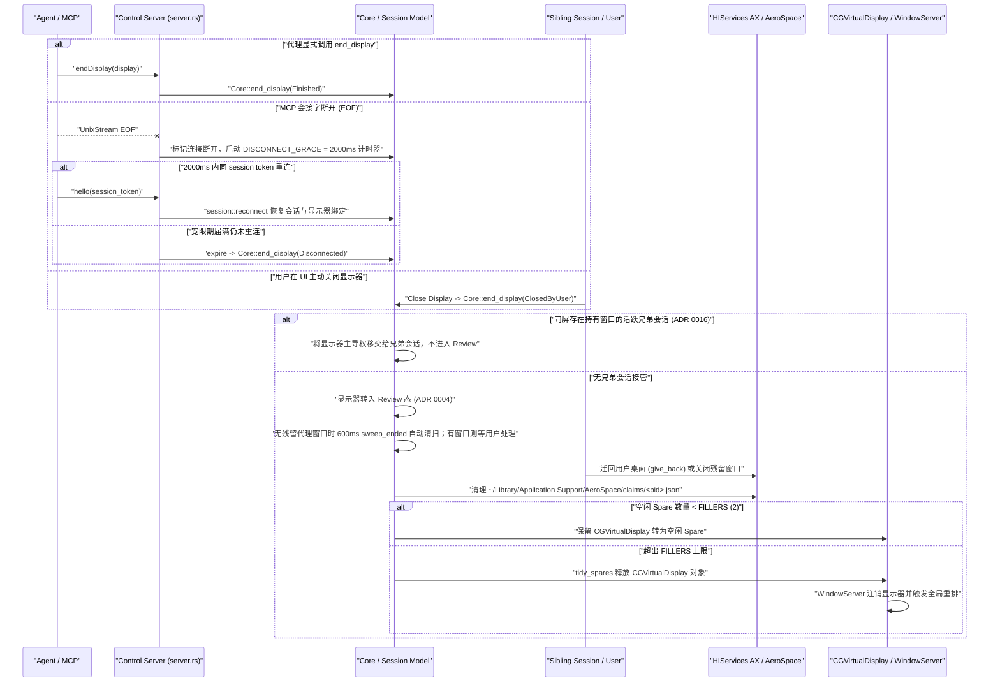

# 操作 02：end_display、Review 态、断连宽限与重启接管

`end_display` 结束代理会话对虚拟显示器的占用。根据 ADR 0004 与 ADR 0016，显示器在同屏仍有兄弟会话窗口时先执行所有权移交，否则进入 `Review` 态等待用户确认或自动清扫，并在清扫后回收至备用池或销毁 `CGVirtualDisplay`。

## 端到端流程

## 节点明细表

| 节点 | 我方代码 | macOS 组件与内部行为 | 限制与故障模式 | 关联问题 | 验证状态 |
| --- | --- | --- | --- | --- | --- |
| 1. `end_display` 请求入口 | `crates/mcp/src/tools.rs:1511-1542`、`apps/macos/src/control/agent.rs:99-123` | 通过 Unix 域控制套接字发送 `endDisplay`，按会话句柄解析目标 `DisplayId`。 | 句柄不属于当前会话或已结束时返回权限或不存在错误；显示器正处于用户 `Takeover`（ADR 0004）时代理侧收尾受用户控制态约束。 | `#189` | `[已验证]` `apps/macos/src/control/agent.rs:99-123` |
| 2. 套接字 EOF 与 `2000 ms` 断连宽限 | `apps/macos/src/control/server.rs:88-190`、`crates/model/src/session.rs:15-140` | `UnixStream` 读到 EOF 后不立即销毁会话，在模型层记录断连时间戳并安排 `DISCONNECT_GRACE = 2000 ms` 延迟检查；期间同 `session_token` 发来 `hello` 则无缝恢复句柄与挂起状态。 | **核心限制（`#189`）**：若上游代理崩溃或被挂起，但父进程（例如 IDE 或包装器）仍持有 `AgentScreen mcp` 子进程的 stdio 管道未关闭，`AgentScreen mcp` 进程不会退出，控制套接字也不会出现 EOF，导致会话永久显示为"活跃"并锁死跨会话窗口请求。 | `#189` | `[已验证]` `apps/macos/src/control/server.rs:88-190`、`crates/mcp/src/session.rs:35-195` |
| 3. 兄弟会话移交判定（ADR 0016） | `apps/macos/src/core.rs:414-462`、`crates/model/src/model.rs` | 纯领域模型检查该 `DisplayId` 上是否仍有其他未结束会话持有的窗口记录。若有，将显示器控制权移交给该兄弟会话，原会话仅释放自身窗口记录。 | 若兄弟会话实为 `#189` 假活僵尸会话，显示器会被移交给僵尸会话而无法按预期进入 `Review` 回收。 | `#189` | `[已验证]` `docs/adr/0016-sibling-display-handoff.md`、`apps/macos/src/core.rs:414-462` |
| 4. 进入 `Review` 态与 `600 ms` 清扫 | `apps/macos/src/core.rs:445-508`、`docs/adr/0004-takeover-and-review.md` | 记录 `EndReason::{Finished, Disconnected, ClosedByUser}` 并将显示器置为 `Review`。若屏上已无归属窗口，启动 `600 ms` `sweep_ended` 定时器自动完成清扫；若仍有窗口，保留画面供用户检视、迁回或关闭。 | 若目标应用残留不可见子窗口或图层异常窗口被计入屏上窗口，可能阻止自动清扫而要求用户手动关闭。 | `#205` | `[已验证]` `apps/macos/src/core.rs:445-508` |
| 5. 残留窗口归还与 AeroSpace 解绑 | `apps/macos/src/dismissal.rs:25-145`、`apps/macos/src/mac/claims.rs:20-95` | 用户选择归还或关闭 Review 显示器时，`dismissal::give_back` 先移除 `~/Library/Application Support/AeroSpace/claims/<pid>.json` 中的窗口声明，再通过 `AXPosition`/`AXSize` 将窗口迁回用户主屏可见区域。 | 1. 全屏 Space 或最小化窗口不接受普通 `AXPosition` 搬移；2. AeroSpace 轮询或监听声明文件存在时间窗，顺序颠倒会导致 AeroSpace 把刚迁回的窗口再次拉走或平铺错位。 | AeroSpace 归属竞争 | `[已验证]` `apps/macos/src/dismissal.rs:25-145`、`apps/macos/src/mac/claims.rs:20-95` |
| 6. 备用池整理（`tidy_spares`） | `crates/model/src/spares.rs:45-83`、`apps/macos/src/core.rs:475-508` | 清扫完成后，若当前空闲 Spare 数小于 `FILLERS = 2` 且显示器无 `unit_twin` 故障，则保留 `CGVirtualDisplay` 实例转入空闲池；否则丢弃 `VirtualDisplay` 句柄触发 ObjC `release`。 | 丢弃 `CGVirtualDisplay` 会令 `WindowServer` 立即触发一次全局 `ScreensChanged` 与 ColorSync 注销，若此时用户正在主屏拖拽窗口可能感受到短暂掉帧。 | `#204` | `[已验证]` `crates/model/src/spares.rs:45-83` |
| 7. 应用重启与孤儿显示器清理 | `apps/macos/src/core.rs:120-235`、`apps/macos/src/mac/cg.rs:68-148` | 旧进程退出时内核回收其进程空间，`WindowServer` 自动销毁旧进程持有的全部 `CGVirtualDisplay`；新实例启动时扫描在线屏幕，将留在虚拟屏原旧坐标而失去屏幕承载的窗口交由系统或后续会话重新安置，并按需预建初始 Spare。 | 若旧进程崩溃瞬间窗口曾停放在远端虚拟坐标，`WindowServer` 注销虚拟屏后会自行把孤儿窗口收拢到主屏左上角，覆盖用户当前桌面视野。 | `#204` | `[已验证]` `apps/macos/src/mac/display.rs:42-95`、`apps/macos/src/core.rs:120-235` |
