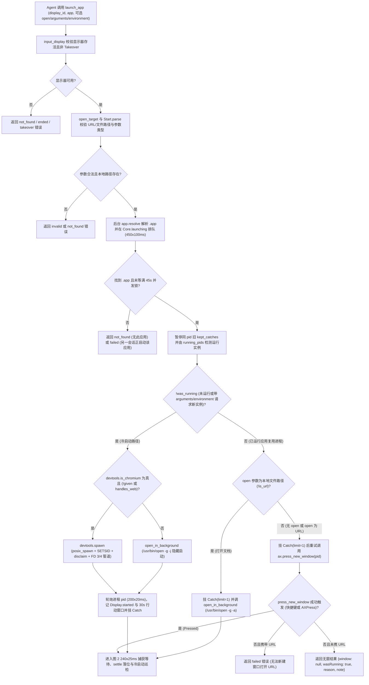
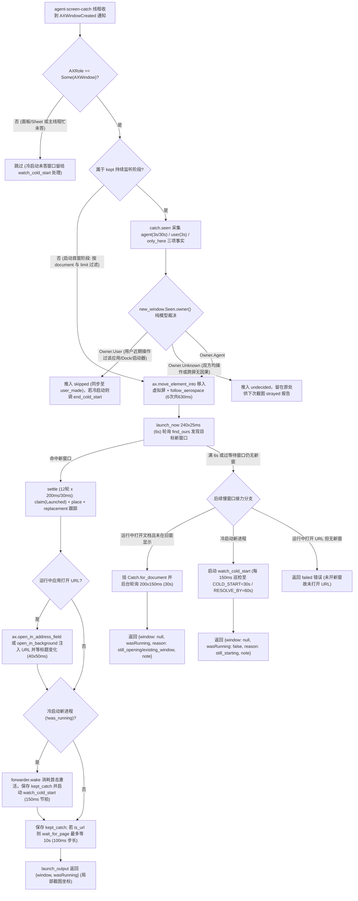

# 03. `launch_app`、新窗口捕获 (`Catch`) 与冷启动归属判定 (`ADR 0007`)

macOS 没有将应用直接启动到指定 `CGDirectDisplayID` 的公开接口。新启动或新建窗口的图形应用默认在主物理屏或指针所在屏幕创建窗口。`launch_app` 通过四阶段流程在不抢占用户焦点和指针的前提下完成后台启动与窗口捕获：先在专用 `agent-screen-catch` 线程挂载 `AXObserver` (`Catch`)，再按引擎类型选择 `devtools::spawn`（`posix_spawn` 注入 `--remote-debugging-pipe` 并免除 TCC 连带责任）或 `/usr/bin/open -g`（冷启动附加 `-j` 隐藏启动）拉起进程，对已运行应用通过后台读取菜单栏触发新建窗口菜单项，最后依据 `ADR 0007` (`crates/model/src/new_window.rs`) 的 `3s` 动作窗口与 `30s` 冷启动规则裁决归属并迁入虚拟屏。

## 线程与队列分工

1. **GPUI 主线程 (`AsyncApp`)**：校验参数 (`open_target`、`Start::parse`)、串行化同一应用的并发启动 (`Core.launching`)、登记 `Display.started` 与 `Origin::Launched`、调度 `watch_cold_start` (`150ms` 节拍) (`apps/macos/src/control/agent.rs:1620-1646, 4966-6150, 6500-6690`)。
2. **`agent-screen-catch` 专用线程**：`catch::runner` (`apps/macos/src/mac/catch.rs:323-358`) 独立运行 `CFRunLoopRun()`，持有所有 `AXObserver` 实例并接收新窗口通知，避免主线程忙碌漏掉首帧。
3. **后台执行器 (`background_executor`) 与辅助线程**：运行应用解析 (`app::resolve`)、`devtools::spawn`（衍生 `agent-screen-devtools`、`agent-screen-reap`、`agent-screen-devtools-hello` 线程）、`/usr/bin/open -g`、`ax::press_new_window`、`settle` 与 `wait_for_page` (`apps/macos/src/mac/devtools.rs:203-241`, `agent.rs:5006-6102`)。

---

## 图 1：`launch_app` 参数校验、应用解析与三类启动通道分流

### 图 1 节点明细表

| 节点 | 线程与队列 | 我方代码与常量 | macOS 组件与内部行为 | 限制与关联缺陷 | Agent 侧返回 | 用户侧表现 | 验证证据 |
| :--- | :--- | :--- | :--- | :--- | :--- | :--- | :--- |
| `L1` | `mcp` -> GPUI 主线程 | `tools::run("launch_app")` (`crates/mcp/src/tools.rs:1042-1063`), `agent.rs:1620-1646` | 转发 `displayId`、`app`、可选 `open`（URL 或文件路径，无独立 `url` 字段）、`arguments`、`environment`；启动新进程时 `mcp` 调 `control.started_app` 记录孤儿认领表 | 需录屏与辅助功能权限 | 进入 `L2` | 无变化 | 已验证：`crates/mcp/src/tools.rs:1050-1056` `json!({ "displayId": display, "app": app, "open": a.string("open")?, "arguments": a.0.get("arguments"), "environment": a.0.get("environment") })` |
| `L2` | GPUI 主线程 + 后台 | `input_display` (`apps/macos/src/control/agent.rs:1621, 7266-7285`) | 校验显示器存活且 `takeover == false`，并在后台预存 `cg::all_ids()` 快照 | 接管期间拒绝启动应用 | 进入 `L3` | 无变化 | 已验证：`apps/macos/src/control/agent.rs:1621` `let id = input_display(&core, &p, cx).await?;` |
| `L3` | GPUI 主线程 | `usable` / `input_display` (`apps/macos/src/control/agent.rs:2686-2712, 7271-7275`) | 判定目标显示器是否归属本会话、未结束且未被用户接管 | 无 | 失败走 `LX1`，通过走 `L4` | 无变化 | 已验证：`apps/macos/src/control/agent.rs:7272-7274` `if core.read_with(cx, \|c, _\| c.displays.get(id).is_some_and(\|d\| d.takeover)) { return Err(ControlError::takeover(...)); }` |
| `LX1` | GPUI 主线程 | `ControlError` (`apps/macos/src/control/server.rs:34-51`) | 返回对应状态错误码 | 无 | 错误码 `not_found`、`ended` 或 `takeover` | 无变化 | 已验证：`apps/macos/src/control/server.rs:36,42,48` `code: "not_found"` / `code: "ended"` / `code: "takeover"` |
| `L4` | GPUI 主线程 | `open_target` / `Start::parse` / `file_target` (`apps/macos/src/control/agent.rs:4966-4991, 5131-5172, 5972-5988`) | 展开 `~/`，检查绝对文件路径或 `file://` 目标在磁盘上存在；校验 `arguments` 为字符串数组、`environment` 为非空无 `=` 键的字符串字典 | 若为浏览器且传入本地路径，`file_target` 转为 `file://` URL 以免在用户前台窗口开新标签 (`#168`) | 进入 `L5` | 无变化 | 已验证：`apps/macos/src/control/agent.rs:4973-4976` `if std::path::Path::new(text).exists() { Ok(text.to_string()) } else { Err(ControlError::not_found(format!("no file at {text}"))) }`；`agent.rs:5973` `if let Some(path) = target.filter(\|t\| browser && t.starts_with('/'))` |
| `L5` | GPUI 主线程 | 参数校验分支 (`apps/macos/src/control/agent.rs:1625-1626, 5235`) | 汇总 `open_target`、`Start::parse` 与 `file_target` 校验结果 | 无 | 非法走 `LX2`，合法走 `L6` | 无变化 | 已验证：`apps/macos/src/control/agent.rs:1625-1626` `let target = p.string("open").map(\|t\| open_target(&t)).transpose()?; let start = Start::parse(&p)?;` |
| `LX2` | GPUI 主线程 | `ControlError::invalid` / `not_found` (`apps/macos/src/control/agent.rs:4976, 4987, 5139-5165, 5982`) | 纯参数拒绝，不启动任何进程 | 无 | 错误码 `invalid` 或 `not_found` (`no file at ...`) | 无变化 | 已验证：`apps/macos/src/control/agent.rs:4987-4989` `Err(ControlError::invalid("open takes a URL such as https://example.com or an absolute file path"))` |
| `L6` | 后台执行器 + 主线程 | `app::resolve` (`apps/macos/src/mac/app.rs:388-430`), `launch` (`agent.rs:5217-5256`) | 按 Bundle ID、`Info.plist` 路径或 `fullPathForApplication:` 解析 `.app`；随后在 `Core.launching` 上等待最多 `450 * 100ms` (`45s`) 获取同一应用启动互斥权 | 防止两个会话同时启动同一应用导致无法区分各自新窗口 (`core.rs:98-100`) | 进入 `L7` | 无变化 | 已验证：`apps/macos/src/control/agent.rs:5243-5250` `for _ in 0..450 { free = core.update(cx, \|c, _\| c.launching.insert(path.clone())); ... .timer(Duration::from_millis(100)).await; }` |
| `L7` | GPUI 主线程 | `launch` (`apps/macos/src/control/agent.rs:5217-5256`) | 判断 `.app` 是否存在及是否拿到 `Core.launching` 锁（代码中不拦截宿主自身 Bundle ID） | 无 | 失败走 `LX3`，成功走 `L8` | 无变化 | 已验证：`apps/macos/src/control/agent.rs:5217-5221,5252-5255` `.ok_or_else(\|\| ControlError::not_found(format!("no app named {name}...")))` / `if !free { return Err(ControlError::failed(...)) }` |
| `LX3` | GPUI 主线程 | `launch` (`apps/macos/src/control/agent.rs:5218-5220, 5253-5255`) | 返回找不到应用或并发启动忙错误 | 无 | `not_found` (`no app named {name}...`) 或 `failed` (`another session is still launching {name}...`) | 无变化 | 已验证：`apps/macos/src/control/agent.rs:5253-5255` `Err(ControlError::failed(format!("another session is still launching {name}; try again shortly")))` |
| `L8` | 后台执行器 + 主线程 | `app::running_pids` (`apps/macos/src/mac/app.rs:18-31`), `launch` (`agent.rs:5258-5275, 5304-5310`) | 暂停同 `pid` 上既有的 `kept_catches` 以免争抢本次新窗口；通过 `proc_listallpids` + `proc_pidpath` + `NSRunningApplication` 枚举运行中实例 | 脱离主线程快速枚举进程 | 得到 `instances_before` 与 `was_running` | 无变化 | 已验证：`apps/macos/src/mac/app.rs:25-29` `process_ids().into_iter().filter(\|&pid\| process_path(pid).as_deref() == Some(executable.as_path()))`；`agent.rs:5266` `kept.pause(on);` |
| `L9` | GPUI 主线程 | `Start::new_instance` (`apps/macos/src/control/agent.rs:5197-5199, 5303-5310`) | `fresh = !arguments.is_empty() \|\| !environment.is_empty()`，`was_running = !fresh && !instances_before.is_empty()` | 若目标为单实例应用且已在运行，`fresh` 新进程退出后由 `already_running` 兜底 (`#29`) | `!was_running` 走 `L10`，`was_running` 走 `L14` | 无变化 | 已验证：`apps/macos/src/control/agent.rs:5197-5199,5309` `fn new_instance(&self) -> bool { !self.arguments.is_empty() \|\| !self.environment.is_empty() }` / `let was_running = !fresh && !instances_before.is_empty();` |
| `L10` | 后台执行器 | `devtools::is_chromium` (`apps/macos/src/mac/devtools.rs:29-40`), `agent.rs:5353-5358` | 扫描 `Contents/Frameworks/*.framework` 下是否存在 `chrome_100_percent.pak`；若未传 `open` 或该应用支持网页 (`app::handles_web`)，走 DevTools 管道启动 | 非浏览器 Chromium 应用（如 Electron）带文档打开时改走 `open -g` (`agent.rs:5351-5356`) | 是走 `L11`，否走 `L12` | 无变化 | 已验证：`apps/macos/src/mac/devtools.rs:36-38` `f.join("Resources/chrome_100_percent.pak").exists() \|\| f.join("Versions/Current/Resources/chrome_100_percent.pak").exists()` |
| `L11` | 后台执行器 | `devtools::spawn` (`apps/macos/src/mac/devtools.rs:57-67, 106-248`), `agent.rs:5360-5403` | 若宿主正在预造备用屏 (`making_spare`) 最多先等 `100 * 20ms` (`2s`，防 `#123`)；随后调用 `posix_spawn`：设 `POSIX_SPAWN_SETSID` (`0x0400`)、`responsibility_spawnattrs_setdisclaim(&mut attrs, 1)`，将匿名管道 `dup2` 至子进程 `FD 3` / `FD 4`，传入 `--remote-debugging-pipe`（浏览器附带 `--window-position`/`--window-size`），并在 `agent-screen-devtools-hello` 线程等 `HELLO_WAIT = 30s` 握手；若 `spawn` 失败回退 `L12` | 供后续网页内 HTML5 拖拽与下拉框使用 (`ADR 0010`)；仅调试构建支持 `AGENTSCREEN_OPEN_DELAY_MS` (`agent.rs:4996-5002`) | 拿到新进程 `pid` | 后台启动，不抢前台焦点 | 已验证：`apps/macos/src/mac/devtools.rs:114,151-152,167,248` `c_string("--remote-debugging-pipe")` / `posix_spawn_file_actions_adddup2(&mut actions, to_app.0, 3)` / `responsibility_spawnattrs_setdisclaim(&mut attrs, 1)` / `const HELLO_WAIT: Duration = Duration::from_secs(30);` |
| `L12` | 后台执行器 | `open_in_background` (`apps/macos/src/control/agent.rs:5006-5052, 5181-5194`) | 执行 `/usr/bin/open -g`（不激活前台），冷启动传 `-j`（隐藏启动），`new_instance` 传 `-n`，附带 `--env`；未传自定义参数时默认追加 `-NSShowAppCentricOpenPanelInsteadOfUntitledFile NO -ApplePersistenceIgnoreState YES` | 阻止文档型应用弹出跨进程系统打开文件面板留在用户屏上 (`agent.rs:5174-5188`) | 衍生等待线程监听 `open` 退出码 | 后台隐藏启动，主屏不闪现窗口 | 已验证：`apps/macos/src/control/agent.rs:5019-5036` `let mut open = std::process::Command::new("/usr/bin/open"); open.arg("-g"); ... if hidden { open.arg("-j"); } ... open.arg("--args").args(&arguments);` |
| `L13` | 后台 + `agent-screen-catch` 线程 | `launch_now` (`apps/macos/src/control/agent.rs:5440-5573`), `catch::agent_acted_for` (`catch.rs:83-85`) | 最多轮询 `200 * 20ms` (`4s`) 匹配新 `pid`（失败报 `{name} did not start`，单实例秒退转 `already_running`）；将 `pid` 写入 `Display.started`，登记 `LATE_WINDOW_WAIT = 30s` 冷启动窗口期，最多重试 `100 * 20ms` 挂载 `Catch` 并隐藏移入抢跑首窗 (`150 * 20ms`) 后调用 `app::unhide(pid)` | 先把窗口移入虚拟屏坐标再 `unhide`，避免主屏闪现 | 进入 `L18` | 首窗直接在虚拟屏显现 | 已验证：`apps/macos/src/control/agent.rs:5440,5488,5506,5572` `for _ in 0..200 {` / `ControlError::failed(format!("{name} did not start"))` / `agent_acted_for(id, pid, LATE_WINDOW_WAIT)` / `off(cx, move \|\| app::unhide(pid)).await;` |
| `L14` | GPUI 主线程 | `launch_now` (`apps/macos/src/control/agent.rs:5316-5348, 5578`) | 已运行应用分支：先调 `forwarder.remember_user_window(pid)` 记下用户当前窗口以便事后归还焦点，再区分打开本地文件 (`!is_url`) 与新建窗口/打开 URL (`asked_for_window`) | 运行中浏览器直接 `open <url>` 会在用户前台窗口加标签，因此必须先新建窗口再填 URL (`agent.rs:5324-5328`) | 本地文件走 `L15`，无参或 URL 走 `L16` | 无变化 | 已验证：`apps/macos/src/control/agent.rs:5328,5346,5578` `let is_url = target.is_some_and(\|t\| !t.starts_with('/'));` / `.remember_user_window(pid)` / `let asked_for_window = was_running && (target.is_none() \|\| is_url);` |
| `L15` | 后台 + `agent-screen-catch` 线程 | `Catch::start(..., Some(1))` + `open_in_background` (`apps/macos/src/control/agent.rs:5316-5321, 5409-5413`) | 挂载 `limit = Some(1)` 的 `Catch`，执行 `/usr/bin/open -g -a <app> <file>` 让运行中应用在独立新窗口打开该文件 | 若超时未见新窗，图 2 切换为 `Catch::for_document` 精准按 `AXDocument` 路径捕获 | 进入 `L18` | 不抢前台焦点 | 已验证：`apps/macos/src/control/agent.rs:5316-5317,5410` `let limit = was_running.then_some(1);` / `open_in_background(path.clone(), first, !was_running, start, cx)` |
| `L16` | 后台执行器 | `ax::press_new_window` (`apps/macos/src/mac/ax.rs:2193-2277`), `agent.rs:5579-5623` | 读取 `"AXMenuBar"`（无额外自定义超时常量），遍历两级菜单由 `pick_new_window` 匹配新建窗口项；若菜单项带快捷键（如 `cmd+n`）优先调用 `input::post_key_to_pid(pid, chord)` 后台投键，否则调 `AXPress`；`NotReady` 最多重试 `10 * 150ms`，刚启动无窗应用报 `Missing` 再等最多 `20 * 150ms` | 不直接使用盲发 `cmd+n`，避免在备忘录/日历中误建用户数据 (`ax.rs:2191-2192`) | 进入 `L17` | 用户屏幕不弹出菜单 | 已验证：`apps/macos/src/mac/ax.rs:2220-2221,2267-2271` `pub fn press_new_window(pid: i32) -> NewWindow { let Some(bar) = element_attribute(&application(pid), "AXMenuBar")` / `else if let Some(chord) = chord { super::input::post_key_to_pid(pid, chord); NewWindow::Pressed }` |
| `L17` | GPUI 主线程 | `NewWindow` 分支 (`apps/macos/src/control/agent.rs:5625-5654`) | 将 `Pressed`、`Disabled` (`app_busy`)、`Missing` (`still_starting` / `just_started` / `no_new_window`)、`NotReady` (`menus_unreadable`) 映射为结果 | 区分带 URL（失败必须报错防污染用户窗口）与不带 URL（返回结构化 `reason`） | `Pressed` 走 `L18`，带 URL 失败走 `LX4`，无 URL 失败走 `LR0` | 无变化 | 已验证：`apps/macos/src/control/agent.rs:5625-5634` `let missing = match asked { ax::NewWindow::Pressed => None, ax::NewWindow::Disabled => Some("app_busy"), ... ax::NewWindow::NotReady => Some("menus_unreadable"), };` |
| `LX4` | GPUI 主线程 | `launch_now` (`apps/macos/src/control/agent.rs:5637-5646`) | 运行中浏览器无法新建窗口时拒绝发送 URL，以免把网页开进用户正在看的浏览器标签页 | 严格保护用户现有浏览器窗口 | 错误码 `failed`：`{name} is running and can't open a new window now ({reason}), so the URL was not opened...` | 用户窗口不受影响 | 已验证：`apps/macos/src/control/agent.rs:5643-5645` `return Err(ControlError::failed(format!("{name} is running and can't open a new window now ({reason}), so the URL was not opened; {next}")));` |
| `LR0` | 宿主 -> `mcp` | `launch_now` (`apps/macos/src/control/agent.rs:5647-5652`), `launch_output` (`crates/mcp/src/tools.rs:2218-2247`) | 非错误返回 `Launched { window: None, was_running: true, reason: Some(reason), pid: None }`，由 `mcp` 补充对应 `note` 指引（如建议询问用户交出窗口或退出重开） | 注意：单窗口应用（如计算器）走此 `window: null` 分支而非抛异常 | 返回 `{"window": null, "wasRunning": true, "reason": "...", "note": "..."}` | 用户窗口不受影响 | 已验证：`crates/mcp/src/tools.rs:2246` `json!({ "window": null, "wasRunning": was_running, "reason": reason, "note": note })` |
| `L18` | 协同进入图 2 | `launch_now` (`apps/macos/src/control/agent.rs:5681-5922`) | 进入 `240 * 25ms` (`6s`) 捕获等待、`settle` 落位与后台慢启动接力 | 转入图 2 | 转入图 2 | 转入图 2 | 已验证：`apps/macos/src/control/agent.rs:5681-5683` `for tick in 0..240 { cx.background_executor().timer(Duration::from_millis(25)).await;` |

---

## 图 2：`Catch` 实时拦截、`ADR 0007` 归属裁决、`settle` 落位与 `watch_cold_start` 巡检

### 图 2 节点明细表

| 节点 | 线程与队列 | 我方代码与常量 | macOS 组件与内部行为 | 限制与关联缺陷 | Agent 侧返回 | 用户侧表现 | 验证证据 |
| :--- | :--- | :--- | :--- | :--- | :--- | :--- | :--- |
| `W1` | `agent-screen-catch` 线程 | `created` (`apps/macos/src/mac/catch.rs:329, 563-575`) | 独立 `CFRunLoop` 线程收到 `AXObserver` 新窗口回调；若 `paused == true` 直接返回 | 不阻塞 GPUI 主线程 | 事件进入 `W2` | 无变化 | 已验证：`apps/macos/src/mac/catch.rs:329,563` `.name("agent-screen-catch".into())` / `extern "C" fn created(` |
| `W2` | `agent-screen-catch` 线程 | `created` (`apps/macos/src/mac/catch.rs:578-592`) | 读取窗口 `"AXRole"` 是否等于 `Some("AXWindow")` | 对话框 Sheet、菜单及启动期主线程卡死未响应 (`role.is_none()`) 的窗口不在此处强移 | 非 `AXWindow` 走 `WX1`，`AXWindow` 走 `W3` | 无变化 | 已验证：`apps/macos/src/mac/catch.rs:578-579` `let role = ax::string_attribute(window, "AXRole"); if role.as_deref() != Some("AXWindow") {` |
| `WX1` | `agent-screen-catch` 线程 | `created` (`apps/macos/src/mac/catch.rs:584-591`) | 记录未描述窗口日志并交由冷启动 `watch_cold_start` 后续跟进，不消耗 `limit` 计数 | 避免在应用繁忙时卡死共享 `catch` 线程 | 继续监听 | 无变化 | 已验证：`apps/macos/src/mac/catch.rs:586` `"catch: pid {} made a window it doesn't describe yet, {:?}; left to the launch's watch"` |
| `W3` | `agent-screen-catch` 线程 | `created` (`apps/macos/src/mac/catch.rs:594-607`) | 若为归还监控 (`target.home.is_some()`) 则将无 Agent 因果的自开窗退回 `home`；否则区分启动期即时捕获 (`kept == false`) 与存活期常驻捕获 (`kept == true`) | 常驻 `kept_catches` 必须经 `Seen::owner()` 逐窗裁决 | 常驻走 `W4`，启动期走 `W7` | 无变化 | 已验证：`apps/macos/src/mac/catch.rs:594,607` `if let Some(home) = target.home {` / `if target.kept.load(Ordering::Relaxed) {` |
| `W4` | `agent-screen-catch` 线程 | `catch::seen` (`apps/macos/src/mac/catch.rs:197-199, 242-253`), `ACTION_WINDOW = 3s` (`crates/model/src/new_window.rs:11-39`) | 汇总 `Seen { agent, user, only_here }`：`agent` 为本屏在 `3s`（或 `30s` 冷启动）内驱动过且无其它持该应用的屏幕刚驱动过；`user` 为用户在 `3s` 内操作过该应用或 `Finder`/`Dock`/`Spotlight`/`Raycast`/`Alfred` (`app::opens_things`)；`only_here` 为该应用其余窗口全在本屏 | 用户操作证据保留 `RESOLVE_BY = 60s` (`catch.rs:116`) | 交 `W5` 裁决 | 无变化 | 已验证：`apps/macos/src/mac/catch.rs:245-248` `let agent = acted_recently(display, pid) && !others_acted_recently(display, pid); let user = user_acted_recently(pid); let only_here = !agent && !user && only_on(pid, bounds, new);` |
| `W5` | 纯模型函数 | `Seen::owner` (`crates/model/src/new_window.rs:43-61`) | 纯函数裁决 (`ADR 0007`)：`(true, false) => Owner::Agent`，`(false, true) => Owner::User`，`(false, false) if only_here => Owner::Agent`，其余返回 `Owner::Unknown` | 零系统调用，枚举变体名为 `Agent` / `User` / `Unknown` | 三路分流 | 无变化 | 已验证：`crates/model/src/new_window.rs:52-60` `pub fn owner(self) -> Owner { match (self.agent, self.user) { (true, false) => Owner::Agent, (false, true) => Owner::User, (false, false) if self.only_here => Owner::Agent, _ => Owner::Unknown, } }` |
| `WX2` | `agent-screen-catch` 线程 | `created` (`apps/macos/src/mac/catch.rs:615-630`), `sync_user_made` (`agent.rs:3117-3127`) | 若 `seen.ends_cold_start()` (`seen.user == true`) 立即调用 `end_cold_start` 终止 `30s` 冷启动特权；将窗口 ID 记入 `skipped`（后续同步到 `Display.user_made`），不移动窗口 | 保护用户在冷启动期间手动点击打开的窗口 | 无 | 用户自开窗口留在物理屏 | 已验证：`apps/macos/src/mac/catch.rs:615-629` `if seen.ends_cold_start() { end_cold_start(target.display, target.pid); } ... Owner::User => { ... lock(&target.skipped).push(id); return; }` |
| `W6` | `agent-screen-catch` 线程 + 主线程 | `created` (`apps/macos/src/mac/catch.rs:631-644`), `undecided_strays` (`agent.rs:3133-3193`) | 将归属不明窗口记入 `Catch.undecided` 留在原处；Agent 下次截图时由 `add_strayed` 通过 `Core.told` 去重后写入截图响应的 `strayed` 数组 | 不静默搬走因果不明窗口 | 下次截图附带 `strayed` | 窗口留在原处 | 已验证：`apps/macos/src/mac/catch.rs:638` `lock(&target.undecided).push(id);`；`agent.rs:3188-3190` `let strayed = core.update(cx, \|c, _\| undecided_strays(c, id)); if !strayed.is_empty() { result["strayed"] = json!(strayed); }` |
| `W7` | `agent-screen-catch` 线程 + 跟随线程 | `created` / `follow_aerospace` (`apps/macos/src/mac/catch.rs:649-716`) | 若指定 `document` 则核验 `ax::document_path`（未就绪时订阅 `"AXTitleChanged"`）；扣减 `limit` 配额后调用 `ax::move_element_into(window, target.bounds)` 居中移入虚拟屏；若运行 AeroSpace 且未配 `ignored-monitors`，衍生线程按 `[10, 20, 40, 80, 160, 320]` ms（6 次共 `630ms`）跟进调用 `windows::place` | 赶在 AeroSpace 把新窗排进用户焦点工作区后第一时间迁回虚拟屏工作区 | 记录 `taken = Some(wid)` | 新窗口不留在用户桌面 | 已验证：`apps/macos/src/mac/catch.rs:674,705` `let moved = ax::move_element_into(window, target.bounds).is_ok();` / `for wait in [10, 20, 40, 80, 160, 320] {` |
| `W8` | 后台执行器 | `launch_now` (`apps/macos/src/control/agent.rs:5681-5725`), `waited_long_enough` (`agent.rs:6000-6012`) | 每 `25ms` 轮询一次共 `240` 次 (`6s`)；运行中应用受 `ASKED_WINDOW_WAIT = 3000ms`（菜单新建）、`OPENED_WINDOW_WAIT = 2000ms`（`open` 返回后）及总轮次上限 `RUNNING_APP_TURN = 4000ms`（仅 `debug_methods()` 下支持 `AGENTSCREEN_RUNNING_TURN_MS` 覆盖）约束，超时即停抓以免误抓用户随后新开的窗口 | `RUNNING_APP_TURN` 是停止等待的截止时限而非重试机制 | 命中新窗走 `W9`，超时无窗走 `W15` | 无变化 | 已验证：`apps/macos/src/control/agent.rs:5105-5111,6006-6011` `const ASKED_WINDOW_WAIT: Duration = Duration::from_millis(3000); const OPENED_WINDOW_WAIT: Duration = Duration::from_millis(2000); const RUNNING_APP_TURN: Duration = Duration::from_millis(4000);` |
| `W9` | 后台执行器 + 主线程 | `settle` / `replacement` / `guard_placed` (`apps/macos/src/control/agent.rs:6016-6150`) | 登记 `claim(..., Origin::Launched)`，循环最多 `12` 轮（装有 AeroSpace 每轮等 `200ms`，否则 `30ms`）：若首窗在加载文档时被替换为同进程新窗则通过 `replacement` 追踪新窗，调 `place`、`forwarder.focus` 与 `windows::keep_inside`；装有 AeroSpace 时启动 `guard_placed` 额外看护 `3s`（最多 `10s`）；若 12 轮均失败则 `ax::minimize` 最小化窗口并返回 `failed` | 显示器中途结束时返回错误码 `ended` (`agent.rs:6022`) | 锁定就位 `Window` | 窗口稳定落在虚拟屏内 | 已验证：`apps/macos/src/control/agent.rs:6037-6039,6071,6090` `let look = if aerospace_takes { 200 } else { 30 }; ... for _ in 0..12 {` / `guard_placed(core, target, id, cx);` / `ax::minimize(target)` |
| `W10` | GPUI 主线程 | `launch_now` (`apps/macos/src/control/agent.rs:5733-5736`) | 检查是否为 `was_running && is_url`（已运行浏览器刚新建了空白窗口，尚待填入目标 URL） | 冷启动已在启动参数/首次 `open` 携带了 URL，无需重复打开 | 是走 `W11`，否走 `W12` | 无变化 | 已验证：`apps/macos/src/control/agent.rs:5733-5735` `if was_running && is_url && let Some(target) = target` |
| `W11` | 后台执行器 | `ax::open_in_address_field` / `open_in_background` (`apps/macos/src/control/agent.rs:5738-5792`) | 优先向新窗口地址栏直接填入 URL (`open_in_address_field`)，不支持时回退调用 `open_in_background`（等 `10s` 退出码）使新成为最前窗的虚拟屏窗口接收 URL，随后最多轮询 `40 * 50ms` (`2s`) 等待窗口标题变化，再允许归还用户焦点 | 防止归还焦点过早导致浏览器把 URL 开进用户的旧窗口 (`agent.rs:5775-5777`) | 失败报 `failed`，成功走 `W12` | URL 在虚拟屏新窗口内打开 | 已验证：`apps/macos/src/control/agent.rs:5746,5779,5789` `ax::open_in_address_field(new_window, &url)` / `for _ in 0..40 {` / `.timer(Duration::from_millis(50))` |
| `W12` | GPUI 主线程 | `launch_now` (`apps/macos/src/control/agent.rs:5795-5811`) | 判断本次是否为冷启动新进程 (`!was_running`) | 无 | 是走 `W13`，否走 `W14` | 无变化 | 已验证：`apps/macos/src/control/agent.rs:5795` `if !was_running {` |
| `W13` | GPUI 主线程 + 后台 | `Forwarder::wake` / `watch_cold_start` (`apps/macos/src/control/agent.rs:5796-5797, 5807-5811`) | 调用 `forwarder.wake(placed.target, placed.bounds)` 预消耗后台启动窗口吞掉的首次点击；启动 `watch_cold_start` 持续跟进加载窗之后弹出的正式主窗口 | 修复后台冷启动应用第一次点击只激活窗口不触发控件的问题 | 转入 `W14` | 后续慢主窗自动迁入虚拟屏 | 已验证：`apps/macos/src/control/agent.rs:5796-5797,5810` `core.update(cx, \|c, _\| c.forwarder(id)).wake(placed.target, placed.bounds);` / `watch_cold_start(core, id, pid, seen, true, launched_at, screen.clone(), cx);` |
| `W14` | 后台执行器 + 主线程 | `wait_for_page` / `keep_catch` (`apps/macos/src/control/agent.rs:5056-5080, 5801-5805`) | 若 `is_url` 为真，调用 `wait_for_page` 每 `100ms` 检查 `ax::page(target)`（`NoWindow \| Blank` 满 `3s` 放行，`Loading` 最多等 `10s`，超时打日志直接放行）；调用 `keep_catch` 将 `Catch` 存入 `Core.kept_catches` | 避免页面脚本未就绪时 Agent 第一下点击落空 (`agent.rs:5799-5800`) | 进入 `R1` | 页面首屏加载完成 | 已验证：`apps/macos/src/control/agent.rs:5058,5065,5076` `while started.elapsed() < Duration::from_secs(10)` / `ax::Page::NoWindow \| ax::Page::Blank => started.elapsed() > Duration::from_secs(3)` / `.timer(Duration::from_millis(100))` |
| `R1` | 宿主 -> `mcp` 进程 | `launchApp` (`apps/macos/src/control/agent.rs:1628-1645`), `launch_output` (`crates/mcp/src/tools.rs:2203-2217`) | 宿主将窗口坐标按 `in_shot(..., display_scale)` 换算为截图局部像素并返回 `window`、`wasRunning` 与内部 `pid`；`mcp` 输出 `{"window": ..., "wasRunning": ...}`（单实例合并时附带 `"reason": "already_running"` 与 `note`） | 返回值不含 `bundleId` 或 `strayed`（`strayed` 在截图工具返回中附带） | 返回 `{"window": {...}, "wasRunning": bool}` | Peek 与 Viewer 呈现新窗口 | 已验证：`crates/mcp/src/tools.rs:2216` `_ => json!({ "window": window, "wasRunning": was_running })`；`agent.rs:1630` `"window": in_shot(w.json(), display_scale(&core, id, cx))` |
| `W15` | GPUI 主线程 | `launch_now` (`apps/macos/src/control/agent.rs:5824-5907`) | `6s` 内未拿到窗口时保留 `keep_catch` 并按启动场景分流慢窗口接力路径 | 不阻塞当前工具调用无限死等 | 三路分流 | 无变化 | 已验证：`apps/macos/src/control/agent.rs:5851,5886,5903` `if let Some(document) = watching` / `else if !was_running` / `if was_running && is_url` |
| `W16` | 后台执行器 | `Catch::for_document` + 文档慢开轮询 (`apps/macos/src/control/agent.rs:5712-5715, 5832-5885`) | 若文件已在旧窗口显示 (`shown_already`) 则不移动并报 `"existing_window"`；否则挂 `Catch::for_document` 并在后台轮询 `200 * 150ms` (`30s`) 等待匹配 `shows_document` 的新窗出现后调用 `settle` | 绝不误抓用户在此期间打开的其它文档窗口 | 转入 `LR1` | 慢文档打开后自动入虚拟屏 | 已验证：`apps/macos/src/control/agent.rs:5856-5858,5875` `for _ in 0..200 { cx.background_executor().timer(Duration::from_millis(150)).await;` / `let _ = settle(&core, late.target, id, cx).await;` |
| `W17` | 后台执行器 + 主线程 | `watch_cold_start` (`apps/macos/src/control/agent.rs:6500-6690`), `new_window::step` / `watch` (`crates/model/src/new_window.rs:17-22, 118-248`) | 每 `150ms` 巡检一次：前 `COLD_START = 30s` (`Step::Look`) 按退避节拍 `retries_catch` 补挂 `Catch`、为隐藏完启动的应用调 `ShowHidden`，并对新窗按 `Role` (`Window \| Other \| Unanswered \| Unreadable`) 与 `Seen` 裁决（`Watch::Place` 调 `settle`，`Theirs` 记 `user_made`，`Undecided` 记 `Core.left_alone`）；`30s..60s` (`Step::Resolve`) 仅跟踪已见但未响应 `Unanswered` 的窗口，满 `RESOLVE_BY = 60s` (`Step::GiveUp`) 记入 `Core.left_alone` 停止等待 | 解决大型应用（如企业微信主窗口）构建期间主线程不响应 AX 导致的漏抓问题 (`new_window.rs:4-6`) | 转入 `LR2` | 慢启动应用窗口出来即入虚拟屏 | 已验证：`apps/macos/src/control/agent.rs:6520-6521,6548-6556` `.timer(Duration::from_millis(150)).await;` / `Step::GiveUp => { ... c.left_alone.extend(...) }`；`crates/model/src/new_window.rs:22` `pub const RESOLVE_BY: Duration = Duration::from_secs(60);` |
| `WX3` | GPUI 主线程 | `launch_now` (`apps/macos/src/control/agent.rs:5903-5907`) | 运行中浏览器按下新建窗口后仍未生出窗口时，放弃打开 URL 并返回错误 | 防止将 URL 打开到用户最前窗口中 | 错误码 `failed`：`{name} opened no new window, so the URL was not opened...` | 用户窗口不受影响 | 已验证：`apps/macos/src/control/agent.rs:5904-5906` `return Err(ControlError::failed(format!("{name} opened no new window, so the URL was not opened; ask the user to quit {name}, then call launch_app again")));` |
| `LR1` | 宿主 -> `mcp` 进程 | `launch_now` (`apps/macos/src/control/agent.rs:5908-5921`), `launch_output` (`tools.rs:2224-2246`) | 返回 `window: null` 及 `reason: "existing_window"` 或 `"still_opening"` 与操作指引 | 无 | 返回无窗状态 JSON | 无变化 | 已验证：`apps/macos/src/control/agent.rs:5916-5919` `else if shown_already { "existing_window" } else { "still_opening" }` |
| `LR2` | 宿主 -> `mcp` 进程 | `launch_now` (`apps/macos/src/control/agent.rs:5908-5914`), `launch_output` (`tools.rs:2242-2246`) | 返回 `window: null`、`wasRunning: false`、`reason: "still_starting"`，提示 Agent 稍后调 `list_windows` 检查 | 新窗口在 `30s` 内出现时仍由后台 `Catch` / `watch_cold_start` 自动迁入虚拟屏 | 返回 `{"window": null, "wasRunning": false, "reason": "still_starting", "note": "..."}` | 窗口随后就位 | 已验证：`apps/macos/src/control/agent.rs:5912-5913` `if !was_running { "still_starting" }` |

---

## 关键时间常数汇总

| 常量 | 数值 | 定义位置 | 作用说明 | 验证证据 |
| :--- | :--- | :--- | :--- | :--- |
| `ACTION_WINDOW` | `3 s` | `crates/model/src/new_window.rs:11` | Agent 动作与用户键鼠动作的短期因果归属窗口 | 已验证：`crates/model/src/new_window.rs:11` `pub const ACTION_WINDOW: Duration = Duration::from_secs(3);` |
| `COLD_START` / `LATE_WINDOW_WAIT` | `30 s` | `crates/model/src/new_window.rs:17`, `apps/macos/src/control/agent.rs:5101` | 冷启动新进程的窗口归属有效期与 `watch_cold_start` 主动寻窗时长 | 已验证：`crates/model/src/new_window.rs:17` `pub const COLD_START: Duration = Duration::from_secs(30);`；`agent.rs:5101` `const LATE_WINDOW_WAIT: Duration = agent_screen_model::new_window::COLD_START;` |
| `RESOLVE_BY` | `60 s` | `crates/model/src/new_window.rs:22` | `watch_cold_start` 等待冷启动期已出现但 AX 未响应 (`Unanswered`) 窗口给出角色的截止上限 | 已验证：`crates/model/src/new_window.rs:22` `pub const RESOLVE_BY: Duration = Duration::from_secs(60);` |
| `RUNNING_APP_TURN` | `4000 ms` | `apps/macos/src/control/agent.rs:5111` | 向已运行应用发起打开请求后，不论 `open` 耗时多久，停止抓窗的总轮次截止时限（仅 `debug_methods()` 下可读 `AGENTSCREEN_RUNNING_TURN_MS` 覆盖） | 已验证：`apps/macos/src/control/agent.rs:5111,5116-5118` `const RUNNING_APP_TURN: Duration = Duration::from_millis(4000);` / `std::env::var("AGENTSCREEN_RUNNING_TURN_MS").ok().filter(\|_\| debug_methods())` |
| `ASKED_WINDOW_WAIT` | `3000 ms` | `apps/macos/src/control/agent.rs:5105` | 对已运行应用触发新建窗口菜单项后捕获新窗口的最长等待时间 | 已验证：`apps/macos/src/control/agent.rs:5105` `const ASKED_WINDOW_WAIT: Duration = Duration::from_millis(3000);` |
| `OPENED_WINDOW_WAIT` | `2000 ms` | `apps/macos/src/control/agent.rs:5108` | 对已运行应用执行 `open` 返回后等待文件窗口出现的最长时间 | 已验证：`apps/macos/src/control/agent.rs:5108` `const OPENED_WINDOW_WAIT: Duration = Duration::from_millis(2000);` |
| `HELLO_WAIT` | `30 s` | `apps/macos/src/mac/devtools.rs:248` | Chromium 子进程 `--remote-debugging-pipe` 响应 `Browser.getVersion` 的握手等待上限 | 已验证：`apps/macos/src/mac/devtools.rs:221-222,248` `channel.send("Browser.getVersion", json!({}), None)` / `const HELLO_WAIT: Duration = Duration::from_secs(30);` |
