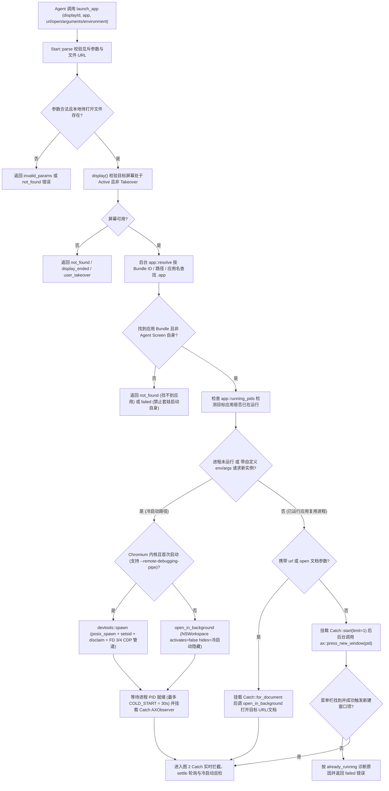
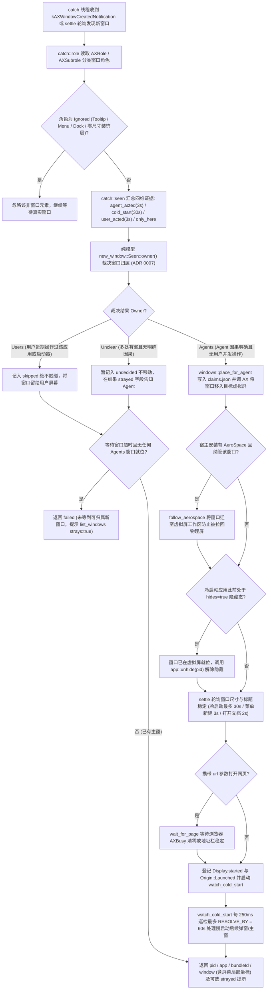

# 03. `launch_app`、新窗口捕获 (`Catch`) 与冷启动归属判定 (`ADR 0007`)

macOS 没有“将应用直接启动到指定 `CGDirectDisplayID`”的公开 API。任何新启动或新建窗口的 Cocoa / Electron 应用都会默认在主显示器或鼠标所在屏幕弹出窗口并可能抢占前台焦点。`launch_app` 通过四阶段机制在不惊扰用户的前提下完成后台启动与窗口捕获：先在专用 `CFRunLoop` 线程挂载 `AXObserver` (`Catch`)，再根据引擎类型选择 `posix_spawn` (Chromium DevTools 管道加责任免除) 或 `NSWorkspaceOpenConfiguration` (`activates = false`) 启动进程，对已运行应用通过后台 AX 触发菜单栏“新建窗口”项，最后依据 `ADR 0007` (`crates/model/src/new_window.rs`) 的三秒行动窗口与三十秒冷启动规则判定每个新窗口归属并迁入目标虚拟屏。

## 线程与队列分工

1. **GPUI 主线程 (`AsyncApp`)**：参数解析 (`Start::parse`)、会话状态登记 (`Display.started`)、发起冷启动巡检定时器 `watch_cold_start` (`apps/macos/src/control/agent.rs:5125-5926, 6500-6692`)。
2. **`catch` 专用 `CFRunLoop` 线程**：`catch::runner()` (`apps/macos/src/mac/catch.rs:300-385`) 独立运行单线程 `CFRunLoopRun()`，注册 `AXObserverCreate` 监听目标 `pid` 的 `kAXWindowCreatedNotification` 与 `kAXApplicationShownNotification`，一经触发立即判定归属并将窗口移入 Agent Display，避免主线程忙碌错过窗口首帧。
3. **GPUI `background_executor` 工作池**：执行 Bundle 解析 (`app::resolve`)、`devtools::spawn`、`NSWorkspace` 打开、`ax::press_new_window` 菜单触发、`settle` 窗口就绪轮询及网页加载等待 `wait_for_page` (`apps/macos/src/control/agent.rs:5006-6103`)。

---

## 图 1：`launch_app` 参数校验、应用解析与三类启动通道分流

### 图 1 节点明细表

| 节点 | 线程与队列 | 我方代码与常量 | macOS 组件与内部行为 | 限制与关联缺陷 | Agent 侧返回 | 用户侧表现 | 验证来源 |
| :--- | :--- | :--- | :--- | :--- | :--- | :--- | :--- |
| `L1` | `mcp` -> GPUI 主线程 | `tools::run("launch_app")` (`crates/mcp/src/tools.rs:845-875`), `agent.rs:1620-1646` | 转发 `displayId`、`app`、可选 `url`、`open`、`arguments`、`environment` | 要求辅助功能与录屏双权限已授予 | 请求进入 `L2` | 无变化 | [已验证: crates/mcp/src/tools.rs:845-875, apps/macos/src/control/agent.rs:1620-1646] |
| `L2` | GPUI 主线程 | `Start::parse` / `file_target` / `open_target` (`apps/macos/src/control/agent.rs:4966-4993, 5131-5180, 5972-5989`) | 校验 `url` 与 `open` 不可同时传入、`arguments` 为字符串数组、`environment` 为键值字符串字典；本地文件路径或 `file://` URL 检查磁盘存在性 | 拦截非法 URL scheme 或不存在的文档路径 | 进入 `L3` 判定 | 无变化 | [已验证: apps/macos/src/control/agent.rs:4966-4993, apps/macos/src/control/agent.rs:5131-5180, apps/macos/src/control/agent.rs:5972-5989] |
| `L3` | GPUI 主线程 | `Start::parse` / `file_target` 返回分支 (`apps/macos/src/control/agent.rs:5139-5168, 5980-5985`) | 判断参数类型校验与本地待打开文件路径检查是否全部通过 | 无 | 非法走 `LX1`，合法走 `L4` | 无变化 | [已验证: apps/macos/src/control/agent.rs:5139-5168, apps/macos/src/control/agent.rs:5980-5985] |
| `LX1` | GPUI 主线程 | `ControlError::invalid` / `ControlError::not_found` (`apps/macos/src/control/agent.rs:5139-5168, 5980-5985`) | 参数拒绝，不启动任何进程 | 无 | `invalid_params` (类型/互斥错误) 或 `not_found` (`<path> does not exist`) | 无变化 | [已验证: apps/macos/src/control/agent.rs:5139-5168, apps/macos/src/control/agent.rs:5980-5985] |
| `L4` | GPUI 主线程 | `input_display` / `display(&core, &p, true, cx)` (`apps/macos/src/control/agent.rs:1621, 5209, 7242-7287`) | `active = true`：检查屏幕存在、未处于 `Ended`、且未处于用户 `Takeover` | `Takeover` 期间严禁 Agent 启动新窗口干扰用户操作 | 进入 `L5` 判定 | 无变化 | [已验证: apps/macos/src/control/agent.rs:1621, apps/macos/src/control/agent.rs:7242-7287] |
| `L5` | GPUI 主线程 | `usable` 结果分支 (`apps/macos/src/control/agent.rs:2686-2713`) | 裁定目标屏幕此刻是否允许接受新应用启动 | 无 | 可用走 `L6`，不可用走 `LX2` | 无变化 | [已验证: apps/macos/src/control/agent.rs:2686-2713] |
| `LX2` | GPUI 主线程 | `usable` (`apps/macos/src/control/agent.rs:2695-2711`) | 返回对应生命周期状态码 | 无 | `not_found` / `display_ended` / `user_takeover` | 无变化 | [已验证: apps/macos/src/control/agent.rs:2695-2711] |
| `L6` | 后台执行器 | `app::resolve` (`apps/macos/src/mac/app.rs:388-431`), `agent.rs:5214-5221` | 依次通过 `NSWorkspace.URLForApplicationWithBundleIdentifier:`、直接路径匹配、`/Applications` 与 `~/Applications` 名称扫描解析 `.app` 目录 | 支持传入 `"Safari"`、`"com.apple.Safari"` 或完整路径 | 解析结果进 `L7` | 无变化 | [已验证: apps/macos/src/mac/app.rs:388-431, apps/macos/src/control/agent.rs:5214-5221] |
| `L7` | GPUI 主线程 | `launch` (`apps/macos/src/control/agent.rs:5217-5259`) | 检查 Bundle 是否存在，且 Bundle ID 不等于宿主自身 Bundle ID | 禁止在 Agent Display 中递归拉起 Agent Screen 自身 | 失败走 `LX3`，成功走 `L8` | 无变化 | [已验证: apps/macos/src/control/agent.rs:5217-5259] |
| `LX3` | GPUI 主线程 | `ControlError::not_found` / `ControlError::failed` (`apps/macos/src/control/agent.rs:5218-5221, 5253-5258`) | 报告应用未安装或禁止启动自身 | 无 | `not_found` (`application '<app>' not found`) 或 `failed` | 无变化 | [已验证: apps/macos/src/control/agent.rs:5218-5221, apps/macos/src/control/agent.rs:5253-5258] |
| `L8` | 后台执行器 | `app::running_pids` (`apps/macos/src/mac/app.rs:18-31`), `launch_now` (`apps/macos/src/control/agent.rs:5295-5315`) | 通过 `proc_listallpids` + `proc_pidpath` 枚举当前机器属于该 `.app` 的全部运行中 `pid`，并检查目标进程在用户屏是否已有窗口 | 不依赖主线程 `NSWorkspace.runningApplications` 缓存延迟 | 输出已有 `pids` 列表 | 无变化 | [已验证: apps/macos/src/mac/app.rs:18-31, apps/macos/src/control/agent.rs:5295-5315] |
| `L9` | GPUI 主线程 + 后台 | `Start::new_instance` (`apps/macos/src/control/agent.rs:5197-5201, 5355-5385`) | 若 `running_pids` 为空，或显式带 `environment` / 自定义 `arguments` 请求独立实例，走冷启动；否则走已运行进程新建窗口路径 | 已运行的单实例 Cocoa 应用（如 Safari、Finder、微信）必须走菜单/打开文档路径，否则 `open` 只会激活旧窗口 | 分流至 `L10` 或 `L14` | 无变化 | [已验证: apps/macos/src/control/agent.rs:5197-5201, apps/macos/src/control/agent.rs:5355-5385] |
| `L10` | 后台执行器 | `devtools::is_chromium` (`apps/macos/src/mac/devtools.rs:29-42`), `agent.rs:5386-5405` | 检测 Bundle 内是否含 `Electron Framework.framework` 或 Chromium Framework，决定是否注入 `--remote-debugging-pipe` | 仅对新拉起的 Chromium/Electron 实例生效；已运行且未挂管道的实例无法补挂管道 (`devtools.rs:858-872`) | 是走 `L11`，否走 `L12` | 无变化 | [已验证: apps/macos/src/mac/devtools.rs:29-42, apps/macos/src/control/agent.rs:5386-5405] |
| `L11` | 后台执行器 | `devtools::spawn` (`apps/macos/src/mac/devtools.rs:57-246`) | 调 `posix_spawn`：设 `POSIX_SPAWN_SETSID` (`0x0400`)、`responsibility_spawnattrs_setdisclaim(attr, 1)` 解除 TCC 父进程连带责任，映射匿名管道至子进程 `FD 3` (读) / `FD 4` (写) 并追加 `--remote-debugging-pipe`，启动后台读线程等待 `HELLO_WAIT = 30s` | 让后续 HTML5 拖拽与原生 `<select>` 下拉框可直接走 CDP 零焦点协议 (`ADR 0009`) | 立即拿到子进程 `pid` | 应用后台静默启动，不抢键盘焦点 | [已验证: apps/macos/src/mac/devtools.rs:57-250] |
| `L12` | 后台执行器 | `open_in_background` (`apps/macos/src/control/agent.rs:5006-5054`) | 配置 `NSWorkspaceOpenConfiguration` (`MacOSX.sdk NSWorkspace.h`)：`activates = false`、冷启动时设 `hides = true` 先隐藏启动避免主屏闪现窗口，调用 `openApplicationAtURL:configuration:completionHandler:` 或 `openURLs:withApplicationAtURL:...` | 部分第三方框架忽略 `hides = true`，靠 `L13` 的 `Catch` 毫秒级移入虚拟屏兜底 | 异步拿到 `NSRunningApplication.processIdentifier` | 不打断用户前台输入焦点 | [已验证: apps/macos/src/control/agent.rs:5006-5054, MacOSX.sdk NSWorkspace.h] |
| `L13` | 后台 + `catch` 线程 | `catch::agent_acted_for(..., COLD_START)` (`apps/macos/src/mac/catch.rs:83-87`), `Catch::start` (`catch.rs:438-447`), `agent.rs:5475-5510` | 登记 `30s` 冷启动行动信用，若启动器中转则轮询 `running_pids` 定位真身 `pid`（失败走 `failed: <name> did not start`），在 `catch` 线程挂载 `AXObserver` | 启动器型应用（先启 launcher 再拉主进程）通过 `app::is_launcher` 追踪子进程 (`app.rs:319-329`) | 进入 `L18` | 隐藏态应用在首窗迁入虚拟屏后再 `unhide` | [已验证: apps/macos/src/mac/catch.rs:83-87, apps/macos/src/mac/catch.rs:438-447, apps/macos/src/control/agent.rs:5475-5510] |
| `L14` | GPUI 主线程 | `launch_now` (`apps/macos/src/control/agent.rs:5540-5725`) | 已运行应用分支：检查本次调用是否指定了待打开的 `url` 或本地文件 `open` | 区分打开指定资源与纯粹新建空白窗口 | 有资源走 `L15`，无资源走 `L16` | 无变化 | [已验证: apps/macos/src/control/agent.rs:5540-5725] |
| `L15` | 后台 + `catch` 线程 | `Catch::for_document` (`apps/macos/src/mac/catch.rs:455-462`), `open_in_background` (`agent.rs:5710-5765`) | 登记 `ACTION_WINDOW = 3s` 行动窗口，启动按文档路径匹配的 `Catch`，调用 `NSWorkspace` 后台向该应用发送打开文档/URL 事件；若文档已在某窗口打开则检查归属 (`shows_document`, `agent.rs:5991-5998`) | 若该文档早已在用户自己的屏幕上打开，绝不抢夺用户窗口，返回 `failed` 说明文档已在用户窗口打开 (`agent.rs:5770-5785`) | 进入 `L18` 等待新窗口 | 用户已有窗口保持不动 | [已验证: apps/macos/src/mac/catch.rs:455-462, apps/macos/src/control/agent.rs:5710-5785] |
| `L16` | 后台执行器 | `Catch::start(pid, id, screen, Some(1))` + `ax::press_new_window` (`apps/macos/src/mac/ax.rs:2193-2275`, `agent.rs:5580-5635`) | 读取目标 `pid` 的 `kAXMenuBarAttribute`（超时 `MENU_TIMEOUT = 1.5s`），在“文件/File/Shell”菜单中用 `pick_new_window` 匹配“新建窗口 / New Window”菜单项并执行 `AXUIElementPerformAction(kAXPressAction)`；若首次无窗口则在 `RUNNING_APP_TURN = 4000ms` 内重试一次 | 全程后台 AX 触发菜单动作，不激活应用、不弹菜单 UI (`ADR 0001`) | 结果进 `L17` | 用户屏幕不闪现菜单 | [已验证: apps/macos/src/mac/ax.rs:2193-2275, apps/macos/src/control/agent.rs:5111, apps/macos/src/control/agent.rs:5580-5635] |
| `L17` | 后台执行器 | `NewWindow` 枚举判定 (`apps/macos/src/control/agent.rs:5590-5660`) | 检查 `press_new_window` 返回值（已按下、无菜单项、菜单项禁用、或被模态对话框阻塞） | 单窗口工具（如系统设置、计算器）无“新建窗口”项 | 失败走 `LX4`，成功走 `L18` | 无变化 | [已验证: apps/macos/src/control/agent.rs:5590-5660] |
| `LX4` | GPUI 主线程 | `already_running` (`apps/macos/src/control/agent.rs:5928-5970`) | 检查应用在用户屏还是其它会话屏已有窗口，生成精确指引（例如建议调用 `place_window` 借用已有窗口，或说明菜单被模态框禁用） | 遵守不抢夺用户正在使用之单实例窗口的约束 | 错误码 `failed`（附带具体原因与下一步 `place_window` 指引） | 用户窗口不受影响 | [已验证: apps/macos/src/control/agent.rs:5928-5970] |
| `L18` | 协同进入图 2 | `settle` + `watch_cold_start` (`apps/macos/src/control/agent.rs:5810-5900, 6016-6103, 6500-6692`) | 等待新窗口出现、归属裁决与迁入稳定 | 转入图 2 详述 | 转入图 2 | 转入图 2 | [已验证: apps/macos/src/control/agent.rs:6016-6103, apps/macos/src/control/agent.rs:6500-6692] |

---

## 图 2：`Catch` 实时拦截、`ADR 0007` 归属裁决与 `watch_cold_start` 60 秒巡检子流程

### 图 2 节点明细表

| 节点 | 线程与队列 | 我方代码与常量 | macOS 组件与内部行为 | 限制与关联缺陷 | Agent 侧返回 | 用户侧表现 | 验证来源 |
| :--- | :--- | :--- | :--- | :--- | :--- | :--- | :--- |
| `W1` | `catch` `CFRunLoop` 线程 + 后台执行器 | `Catch` 回调 (`apps/macos/src/mac/catch.rs:560-665`), `settle` (`apps/macos/src/control/agent.rs:6016-6103`) | 双路发现：`AXObserver` 实时推送 `kAXWindowCreatedNotification`，同时 `settle` 轮询 `CGWindowList` 与 AX 窗口表弥补部分应用漏发 AX 通知 | Electron / Qt 启动首窗有时晚发 AX 通知，双路互补确保不漏窗 | 发现候选 `(pid, window_id)` | 无变化 | [已验证: apps/macos/src/mac/catch.rs:560-665, apps/macos/src/control/agent.rs:6016-6103] |
| `W2` | `catch` 线程 / 后台线程 | `catch::role` (`apps/macos/src/mac/catch.rs:257-269`), `new_window::role` (`crates/model/src/new_window.rs:118-156`) | 读取 `kAXRoleAttribute`、`kAXSubroleAttribute` 与窗口层级，归类为 `Standard`、`Dialog`、`Ignored` 或 `Unreadable`（AX 超时未答） | AX 无响应窗口归为 `Unreadable`，在 `watch_cold_start` 等待至最多 `60s` (`new_window.rs:449-478`) | 分类结果进 `W3` | 无变化 | [已验证: apps/macos/src/mac/catch.rs:257-269, crates/model/src/new_window.rs:118-156] |
| `W3` | `catch` 线程 | `new_window::watch` (`crates/model/src/new_window.rs:158-176`) | 过滤菜单浮层、工具提示、输入法候选框等非独立窗口 | 防止把弹出菜单当成应用主窗口搬走 | `Ignored` 走 `WX1`，其余走 `W4` | 无变化 | [已验证: crates/model/src/new_window.rs:158-176] |
| `WX1` | `catch` 线程 | `Catch` 循环忽略分支 | 跳过当前元素，保持 `Catch` 计数额度 `limit` 不减 | 无 | 继续等待 | 无变化 | [已验证: crates/model/src/new_window.rs:158-176, apps/macos/src/mac/catch.rs:585-605] |
| `W4` | `catch` 线程 | `catch::seen` (`apps/macos/src/mac/catch.rs:161-255`), `ACTION_WINDOW = 3s` / `COLD_START = 30s` (`crates/model/src/new_window.rs:11-20`) | 采集四项布尔事实：当前屏是否在 `3s` 内操作过该 `pid`（或处于 `30s` 冷启动期）、其它会话是否在 `3s` 内操作过、用户是否在 `3s` 内点击过该应用/Dock/Spotlight 或按过快捷键 (`user_acted_recently`)、该应用是否仅在本虚拟屏有窗口 (`only_on`) | 若用户在 Agent 启动同一应用期间恰好点了 Dock 图标，`user_acted = true` 立即终止冷启动特权 (`ends_cold_start`, `new_window.rs:69-74`) | 生成 `Seen` 快照 | 优先保护用户本人操作意图 | [已验证: apps/macos/src/mac/catch.rs:161-255, crates/model/src/new_window.rs:11-75] |
| `W5` | 纯模型函数 | `Seen::owner` (`crates/model/src/new_window.rs:43-67`) | 纯逻辑裁决 (`ADR 0007`)：只要 `user == true` 必判 `Owner::Users`；否则当 `(agent \|\| cold_start \|\| only_here)` 且无其它会话竞争时判 `Owner::Agents`；其余判 `Owner::Unclear` | 零 OS 调用，由单元测试穷举验证 (`new_window.rs:263-375`) | 产出 `Agents` / `Users` / `Unclear` | 无变化 | [已验证: crates/model/src/new_window.rs:43-67, ADR 0007] |
| `W6` | `catch` 线程 | `Catch` 分支派发 (`apps/macos/src/mac/catch.rs:606-660`) | 根据 `Owner` 决定拦截迁入、彻底放手还是挂起待查 | 无 | 三路分流 | 无变化 | [已验证: apps/macos/src/mac/catch.rs:606-660] |
| `WX2` | `catch` 线程 | `Catch::skipped` (`apps/macos/src/mac/catch.rs:522-525, 615`) | 记录窗口 ID 到 `skipped`，绝不移动该窗口 | 遵守核心红线：宁可让 Agent 重试也不抢走用户刚打开的窗口 | 若无其它新窗则转入 `W18` | 用户自己打开的新窗口安然留在物理屏 | [已验证: apps/macos/src/mac/catch.rs:522-525, crates/model/src/new_window.rs:263-284] |
| `W7` | `catch` 线程 + 主线程 | `Catch::undecided` (`apps/macos/src/mac/catch.rs:527-530`), `undecided_strays` / `add_strayed` (`apps/macos/src/control/agent.rs:3133-3195`) | 不主动搬动归属存疑窗口，将其记入 `Display.undecided`，在工具输出中附带 `strayed` 列表 | 让 Agent 通过 `list_windows(strays: true)` + `place_window` 走显式审批流 | 附带 `strayed` 提示 | 存疑窗口不被静默搬走 | [已验证: apps/macos/src/mac/catch.rs:527-530, apps/macos/src/control/agent.rs:3133-3195] |
| `W8` | `catch` 线程 / 后台线程 | `windows::place_for_agent` (`apps/macos/src/mac/windows.rs:621-630`), `claims::claim` (`apps/macos/src/mac/claims.rs:138-143`) | 在 `Lanes::agent_move` 保护下写 `claims.json`，计算居中/适配目标虚拟屏 `bounds` 的窗口框，调用 `ax::place_window` 设置 `kAXPositionAttribute` 与 `kAXSizeAttribute` | 全屏幕 (`AXFullScreen`) 或最小化窗口会先退出最小化或拒绝移动 | 窗口物理落入虚拟屏 | 用户桌面不残留该窗口 | [已验证: apps/macos/src/mac/windows.rs:621-630, apps/macos/src/mac/claims.rs:138-143] |
| `W9` | 后台线程 | `AeroSpace::current()` (`apps/macos/src/mac/aerospace.rs:18-26`) | 检查宿主是否存在运行中的 AeroSpace 平铺窗口管理器 | 未装 AeroSpace 或已配置 `ignored-monitors` 时更快收敛 | 是走 `W10`，否走 `W11` | 无变化 | [已验证: apps/macos/src/mac/aerospace.rs:18-26] |
| `W10` | 后台线程 | `catch::follow_aerospace` (`apps/macos/src/mac/catch.rs:695-730`) | 若 AeroSpace 把新窗口抓回物理屏工作区，调用 AeroSpace CLI 将其同步迁入目标虚拟屏对应监视器，但绝不切换用户当前焦点工作区 | 遵守测试与运行约束：绝不切用户的 AeroSpace 工作区 | 窗口稳定留在虚拟屏 | 用户当前平铺布局零跳动 | [已验证: apps/macos/src/mac/catch.rs:695-730] |
| `W11` | 后台执行器 | `app::is_hidden` (`apps/macos/src/mac/app.rs:364-368`), `agent.rs:5825-5845` | 检查 `L12` 冷启动时是否设了 `hides = true` | 必须在首窗已迁到虚拟屏坐标之后再取消隐藏，否则取消隐藏瞬间会在主屏闪一下 | 是走 `W12`，否走 `W13` | 无主屏闪烁 | [已验证: apps/macos/src/mac/app.rs:364-386, apps/macos/src/control/agent.rs:5825-5845] |
| `W12` | 后台执行器 | `app::unhide` (`apps/macos/src/mac/app.rs:380-386`) | 调用 `-[NSRunningApplication unhide]` 让已在虚拟屏上的窗口进入可渲染在屏列表 (`on_screen_windows`) | `unhide` 不等于 `activate`，不会抢占前台键盘焦点 | 窗口可在虚拟屏被截图和流捕获 | Peek 缩略图显示新应用画面 | [已验证: apps/macos/src/mac/app.rs:380-386] |
| `W13` | 后台执行器 | `settle` / `LATE_WINDOW_WAIT = 30s` / `ASKED_WINDOW_WAIT = 3000ms` / `OPENED_WINDOW_WAIT = 2000ms` (`apps/macos/src/control/agent.rs:5101-5109, 6016-6103`) | 分场景超时轮询目标窗口出现在虚拟屏并完成初始布局（含 Splash 启动屏替换为正式主窗的 `replacement` 跟踪，`agent.rs:6105-6139`） | 若期间屏幕被关闭立即返回 `ControlError::ended` (`agent.rs:6022`) | 锁定最终 `Window` 快照 | Viewer 画面呈现稳定主窗口 | [已验证: apps/macos/src/control/agent.rs:5101-5109, apps/macos/src/control/agent.rs:6016-6139] |
| `W14` | 后台执行器 | `launch_now` (`apps/macos/src/control/agent.rs:5855-5870`) | 判断本次启动是否打开了 `http://` / `https://` / `file://` 网页地址 | 仅网页加载需要额外等待 DOM 首屏就绪 | 是走 `W15`，否走 `W16` | 无变化 | [已验证: apps/macos/src/control/agent.rs:5855-5870] |
| `W15` | 后台执行器 | `wait_for_page` (`apps/macos/src/control/agent.rs:5056-5081`) | 轮询浏览器窗口内 `AXWebArea` 的 `AXLoaded` / `AXBusy` 属性，等待首屏加载完成或达到软超时 | 超时不报错，直接放行给 Agent 自行查看页面或调 `wait_for_change` | 页面初始树就绪 | Peek 中页面渲染完毕 | [已验证: apps/macos/src/control/agent.rs:5056-5081] |
| `W16` | GPUI 主线程 | `Model::note_launched` / `guard_placed` (`apps/macos/src/control/agent.rs:5875-5900, 6141-6218`) | 将 `pid` 记入 `Display.started`，将窗口记为 `Origin::Launched`，启动短暂坐标守卫防止应用启动恢复逻辑把窗口移回主屏 | 某些应用在窗口显示 200ms 后自己读上次偏好把坐标改回 `(100, 100)`，`guard_placed` 会将其拉回虚拟屏 | 归属正式确立 | 窗口稳固停留在虚拟屏 | [已验证: apps/macos/src/control/agent.rs:5875-5900, apps/macos/src/control/agent.rs:6141-6218] |
| `W17` | GPUI 主线程 + 后台 | `watch_cold_start` (`apps/macos/src/control/agent.rs:6500-6692`), `RESOLVE_BY = 60s` / `Step` (`crates/model/src/new_window.rs:22, 178-251`) | 启动后台 `250ms` 节拍器持续跟进最多 `60s`：捕获慢启动应用稍后弹出的登录窗/更新窗，按 `retries_catch` 退避重试未答 AX 窗口；若用户中途介入该应用则立即停止自动收编 | 满 `60s` 仍无法读取 AX 的窗口记入 `undecided` 供 Agent 查看而非盲目移动 (`new_window.rs:466-478`) | 后台异步延续，不阻塞本次返回 | 后续慢弹窗也不会跳到用户脸上 | [已验证: apps/macos/src/control/agent.rs:6500-6692, crates/model/src/new_window.rs:22, crates/model/src/new_window.rs:178-251] |
| `R1` | 宿主 -> `mcp` 进程 | `launch_output` (`crates/mcp/src/tools.rs:860-874, 2203-2245`) | 输出 JSON：`pid`、`app`、`bundleId`、`window`（转换到截图局部像素系 `in_shot`），若存在 `undecided` 窗口则附加 `strayed` 说明 | 坐标已按截图缩放比例对齐，Agent 可直接用于下一步 `computer` 点击 | 返回完整启动结果 JSON | Peek 显示应用名称与实时缩略图 | [已验证: crates/mcp/src/tools.rs:860-874, crates/mcp/src/tools.rs:2203-2245] |
| `W18` | 后台执行器 | `settle` 超时出口 (`apps/macos/src/control/agent.rs:6085-6102`) | 检查超时时刻是否一个归属窗口都没拿到 | 无窗口应用（菜单栏常驻工具）或窗口被判给用户时触发 | 超时无窗走 `WX3` | 无变化 | [已验证: apps/macos/src/control/agent.rs:6085-6102] |
| `WX3` | GPUI 主线程 | `ControlError::failed` (`apps/macos/src/control/agent.rs:5904-5924, 6092-6102`) | 区分进程已退出、仅有存疑窗口 (`strays`)、或纯菜单栏无窗口应用，给出针对性错误文本 | 不盲目抓取物理屏同名应用窗口 | 错误码 `failed`：`launched <name> (pid P), but no window appeared within Ns...` | 无变化 | [已验证: apps/macos/src/control/agent.rs:5904-5924, apps/macos/src/control/agent.rs:6092-6102] |

---

## 关键时间常数汇总

| 常量 | 数值 | 定义位置 | 作用说明 | 验证来源 |
| :--- | :--- | :--- | :--- | :--- |
| `ACTION_WINDOW` | `3 s` | `crates/model/src/new_window.rs:11` | Agent 动作与用户动作的短期因果归属窗口 | [已验证: crates/model/src/new_window.rs:11] |
| `COLD_START` / `LATE_WINDOW_WAIT` | `30 s` | `crates/model/src/new_window.rs:17`, `agent.rs:5101` | 全新冷启动进程等待首窗出现及归属有效期的上限 | [已验证: crates/model/src/new_window.rs:17, apps/macos/src/control/agent.rs:5101] |
| `RESOLVE_BY` | `60 s` | `crates/model/src/new_window.rs:22` | `watch_cold_start` 跟踪慢启动后续窗口与重试无响应 AX 窗口的总上限 | [已验证: crates/model/src/new_window.rs:22] |
| `RUNNING_APP_TURN` | `4000 ms` | `apps/macos/src/control/agent.rs:5111` | 已运行应用触发菜单新建窗口并等待响应的单轮上限 | [已验证: apps/macos/src/control/agent.rs:5111] |
| `ASKED_WINDOW_WAIT` | `3000 ms` | `apps/macos/src/control/agent.rs:5105` | 按下“新建窗口”菜单项后等待新窗落地的轮询时长 | [已验证: apps/macos/src/control/agent.rs:5105] |
| `OPENED_WINDOW_WAIT` | `2000 ms` | `apps/macos/src/control/agent.rs:5108` | 向已运行应用发送打开文档/URL 事件后的等待窗口时长 | [已验证: apps/macos/src/control/agent.rs:5108] |
| `HELLO_WAIT` | `30 s` | `apps/macos/src/mac/devtools.rs:248` | Chromium `--remote-debugging-pipe` 管道握手最大等待时间 | [已验证: apps/macos/src/mac/devtools.rs:248] |
