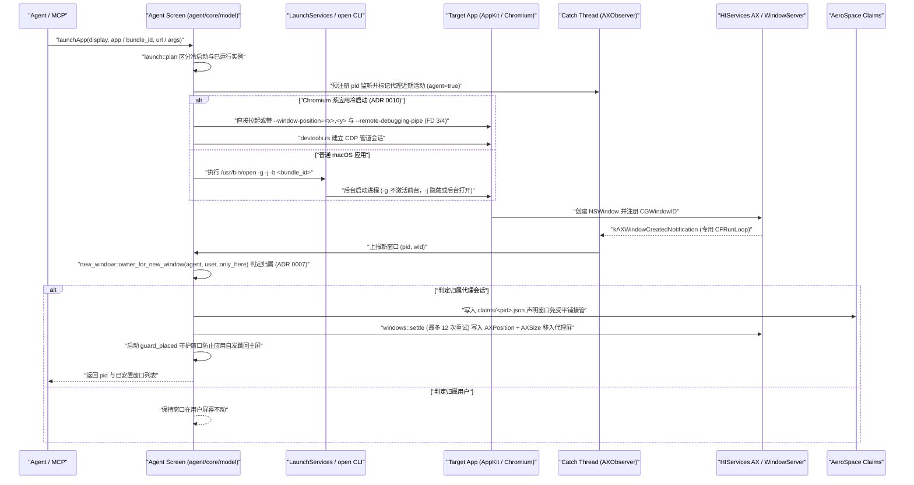

# 操作 03：launch_app 与新窗口归属规则（ADR 0007）

`launch_app` 在不抢占用户前台焦点与光标的前提下启动或复用目标应用，通过专用 `CFRunLoop` 线程上的 `AXObserver` 捕获新建窗口，按 ADR 0007 三元组规则判定窗口归属，并将其安置与守护在代理显示器上。

## 端到端流程

## 节点明细表

| 节点 | 我方代码 | macOS 组件与内部行为 | 限制与故障模式 | 关联问题 | 验证状态 |
| --- | --- | --- | --- | --- | --- |
| 1. 启动规划与已运行检测 | `crates/mcp/src/tools.rs:1544-1608`、`crates/model/src/launch.rs:15-110`、`apps/macos/src/mac/app.rs:45-120` | 通过 `NSWorkspace.runningApplications` 查询 `bundleIdentifier` 或应用名，区分冷启动与已运行进程（用户可能已在主屏打开同一应用）。 | 单实例应用（如 Safari、Finder、预览、多数 Electron 应用）已运行时，二次启动不会产生新 PID，新建窗口与用户窗口共享同一进程与焦点域。 | `#110`、`#189` | `[已验证]` `crates/model/src/launch.rs:15-110`、`apps/macos/src/mac/app.rs:45-120` |
| 2. 后台启动进程（`open -g -j`） | `apps/macos/src/mac/app.rs:122-215` | 调用 `/usr/bin/open -g -j` 通过 `LaunchServices` 启动目标应用：`-g`（`kLSLaunchDontSwitch`）请求不切换前台应用，`-j` 请求后台隐藏启动。 | **macOS 限制**：`-g` 仅约束 `LaunchServices` 本身不切前台；部分应用在 `applicationDidFinishLaunching:` 或处理打开 URL 时内部主动调用 `-[NSApplication activateIgnoringOtherApps:YES]`，仍会短暂抢走用户前台焦点。 | 后台自激活抢焦点 | `[已验证]` `apps/macos/src/mac/app.rs:122-215` |
| 3. Chromium 初始定位与 CDP 管道（ADR 0010） | `apps/macos/src/mac/app.rs:170-260`、`apps/macos/src/mac/devtools.rs:60-195` | 冷启动受支持的 Chromium 浏览器时传入 `--window-position=<x>,<y>` 使首窗直接落在代理屏，并挂载 `--remote-debugging-pipe`（FD 3/4）供后续网页拖拽（`Input.setInterceptDrags`）使用。 | 仅对由 Agent Screen 冷启动的 Chromium 实例生效；若浏览器已由用户提前启动，无法事后注入 FD 3/4 调试管道，网页 HTML5 拖拽将退回真实输入队列。 | `#37`、`#206` | `[已验证]` `docs/adr/0010-chromium-devtools-pipe.md`、`apps/macos/src/mac/devtools.rs:60-195` |
| 4. `Catch` 线程与 `AXObserver` 新窗监听 | `apps/macos/src/mac/catch.rs:35-230` | 独立线程运行专属 `CFRunLoop`，对目标 `pid` 调用 `AXObserverCreate` 并注册 `kAXWindowCreatedNotification` 与 `kAXFocusedWindowChangedNotification`，通过 `_AXUIElementGetWindow` 提取 `CGWindowID`。 | 1. 进程刚拉起尚未完成 AppKit 初始化时 `AXObserverAddNotification` 可能返回 `kAXErrorCannotComplete (-25204)`，需轮询重试挂载；2. 某些延迟初始化的辅助面板不发标准 `kAXWindowCreatedNotification`，需靠窗口列表轮询兜底。 | 新窗漏捕竞态 | `[已验证]` `apps/macos/src/mac/catch.rs:35-230`、`AXError.h:49` |
| 5. ADR 0007 新窗口归属三元组判定 | `crates/model/src/new_window.rs:18-125`、`docs/adr/0007-new-window-ownership.md` | 纯模型函数根据 `(agent, user, only_here)` 三项布尔事实判定新窗归属：`agent` 为该会话近期是否向该 PID 发起启动或输入，`user` 为用户近期是否在该应用上有真实交互，`only_here` 为该应用窗口是否仅存在于代理屏。仅当证据明确指向代理侧（例如 `(true, false, _)` 或 `(_, false, true)`）时归入代理会话；用户与代理同时活跃 `(true, true, false)` 时保守留给用户。 | 若用户在代理调用 `launch_app` 或点击链接打开弹窗的同一秒恰好点击了同一应用的用户窗口，`user == true` 会使新弹窗留在用户桌面，代理侧等不到预期弹窗。 | `#110`、ADR 0007 边界竞态 | `[已验证]` `crates/model/src/new_window.rs:18-125`、`docs/adr/0007-new-window-ownership.md` |
| 6. AeroSpace 窗口声明写入 | `apps/macos/src/mac/claims.rs:20-95`、`apps/macos/src/mac/aerospace.rs:25-120` | 将归属代理的 `CGWindowID` 写入 `~/Library/Application Support/AeroSpace/claims/<pid>.json`，通知定制版或协作态 AeroSpace 忽略该窗口的平铺抓取。 | 若写入晚于 AeroSpace 的新窗扫描周期，AeroSpace 可能先一步将新窗拉回用户工作区并改写尺寸，随后与 `settle` 产生一次可见往返拉扯。 | AeroSpace 新窗竞争 | `[已验证]` `apps/macos/src/mac/claims.rs:20-95` |
| 7. `settle` 搬移与 `guard_placed` 位置守护 | `apps/macos/src/mac/windows.rs:180-340`、`crates/model/src/held.rs:15-130` | `settle` 在最多 12 次循环中交替写入 `AXPosition` 与 `AXSize` 并核对 `CGWindowListCopyWindowInfo` 实际几何，处理 AppKit 新窗恢复旧尺寸或屏幕夹紧逻辑；随后 `guard_placed` 监控窗口是否被应用私自移回用户屏并予以拉回（用户正在 Viewer 中主动拖拽该窗时由 `ViewerDragGuard` 暂停守护）。 | 1. 窗口最小化尺寸大于代理屏尺寸时 `AXSize` 被目标应用夹紧；2. 应用在首帧动画期间多次覆盖 `setFrame:`，若超过 12 次重试窗口可能停在半途或旧屏边缘。 | `#205`、Viewer 拖拽守卫交互 | `[已验证]` `apps/macos/src/mac/windows.rs:180-340`、`apps/macos/src/mac/viewer_input.rs:1510-1565` |
