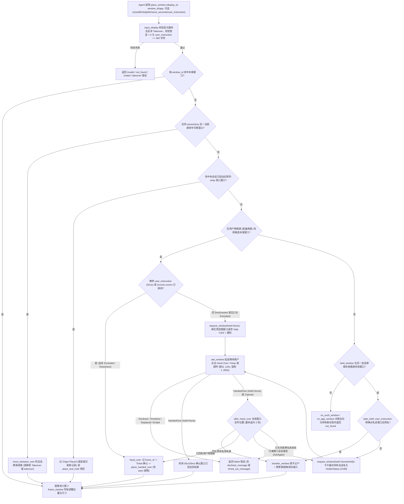
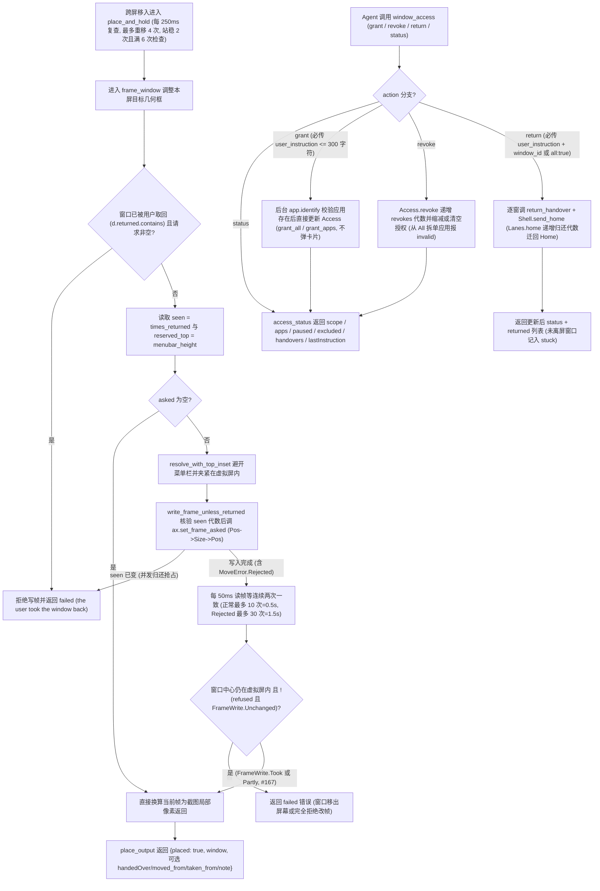

# 04. `place_window`、`window_access` 与跨屏窗口移交 (`Handover`) 流水线

当 Agent 需要操作用户物理屏上已有的窗口、调整虚拟屏内窗口尺寸、在同会话多台显示器之间调拨窗口、跨会话申请移交窗口，或在用户指令下批量开关窗口授权 (`Window Access`) 与提前归还借出窗口时，统一通过 `place_window` 与 `window_access` 完成 (`ADR 0004`, `ADR 0013`, `ADR 0016`, `ADR 0017`)。系统区分五类来源：本屏已有窗口（直接写帧）、同会话兄弟屏窗口（`move_between_own` 免审批调拨）、本会话冷启动遗留 `stray` 窗口（免弹窗领回）、用户物理屏窗口（凭 `user_instruction` 或 `Access` 授权直接迁入，否则弹出无预览图的窗口请求 Help Card 等待默认 `120s`）、以及另一会话或待查看显示器持有的窗口（`take_held` 凭点名该应用的 `user_instruction` 过户，或弹出标明原持有会话及活跃度 `HolderStatus` 的卡片请求移交，解决 `#189` 盲等困局）。

## 线程与队列分工

1. **GPUI 主线程 (`Core` / `Shell`)**：核查会话归属与 `Access` 范围 (`Scope::All` / `Scope::Apps`)、签发 `hand_over` 票据 (`Ticket`)、挂起窗口请求 (`Ask::Window`)、驱动 Help Card 与系统通知、维护跨会话过户账本 (`Displays::transfer` / `undo_transfer`) (`apps/macos/src/control/agent.rs:1081-1325, 3384-4560`)。
2. **后台执行器 (`background_executor`)**：枚举窗口列表、采集归还坐标 `dismissal::home_of`、在 `windows::Lanes` 每窗口互斥通道内通过 `ax::set_frame_asked` 或 `windows::place_handed_over` 写坐标与尺寸，并调用 `aerospace move-node-to-workspace` 同步工作区 (`apps/macos/src/mac/windows.rs:579-640`, `ax.rs:1562-1591`, `aerospace.rs:28-44`)。

---

## 图 1：`place_window` 目标定位、五类来源分流与借窗/跨会话过户审批

### 图 1 节点明细表

| 节点 | 线程与队列 | 我方代码与常量 | macOS 组件与内部行为 | 限制与关联缺陷 | Agent 侧返回 | 用户侧表现 | 验证证据 |
| :--- | :--- | :--- | :--- | :--- | :--- | :--- | :--- |
| `P1` | `mcp` -> GPUI 主线程 | `tools::run("place_window")` (`crates/mcp/src/tools.rs:991-1019`), `agent.rs:1081-1096, 1181-1186` | 转发 `displayId`、`windowId`、`app`、`x, y, width, height`、`timeoutSeconds` 与可选 `userInstruction`（无 `reason` 参数） | 宽高在 `mcp` 与宿主双侧校验必须 `> 0.0` | 进入 `P2` | 无变化 | 已验证：`crates/mcp/src/tools.rs:1003-1012` `let mut params = json!({ "displayId": ..., "windowId": ..., "app": ..., "timeoutSeconds": ..., "userInstruction": ... });` |
| `P2` | GPUI 主线程 | `input_display` (`apps/macos/src/control/agent.rs:1082`), `access::user_instruction` (`crates/model/src/access.rs:14, 18-29`) | 校验显示器存活且非 `Takeover`；校验 `windowId` 与 `app` 至少传一；若传 `user_instruction` 校验非空且字符数 `<= INSTRUCTION_CHARS` (`300`) | 超长对话粘贴被拒绝，只接受精简用户原话 | 失败走 `PX1`，通过走 `P3` | 无变化 | 已验证：`crates/model/src/access.rs:14,23` `pub const INSTRUCTION_CHARS: usize = 300;` / `if text.chars().count() > INSTRUCTION_CHARS`；`agent.rs:1085-1086` `if wanted.is_none() && app.is_none() { return Err(ControlError::invalid("window_id or app is required")); }` |
| `PX1` | GPUI 主线程 | `ControlError` (`apps/macos/src/control/server.rs:28-51`) | 参数或状态拒绝 | 无 | 错误码 `invalid`、`not_found`、`ended` 或 `takeover` | 无变化 | 已验证：`apps/macos/src/control/agent.rs:1094-1095` `if asked.width.is_some_and(\|w\| w <= 0.0) \|\| asked.height.is_some_and(\|h\| h <= 0.0) { return Err(ControlError::invalid("width and height must be above 0")); }` |
| `P3` | 后台执行器 | `windows::on_display(id)` (`apps/macos/src/control/agent.rs:1098-1108`) | 若指定了 `windowId` 且该窗口当前已在本显示器上，直接转去调整几何框 | 按应用名调用时若本屏已有该应用窗口，也在 `1143-1149` 跳过兄弟屏查找留待后续处理 | 命中走 `P7`，否则走 `P4` | 无变化 | 已验证：`apps/macos/src/control/agent.rs:1098-1106` `if let Some(wanted) = wanted { ... if let Some(window) = here { return frame_window(&core, id, window.target, asked, cx).await; } }` |
| `P4` | 后台执行器 + 主线程 | `Displays::of_session` / `first_movable` (`apps/macos/src/control/agent.rs:1126-1180`) | 在同一 `sessionKey` 的其它活跃显示器上检索匹配窗口；按应用名查找时自动跳过用户刚取回、用户自建或正处于 `Takeover` 屏幕上的窗口 (`ADR 0016`) | 同会话多屏协作免打扰用户 | 命中走 `P8`，未命中走 `P5` | 无变化 | 已验证：`apps/macos/src/control/agent.rs:1174-1178` `c.displays.first_movable(id, &found) ... if let Some((from, target)) = pick { return move_between_own(&core, from, id, target, asked, cx).await; }` |
| `P8` | 后台执行器 + 主线程 | `move_between_own` (`apps/macos/src/control/agent.rs:4521-4559`) | 若源屏处于 `Takeover` 返回错误码 `takeover`；否则调用 `Displays::move_between` 保留原 `Record`（借出窗仍保持 `HandedOver` 与原 `Home`），执行 `place_and_hold`（失败调 `undo_move` 回滚），并在响应写入 `"movedFrom": from` | 终端结束时借出窗仍归还用户原物理屏 `Home` | 转入 `P7` | 窗口在同会话两屏间转移 | 已验证：`apps/macos/src/control/agent.rs:4538,4543,4557` `c.displays.move_between(from, to, target, true)` / `c.displays.undo_move(moved);` / `reply.insert("movedFrom".into(), json!(from));` |
| `P5` | 后台执行器 + 主线程 | `strays` (`apps/macos/src/control/agent.rs:1189-1193`) | 查找本会话启动进程 (`Display.started`) 遗留在用户物理屏上的孤儿/游离窗口 | 重启认领或归属未决窗口由此免审批收回 | 命中走 `P9`，未命中走 `P6` | 无变化 | 已验证：`apps/macos/src/control/agent.rs:1189-1192` `let stray = strays(&core, id, cx).await.into_iter().find(\|w\| is_named(w, wanted, matcher.as_ref(), &mut ids));` |
| `P9` | 后台执行器 + 主线程 | `placeWindow` 孤儿分支 (`apps/macos/src/control/agent.rs:1293-1340`) | 若同会话另一屏曾记录该窗口则调 `move_between` 继承记录，否则记 `Origin::Placed` 并调 `place_and_hold` 移入虚拟屏 | 移入失败保留 `stray` 状态供重试 | 转入 `P7` | 游离窗口迁入虚拟屏 | 已验证：`apps/macos/src/control/agent.rs:1320,1324` `claim(&core, id, window.target, Origin::Placed, cx);` / `if let Err(e) = place_and_hold(window.target, id, cx).await` |
| `P6` | 后台执行器 | 候选窗口枚举 (`apps/macos/src/control/agent.rs:1197-1217`) | 枚举全系统 `layer == 0` 且位于用户物理屏（`accepts_window_request()`）或误落在备用屏 (`spares`) 上的匹配窗口及各自 Bundle ID | 排除菜单、高浮层及 Agent Screen 自身窗口 | 非空走 `P10`，为空走 `P13` | 无变化 | 已验证：`apps/macos/src/control/agent.rs:1204-1207` `if w.layer == 0 && (windows::display_role(&w).accepts_window_request() \|\| windows::on_any(&w.bounds, &spares)) && is_named(...)` |
| `P10` | GPUI 主线程 | `Displays::may_hand_over` (`apps/macos/src/control/agent.rs:1252-1287`), `Access::covers` (`crates/model/src/access.rs:78-92, 192-198`) | 若携带 `user_instruction` 则构造 `Authority::Once`（单次口令授权），否则构造 `Authority::Grant { bundle_id }` 核查会话 `Access`；若该窗口实为另一会话在用户屏登记的 `stray` (`Refusal::Elsewhere`) 则转交 `take_held` | 用户曾手动取回的窗口记入 `Access.excluded`，普通 `Grant` 不再覆盖，须传 `user_instruction` 或重新点卡片 (`access.rs:85-87, 128-130`) | 允许走 `P11`，未授权且无口令走 `P12`，`Elsewhere` 转 `P14` | 无变化 | 已验证：`apps/macos/src/control/agent.rs:1252-1263` `let authority = match &words { Some(_) => Authority::Once, None => Authority::Grant { bundle_id }, }; ... Ok(()) => hand_over(&core, id, theirs, authority, words, cx).await?, ... Err(Refusal::NotGranted \| Refusal::Excluded) if words.is_none() => { request_window(&core, id, theirs, None, timeout, cx).await? }` |
| `P11` | 后台执行器 + 主线程 | `hand_over` (`apps/macos/src/control/agent.rs:3972-4064`), `dismissal::home_of` (`apps/macos/src/dismissal.rs:245-250`) | 后台调 `home_of` 记录用户屏原始 `Home { frame, workspace }`，主线程签发 `Ticket` (`displays.hand_over`) 并二次调用 `confirm_hand_over` 防并发撤销/接管，读取 `seen = windows::times_returned` 后后台调 `windows::place_handed_over` 迁入虚拟屏，最后 `commit_hand_over` 记为 `Origin::HandedOver` 并清除 `returning` 拦截 | 若迁入途中用户取回窗口，`commit_hand_over` 返回 `false` 并报错 (`agent.rs:4054-4058`) | 附带 `"handedOver": true` 转入 `P7` | 授权窗口迁入虚拟屏 | 已验证：`apps/macos/src/dismissal.rs:245-249` `pub fn home_of(target: WindowTarget, frame: Option<Rect>) -> Option<Home> { ... Some(Home { frame, workspace }) }`；`apps/macos/src/control/agent.rs:4013` `let seen = windows::times_returned(target.window_id);`；`apps/macos/src/control/agent.rs:4030` `windows::place_handed_over(target, id, screen.as_deref(), seen)` |
| `P12` | GPUI 主线程 | `request_window(..., None, ...)` / `ask_window` (`apps/macos/src/control/agent.rs:3564-3593, 3706-3727`), `help_card.rs:50-51` | 调用 `c.displays.request_window(id, named, None)` 挂起 `Ask::Window`，`cx.notify()` 驱动 `Shell` 弹出高度固定的无预览图窗口请求 Help Card (`REQUEST_HEIGHT`) 并发送系统通知 (`Note::Window`) | 窗口请求卡片**不含截图预览** (`help_card.rs:50`) | 进入 `P16` 等待 | 菜单栏下方弹出双语借窗卡片（Hand Over / Keep） | 已验证：`apps/macos/src/ui/help_card.rs:50-51` `/// The card's height for a Window Request, which has no picture.` ... `pub const REQUEST_HEIGHT: f32 =`；`apps/macos/src/control/agent.rs:3723` `let asked = c.displays.request_window(id, named, held.clone());` |
| `P13` | 后台执行器 + 主线程 | `held_window` (`apps/macos/src/control/agent.rs:1220-1224, 3810-3854`), `Held` (`crates/model/src/held.rs:19-54`) | 扫描所有其它会话活跃显示器 (`Place::Display`) 与已结束待查看显示器 (`Place::Review`) 上的匹配窗口，连同 `HolderStatus`（会话键、空闲/在途调用/断线秒数）构造 `Held` | 待查看显示器上的窗口同样返回 `Some(Held { place: Place::Review, ... })`，绝不当作无主物理屏窗口处理 | 命中走 `P14`，未命中走 `PX2` | 无变化 | 已验证：`crates/model/src/held.rs:46-54` `pub enum Place { ... Display, ... Review, ... UserScreen, }`；`apps/macos/src/control/agent.rs:3850` `let held = c.displays.held_by_at(id, w.target, Some(on), now_ms)?;` |
| `PX2` | 后台执行器 | `no_such_window` / `no_app_window` (`apps/macos/src/control/agent.rs:1225-1235, 3436-3558`) | 区分窗口不存在 (`Gone`)、最小化或其它桌面空间 (`OffScreen`)、非文档浮层 (`NotDocument` / `OnlyPanels`)、应用未运行 (`NotRunning`) 或被其它显示器持有（附带 `HolderStatus` 摘要与跨实例 `0x5353` 序列号诊断，`#189`） | 给出精确未命中原因 | 错误码 `not_found` | 无变化 | 已验证：`apps/macos/src/control/agent.rs:3423` `"display {id} [serial {serial}, another Agent Screen instance]"`；`apps/macos/src/control/agent.rs:3482` `placement::no_window_named(`；`apps/macos/src/control/agent.rs:3553` `placement::no_app_window_named(` |
| `P14` | 后台执行器 + 主线程 | `take_held` (`apps/macos/src/control/agent.rs:3861-3908`), `held::names_window` | 检查是否传入了明确点名目标窗口应用名/Bundle ID 的 `user_instruction`（会话级 `Window Access` 绝不覆盖跨会话持有的窗口，`ADR 0017`） | 防止泛化口令静默夺走另一 Agent 正在操作的窗口 | 已点名走 `P18`，否则走 `P15` | 无变化 | 已验证：`apps/macos/src/control/agent.rs:3879-3904` `held::names_window(&text, &[&owner, &name, &bundle]) ... Some(text) if named => { ... transfer_window( ... _ => request_window(core, id, window, Some(held), timeout, cx).await?` |
| `P15` | GPUI 主线程 | `request_window(..., Some(held), ...)` (`apps/macos/src/control/agent.rs:3564-3593, 3721-3727`), `shell.rs:914-922` | 弹出带 `Held` 持有者信息的窗口请求 Help Card 与通知，明确告知用户该窗口当前在哪个会话或待查看屏上 | 解决 `#189`：用户与 Agent 均可看清占用方会话状态并决定移交或保留 | 进入 `P16` 等待 | 卡片显示当前持有会话标签并供选择移交或保留 | 已验证：`apps/macos/src/ui/shell.rs:914-921` `Some((_, Ask::Window { window, held })) => notify::update( ... Some(Note::Window { app: window.app.clone(), holder: held.as_ref().map(\|h\| (h.label.clone(), h.place)), }),` |
| `P16` | GPUI 异步挂起 | `ask_window` (`apps/macos/src/control/agent.rs:3728-3750`) | 启动超时计时器 `timeout.unwrap_or(120.0).clamp(1.0, 600.0)`（默认 `120s`，范围 `1..=600s`），通过 `futures::select!` 等待用户应答或超时 | 同屏新发起另一个窗口请求会令前一个请求收到 `Resolution::Replaced` | 按 `Resolution` 分流 | 等待用户点击卡片或通知 | 已验证：`apps/macos/src/control/agent.rs:3728,3733` `let seconds = timeout.unwrap_or(120.0).clamp(1.0, 600.0);` ... `let resolution = futures::select! {` |
| `PX3` | GPUI 主线程 | `ask_window` / `after_hand_over` (`apps/macos/src/control/agent.rs:3696-3702, 3760-3785`), `held::declined_message` / `timed_out_message` (`crates/model/src/held.rs:478-529`) | 处理用户拒绝 (`Declined`)、超时 (`TimedOut`，跨会话时附带持有者活跃度摘要 `#189`)、请求被顶替 (`Replaced`)、显示器结束 (`Ended`) 或窗口中途关闭 (`Closed`)，全部返回 `ControlError::failed` | 超时撤回卡片与通知 (`time_out_window`) | 错误码 `failed`（含具体原因与持有者状态） | 卡片与通知收起，窗口留原处 | 已验证：`apps/macos/src/control/agent.rs:3761-3781` `Err(ControlError::failed(held::declined_message(&app, held))) ... held::timed_out_message( ... "your request for the {app} window was withdrawn: the display ended"` |
| `P17` | 后台执行器 | `ask_window` (`apps/macos/src/control/agent.rs:3787-3804`) | 用户点击 Hand Over 后，`Shell::hand_over` 在后台移动窗口；此处轮询最多 `30 * 100ms` (`3s`) 确认窗口出现在目标屏上 | 若 `3s` 未到达报 `failed` | 返回 `"handedOver": true` 转入 `P7` | 用户窗口迁入虚拟屏 | 已验证：`apps/macos/src/control/agent.rs:3787-3803` `for _ in 0..30 { ... .timer(Duration::from_millis(100)).await; } Err(ControlError::failed(format!("the user handed over the {app} window, but it didn't reach the display")))` |
| `P19` | 后台执行器 + 主线程 | `after_hand_over` (`apps/macos/src/control/agent.rs:3670-3703`), `held::decide_after_hand_over` (`crates/model/src/held.rs:556-570`) | 用户同意移交瞬间由 `where_now` 复查窗口实时位置：仍原持有者持有走 `Transfer`，已退回用户屏走 `FromUser`，被第三会话抢先接走返回 `AskAgain`（外层 `request_window` 最多重问 `3` 轮，`agent.rs:3577`） | 保证用户审批的对象与实际被夺窗的会话严格一致 (`ADR 0017`) | 按实时位置分流 | 换手时重新弹出指明新持有者的卡片 | 已验证：`crates/model/src/held.rs:560-569` `match where_now { NowState::Here => HandOverAction::AlreadyHere, NowState::Held(now) if named_holder.is_some_and(\|n\| n.display == now.display) => { HandOverAction::Transfer(now) } NowState::Held(now) => HandOverAction::AskAgain(now), ... }` |
| `P18` | GPUI 主线程 + 后台 | `transfer_window` (`apps/macos/src/control/agent.rs:3914-3966`) | 调用 `c.displays.transfer(from, to, target, app)` 原子过户（若原为借出窗则保留原始用户 `Home`，并在原屏写入 `Display.given`），执行 `place_and_hold`（失败调 `undo_transfer` 回滚），完成后调用 `release_hold_on` 与 `input_queue.window_given` 停止原屏在该窗口上的拖拽和排队真实输入 | 原会话下次在原屏截图/操作时由 `add_given` 在响应 `"given"` 字段收到被转交提醒 (`agent.rs:3197-3214`) | 附带 `"takenFrom"` 转入 `P7` | 窗口从原会话屏迁入目标会话屏 | 已验证：`apps/macos/src/control/agent.rs:3926,3932,3943-3945,3961` `c.displays.transfer(from, to, target, app)` / `c.displays.undo_transfer(moved)` / `release_hold_on(from, target.window_id); ... c.input_queue.window_given(from, target.window_id)` / `("takenFrom".into(), json!(held.label))` |

---

## 图 2：`place_and_hold` 驻留守护、`Lanes` 写帧、`window_access` 口令授权与归还子流程

### 图 2 节点明细表

| 节点 | 线程与队列 | 我方代码与常量 | macOS 组件与内部行为 | 限制与关联缺陷 | Agent 侧返回 | 用户侧表现 | 验证证据 |
| :--- | :--- | :--- | :--- | :--- | :--- | :--- | :--- |
| `F0` | 后台执行器 | `place_and_hold` (`apps/macos/src/control/agent.rs:4482-4515`), `AeroSpace::move_to_monitor` (`aerospace.rs:28-44`) | 调用 `place`（写 `claims.json`、AX 移入并执行 `aerospace move-node-to-workspace --window-id <wid> <workspace>`），随后每 `250ms` 检查一次：若被应用或 AeroSpace 拉走则重移（最多 `moves == 4` 次），直至满 `checks >= 6` (`1.5s`) 且最后连续 `stayed >= 2` (`0.5s`) 稳定在屏 (`#47`) | 4 次仍被拉回物理屏则返回错误 | 成功进 `F1` | 窗口稳固停留在虚拟屏 | 已验证：`apps/macos/src/control/agent.rs:4491-4501` `while outcome.is_ok() && !(checks >= 6 && stayed >= 2) { ... .timer(Duration::from_millis(250)) .await; ... if moves == 4 { return Err(`；`apps/macos/src/mac/aerospace.rs:38` `"move-node-to-workspace"` |
| `F1` | GPUI 主线程 | `frame_window` (`apps/macos/src/control/agent.rs:4368-4392`) | 读取截图缩放比 `display_scale`、`d.returned` 集合、`seen = windows::times_returned` 与顶部菜单栏预留高度 `menubar_height(id)` | 无 | 进入 `F2` | 无变化 | 已验证：`apps/macos/src/control/agent.rs:4389-4392` `let seen = windows::times_returned(target.window_id); ... let reserved_top = crate::mac::menubar_height(id);` |
| `F2` | GPUI 主线程 | `frame_window` (`apps/macos/src/control/agent.rs:4379-4388`) | 检查目标窗口是否已被用户取回 (`d.returned.contains`) 且本次请求非空 | 禁止 Agent 追着已被用户取回物理屏的窗口改尺寸 | 已取回走 `FX1`，否则走 `F3` | 无变化 | 已验证：`apps/macos/src/control/agent.rs:4384-4387` `if taken_back && !asked.is_empty() { return Err(ControlError::failed( "the user took the window back; it stays where they put it", )); }` |
| `FX1` | GPUI 主线程 / 后台 | `frame_window` / `unless_returned_since` (`apps/macos/src/control/agent.rs:4385`, `windows.rs:597-607`) | 主线程预检或 `Lanes` 通道内发现 `state.count[window] != seen`（排队期间发生了归还），立即中止 AX 写帧 | 根治并发 `place_window` 把刚归还用户的窗口拽回虚拟屏的竞态 | 错误码 `failed` | 用户取回的窗口安然留在原位 | 已验证：`apps/macos/src/mac/windows.rs:605-607` `if self.state().count.get(&window).copied().unwrap_or(0) != seen { return Err("the user took the window back meanwhile".into()); }` |
| `F3` | 后台执行器 | `frame_window` (`apps/macos/src/control/agent.rs:4393-4398`) | 读取显示器全局 `area = cg::display_bounds(id)` 与窗口当前实时帧 `before` | 窗口已关则报 `the window closed` | 进入 `F4` | 无变化 | 已验证：`apps/macos/src/control/agent.rs:4395-4397` `let now = \|\| windows::find(target.window_id).map(\|w\| w.bounds); let closed = \|\| "the window closed".to_string(); let mut bounds = now().ok_or_else(closed)?;` |
| `F4` | 后台执行器 | `apply_frame_request` (`apps/macos/src/control/agent.rs:4349-4363`) | 检查 `asked.is_empty()`（未传任何 `x, y, width, height`） | 仅跨屏搬运不改尺寸时不触发多余 AX 写帧 | 为空走 `F9`，非空走 `F5` | 无变化 | 已验证：`apps/macos/src/control/agent.rs:4357-4359` `if asked.is_empty() { return Ok(false); }` |
| `F5` | 纯模型计算 | `FrameRequest::resolve_with_top_inset` (`apps/macos/src/control/agent.rs:4360-4362`) | 按菜单栏预留条 `reserved_top` 与虚拟屏 `area` 夹紧目标矩形，并计算布尔标记 `constrained = frame != asked.resolve(...)` | 避免窗口标题栏钻进菜单栏下方或跨出虚拟屏边缘 | 进入 `F6` | 无变化 | 已验证：`apps/macos/src/control/agent.rs:4360-4362` `let frame = asked.resolve_with_top_inset(current, area, scale, reserved_top); set(frame)?; Ok(frame != asked.resolve(current, area, scale))` |
| `F6` | 后台执行器 | `windows::write_frame_unless_returned` + `ax::set_frame_asked` (`apps/macos/src/mac/ax.rs:1562-1591`, `agent.rs:4402-4409`) | 在该窗口专属 `Lane` 内核对 `seen` 无误后，无视前一步返回码依次执行三次写入：`AXPosition -> AXSize -> AXPosition`；若任一步非 `AXError::Success` 则记 `refused = Some(frame)` 但暂不报错 (`#167`) | Chromium 等应用对有效写帧也会返回 AX 错误码，须以最终落点帧为准 (`ax.rs:1558-1561`) | 代数不符走 `FX1`，写完走 `F7` | 窗口执行移动与缩放 | 已验证：`apps/macos/src/mac/ax.rs:1570-1577` `[ write("AXPosition", at()), write( "AXSize", ... ), write("AXPosition", at()), ]` |
| `F7` | 后台执行器 | `frame_window` (`apps/macos/src/control/agent.rs:4411-4432`) | 每 `50ms` 重读窗口帧等待连续两次读数一致 (`steady`)：正常最多读 `10` 次 (`0.5s`)，若 `refused.is_some()` 最多读 `30` 次 (`1.5s`) 等待繁忙应用落地 | 适应 Electron 等异步响应尺寸变更的应用 | 进入 `F8` | 无变化 | 已验证：`apps/macos/src/control/agent.rs:4417-4420` `let reads = if refused.is_some() { 30 } else { 10 }; ... for _ in 0..reads { std::thread::sleep(Duration::from_millis(50));` |
| `F8` | 后台执行器 + 纯模型 | `placement::frame_write` (`crates/model/src/placement.rs:273-306`, `SAME_FRAME = 1.0`), `agent.rs:4433-4458` | 校验写后窗口中心仍在 `area` 内；若 `refused.is_some()`，用 `frame_write(before, frame, bounds)`（`1.0 pt` 容差）分类为 `Took`、`Partly` 或 `Unchanged`：只要发生移动或部分缩放 (`Took` / `Partly`) 即视为成功 (`#167`)，仅 `Unchanged` 判定失败 | 解决 Dia 浏览器维持最小高度返回 AX 错误但实际已完成移位缩放的误报错问题 (`placement.rs:322-326`) | 越界或未动走 `FX2`，其余走 `F9` | 无变化 | 已验证：`crates/model/src/placement.rs:273-284` `pub enum FrameWrite { ... Took, ... Partly, ... Unchanged, } ... const SAME_FRAME: f64 = 1.0;`；`apps/macos/src/control/agent.rs:4451` `if write == agent_screen_model::placement::FrameWrite::Unchanged` |
| `FX2` | 后台 -> 主线程 | `frame_window` (`apps/macos/src/control/agent.rs:4437-4441, 4451-4457`) | 报告应用在设帧后把窗口移出了虚拟屏，或彻底拒绝了帧修改并保留原坐标 | 无 | 错误码 `failed` | 无变化 | 已验证：`apps/macos/src/control/agent.rs:4438-4454` `"the app moved the window off the display after the frame was set" ... "could not set the window's frame: the app rejected the change` |
| `F9` | 后台 -> 主线程 | `frame_in_shot` (`apps/macos/src/control/agent.rs:4459-4474`) | 将最终全局点坐标转换为当前显示器截图缩放像素系下的 `{x, y, width, height}` 并附带 `frameConstrained` | 无 | 进入 `R1` | Viewer 画面呈现真实窗口帧 | 已验证：`apps/macos/src/control/agent.rs:4463-4474` `Ok(Map::from_iter([ ("frameConstrained".into(), json!(constrained)), ( "window".into(), json!({ ... }), ), ]))` |
| `R1` | 宿主 -> `mcp` 进程 | `place_output` (`crates/mcp/src/tools.rs:1313-1352`) | 组装 `{"placed": true, "window": ...}`，按需附带 `"handedOver"`、`"moved_from"`、`"taken_from"`；若任一请求维度与实际值相差 `> 1.0` 或 `frameConstrained == true`，在 `"note"` 说明应用尺寸限制或菜单栏预留条调整 | 让 Agent 直接读取真实落点坐标继续操作 | 返回放置结果 JSON | 操作完成 | 已验证：`crates/mcp/src/tools.rs:1314` `let mut out = json!({ "placed": true });`；`crates/mcp/src/tools.rs:1338,1346` `((got - wanted).abs() > 1.0) ... else if reply.get("frameConstrained") == Some(&Value::Bool(true))` |
| `A1` | `mcp` -> GPUI 主线程 | `window_access_params` (`crates/mcp/src/tools.rs:1379-1452`), `window_access` (`apps/macos/src/control/agent.rs:4143-4175`) | 支持 `"grant"`、`"revoke"`、`"return"`、`"status"` 四种动作；`needs_permissions` 豁免 `windowAccess` 权限预检 (`agent.rs:2617`)，但要求目标显示器仍存活 (`live = true`) | `"grant"` 与 `"return"` 均强制要求传入非空且 `<= 300` 字符的 `user_instruction` | 进入 `A2` 分流 | 无变化 | 已验证：`crates/mcp/src/tools.rs:1381` `.one_of("action", &["grant", "revoke", "return", "status"])?`；`crates/mcp/src/tools.rs:1416` `words.as_ref().ok_or_else(needs_words)?;` |
| `A2` | GPUI 主线程 | `window_access` (`apps/macos/src/control/agent.rs:4175-4339`) | 路由四类动作，未知动作返回错误码 `invalid` | 无 | 四路分流 | 无变化 | 已验证：`apps/macos/src/control/agent.rs:4334-4337` `other => { return Err(ControlError::invalid(format!("action must be grant, revoke, return or status, not {other}"))); }` |
| `AR1` | GPUI 主线程 -> `mcp` | `access_status` (`apps/macos/src/control/agent.rs:4113-4140, 4340-4344`), `access_output` (`tools.rs:1455-1483`) | 返回会话授权状态 `scope` (`"none"` / `"apps"` / `"all"`)、`apps`、`paused` (`d.access_paused()`)、`excluded`、`handovers`、`lastInstruction` 及 `note` | 接管期间 `paused == true`，暂停免弹窗拉窗 | 返回窗口授权状态 JSON | Viewer 展示最新授权说明 | 已验证：`apps/macos/src/control/agent.rs:4132-4139` `json!({ "scope": access.scope_name(), "apps": ... "paused": d.access_paused(), "excluded": access.excluded, "handovers": handovers, "lastInstruction": ... })` |
| `A3` | 后台执行器 + 主线程 | `window_access("grant")` (`apps/macos/src/control/agent.rs:4177-4226`) | 凭用户聊天原话 `user_instruction` 授权 (`ADR 0013`)：若传 `apps` 则后台调 `app::identify` 核验本机已安装（缺失报 `not_found`），随后主线程直接调用 `access.grant_all()` 或 `access.grant_apps(list)` 并记录 `ChatAction::Grant`（**不弹出 Help Card，也不等待审批**） | 系统信任 Agent 转述的用户原话并写入日志、录屏与 Viewer 供监督 (`access.rs:1-4`) | 转入 `AR1` 返回生效范围 | Viewer 更新授权范围展示 | 已验证：`apps/macos/src/control/agent.rs:4205-4212` `match resolved.clone() { None => access.grant_all(), Some(list) => access.grant_apps(list), } access.last = Some(Instruction { action: ChatAction::Grant, text: words.clone(), });` |
| `A4` | 后台执行器 + 主线程 | `window_access("revoke")` (`apps/macos/src/control/agent.rs:4227-4264`), `Access::revoke` (`crates/model/src/access.rs:162-190`) | 缩减指定应用或清空全部 `Access`，每次变更递增 `access.revokes` 代数使并发在途 `hand_over` 在 `confirm_hand_over` 时失效；对 `Scope::All` 单独撤销某个子应用返回错误码 `invalid` | 已在屏幕上的窗口不因 `revoke` 移动 | 转入 `AR1` | Viewer 授权状态即时收紧 | 已验证：`crates/model/src/access.rs:164-166` `if changed { self.revokes += 1; }`；`crates/model/src/access.rs:176-178` `Some(Scope::All) => Err( "window access covers all apps; revoke it all, then grant the apps the user still allows"` |
| `A5` | GPUI 主线程 + 后台 | `window_access("return")` (`apps/macos/src/control/agent.rs:4265-4333`) | 凭 `user_instruction` 将指定 `windowId` 或 `all: true` 全部借出窗口逐个调 `displays.return_handover`（同时加入 `Access.excluded`）与 `shell.send_home`（经 `Lanes.home` 递增归还代数迁回原物理屏 `Home`）；非本屏借出窗且 `!all` 报 `not_found` | 单个归还若未能离开虚拟屏报 `failed`；`all: true` 时记入 `stuck` 数组 | 转入 `AR2` | 借出窗口立即回到用户原物理屏与原工作区 | 已验证：`apps/macos/src/control/agent.rs:4287,4301,4306` `let given = c.displays.return_handover(id, window);` / `Err(e) if !all => return Err(ControlError::not_found(e))` / `shell.send_home(given.target, id, Some(given), cx)` |
| `AR2` | GPUI 主线程 -> `mcp` | `window_access` (`apps/macos/src/control/agent.rs:4323-4344`), `access_output` (`crates/mcp/src/tools.rs:1455-1483`) | 输出 `status` 合并 `"returned"`（及可选 `"stuck"`）与 `note`，告知 Agent 该窗口已归还且不再受既有授权覆盖 | 若后续再次需要须用户重新许可 | 返回归还结果 JSON | Peek 不再显示已归还窗口 | 已验证：`crates/mcp/src/tools.rs:1460-1472` `"return" if stuck => Some("The windows in returned are back where they came from...")` / `"return" => Some("Those windows are back where they came from...")` |
