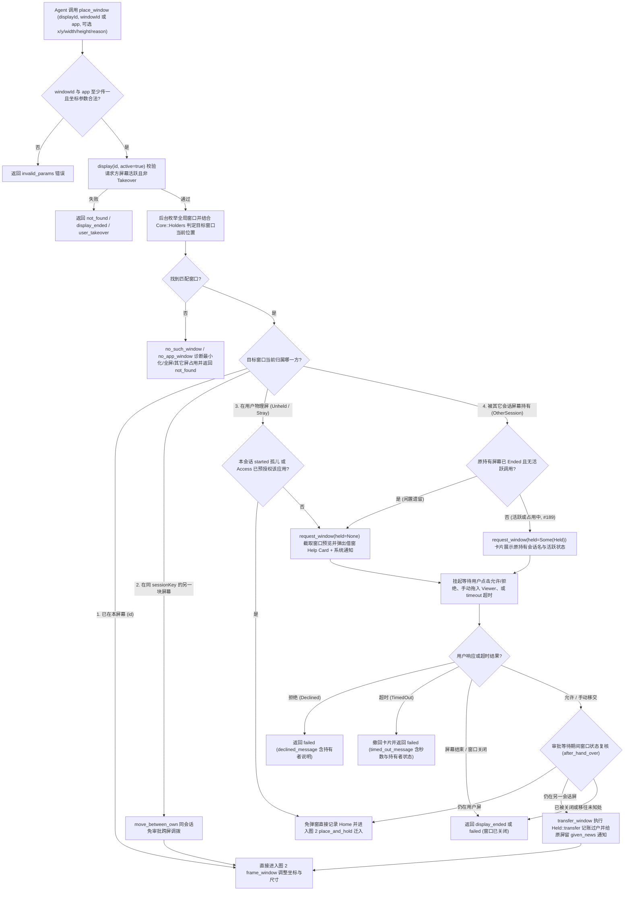
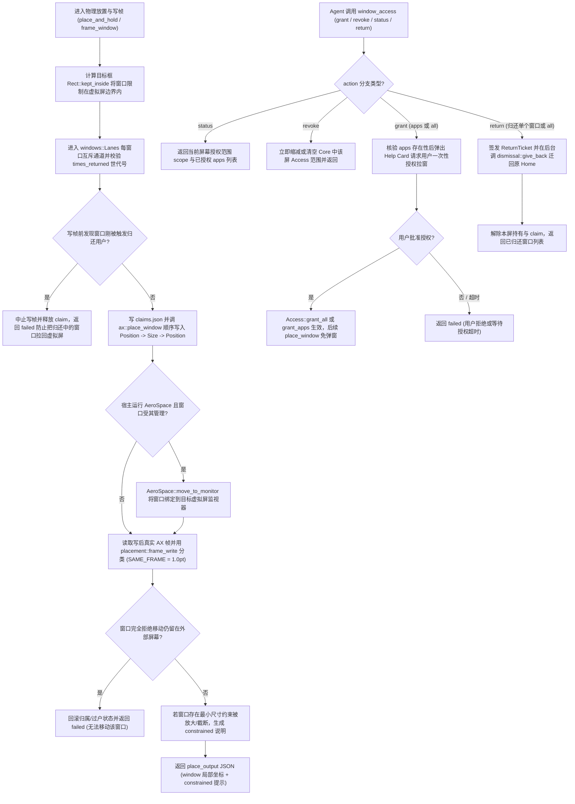

# 04. `place_window`、`window_access` 与跨屏窗口移交 (`handover`) 流水线

当 Agent 需要操作用户桌面上已有的窗口（例如已登录的浏览器或聊天软件），或需要调整窗口几何尺寸、在同会话多块屏幕间调拨窗口、乃至将借用窗口提前归还用户时，均通过 `place_window` 与 `window_access` 完成 (`ADR 0004`, `ADR 0016`, `ADR 0017`)。系统严格区分四类窗口来源：本屏已持有窗口（直接调尺寸）、同会话兄弟屏窗口（直接跨屏调拨）、用户物理屏窗口（检查 `Access` 预授权或弹出 **Help Card** 借窗审批，迁入前记录 `Home`）、以及其它 Agent 会话持有的窗口（弹出带持有者身份与活跃状态的跨会话移交卡片 `Held` / `Transfer`，修复 `#189` 盲等困局）。

## 线程与队列分工

1. **GPUI 主线程 (`Core` / `Shell`)**：查询 `Model` 与 `Holders` 归属表、核查 `Access` 授权范围 (`Scope::All` / `Scope::Apps`)、创建 `Request::TakeWindow` 审批单、弹出 Help Card 与发送 `UNUserNotificationCenter` 系统通知、维护 `Held::transfer` 跨会话过户账本 (`apps/macos/src/control/agent.rs:3384-4560`)。
2. **GPUI `background_executor` 工作池**：通过 `CGWindowListCopyWindowInfo` + AX 枚举全局窗口、拍摄待借窗口预览图供审批卡片展示、在 `windows::Lanes` 每窗口串行通道内调用 `AXUIElementSetAttributeValue` 移动/缩放窗口并联动 AeroSpace (`apps/macos/src/mac/windows.rs:516-680`)。

---

## 图 1：`place_window` 目标定位、来源分流与借用/跨会话移交审批总览

### 图 1 节点明细表

| 节点 | 线程与队列 | 我方代码与常量 | macOS 组件与内部行为 | 限制与关联缺陷 | Agent 侧返回 | 用户侧表现 | 验证来源 |
| :--- | :--- | :--- | :--- | :--- | :--- | :--- | :--- |
| `P1` | `mcp` -> GPUI 主线程 | `tools::run("place_window")` (`crates/mcp/src/tools.rs:942-995`), `agent.rs:1081-1108` | 接收 `displayId`、二选一或同时指定的 `windowId` / `app`、可选几何框 `x, y, width, height`、审批说明 `reason` 与 `timeout` | 坐标传入的是截图缩放系，入内核前按 `display_scale` 换算为点 (`pt`) | 进入校验 | 无变化 | [已验证: crates/mcp/src/tools.rs:942-995, apps/macos/src/control/agent.rs:1081-1108] |
| `P2` | GPUI 主线程 | `placeWindow` 参数解析 (`apps/macos/src/control/agent.rs:1083-1096`) | 校验 `windowId` / `app` 非全空，校验 `width` / `height` 若提供必须 `> 0`，校验 `watch::timeout` (`<= 120s`, 默认 `30s`) | `reason` 超过 `INSTRUCTION_CHARS = 300` 时报错 | 非法走 `PX1`，合法走 `P3` | 无变化 | [已验证: apps/macos/src/control/agent.rs:1083-1096, crates/model/src/watch.rs:13-38] |
| `PX1` | GPUI 主线程 | `ControlError::invalid` (`apps/macos/src/control/agent.rs:1086, 1095`) | 纯参数层拒绝 | 无 | 错误码 `invalid_params` | 无变化 | [已验证: apps/macos/src/control/agent.rs:1086, apps/macos/src/control/agent.rs:1095] |
| `P3` | GPUI 主线程 | `input_display(&core, &p, cx)` (`apps/macos/src/control/agent.rs:1082, 7266-7287`) | 确认目标屏幕存活且不在 `Takeover` 中 | 无 | 失败走 `PX2`，通过走 `P4` | 无变化 | [已验证: apps/macos/src/control/agent.rs:1082, apps/macos/src/control/agent.rs:7266-7287] |
| `PX2` | GPUI 主线程 | `usable` (`apps/macos/src/control/agent.rs:2695-2711`) | 返回屏幕不可用原因 | 无 | `not_found` / `display_ended` / `user_takeover` | 无变化 | [已验证: apps/macos/src/control/agent.rs:2695-2711] |
| `P4` | 后台执行器 + 主线程 | `windows::all` (`apps/macos/src/mac/windows.rs:209-238`), `Holders::of` (`apps/macos/src/control/agent.rs:3384-3434`) | 枚举全系统窗口，关联 `Core` 中所有屏幕的持有关系与会话存活状态 (`HolderStatus`：是否有在途调用、上次调用距今秒数、客户端名称，`session.rs:35-71`) | 忽略最小化窗口、原生全屏独立 Space 窗口与系统浮层，但在 `P5` 保留诊断线索 (`WindowSighting`) | 交 `P5` 匹配 | 无变化 | [已验证: apps/macos/src/mac/windows.rs:209-238, apps/macos/src/control/agent.rs:3384-3434, crates/model/src/session.rs:35-71] |
| `P5` | GPUI 主线程 | `no_such_window` / `no_app_window` (`apps/macos/src/control/agent.rs:3436-3562`), `placement.rs:52-270` | 按 `windowId` 精确命中，或按 `NamedApp` 挑选目标应用最前端可放置标准窗口 | 原生 macOS 全屏窗口无法通过 AX 跨屏直接设坐标，会被识别为 `Fullscreen` 并拒绝 | 未找到走 `PX3`，命中走 `P6` | 无变化 | [已验证: apps/macos/src/control/agent.rs:3436-3562, crates/model/src/placement.rs:52-270] |
| `PX3` | GPUI 主线程 | `ControlError::not_found` (`apps/macos/src/control/agent.rs:1145-1220, 3436-3562`) | 精确说明窗口不存在、已最小化、处于原生全屏、还是仅在另一会话屏上存在（含对方标签 `#189`） | 绝不返回笼统的“找不到窗口” | 错误码 `not_found`（附带窗口去向与恢复建议） | 无变化 | [已验证: apps/macos/src/control/agent.rs:3436-3562, crates/model/src/placement.rs:104-268] |
| `P6` | GPUI 主线程 | `where_now` / `held_window` (`apps/macos/src/control/agent.rs:3617-3668, 3810-3859`) | 判定目标窗口属于当前屏、同会话兄弟屏、用户物理屏还是外会话屏幕 | 综合 `recorded_owners`、`claims.json` 与实时几何包含关系 (`window_belongs_to_area`) | 四路分流 | 无变化 | [已验证: apps/macos/src/control/agent.rs:3617-3668, apps/macos/src/control/agent.rs:3810-3859] |
| `P7` | 后台执行器 + 主线程 | `frame_window` (`apps/macos/src/control/agent.rs:4368-4480`) | 已在本屏，进入图 2 几何调整与边界约束流程 | 无 | 转入图 2 | 窗口在本虚拟屏内移动/缩放 | [已验证: apps/macos/src/control/agent.rs:4368-4480] |
| `P8` | 后台执行器 + 主线程 | `move_between_own` (`apps/macos/src/control/agent.rs:4521-4560`) | 同一 `sessionKey` 名下两块屏幕间转移窗口：保留原始 `Origin` 与 `Home`（若原本借自用户，将来结束时仍归还给用户的原始 `Home`），更新 `claims.json` 与 `Model` 归属后调 `place` | 无需打扰用户二次审批 (`ADR 0016`) | 转入 `P7` 返回放置结果 | 两块虚拟屏的 Peek 缩略图实时更新 | [已验证: apps/macos/src/control/agent.rs:4521-4560, ADR 0016] |
| `P9` | GPUI 主线程 | `Access::covers` (`crates/model/src/access.rs:192-199`), `Display.started` 检查 (`apps/macos/src/control/agent.rs:3630-3665`) | 检查该窗口是否属于本会话重启前启动的 `stray` 孤儿进程，或用户已通过 `window_access` 授予了该应用/`all` 的拉窗权限 | 未授权的用户窗口严禁静默拉入虚拟屏 (`ADR 0004`) | 已授权走 `P10`，未授权走 `P11` | 无变化 | [已验证: crates/model/src/access.rs:192-199, apps/macos/src/control/agent.rs:3630-3665] |
| `P10` | 后台执行器 + 主线程 | `dismissal::home_of` (`apps/macos/src/dismissal.rs:245-270`), `place_and_hold` (`apps/macos/src/control/agent.rs:4482-4519`) | 在移动前记录窗口在用户桌面的原始 `Rect`、物理显示器 ID 及 AeroSpace 工作区为 `Home`，随后进入图 2 迁入虚拟屏并标为 `Origin::HandedOver` | 确保会话结束或调用 `return_window` 时能分毫不差归还原位 | 转入图 2 | 被授权窗口平滑迁入虚拟屏，Peek 可见 | [已验证: apps/macos/src/dismissal.rs:245-270, apps/macos/src/control/agent.rs:4482-4519] |
| `P11` | GPUI 主线程 + 后台 | `request_window` / `ask_window` (`apps/macos/src/control/agent.rs:3564-3594, 3706-3755`) | 后台用 `SCScreenshotManager` / `SLSHWCaptureWindowList` 拍下目标窗口缩略图 (`MAX_PICTURE = 184pt`, `help_card.rs:47`)，登记 `Request::TakeWindow`，弹出 Help Card 并发送系统通知 (`notify.rs`) | 同屏幕同一时刻仅允许一个挂起请求；重复挂起立即拒绝 | 挂起等待 `P14` | 屏幕右上角弹出双语借窗卡片（含窗口截图、Agent 理由、“移交窗口”与“拒绝”按钮） | [已验证: apps/macos/src/control/agent.rs:3706-3755, apps/macos/src/ui/help_card.rs:47] |
| `P12` | GPUI 主线程 | `held_window` (`apps/macos/src/control/agent.rs:3810-3859`), `Held` (`crates/model/src/held.rs:19-44`) | 检查持有该窗口的另一块屏幕当前是 `Ended` 审阅态还是活跃会话态 | 区分无主审阅屏与活跃兄弟 Agent (`ADR 0017`, `#189`) | 已结束无调用走 `P11`，活跃走 `P13` | 无变化 | [已验证: apps/macos/src/control/agent.rs:3810-3859, crates/model/src/held.rs:19-44, ADR 0017] |
| `P13` | GPUI 主线程 | `ask_window(..., Some(held))` (`apps/macos/src/control/agent.rs:3706-3755`), `HolderStatus::summary` (`crates/model/src/session.rs:51-71`) | 在 Help Card 上明确标出当前持有该窗口的会话标题与实时活跃度（例如“正在执行调用”或“空闲 45 秒”），由用户裁决是否夺回转交 | 彻底解决 `#189` 另一会话未关 stdin 占住窗口无法识别也无法收回的问题 | 挂起等待 `P14` | 卡片额外显示原持有 Agent 名称及活跃状态警告 | [已验证: apps/macos/src/control/agent.rs:3706-3755, crates/model/src/session.rs:51-71, Issue #189] |
| `P14` | GPUI 异步挂起 | `ask_window` 选择器 (`apps/macos/src/control/agent.rs:3745-3805`) | 同时监听用户点击卡片按钮、通知操作、用户手动把窗口拖到目标屏、客户端取消、或 `timeout` 计时器（默认 `30s`，最大 `120s`） | 等待期间不阻塞主线程或其它屏幕的调用 | 阻塞当前 MCP 请求 | 卡片显示倒计时/等待用户点击 | [已验证: apps/macos/src/control/agent.rs:3745-3805] |
| `P15` | GPUI 主线程 | `ask_window` 分支解析 (`apps/macos/src/control/agent.rs:3758-3805`) | 解析 `Answer` 结果 | 无 | 四路分流 | 卡片自动收起，系统通知撤回 | [已验证: apps/macos/src/control/agent.rs:3758-3805] |
| `PX4` | GPUI 主线程 | `held::declined_message` (`crates/model/src/held.rs:478-494`), `agent.rs:3760-3766` | 生成用户拒绝借窗或拒绝跨会话夺窗的明确说明 | Agent 被告知尊重用户决定不要反复弹窗骚扰 | 错误码 `failed`：`The user declined to move <App> to this display...` | 窗口留在原处 | [已验证: crates/model/src/held.rs:478-494, apps/macos/src/control/agent.rs:3760-3766] |
| `PX5` | GPUI 主线程 | `held::timed_out_message` (`crates/model/src/held.rs:496-532`), `agent.rs:3768-3774` | 超时撤回请求 (`Core::answer` 清理状态)，若系跨会话占用则在超时文本中完整附带持有者身份与空闲时长 | 给用户或上层编排器足够信息判断是否结束旧会话 (`#189`) | 错误码 `failed`：`Timed out after Ns waiting for the user to move <App>...` | 卡片与通知消失 | [已验证: crates/model/src/held.rs:496-532, apps/macos/src/control/agent.rs:3768-3774] |
| `PX6` | GPUI 主线程 | `ask_window` / `after_hand_over` (`apps/macos/src/control/agent.rs:3696-3703, 3775-3804`) | 处理等待期间请求屏被关闭或目标窗口已被销毁/移走 | 防止对失效 `window_id` 强写坐标 | `display_ended` 或 `failed` (`<App> window closed while waiting`) | 无变化 | [已验证: apps/macos/src/control/agent.rs:3696-3703, apps/macos/src/control/agent.rs:3775-3804] |
| `P16` | 后台 + 主线程 | `after_hand_over` / `held::decide_after_hand_over` (`apps/macos/src/control/agent.rs:3670-3704`, `crates/model/src/held.rs:534-572`) | 用户点“允许”瞬间重查窗口实时位置（防止等待期间原持有会话刚把窗口归还给用户或转给了第三块屏） | 纯状态机 `decide_after_hand_over` 覆盖所有并发移位组合 (`held.rs:848-960`) | 按实时位置转 `P10` / `P17` / `PX6` | 无变化 | [已验证: apps/macos/src/control/agent.rs:3670-3704, crates/model/src/held.rs:534-572] |
| `P17` | GPUI 主线程 + 后台 | `transfer_window` (`apps/macos/src/control/agent.rs:3914-3970`), `Held::transfer` (`crates/model/src/held.rs:244-438`) | 原子过户：继承原屏保存的用户 `Home`（若最初来自用户），从原屏持有表移除并记入 `given_news` 队列；若后续物理移动失败则调 `undo_transfer` 回滚 (`held.rs:401-438`) | 原持有 Agent 下次在原屏调用任何工具时，返回值自动附带 `givenNote` 告知该窗口已由用户转交其它会话 (`agent.rs:3197-3216`) | 过户完成进入 `P7` | 窗口从旧虚拟屏迁至新虚拟屏 | [已验证: apps/macos/src/control/agent.rs:3197-3216, apps/macos/src/control/agent.rs:3914-3970, crates/model/src/held.rs:244-438] |

---

## 图 2：`Lanes` 串行写帧、几何约束、`window_access` 批量授权与窗口归还子流程

### 图 2 节点明细表

| 节点 | 线程与队列 | 我方代码与常量 | macOS 组件与内部行为 | 限制与关联缺陷 | Agent 侧返回 | 用户侧表现 | 验证来源 |
| :--- | :--- | :--- | :--- | :--- | :--- | :--- | :--- |
| `F1` | GPUI 主线程 -> 后台 | `place_and_hold` / `frame_window` (`apps/macos/src/control/agent.rs:4368-4519`) | 汇总请求方传入的可选 `x, y, width, height` 与虚拟屏全局 `bounds` | 未传 `x, y` 时默认保持相对位置或居中适配 | 进入几何规划 | 无变化 | [已验证: apps/macos/src/control/agent.rs:4368-4519] |
| `F2` | 纯模型函数 | `apply_frame_request` (`apps/macos/src/control/agent.rs:4349-4366`), `Rect::kept_inside` (`crates/model/src/model.rs:87-95`) | 将目标矩形夹紧在目标虚拟屏 `Rect` 内，确保窗口不会跨出虚拟屏边缘漏到用户物理屏上 | 若窗口请求尺寸大于虚拟屏宽高，先按虚拟屏上限裁剪请求值 | 得到目标全局 `Rect` | 杜绝窗口半截露在用户物理屏边缘 | [已验证: apps/macos/src/control/agent.rs:4349-4366, crates/model/src/model.rs:87-95] |
| `F3` | 后台执行器 | `Lanes::agent_move` / `unless_returned_since` (`apps/macos/src/mac/windows.rs:516-619`) | 按 `window_id` 加细粒度互斥锁串行化移动，读取进入时刻的 `times_returned(window_id)` 计数 | 解决并发归还 (`return_home`) 与在途 `place_window` 竞态覆盖的缺陷 (`windows.rs:781`) | 进入 `F4` 判定 | 无变化 | [已验证: apps/macos/src/mac/windows.rs:516-619, apps/macos/src/mac/windows.rs:781] |
| `F4` | 后台执行器 | `Lanes::unless_returned_since` (`apps/macos/src/mac/windows.rs:597-619`) | 核对当前窗口归还代数是否已在排队期间递增 | 一旦递增说明用户或屏幕结束逻辑已发起归还，必须无条件让路 | 被归还抢占走 `FX1`，否则走 `F5` | 无变化 | [已验证: apps/macos/src/mac/windows.rs:597-619] |
| `FX1` | 后台 -> 主线程 | `place_for_agent` / `frame_window` (`apps/macos/src/mac/windows.rs:621-664`, `agent.rs:4462`) | 检测到归还计数已递增，放弃写 AX 坐标并清理 `claims.json` | 保证用户或结束流程的归还动作不可逆 | 错误码 `failed` | 窗口安稳留在用户桌面 | [已验证: apps/macos/src/mac/windows.rs:621-664] |
| `F5` | 后台执行器 | `ax::place_window` (`apps/macos/src/mac/ax.rs:1955-2035`) | 经典三步 AX 写帧：先设 `kAXPositionAttribute` 到目标屏，再设 `kAXSizeAttribute`（此时 `AppKit` 按目标屏边界而非旧屏边界裁剪尺寸），最后补写一次 `kAXPositionAttribute` 消除尺寸变化引起的原点偏移 | 单次 AX 调用受 `AXUIElementSetMessagingTimeout` 保护，目标进程卡死不挂死宿主 | AX 写帧完成 | 窗口跨屏到位 | [已验证: apps/macos/src/mac/ax.rs:1955-2035] |
| `F6` | 后台执行器 | `AeroSpace::current()` (`apps/macos/src/mac/aerospace.rs:18-26`) | 检查平铺管理器是否在线 | 无 | 在线走 `F7`，离线走 `F8` | 无变化 | [已验证: apps/macos/src/mac/aerospace.rs:18-26] |
| `F7` | 后台执行器 | `AeroSpace::move_to_monitor` (`apps/macos/src/mac/aerospace.rs:28-35`) | 调用 `aerospace move-node-to-monitor --window-id <wid>` 通知 AeroSpace 该窗口已迁至虚拟屏监视器 | 若未配 `ignored-monitors`，阻止 AeroSpace 下个周期把窗口硬拽回物理屏 | 平铺状态同步 | 用户物理屏平铺树自动重排填补空缺 | [已验证: apps/macos/src/mac/aerospace.rs:28-35] |
| `F8` | 后台执行器 | `placement::frame_write` (`crates/model/src/placement.rs:273-325`, `SAME_FRAME = 1.0`) | 读回写后真实 `CGWindowBounds` / `AXFrame`，以 `1.0 pt` 容差判断是精确命中 (`Exact`)、尺寸受应用最小宽高限制 (`Constrained`) 还是完全未动 (`Unchanged`) | 固定尺寸对话框（如“关于”面板、系统授权窗）不允许改宽高，只允许移动位置 | 结果进入 `F9` | 无变化 | [已验证: crates/model/src/placement.rs:273-325] |
| `F9` | 后台 + 主线程 | `place_and_hold` / `transfer_window` (`apps/macos/src/control/agent.rs:3945-3968, 4495-4515`) | 核验写后窗口中心/面积是否确实已落入目标虚拟屏 (`window_belongs_to_area`) | 拦截不可移动的特殊窗口或权限丢失 | 未入屏走 `FX2`，已入屏走 `F10` | 无变化 | [已验证: apps/macos/src/control/agent.rs:3945-3968, apps/macos/src/control/agent.rs:4495-4515] |
| `FX2` | GPUI 主线程 | `Held::undo_transfer` (`crates/model/src/held.rs:401-438`), `claims::release` | 回滚账本与 `claims.json` 记录，报告窗口拒绝移动 | 不留脏状态 | 错误码 `failed`：`could not move <App> window <wid> to display <id>` | 窗口留在原位 | [已验证: crates/model/src/held.rs:401-438, apps/macos/src/control/agent.rs:3945-3968] |
| `F10` | GPUI 主线程 | `frame_window` (`apps/macos/src/control/agent.rs:4462-4479`) | 当应用强制实施 `minSize` / `maxSize` 导致实际宽高与请求值偏差 `> 1.0 pt` 时，记录 `constrained: true` 与实际尺寸 | 不作错误处理，而是如实反馈真实尺寸让 Agent 基于真实坐标点击 | 进入 `R1` | Viewer 展示真实窗口大小 | [已验证: apps/macos/src/control/agent.rs:4462-4479, crates/mcp/src/tools.rs:1313-1354] |
| `R1` | 宿主 -> `mcp` 进程 | `place_output` (`crates/mcp/src/tools.rs:1313-1354`) | 输出局部截图系下的窗口坐标与尺寸，若受限则附加说明文本 | 附带任何待通知的 `strayed` 或 `givenNote` | 返回窗口 JSON 描述 | Peek 与 Viewer 同步显示该窗口 | [已验证: crates/mcp/src/tools.rs:1313-1354] |
| `A1` | `mcp` -> GPUI 主线程 | `window_access_params` (`crates/mcp/src/tools.rs:1379-1453`), `window_access` (`apps/macos/src/control/agent.rs:4143-4347`) | 处理权限预授 (`grant`)、撤销 (`revoke`)、查询 (`status`) 与主动归还借用窗口 (`return` / MCP `return_window`) | `instruction` 文本受 `INSTRUCTION_CHARS = 300` 校验 (`access.rs:14-31`) | 进入 `A2` 路由 | 无变化 | [已验证: crates/mcp/src/tools.rs:1379-1453, apps/macos/src/control/agent.rs:4143-4347, crates/model/src/access.rs:14-31] |
| `A2` | GPUI 主线程 | `window_access` (`apps/macos/src/control/agent.rs:4165-4340`) | 匹配四类子操作名称，未知动作报 `invalid_params` (`agent.rs:4335`) | 无 | 四路分流 | 无变化 | [已验证: apps/macos/src/control/agent.rs:4165-4340] |
| `AR1` | GPUI 主线程 | `access_status` (`apps/macos/src/control/agent.rs:4113-4141`) | 只读查询当前屏幕 `Access::scope_name()` (`"none"` / `"apps"` / `"all"`) 与应用清单 | 零副作用 | 返回授权状态 JSON | 无变化 | [已验证: apps/macos/src/control/agent.rs:4113-4141] |
| `AR2` | GPUI 主线程 | `Access::revoke` (`crates/model/src/access.rs:162-190`), `agent.rs:4260-4278` | 无需用户确认，立即从本屏幕 `Access` 中移除指定应用或全部预授权 | 若撤销未曾授权的应用返回 `invalid_params` | 返回更新后授权范围 | Peek 授权徽标即时更新 | [已验证: crates/model/src/access.rs:162-190, apps/macos/src/control/agent.rs:4260-4278] |
| `A3` | GPUI 主线程 + 后台 | `window_access("grant")` (`apps/macos/src/control/agent.rs:4180-4258`) | 解析每个应用名到真实 `AppId`（不存在报 `not_found`，`agent.rs:4195`），发起 `Request` 弹出双语授权 Help Card | 允许 Agent 一次申请多个常用应用的拉窗权，避免逐窗打扰用户 | 等待用户点击 | Help Card 展示请求授权的应用图标与理由 | [已验证: apps/macos/src/control/agent.rs:4180-4258] |
| `A4` | GPUI 异步挂起 | 授权应答分支 (`apps/macos/src/control/agent.rs:4230-4258`) | 等待用户点击允许、拒绝或超时 | 无 | 允许走 `AR3`，拒绝/超时走 `AX1` | 卡片收起 | [已验证: apps/macos/src/control/agent.rs:4230-4258] |
| `AR3` | GPUI 主线程 | `Access::grant_all` / `Access::grant_apps` (`crates/model/src/access.rs:140-160`) | 授权记入当前 `Display`（屏幕结束时自动随 `Access::clear` 作废） | 权限严格隔离在单块屏幕内，不跨会话泄漏 | 返回生效的 `scope` 与 `apps` | 无变化 | [已验证: crates/model/src/access.rs:140-160, crates/model/src/access.rs:209-217] |
| `AX1` | GPUI 主线程 | `ControlError::failed` (`apps/macos/src/control/agent.rs:4240-4255`) | 返回拒绝或超时原因 | 无 | 错误码 `failed` | 无变化 | [已验证: apps/macos/src/control/agent.rs:4240-4255] |
| `A5` | GPUI 主线程 + 后台 | `window_access("return")` (`apps/macos/src/control/agent.rs:4280-4332`), `hand_over` (`agent.rs:3972-4066`) | 签发 `ReturnTicket` 递增屏障，调用 `dismissal::give_back` 把指定借用窗口（或全部借用窗口）迁回原物理屏 `Home` 与原 AeroSpace 工作区（另支持聊天窗口控制权交接 `chat_control`，`agent.rs:4068-4111`） | 若指定窗口并非本屏持有且 `all=false` 报 `not_found` (`agent.rs:4301`) | 进入 `AR4` | 窗口立即回到用户原桌面位置 | [已验证: apps/macos/src/control/agent.rs:3972-4111, apps/macos/src/control/agent.rs:4280-4332] |
| `AR4` | GPUI 主线程 -> `mcp` | `access_output` (`crates/mcp/src/tools.rs:1455-1485`) | 从 `Display` 持有表摘除已归还窗口并清理 `claims.json`，向 Agent 返回归还确认文本 | 归还后若 Agent 再次需要该窗口须重新走 `place_window` | 返回归还完成 JSON | Peek 缩略图不再含该窗口 | [已验证: crates/mcp/src/tools.rs:1455-1485, apps/macos/src/control/agent.rs:4318-4332] |
