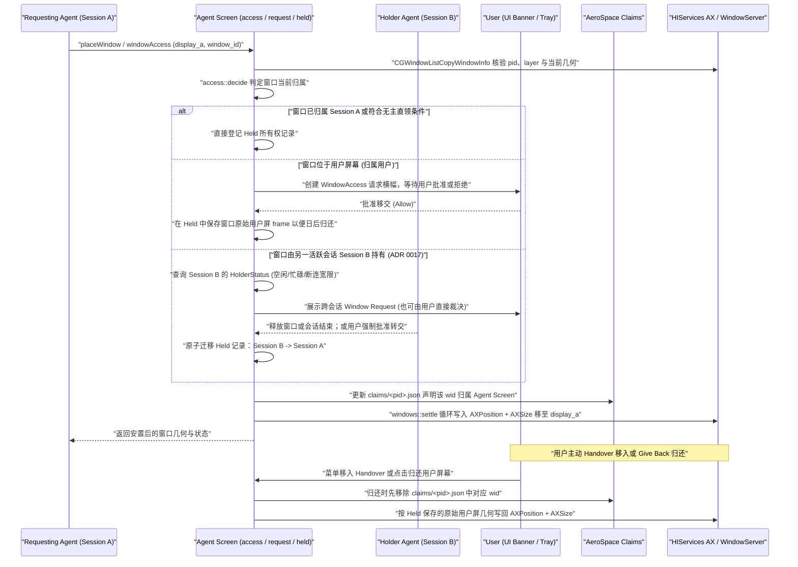

# 操作 04：place_window、window_access、跨会话请求与 Handover

`place_window` 与 `window_access` 负责将已有窗口纳入当前代理会话的显示器。根据窗口当前归属（无主、用户桌面、其他代理会话），系统分别执行直接接管、向用户发起窗口授权、向持有会话发起跨会话移交请求（ADR 0017），并在结束或用户收回时按原尺寸迁回用户桌面。

## 端到端流程

## 节点明细表

| 节点 | 我方代码 | macOS 组件与内部行为 | 限制与故障模式 | 关联问题 | 验证状态 |
| --- | --- | --- | --- | --- | --- |
| 1. 窗口存在性与图层预检 | `crates/mcp/src/tools.rs:1610-1715`、`apps/macos/src/control/agent.rs:220-290`、`apps/macos/src/mac/windows.rs:60-175` | 调用 `CGWindowListCopyWindowInfo` 读取 `kCGWindowNumber`、`kCGWindowOwnerPID`、`kCGWindowLayer`、`kCGWindowBounds`（`CGWindow.h:63,71,91`）。过滤非标准图层（菜单栏 `24`、状态栏 `25`、弹出菜单 `101`）与面积过小的辅助窗口。 | 最小化窗口或位于非当前 Space 的窗口在 `OptionOnScreenOnly` 查询下不可见，需结合全量窗口列表与 AX `AXMinimized` 属性判断；全屏独立 Space 窗口无法直接跨屏平铺搬移。 | `#205` | `[已验证]` `CGWindow.h:63,71,91`、`CGWindowLevel.h:73-75`、`apps/macos/src/mac/windows.rs:60-175` |
| 2. 访问控制分流（`access::decide`） | `crates/model/src/access.rs:15-155`、`crates/model/src/held.rs:15-165` | 纯模型比对 `Held` 所有权表与当前窗口所在的显示器角色（`Role::User` 或 `Role::Ours`）：1. 本会话已持有则放行；2. 落在用户屏幕则必须走用户 `WindowAccess` 审批；3. 落在其他代理会话名下则转入跨会话 `Window Request`（ADR 0017）。 | 若窗口刚被目标应用私自重置回主屏，几何位置与 `Held` 记录短暂不一致（ADR 0018），需先完成记录与几何对账再裁决。 | `#205`、ADR 0018 | `[已验证]` `crates/model/src/access.rs:15-155`、`docs/adr/0018-window-ownership-reconciliation.md` |
| 3. 用户屏窗口授权与原始位置留存 | `crates/model/src/request.rs:18-175`、`apps/macos/src/ui/shell.rs:840-1040` | 在请求队列登记 `WindowAccess`，通过主界面或菜单栏提示用户；用户点击允许前阻塞该 MCP 调用。获批瞬间在 `Held` 记录该窗口在用户屏上的原始 `CGRect`。 | 用户未注意提示时请求持续挂起直至客户端取消或超时；若获批前目标窗口已关闭，唤醒后二次核验窗口消失并返回明确错误。 | `#206` | `[已验证]` `crates/model/src/request.rs:18-175`、`crates/model/src/held.rs:40-120` |
| 4. 跨会话 `Window Request` 与 `HolderStatus`（ADR 0017） | `crates/model/src/access.rs:75-155`、`apps/macos/src/control/agent.rs:292-355` | 当窗口被兄弟会话持有时，附上持有者的 `HolderStatus`（活跃执行中、空闲等待或断连宽限中），允许持有者主动释放或由用户在 UI 上批准接管。 | **核心故障点（`#189`）**：若持有窗口的兄弟会话上游代理已死但 stdio 管道未断，`HolderStatus` 仍被标为存活，系统无法将其当作死会话自动回收窗口，必须依赖用户介入或超时剔除。 | `#189`、ADR 0017 | `[已验证]` `docs/adr/0017-cross-session-window-requests.md`、`crates/model/src/access.rs:75-155` |
| 5. 用户主动 Handover 移入 | `apps/macos/src/ui/shell.rs:910-1040`、`apps/macos/src/core.rs:620-715` | 用户通过 Agent Screen 窗口选择器或辅助入口主动将自己屏幕上的某个窗口交给指定代理显示器（或回答 `request_help` 时选择 `Give a window`），立即建立 `Held` 记录并保存原位置。 | 若移交的窗口属于当前用户正在前台输入的应用，该 PID 立即进入共享前台进程状态，后续代理点击与键入将受 `shared_app.rs` 门控限制。 | `#110` | `[已验证]` `apps/macos/src/control/shared_app.rs:1-120`、`docs/adr/0015-help-requests.md` |
| 6. 跨屏几何写入（`windows::settle`） | `apps/macos/src/mac/windows.rs:180-340`、`apps/macos/src/mac/claims.rs:20-95` | 先写入 AeroSpace `claims/<pid>.json`，再通过 `AXUIElementSetAttributeValue` 连续修正 `AXPosition` 与 `AXSize`（最多 12 轮），因为跨不同缩放比或尺寸的显示器移动时 AppKit 常在首次移动后夹紧尺寸。 | 1. 不可缩放对话框（如系统偏好面板或固定大小登录框）拒绝 `AXSize` 修改；2. 目标进程无响应时每次 AX IPC 阻塞至 `AXUIElementSetMessagingTimeout` 超时。 | `AXError.h:49`、`#205` | `[已验证]` `apps/macos/src/mac/windows.rs:180-340`、`AXUIElement.h:387-402` |
| 7. 窗口归还用户屏幕（`dismissal::give_back`） | `apps/macos/src/dismissal.rs:25-145`、`crates/model/src/held.rs:90-165` | 先从 `claims/<pid>.json` 删除该窗口 ID，读取 `Held` 保存的原始用户屏坐标（若原显示器已拔除则回退到当前主屏安全区），通过 `AXPosition` 与 `AXSize` 迁回并移除 `Held` 记录。 | 若原外接屏已断开且窗口原始尺寸大于内置主屏，写回时会被 AppKit 裁剪或顶在菜单栏下方，需按当前在线用户屏可用工作区兜底夹紧。 | `#204` | `[已验证]` `apps/macos/src/dismissal.rs:25-145` |
