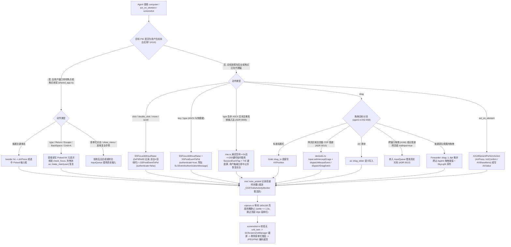

# 操作 05：computer 动作、act_on_element 与截图结算

`computer` 与 `act_on_element` 在后台向代理显示器上的目标应用投递指针、滚轮、键盘与语义操作，并在动作后自动等待画面静止并返回截图。核心挑战在于：SkyLight 按进程而非按窗口投递键盘事件，Chromium 合成拖拽不更新全局按键状态，以及用户与代理共享同一前台进程时必须防止串窗（`#110`）。

## 端到端流程

## 节点明细表

| 节点 | 我方代码 | macOS 组件与内部行为 | 限制与故障模式 | 关联问题 | 验证状态 |
| --- | --- | --- | --- | --- | --- |
| 1. 共享前台进程守门（`shared_app.rs`） | `apps/macos/src/control/shared_app.rs:1-500` | 检查 `NSWorkspace.frontmostApplication` 与该 PID 的 `AXFocusedWindow` / `AXMainWindow`（`Front::{NotFront, AgentFocused, OtherFocused, FocusUnknown}`）。当用户在主屏聚焦同一 PID 的另一窗口时，全面禁止对该 PID 发送 `SLEventPostToPid`。单击改走 AX `beside::hit`；输入与基础编辑键改写 `Picked` AX 文本框并在写入后执行 `check_focus`，一旦目标应用把主窗口切到了代理屏，立即调用 `ax::make_main(user_win)` 夺回用户窗口主态；拒绝菜单栏项与 `AXShowMenu`。 | 1. 向共享前台 PID 发 SkyLight 点击会改写进程内 `keyWindow`，导致用户随后的真实敲击落入代理屏窗口；2. Canvas / WebGL 等无 AX 树表面在共享前台状态下无法靠 `Picked` 键入，只能等待用户切走前台或走 `InputQueue`。 | `#110` | `[已验证]` `apps/macos/src/control/shared_app.rs:1-500` |
| 2. 无抬升后台聚焦（`SSFocusWithoutRaise`） | `apps/macos/native/SkyLight.m:123-141`、`apps/macos/src/mac/input.rs:90-155` | 调用 `_SLPSGetFrontProcess` 获取当前前台 PSN；若 `front == target` 立即返回 `false`（绝不触碰前台进程或打断用户中文输入法候选窗）。随后通过 `SLSGetWindowOwner` + `SLSGetConnectionPSN`（回退 `GetProcessForPID`）解析目标 PSN，构造 248 字节（`0xF8`）事件记录（`record[0x04]=0xF8`、`record[0x08]=0x0D`、`record[0x3C..0x40]=windowID`、`record[0x8A]=0x01`），调用 `SLPSPostEventRecordTo` 注入目标进程 Carbon/AppKit 事件队列，且不向用户前台进程发送 `0x02` 失焦记录。 | 1. 仅发送 `0x0D` 聚焦记录而不发送 `0x01/0x02` make-key 记录时，部分框架（如 VCL 或未激活过的自定义视图窗口）不更新内部 `isKeyWindow`；2. 若进程无有效 WindowServer 连接返回 `1002`，记录被静默丢弃。 | `CustomDrag 首按吞没`、`#110` | `[已验证]` `SkyLight.tbd:94,240-241,752`、`apps/macos/native/SkyLight.m:123-141` |
| 3. 键盘鉴权信封（`SLSEventAuthenticationMessage`） | `apps/macos/native/SkyLight.m:55-80` | `SSEventRecord` 按偏移量 `{24, 32, 16}` 从 `__CGEvent` 结构体提取内部 `SLSEventRecord *` 指针；在 macOS 15+ 上检查 `SLSEventAuthenticationMessage` 类响应 `+messageWithEventRecord:pid:version:` 后生成鉴权对象，经 `SLEventSetAuthenticationMessage` 挂载到键盘 `CGEvent` 上。鼠标事件传 `authenticate = false` 不挂载。 | 1. macOS 14 存在 `SLSEventAuthenticationMessage` 类但无该工厂选择器，漏检会抛 ObjC 异常；2. SkyLight 导出函数 `_SLEventRecordPointer`（反汇编地址 `0x186d90078`）固定校验 `[x0 + 0x10] == 0xade49453` 并读取 `[x0 + 0x18]`（偏移 `24`），未来系统若调整偏移需与 `_SLEventRecordPointer` 同步；3. 若给鼠标事件挂载鉴权信封，会绕过 Chromium 监听的 `cgAnnotatedSessionEventTap` 导致点击失效。 | Chromium 后台键入兼容 | `[已验证]` `SkyLight` 反汇编 `_SLEventRecordPointer` (`0x186d90078`)、`SkyLight.m:55-80` |
| 4. SkyLight 进程级事件投递与空闲计时器副作用 | `apps/macos/native/SkyLight.m:81-87`、`apps/macos/src/mac/ime.rs:64-80` | 调用 `_SLEventPostToPid(pid, event)`（反汇编 `0x187121048`）：在栈上构造合成 CPS PSN `{ high: 1, low: pid }` 并调用 `_SLEventPostToPSN`（`0x187120f54`），经 `postEventsWithStyle(style=2)` 发往目标进程，随后在 `0x187120fcc` 无条件调用 `_CGSTickleActivityMonitor` 更新全局 HID 活跃时间。我方紧接调用 `ime::note_posted()` 记录纳秒时间戳。 | 1. **进程级路由限制**：`_SLEventPostToPid` 仅收 `pid` 不收 `windowID`，键盘事件总是落入该进程当前自认的 `keyWindow`；2. **空闲计时污染**：`_CGSTickleActivityMonitor` 会重置 `CGEventSourceSecondsSinceLastEventType(HIDSystemState)`，若无 `note_posted()` 差值过滤，系统会把代理自己的后台投递误判为"用户刚动过键鼠"，进而饿死 `InputQueue` 与 IME 借用。 | `#110`、`#206` | `[已验证]` `SkyLight` 反汇编 `_SLEventPostToPid` (`0x187121048`) 与 `_SLEventPostToPSN` (`0x187120fcc`)、`ime.rs:64-80` |
| 5. TIS 输入法临时借用路径（ADR 0008） | `apps/macos/src/mac/ime.rs:180-348` | 当键入需要切换键盘布局或规避后台 Unicode 丢字时，先拿 `SESSION_INPUT` 互斥锁，校验 `!IsSecureEventInputEnabled()`、`!real_input::armed()`、`user_idle() >= 2 s` 且按键数 `<= 250`（最长约 `10 s`）。主线程（`on_main`）切换 HIToolbox `TISSelectInputSource`，临时置目标窗 `AXFrontmost` + `AXMain`，以 `40 ms/键` 向 `SessionEventTap` 发送按键；用户一旦触碰真实输入立即中止，且严格按"先恢复用户原前台进程、等待 `200 ms` 兜底 `activate`、最后恢复用户 TIS 输入源"的顺序收尾。 | 1. 非主线程调用 TIS API 会在 HIToolbox 内部触发断言崩溃；2. 若先切回中文输入源再恢复前台进程，用户编辑器会丢失原输入上下文状态；3. 终端或密码框开启 `SecureEventInput` 时该路径被系统锁死，必须回退。 | ADR 0008、`#117` | `[已验证]` `apps/macos/src/mac/ime.rs:180-348`、`docs/adr/0008-ime-and-viewer-input.md` |
| 6. 多路拖拽分流与 Chromium CDP 拦截 | `apps/macos/src/control/agent.rs:542-658`、`apps/macos/src/mac/devtools.rs:575-727`、`apps/macos/src/mac/input.rs:260-365` | 按命中目标选择执行器：1. 标题栏走 `Grab::drag_to` 写 `AXPosition`；2. 跨窗口拖拽（`between_windows`）直转 `InputQueue`；3. 已挂载 `--remote-debugging-pipe` 的 Chromium 网页走 CDP `Input.setInterceptDrags(true)` + `Input.dispatchMouseEvent` + `Input.dispatchDragEvent`；4. 无 CDP 管道的网页或 Electron 窗口拒绝后台合成并转 `InputQueue`；5. 原生控件走 `Forwarder::drag`，起始先发 `1..8 pt`（步进 `16 ms`）微移加 `100 ms` 停顿跨过 AppKit `3..5 pt` 拖拽识别阈值。 | **macOS / Chromium 限制**：1. Chromium 从 `+[NSEvent pressedMouseButtons]`（读取全局 `CGSInputButtonState`）构造网页 `event.buttons`，后台 `SLEventPostToPid` 不改写全局物理按键位，导致 `pointermove` 中 `buttons == 0` 触发 `lostpointercapture`（`#37`）；2. AppKit `-[NSWindow performWindowDragWithEvent:]` 与原生 Cocoa `NSDraggingSession` 均直接锚定 `WindowServer` 真实硬件光标坐标，后台合成事件无法驱动跨窗口拖拽（`#166`）。 | `#37`、`#166`、`#206` | `[已验证]` `AppKit` 反汇编 `performWindowDragWithEvent:` (`0x185673490`)、`devtools.rs:575-727`、`agent.rs:542-658` |
| 7. `act_on_element` 语义动作执行 | `crates/mcp/src/tools.rs:2201-2260`、`apps/macos/src/mac/ax.rs:320-580` | 设置 `AXUIElementSetMessagingTimeout`，定位目标窗口内的 AX 元素并执行 `AXUIElementPerformAction`（`AXPress`、`AXConfirm`、`AXShowMenu`、`AXIncrement` 等）或写入 `AXValue` / `AXFocused`。 | 1. 后台应用点击弹出菜单（`NSPopUpButton` 或 `<select>`）时，AppKit 菜单跟踪内部会调用 `SLPSStealKeyFocusReturningID` 抢夺会话级键盘焦点；2. 模态对话框阻塞主线程时返回 `kAXErrorCannotComplete (-25204)`。 | `#110`、后台弹出菜单抢键焦 | `[已验证]` `apps/macos/src/mac/ax.rs:320-580`、`AXUIElement.h:387-402` |
| 8. 画面静止等待（`settle`）与单帧截图（`screenshot`） | `apps/macos/src/mac/capture.rs:60-107`、`apps/macos/src/mac/screenshot.rs:88-268` | 动作完成后，若 `settle == true`，订阅 `"agent"` 流计数，在 `160x100` 亮度采样网格（跳过顶部 `40 pt` 菜单栏时钟闪烁，`LEVELS = 24` 量化，`SAMPLES = 3` 连续稳定帧）上等待画面稳定，上限 `1.5 s`。随后 `screenshot.rs` 先校验 `cg::unit_twin(id).is_none()`，构造 `SCContentFilter` 排除菜单栏窗口（`layer >= 24` 且 `height <= 40 pt`，`#38`）及按需排除桌面壁纸（`layer < 0`），填充深灰底色 `(0.13, 0.13, 0.14)`，调用 `SCScreenshotManager::capture_image`（遇尺寸变更瞬态错误按 `[100, 300, 700] ms` 重试；缩放裁剪失败则退回全屏捕获再内存裁剪），经 `ImageIO` 编码为 JPEG（质量 `0.8`）或 PNG。 | 1. 命中 `unit_twin` 时拒绝截图防止泄漏用户主屏画面；2. 持续播放动画或光标闪烁超过 `1.5 s` 时按超时截断返回；3. 缺少 TCC 屏幕录制权限（`CGPreflightScreenCaptureAccess() == false`）时 `ScreenCaptureKit` 直接报错。 | `unit twin`、`#38`、`#190` | `[已验证]` `apps/macos/src/mac/screenshot.rs:88-268`、`SCScreenshotManager.h:134` |
