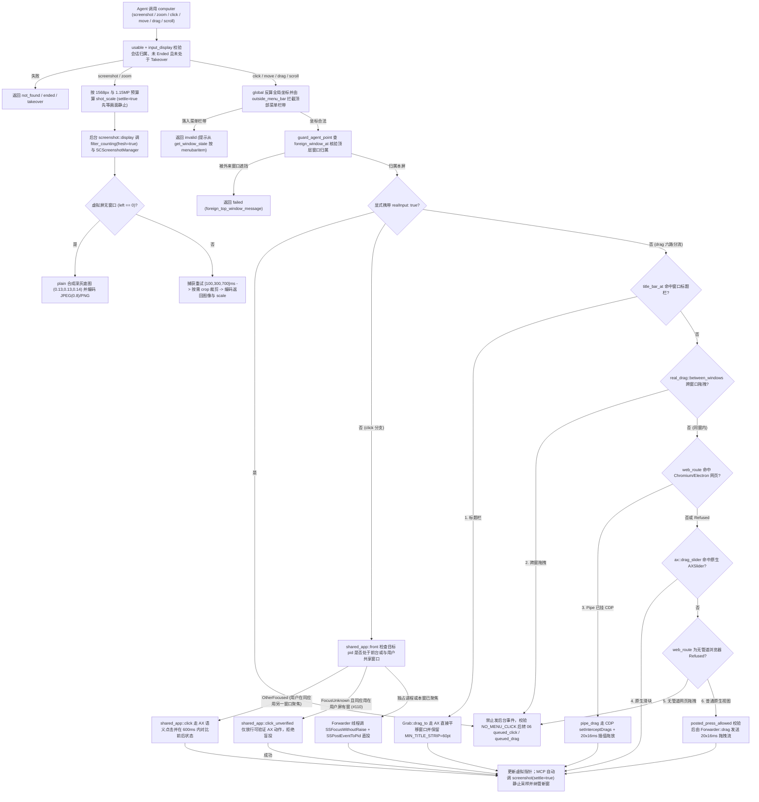
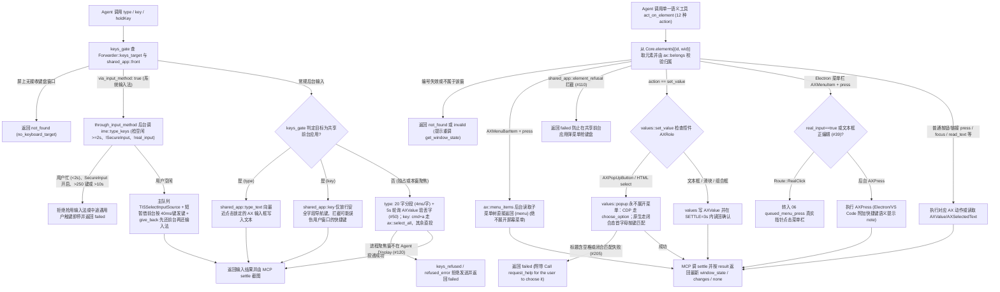

# 05. `computer` 动作路由、后台 SkyLight 投递、共享进程隔离与 `act_on_element` 语义操作

Agent Screen 的核心约束是 Agent 不移动用户物理指针、不抢占用户前台窗口键盘焦点 (`ADR 0001`)。MCP 层通过 `computer` (`crates/mcp/src/tools.rs:1951-2200`) 与单一语义工具 `act_on_element` (`crates/mcp/src/tools.rs:1178-1305`，映射为宿主控制方法 `"elementAction"`) 执行截图、点击、六路拖拽、滚轮、打字、按键及控件语义动作。针对 `AppKit` 标题栏拖拽强绑定硬件光标、Chromium HTML5 拖拽依赖主进程会话、输入法 `TIS` 路由主队列亲和、以及同一进程同时拥有用户窗口与 Agent 窗口 (`shared_app`) 等系统边界，流水线将每次输入分流到后台 `SkyLight` 直投、AX 语义读写、Chromium CDP 管道、`ime` 空闲借用前台或真实输入队列 (`real_input`)。

## 线程与队列分工

1. **GPUI 主线程 (`AsyncApp`)**：执行会话归属检查 `usable`、屏幕与接管检查 `input_display`、截图缩放比 `shot_scale` 与菜单栏禁区拦截 `outside_menu_bar`、更新虚拟指针叠加层 `show_pointer`，并在非纯查询类 `computer` 动作后调用 `settle_display` 等待画面静止 (`apps/macos/src/control/agent.rs:360-995, 1408-1619, 6220-6330, 7242-7625`)。
2. **每屏幕专用输入与焦点线程 (`agent-screen-input` / `agent-screen-focus`)**：`Forwarder::new` (`apps/macos/src/mac/input.rs:416-440`) 为每块 Agent Display 启动串行 OS 线程 `"agent-screen-input"` 消费 `Command` 队列，调用 `SkyLight.m` 桥接函数写入窗口局部坐标与路由字段后投递至目标 `pid`；另启动 `"agent-screen-focus"` 线程供 Viewer 焦点查询。
3. **GPUI `background_executor` 工作池**：执行 `SCScreenshotManager` 截图与裁剪编码 (`apps/macos/src/mac/screenshot.rs`)、`shared_app` 同应用前台隔离检查 (`apps/macos/src/control/shared_app.rs`)、Chromium CDP 拖拽与 `<select>` 选值 (`apps/macos/src/mac/devtools.rs`)、以及 `AXUIElement` 语义操作 (`apps/macos/src/control/values.rs`)。
4. **主队列 TIS 亲和调用 (`ime::on_main`)**：当携带 `via_input_method: true` (`viaInputMethod`) 走系统输入法打字时，`TISCopyCurrentKeyboardInputSource` 与 `TISSelectInputSource` 派发在主队列执行 (`apps/macos/src/mac/ime.rs:99-108`)，避免触发 macOS `HIToolbox` 主队列断言崩溃。

---

## 图 1：截图、坐标换算、共享进程点击隔离与六路拖拽分流

### 图 1 节点明细表

| 节点 | 线程与队列 | 我方代码与常量 | macOS 组件与内部行为 | 限制与关联缺陷 | Agent 侧返回 | 用户侧表现 | 验证证据 |
| :--- | :--- | :--- | :--- | :--- | :--- | :--- | :--- |
| `C1` | `mcp` -> GPUI 主线程 | `tools::computer` (`crates/mcp/src/tools.rs:1951-2200`), `agent.rs:360-806` | 将 MCP `computer` 的 `action` 映射为 `"screenshot"`、`"click"`、`"move"`、`"drag"`、`"scroll"` 等控制协议方法；除 `"screenshot"`、`"zoom"`、`"cursor_position"`、`"wait"` 外自动追加 `screenshot(settle: true)` | 缺坐标或非法按钮名在参数解析期即返回错误码 `invalid` | 分发至具体分支 | 无变化 | 已验证：`crates/mcp/src/tools.rs:1951,2172-2176` `async fn computer(` / `if !matches!(action, "screenshot" \| "zoom" \| "cursor_position" \| "wait") {` |
| `C2` | GPUI 主线程 | `usable` / `display` / `input_display` (`apps/macos/src/control/agent.rs:2695-2711, 7242-7286`) | 核验 `sessionKey` 匹配、屏幕未 `Ended`、且 `d.takeover == false`，并在动作前记录 `cg::all_ids()` 快照存入线程局部 `BEFORE` | 用户接管或屏幕关闭后立即拦截后台输入 | 失败走 `CX1`，通过继续 | 无变化 | 已验证：`apps/macos/src/control/agent.rs:7272-7275` `if core.read_with(cx, \|c, _\| c.displays.get(id).is_some_and(\|d\| d.takeover)) { return Err(ControlError::takeover(...)); }` |
| `CX1` | GPUI 主线程 | `ControlError::not_found` / `ended_error` / `ControlError::takeover` (`apps/macos/src/control/agent.rs:2700-2709, 7252-7275`) | 按原因返回协议标准错误码 | 无 | 错误码 `not_found` / `ended` / `takeover` | 无变化 | 已验证：`apps/macos/src/control/agent.rs:2702,2708,7273` `Err(ControlError::not_found(...))` / `Err(ended_error(...))` / `Err(ControlError::takeover(...))` |
| `S1` | GPUI 主线程 | `screenshot` (`apps/macos/src/control/agent.rs:360-405`), `shot_scale` (`crates/model/src/model.rs:667-673`), `settle_display` (`agent.rs:6220-6251`) | 按 `LONG_EDGE = 1568.0` 与 `PIXELS = 1_150_000.0` 计算 `shot_scale`；若 `settle == true` 先订阅读取 30fps `416px` 缩略流等待至少 `500ms` 或帧变后 `120ms` 静默（上限 `1500ms`），并后台派生 `[400, 800]ms` 延迟窗口收拢；若带 `region` 校验 `[x0, y0, x1, y1]` 合法性 | `region` 越界返回错误码 `invalid` (`agent.rs:378-385`) | 计算目标采样尺寸 | 无变化 | 已验证：`crates/model/src/model.rs:668-669` `const LONG_EDGE: f64 = 1568.0; const PIXELS: f64 = 1_150_000.0;`；`agent.rs:6237` `for wait in [400, 800] {` |
| `S2` | 后台执行器 | `screenshot::display` / `filter_counting` (`apps/macos/src/mac/screenshot.rs:38, 95-187, 189-268`) | `display` 调 `filter_counting(id, true, true)`（`fresh = true` 结合 `on_screen_ids` 与 `display_change_stamp` 刷新 `SCShareableContent`；`CONTENT_AGE = 2s` 供 `screenshot::window` 缓存复用），排除 `layer >= 24` 顶部 40pt 菜单栏项与 `layer < 0` 桌面层后调用 `SCScreenshotManager::captureImageWithFilter:configuration:completionHandler:` (`SCScreenshotManager.h:152`) | 过滤系统状态栏与壁纸，仅保留 Agent Display 窗口内容 | 得到窗口计数 `left` 与捕获结果 | 无快门声、无闪烁 | 已验证：`apps/macos/src/mac/screenshot.rs:38,202` `const CONTENT_AGE: Duration = Duration::from_secs(2);` / `let (filter, left) = filter_counting(id, true, true)?;`；`MacOSX.sdk SCScreenshotManager.h:152` `+ (void)captureImageWithFilter:(SCContentFilter *)contentFilter` |
| `S3` | 后台执行器 | `screenshot::display` (`apps/macos/src/mac/screenshot.rs:205-207`) | 判断可捕获窗口数 `left == 0` | 空虚拟屏不调 `SCScreenshotManager`，避免捕获桌面壁纸或报错 | `left == 0` 走 `S4`，否则走 `S5` | 无变化 | 已验证：`apps/macos/src/mac/screenshot.rs:205-206` `if left == 0 { return Ok(None); }` |
| `S4` | 后台执行器 | `screenshot::plain` (`apps/macos/src/mac/screenshot.rs:484-522`) | 用 `CGBitmapContext` 填充 `(0.13, 0.13, 0.14, 1.0)` 深灰底色并编码为 JPEG 或 PNG | 保证空屏截图始终返回合法图像 | 返回图像与可选 `strayed` 字段 | 无变化 | 已验证：`apps/macos/src/mac/screenshot.rs:484,507` `fn plain(size: (f64, f64), format: Format)` / `CGContextSetRGBFillColor(Some(&ctx), 0.13, 0.13, 0.14, 1.0);` |
| `S5` | 后台执行器 | `screenshot::display` / `crop` / `encode` (`apps/macos/src/mac/screenshot.rs:231-263, 363-398, 524-573`) | 捕获失败按 `[100, 300, 700]ms` 重试；若局部 `region` 捕获仍失败则退回整屏捕获再调 `crop` 裁剪；`encode` 默认以质量 `0.8` 输出 JPEG 或输出 PNG | 坐标与后续 `global()` 使用同一 `shot_scale` 对偶换算 | 返回 Base64 图像块 | 无变化 | 已验证：`apps/macos/src/mac/screenshot.rs:231,363,524` `for wait in [100, 300, 700] {` / `fn crop(` / `pub fn encode(image: &CGImage, format: Format)` |
| `C3` | GPUI 主线程 | `target` / `global` / `outside_menu_bar` (`apps/macos/src/control/agent.rs:7549-7597`) | 将截图坐标除以 `shot_scale` 加虚拟屏原点转为全局点；校验 `y - cg::display_bounds(id).y >= menubar_height(id)` | 虚拟屏顶部菜单栏带归属用户前台应用，后台点击会穿透至用户当前前台菜单 | 落入菜单栏带走 `CX2`，其余走 `C4` | 无变化 | 已验证：`apps/macos/src/control/agent.rs:7586-7587` `fn outside_menu_bar(id: DisplayId, (_, y): (f64, f64)) -> Result<(), ControlError> { if y - cg::display_bounds(id).y < crate::mac::menubar_height(id)` |
| `CX2` | GPUI 主线程 | `outside_menu_bar` (`apps/macos/src/control/agent.rs:7588-7595`) | 拒绝顶部菜单栏坐标点击，指导改用 `get_window_state` 中的 `menubaritem` 或用 `place_window` 下移窗口 | 避免误触用户前台应用菜单栏 | 错误码 `invalid` | 无变化 | 已验证：`apps/macos/src/control/agent.rs:7588-7590` `return Err(ControlError::invalid("that is the reserved menu bar strip at the top, which belongs to the user's app. For app menus, press a menubaritem from get_window_state..."))` |
| `C4` | 后台 + 主线程 | `guard_agent_point` (`apps/macos/src/control/agent.rs:4580-4604`), `input::foreign_window_at` (`apps/macos/src/mac/input.rs:2582-2642`) | 查 `CGWindowList` 确认该全局点最上层窗口属于当前 Agent Display（豁免属于本屏宿主的远程 XPC 面板如 `open_and_save_panel` 及弹出菜单层 `#205`） | 若被外来会话或用户窗口遮挡则拒绝穿透点击 | 被遮挡走 `CX3`，归属本屏走 `C5` | 无变化 | 已验证：`apps/macos/src/control/agent.rs:4586-4587` `off(cx, move \|\| crate::mac::input::foreign_window_at(id, at)).await`；`input.rs:2582` `pub fn foreign_window_at(` |
| `CX3` | GPUI 主线程 | `held::foreign_top_window_message` (`crates/model/src/held.rs:574-610`), `agent.rs:4598-4603` | 生成遮挡窗口归属提示并返回错误 | 防止误触其他会话或用户窗口 | 错误码 `failed` | 无变化 | 已验证：`apps/macos/src/control/agent.rs:4598` `Err(ControlError::failed(held::foreign_top_window_message(` |
| `C5` | GPUI 主线程 | `click` / `drag` / `mouseDown` (`apps/macos/src/control/agent.rs:435-452, 550-560, 711`) | 检查 `realInput == Some(true)`：点击前先由 `real_click::opens_menu` 拦截右键或 `Ctrl+左键` (`NO_MENU_CLICK`)，绝不先发任何后台事件，直接转入 `06` 真实输入队列 | 遵守 `ADR 0013` 显式升级规则 | `true` 转 `R_REAL`（右键报 `invalid`），`false` 继续后台路由 | 无变化 | 已验证：`apps/macos/src/control/agent.rs:435,441,550` `if p.0.get("realInput") == Some(&Value::Bool(true))` / `if real_click::opens_menu(pressed, modifiers.control)` |
| `K1` | 后台执行器 | `shared_app::front` / `user_window` (`apps/macos/src/control/shared_app.rs:43-67, 290-334`), `agent.rs:459-486` | 检查目标 `pid` 是否正是用户当前前台应用 (`SSFrontPid`)，以及焦点在另一窗口 (`OtherFocused`) 还是焦点不可读 (`FocusUnknown`) 且同应用在用户屏有窗口 | 向用户正在前台操作的同一进程发 `SSFocusWithoutRaise` 会抢走用户窗口的 `keyWindow` (`#110`) | 分流至 `K2` / `K3` / `K4` | 保护用户同应用前台窗口不丢焦点 | 已验证：`apps/macos/src/control/agent.rs:462-468` `let (front, focused) = shared_app::front(target, cx).await; let shared = front.shared(front == Front::FocusUnknown && shared_app::user_window(target.pid, cx).await);` |
| `K2` | 后台执行器 | `shared_app::click` (`apps/macos/src/control/shared_app.rs:254-279, 598`), `agent.rs:469-476` | 不发 SkyLight 焦点记录，改走 AX 定位控件执行 `AXPress` / `AXFocused = true`，在 `EFFECT_WAIT = 600ms` 内核查界面变化并记录目标输入框供后续 `type` 定向写入 | 纯画布等无 AX 动作控件无法在共享前台态盲点 | 成功走 `R_OK`，无效果或受限返回 `failed` | 用户同应用前台窗口无感 | 已验证：`apps/macos/src/control/shared_app.rs:254,598` `pub async fn click(` / `const EFFECT_WAIT: Duration = Duration::from_millis(600);` |
| `K3` | 后台执行器 | `shared_app::click_unverified` (`apps/macos/src/control/shared_app.rs:405-425`), `agent.rs:479-485` | 当同应用焦点未知 (`FocusUnknown`) 且用户屏有窗口时，不发焦点记录也不盲投鼠标，仅尝试无焦点污染的 AX 语义点击 (`sharedbrowser` e2e 覆盖 Chromium/Electron 双窗隔离) | `#110`：避免未知焦点下篡改用户浏览器窗口 | 成功走 `R_OK`，不可验证返回 `failed` | 不抢夺用户窗口焦点 | 已验证：`apps/macos/src/control/shared_app.rs:405` `pub async fn click_unverified(` |
| `K3_DIA` | 实机手工回归项 (`#110`) | `company.thebrowser.dia` 双窗口现场 | 商用 Dia 浏览器同时在用户物理屏与 Agent Display 打开窗口时的焦点不可读隔离效果 | 依赖商用 Dia 专有 AX 暴露行为 | 同 `K3` | 待人工复测 | 未验证：`shared_app` 代码与 Chromium/Electron 夹具已核实，商用 Dia 浏览器双窗口实机隔离需在用户空闲时双开窗口手工验证 (`docs/research/root-causes-2026-11.md` §8) |
| `K4` | `agent-screen-input` 线程 | `Forwarder::click` / `stamp_routing_using` (`apps/macos/src/mac/input.rs:422, 793-823, 2334-2365`), `SkyLight.m:81-141` | 1. 若目标进程非当前前台则调 `SSFocusWithoutRaise(pid, wid)` 向目标 PSN 发 `0xF8` 字节伪焦点记录 (`_SLPSPostEventRecordTo` `0x186ebc164`)；2. `stamp_routing_using` 写整型字段 `40` (`pid`)、`51` (`0x33` `windowID`)、`91`、`92` (`_SLEventSetIntegerValueField` `0x186d8edf0`) 及窗口局部坐标 (`_SLEventSetWindowLocation` `0x186d8dff8`)；3. 附加 `SLSEventAuthenticationMessage` (`0x18707cf90`) 后调 `_SLEventPostToPid` (`0x187121048`) | 原生自定义拖拽状态机若在首次按下时检查硬件按键态会忽略后台拖拽（见 `07` 缺陷记录） | 投递完成走 `R_OK` | Peek/Viewer 显示虚拟指针，用户真实鼠标不动 | 已验证：`apps/macos/src/mac/input.rs:422,2326,2344` `.name("agent-screen-input".into())` / `field(51, window);`；`apps/macos/native/SkyLight.m:81,123` `SSPostEventToPid` / `SSFocusWithoutRaise`；`/private/tmp/dsc/SkyLight` `0x187121048 _SLEventPostToPid`, `0x186ebc164 _SLPSPostEventRecordTo` |
| `D1` | 后台执行器 | `title_bar_at` (`apps/macos/src/control/agent.rs:564, 7289-7294`), `Grab::title_bar` (`apps/macos/src/mac/windows.rs:105-118`) | 六路拖拽第 1 路（在 `realInput` 之后）：检测起点是否落在窗口标题栏可拖动区 | `AppKit` `-[NSWindow performWindowDragWithEvent:]` (`0x185673490`) 调 `_SLSDragWindowRelativeToMouse` (`0x18710ca20`) 绑定硬件真实光标，后台事件无法拖动标题栏 | 命中走 `D2`，未命中走 `D_CROSS` | 无变化 | 已验证：`apps/macos/src/control/agent.rs:564` `if let Some(grab) = title_bar_at(id, from, cx).await {`；`/private/tmp/dsc/AppKit` `0x185673490`；`/private/tmp/dsc/SkyLight` `0x18710ca20` |
| `D2` | 后台执行器 | `Grab::drag_to` (`apps/macos/src/mac/windows.rs:188-196`), `MIN_TITLE_STRIP = 60.0` (`crates/model/src/viewer_press.rs:57`), `agent.rs:564-572` | 通过 AX `kAXPositionAttribute` 平移窗口并钳制至少保留 `60pt` 标题栏在屏内，返回 `{"movedWindow": true, "route": "placement"}` | 绕开 WindowServer 硬件拖拽绑定 | 走 `R_OK` | 虚拟屏内窗口移位 | 已验证：`apps/macos/src/control/agent.rs:570-571` `return reply(json!({ "movedWindow": true, "route": "placement" }));`；`crates/model/src/viewer_press.rs:57` `const MIN_TITLE_STRIP: f64 = 60.0;` |
| `D_CROSS` | 后台 -> 主线程 | `real_drag::between_windows` (`apps/macos/src/control/agent.rs:577-593`) | 六路拖拽第 2 路：查起止点顶层窗口 `real_drag_window_at`，若跨越两个不同窗口则无需显式传 `realInput: true` 即自动转入 `queued_drag(..., real_drag::BETWEEN_WINDOWS)` | macOS 跨窗口 `CoreDrag` 会话要求物理指针驱动 (`ADR 0013`) | 跨窗转 `R_REAL`，同窗走 `D3` | 进入审批队列 | 已验证：`apps/macos/src/control/agent.rs:582-584` `if agent_screen_model::real_drag::between_windows(ends.0, ends.1) { return queued_drag(` |
| `D3` | 后台执行器 | `web_route` (`apps/macos/src/control/agent.rs:596, 7345-7350`), `devtools::route` (`apps/macos/src/mac/devtools.rs:575-605`) | 六路拖拽第 3 路检测：判断起点窗口是否为握有 `FD 3/4` CDP 管道的 Chromium/Electron 页面 (`Route::Pipe`)、页面映射失败 (`Route::Unmapped` 直接报 `failed`) 或外部已启动无管道浏览器 (`Route::Refused`) | Chromium HTML5 Drag & Drop 依赖主进程拖拽拦截，纯后台鼠标流无法触发 `dragstart`/`drop` (`ADR 0010`) | `Pipe` 走 `D4`，其余走 `D_AX` | 无变化 | 已验证：`apps/macos/src/control/agent.rs:596-597` `let refused = match web_route(from, cx).await { devtools::Route::Pipe(page) =>` |
| `D4` | 后台执行器 | `pipe_drag` (`apps/macos/src/control/agent.rs:7366-7425`), `devtools::Drag` (`apps/macos/src/mac/devtools.rs:610-727`) | 经 CDP 发送 `Input.setInterceptDrags(true)`、`mousePressed` 等 `100ms`、发 `20` 步 x `16ms` `mouseMoved`（若收到 `Input.dragIntercepted` 切换为 `Input.dispatchDragEvent` 的 `dragEnter`/`dragOver`），停 `100ms` 后发送 `drop` 与 `mouseReleased`，返回 `{"route": "devtools"}` | 零前台抢占完成网页看板与排序拖放 | 走 `R_OK` | 网页内元素完成拖放 | 已验证：`apps/macos/src/mac/devtools.rs:610` `pub struct Drag`；`apps/macos/src/control/agent.rs:7420` `reply(json!({ "route": "devtools" }))` |
| `D_AX` | 后台执行器 | `ax::drag_slider` (`apps/macos/src/control/agent.rs:604-624`) | 六路拖拽第 4 路：若起点命中原生 `AXSlider` 滑块，直接按拖拽起止坐标换算百分比写入 AX 数值，返回 `{"route": "accessibility"}` | 包括无管道浏览器的原生滑块控件也能免物理指针设值 | 命中走 `R_OK`，未命中走 `D_REF` | 滑块数值直接更新 | 已验证：`apps/macos/src/control/agent.rs:608,622` `ax::drag_slider(target, from, to,` / `return reply(json!({ "route": "accessibility" }));` |
| `D_REF` | GPUI 主线程 | `devtools::Route::Refused` 分支 (`apps/macos/src/control/agent.rs:625-636`), `devtools::refused_message` (`apps/macos/src/mac/devtools.rs:858-872`) | 六路拖拽第 5 路：若 `refused` 为无 CDP 管道的已运行浏览器 (`Some(app)`) 且非原生滑块，**自动转入 `queued_drag(..., &devtools::refused_message(&app))`** 申请真实输入队列（60s 未批返回 `input_pending`），而非直接报错退出 | 避免后台拖拽在无管道浏览器静默无效 | 转 `R_REAL`，原生应用走 `D5` | 进入审批队列 | 已验证：`apps/macos/src/control/agent.rs:625-632` `if let Some(app) = refused { return queued_drag(... &devtools::refused_message(&app),` |
| `D5` | 后台 + `agent-screen-input` 线程 | `shared_app::posted_press_allowed` (`apps/macos/src/control/shared_app.rs:427-458`), `Forwarder::drag` (`apps/macos/src/mac/input.rs:825-853`), `agent.rs:638-658` | 六路拖拽第 6 路：确认共享进程安全后，由 `Forwarder::drag` 发送按下保持 `100ms`、`STEPS = 20` x `16ms` 插值 `Dragged`、尾停 `100ms` 后释放，返回 `{"route": "posted"}` | 若自定义视图在 `mouseDown` 检查硬件按键态导致无反应，Agent 可显式传 `real_input: true` | 走 `R_OK` | 虚拟指针沿轨迹滑动 | 已验证：`apps/macos/src/mac/input.rs:825` `pub async fn drag(&self, from: (f64, f64), to: (f64, f64), m: Modifiers) -> Sent`；`apps/macos/src/control/agent.rs:657` `Ok(json!({ "route": "posted" }))` |
| `R_REAL` | 转入文档 `06` | `queued_click` / `queued_drag` (`apps/macos/src/control/agent.rs:6841-7140`) | 构造真实输入计划提交至全局 `InputQueue`，等待最多 `60s`（未批或被拒返回错误码 `input_pending`） | 详见 `06-input-queue-and-real-input.md` | 批准完成返回结果，未决返回 `input_pending` | Help Card 弹出琥珀色审批卡片 | 已验证：`apps/macos/src/control/agent.rs:6935,7086` `code: "input_pending"` |
| `R_OK` | GPUI 主线程 -> `mcp` | `show_pointer` / `settle_display` / `adopt_opened` (`apps/macos/src/control/agent.rs:6220-6251, 7439-7537, 7599-7625`), `tools.rs:2172-2185` | 更新虚拟指针叠加层；MCP 层对非纯截图动作设 `settle = action != "screenshot"` 调用 `screenshot` 等待画面静止、纳管同应用新开窗口并返回最新截图与 `strayed` / `givenNote` | 无 | 返回执行结果与最新截图 | Peek/Viewer 更新虚拟指针与画面 | 已验证：`crates/mcp/src/tools.rs:2172-2176` `let settle = action != "screenshot"; ... json!({ "displayId": display, "settle": settle })`；`apps/macos/src/control/agent.rs:6221-6222` `wait_until_still(id, size, cx).await; adopt_opened(core, id, cx).await;` |

---

## 图 2：键盘输入 (`type` / `key`)、输入法 (`via_input_method`) 与 `act_on_element` 语义操作

### 图 2 节点明细表

| 节点 | 线程与队列 | 我方代码与常量 | macOS 组件与内部行为 | 限制与关联缺陷 | Agent 侧返回 | 用户侧表现 | 验证证据 |
| :--- | :--- | :--- | :--- | :--- | :--- | :--- | :--- |
| `T1` | `mcp` -> GPUI 主线程 | `agent.rs:807-995` (`"type"`, `"key"`, `"holdKey"`) | 解析待输入文本或按键序列（如 `"cmd+l"`、`"Return"`）及可选布尔开关 `viaInputMethod` 与 `inputSource` | 非法按键组合在 `KeyChord::parse` 报错 `invalid` | 进入 `T2` | 无变化 | 已验证：`apps/macos/src/control/agent.rs:807,812,879` `"type" =>` / `p.0.get("viaInputMethod") == Some(&Value::Bool(true))` / `"key" =>` |
| `T2` | 后台 + 主线程 | `keys_gate` (`apps/macos/src/control/agent.rs:6376-6395`), `Forwarder::keys_target` (`apps/macos/src/mac/input.rs:1252-1265`) | 查找屏上可接收键盘的目标窗口并结合 `shared_app::front` 判断是否处于同应用共享前台态（注：`Forwarder::secrecy()` 仅用于 Viewer 本地输入保护，不在 `keys_gate` 调用） | 无窗口时提前拦截，共享前台时禁止直接发进程级按键 | 无窗口走 `TX1`，`viaInputMethod` 走 `M1`，常规走 `T3` | 无变化 | 已验证：`apps/macos/src/control/agent.rs:6381-6383` `let Some(target) = forwarder.keys_target(within).await else { return Err(no_keyboard_target()); };` |
| `TX1` | GPUI 主线程 | `no_keyboard_target` (`apps/macos/src/control/agent.rs:6486-6490`) | 虚拟屏无任何可接收键盘输入的窗口 | 引导先启动应用或点击输入框 | 错误码 `not_found`：`no window on the display can take keyboard input...` | 无变化 | 已验证：`apps/macos/src/control/agent.rs:6486-6489` `fn no_keyboard_target() -> ControlError { ControlError::not_found("no window on the display can take keyboard input; launch an app or click a field first") }` |
| `M1` | 后台执行器 | `through_input_method` (`apps/macos/src/control/agent.rs:6415-6458`), `ime::type_keys` (`apps/macos/src/mac/ime.rs:20-25, 72-82, 180-210`) | 当 `viaInputMethod == true` 时（`inputSource` 可省略，省略则沿用系统当前输入源），核查按键数 `<= 250`（`LONGEST / PER_KEY = 10s / 40ms`）、`!IsSecureEventInputEnabled()`、`!real_input::armed()` 且 `ime::user_idle() >= QUIET` (`2.0s`) | macOS `IMKInputSession` 仅对当前前台进程运行输入法组字，必须等用户空闲 (`ADR 0008`) | 条件不满足或中途被打断走 `MX1`，空闲走 `M2` | 用户操作电脑时零打断 | 已验证：`apps/macos/src/mac/ime.rs:20-24,197` `pub const QUIET: Duration = Duration::from_secs(2);` / `pub const LONGEST: Duration = Duration::from_secs(10);` / `const PER_KEY: Duration = Duration::from_millis(40);` / `if IsSecureEventInputEnabled() {` |
| `MX1` | GPUI 主线程 | `through_input_method` 错误分支 (`apps/macos/src/control/agent.rs:6449-6456`) | 若用户正使用键鼠、开启了安全输入、找不到指定输入源、或发键途中用户触碰了键鼠 (`Typed::Stopped(sent)`)，立即停止并返回已发键数说明 | 最长硬上限 `LONGEST = 10s` | 错误码 `failed` | 用户输入与前台立即恢复 | 已验证：`apps/macos/src/control/agent.rs:6451-6455` `Ok(crate::mac::ime::Typed::Stopped(sent)) => Err(ControlError::failed(format!("the user touched the keyboard or pointer after {sent} of {total} keys...")))` |
| `M2` | 主队列 (`on_main`) + 后台 | `ime::on_main` / `type_keys` / `give_back` (`apps/macos/src/mac/ime.rs:99-108, 220-316`) | 在主队列保存原输入源并调 `TISSelectInputSource` (`TextInputSources.h:985`)，将目标应用置为 `AXFrontmost = true` 及主窗后按 `PER_KEY = 40ms` 向 `SessionEventTap` 发键；结束或遇用户触键时在 `give_back` 先还原原前台应用、再在主队列还原原输入源 | 主队列调用避免 macOS 26 `HIToolbox` 主队列断言崩溃 | 走 `TR1` | 用户空闲时瞬时组字并还原前台与输入法 | 已验证：`apps/macos/src/mac/ime.rs:99,308` `fn on_main<T: Send>(` / `fn give_back(front: Option<i32>, agent: i32, source: Option<&Source>)`；`MacOSX.sdk TextInputSources.h:985` `TISSelectInputSource` |
| `T3` | 后台执行器 | `keys_gate` 结果匹配 (`apps/macos/src/control/agent.rs:830-865, 895-955`) | 若目标属于共享前台进程，分流至无进程级键盘污染的 AX 通道 | 向共享前台应用直投 `Cmd+W` 等快捷键会关闭用户正在看的同应用窗口 | 共享走 `S_TYPE` / `S_KEY`，否则走 `T4` | 保护用户同应用窗口 | 已验证：`apps/macos/src/control/agent.rs:831-834,897-904` `Gate::Shared(beside) => shared_app::type_text(` / `Gate::Shared(beside) => shared_app::key(` |
| `S_TYPE` | 后台执行器 | `shared_app::type_text` (`apps/macos/src/control/shared_app.rs:187-193, 745-798`) | 取出上次本屏 `click` 锁定的文本控件，通过 AX 写入 `AXSelectedText` 或 `AXValue` | 未先点击锁定输入框时返回拒绝提示 | 走 `TR1` 或报 `failed` | 用户窗口焦点零影响 | 已验证：`apps/macos/src/control/shared_app.rs:745` `pub async fn type_text(` |
| `S_KEY` | 后台执行器 | `shared_app::key` (`apps/macos/src/control/shared_app.rs:102-112, 800-945`) | 放行字段内安全导航键，拦截会作用于进程活动窗口的修饰快捷键或未知焦点状态 (`#110`) | 防止误伤共享应用用户窗口 | 允许走 `TR1`，受限返回 `failed` | 用户窗口零误伤 | 已验证：`apps/macos/src/control/shared_app.rs:800` `pub async fn key(` |
| `T4` | `agent-screen-input` 线程 | `Forwarder::type_text` / `press` (`apps/macos/src/mac/input.rs:918-977, 1267-1310`), `ax::select_all` (`apps/macos/src/control/agent.rs:927-935`) | `type` 按每批 `20` 字符分段（每字符间隔 `4ms`）调 `CGEventKeyboardSetUnicodeString` + `SSPostEventToPid`，随后轮询 `AXValue` 最多 `200 * 25ms = 5s` 检验 `typing::landed` 检测丢字 (`Sent::Dropped` `#50`)；`key` 对 `cmd+a` 优先走 `ax::select_all(target)`，其余按键经 `SSFocusWithoutRaise` + `SSPostEventToPid` 投递 | 若目标应用当前聚焦窗口不在 Agent Display (`#120`)，底层拒绝投递并记录 `Refused` | 聚焦窗越界走 `TX2`，成功走 `TR1` | 后台窗口文字上屏 | 已验证：`apps/macos/src/mac/input.rs:918` `pub async fn type_text(&self, text: String, within: Rect) -> Sent`；`apps/macos/src/control/agent.rs:931` `.spawn(async move { ax::select_all(target) })` |
| `TX2` | GPUI 主线程 | `keys_refused` / `refused_error` (`apps/macos/src/control/agent.rs:6463-6484`) | 当目标应用的聚焦窗口不在任何 Agent Display 时 (`#120`)，在发送任何按键前拒绝并提示改用 `act_on_element` 的 `insert_text` / `set_value` 或先点击窗口内部 | 防止后台按键落入用户屏幕上的同应用窗口 | 错误码 `failed` | 拒绝污染用户窗口 | 已验证：`apps/macos/src/control/agent.rs:6470,6481` `fn refused_error(refused: &crate::mac::input::Refused, id: DisplayId) -> ControlError` / `"{focused}, so keys posted to {app} could reach the user's window instead of yours..."` |
| `TR1` | GPUI 主线程 -> `mcp` | `tools::computer` 后置静止采样 (`crates/mcp/src/tools.rs:2172-2185`) | `zoom`、`cursor_position` 与 `wait` 已提前返回；其余动作按 `let settle = action != "screenshot"` 调用 `screenshot` 捕获更新画面并纳管新窗口 | 无 | 返回完成结果与最新截图 | Peek/Viewer 同步刷新 | 已验证：`crates/mcp/src/tools.rs:2172` `let settle = action != "screenshot";` |
| `E1` | `mcp` -> GPUI 主线程 | `tools::act_on_element` (`crates/mcp/src/tools.rs:1178-1305`), `"elementAction"` (`apps/macos/src/control/agent.rs:1408-1619`) | 单一 MCP 工具承载全部 12 种语义动作：`press`、`click`、`double_click`、`right_click`、`show_menu`、`focus`、`set_value`、`insert_text`、`read_text`、`scroll_into_view`、`increment`、`decrement`（无拆分出的独立元素动作或菜单动作工具） | 非法动作名在协议入口返回 `invalid` | 进入 `E2` | 无变化 | 已验证：`crates/mcp/src/tools.rs:1178,1255` `"act_on_element" => {` / `.call("elementAction", params)` |
| `E2` | GPUI 主线程 + 后台 | `Core.elements` (`apps/macos/src/control/agent.rs:1418-1455`), `ax::belongs` (`apps/macos/src/mac/ax.rs:1306-1364`) | 从宿主 `Core.elements: HashMap<(DisplayId, u32), Numbers>` 按元素编号取出 `AXUIElement`，后台调 `ax::belongs` 验证元素仍存活且隶属目标窗口（含附着 Sheet 与远程服务面板 `#205`） | 界面重绘后旧编号失效走 `EX1` | 失效走 `EX1`，菜单栏项走 `E_MB`，其余继续 | 无变化 | 已验证：`apps/macos/src/control/agent.rs:1418` `c.elements.get(&(id, window.target.window_id))` |
| `EX1` | GPUI 主线程 | `ControlError::not_found` / `invalid` (`apps/macos/src/control/agent.rs:1425-1454`) | 提示元素不存在或编号已过期，需重调 `get_window_state` | 无 | 错误码 `not_found` 或 `invalid` | 无变化 | 已验证：`apps/macos/src/control/agent.rs:1425-1435` `ControlError::not_found` |
| `E_MB` | 后台执行器 | `ax::menu_items` (`apps/macos/src/control/agent.rs:1457-1469`) | 对 `AXMenuBarItem` 执行 `press` 时，后台遍历 `ax::menu_items` 将子菜单项编号并入 `Core.elements`，直接返回 `{"menu": tree}` 而不展开任何真实屏幕菜单 | 展开真实菜单会夺取用户键盘焦点 | 走 `ER1` 返回子菜单树 | 用户顶部菜单栏零弹窗 | 已验证：`apps/macos/src/control/agent.rs:1457,1468` `ax::menu_items(item.get(), 0)` / `return reply(json!({ "menu": tree }));` |
| `EX_SH` | 后台执行器 | `shared_app::element_refusal` (`apps/macos/src/control/shared_app.rs:375-403`), `agent.rs:1473-1478` | 当与用户共享前台应用时，拦截会在用户前台弹出菜单抢占键盘的语义动作 (`#110`) | 保护用户前台窗口 | 错误码 `failed` | 无变化 | 已验证：`apps/macos/src/control/agent.rs:1474-1476` `if let Some(refusal) = shared_app::element_refusal(window.target, &action, &item, cx).await { return Err(refusal); }` |
| `E3` | 后台执行器 | `elementAction` 常规分支 (`apps/macos/src/control/agent.rs:1479-1496, 1586-1618`) | `read_text` 读取 `AXValue` / `AXSelectedText`（均空报 `not_found`）；其余动作执行 `AXPress`、`AXShowMenu`、`AXIncrement`、`AXDecrement`、`AXFocused` 或局部滚动 | 无需坐标换算即可后台触发控件 | 走 `ER1` | 控件后台触发 | 已验证：`apps/macos/src/control/agent.rs:1479,1491` `if action == "read_text"` / `Err(ControlError::not_found("the element has no text to read"))` |
| `E4` | 后台执行器 | `values::set_value` (`apps/macos/src/control/values.rs:96-195`), `agent.rs:4782-4962` | 按控件 `AXRole` 分流下拉选单 (`AXPopUpButton` / 网页 `<select>`) 与文本/数值控件 | 见 `E5` / `E6` | 下拉框走 `E5`，其余走 `E6` | 无变化 | 已验证：`apps/macos/src/control/values.rs:5,96` `// No step opens a menu: an open menu takes the user's keyboard.` / `pub async fn set_value(` |
| `E5` | 后台 + `agent-screen-input` 线程 | `values::popup` (`apps/macos/src/control/values.rs:196-311`), `devtools::choose_option` (`apps/macos/src/mac/devtools.rs:806-854`), `Forwarder::choose_closed_popup` (`apps/macos/src/mac/input.rs:170, 190, 991-1128`) | **全程绝不打开弹出菜单** (`values.rs:5`)：若为挂有 CDP 管道的网页 `<select>`，注入 `CHOOSE` JS 直接改选中项并派发 `input`/`change`；若为原生 `AXPopUpButton`，定位所属窗口 `popup_window`（含 `.appex` `element_pid` 与 `AXSheet` `#205`），聚焦闭合按钮后按 `KEY_SETTLE = 90ms`、`KEY_GAP = 300ms` 发送不含空格的标题前缀按键序列并在 `SETTLE = 3s` 内核验选中结果 | 选项标题包含空格（空格在闭合 `NSPopUpButton` 上会打开菜单抢键盘！）或闭合键入未命中时拒绝 (`Refusal::Space`) | 失败走 `EX2`，成功走 `ER1` | 零弹窗切换选项 | 已验证：`apps/macos/src/control/values.rs:5,157,196` `No step opens a menu: an open menu takes the user's keyboard.` / `const SETTLE: Duration = Duration::from_secs(3);` / `async fn popup(`；`input.rs:991` `pub async fn choose_closed_popup(` |
| `EX2` | GPUI 主线程 | `values::INSTEAD` (`apps/macos/src/control/values.rs:160-186`) | 如实返回下拉框无法在不打开菜单的前提下完成选择的原因，并指导调用 `request_help` 请用户在 Viewer 内选择 | 必读回核验真实值，绝不假装成功 | 错误码 `failed`（含 `Call request_help for the user to choose it`） | 无变化 | 已验证：`apps/macos/src/control/values.rs:160` `const INSTEAD: &str = "Call request_help for the user to choose it";` |
| `E6` | 后台执行器 | `values::set_value` 属性写回 (`apps/macos/src/control/values.rs:157, 316-455`) | 写入 `AXValue`（必要时触发 `AXConfirm`），在 `SETTLE = 3s` 内轮询确认新值生效 | 只读控件返回 `failed` | 走 `ER1` | 文本或滑块值更新 | 已验证：`apps/macos/src/control/values.rs:157` `const SETTLE: Duration = Duration::from_secs(3);` |
| `E7` | 后台 + 主线程 | Electron 菜单栏路由 (`apps/macos/src/control/agent.rs:1504-1575`), `menu_press::Press` | `real_input` 参数**仅适用于 Electron 应用自身菜单栏中已启用的非 Apple `AXMenuItem` 的 `press` 动作**（其余元素或动作传 `real_input` 直接报 `invalid`）；此外当 Electron 窗口正处于文本编辑焦点 (`electron && ax::editing(target)`) 时自动走 `Route::RealClick` (`#39`) | Electron 将 AX 触发的菜单项当作快捷键处理 (`triggeredByAccelerator = true`)，焦点在输入框时常被忽略 (`#39`) | `RealClick` 走 `E8`，否则走 `E9` | 无变化 | 已验证：`apps/macos/src/control/agent.rs:1509-1512,1538,1546` `"real_input applies to press on a menu item of an Electron app's menu bar"` / `editing: electron && ax::editing(target),` / `press.route() == agent_screen_model::menu_press::Route::RealClick` |
| `E8` | 转入文档 `06` | `queued_menu_press` (`apps/macos/src/control/agent.rs:7155-7238`) | 提交真实输入队列申请借用物理指针点击虚拟屏菜单栏；60s 未决或被拒返回 `input_pending` | 若已有同一菜单项真实点击排队中，重复走 AX 按压会报 `invalid` 防止触发两次 (`agent.rs:1553-1567`) | 批准执行后返回结果，未决返回 `input_pending` | Help Card 弹出审批请求 | 已验证：`apps/macos/src/control/agent.rs:1549,7210` `return queued_menu_press(&core, connection, id, window.target, path, cx).await;` / `code: "input_pending"` |
| `E9` | 后台执行器 | `elementAction` 菜单执行 (`apps/macos/src/control/agent.rs:1574-1615`), `VS_CODE_MENU_NOTE` / `ELECTRON_MENU_NOTE` (`agent.rs:6335-6349`) | 对 `AXMenuItem` 执行后台 `AXPress`；若目标为 VS Code 系或普通 Electron 应用，附加 `VS_CODE_MENU_NOTE` 或 `ELECTRON_MENU_NOTE` 说明快捷键路由差异与重试方法 | 不在屏幕顶栏弹出任何可视菜单 | 走 `ER1` | 用户屏幕顶栏无菜单弹出 | 已验证：`apps/macos/src/control/agent.rs:6335,6338` `const VS_CODE_MENU_NOTE: &str = ...` / `const ELECTRON_MENU_NOTE: &str = ...` |
| `ER1` | `mcp` -> GPUI 主线程 | `tools::act_on_element` 后置结算 (`crates/mcp/src/tools.rs:1263-1305`) | 动作成功后，MCP 工具层调用控制方法 `"settle"` 等待界面稳定，再按 `result` 参数（默认 `"state"`，可选 `"changes"` 或 `"none"`）附带最新窗口元素树或差异摘要 | 一次调用同时完成语义操作与状态刷新 | 返回执行结果与窗口树/差异 | Peek/Viewer 反映最新界面 | 已验证：`crates/mcp/src/tools.rs:1263` `.call("settle", json!({ "displayId": display }))` |
