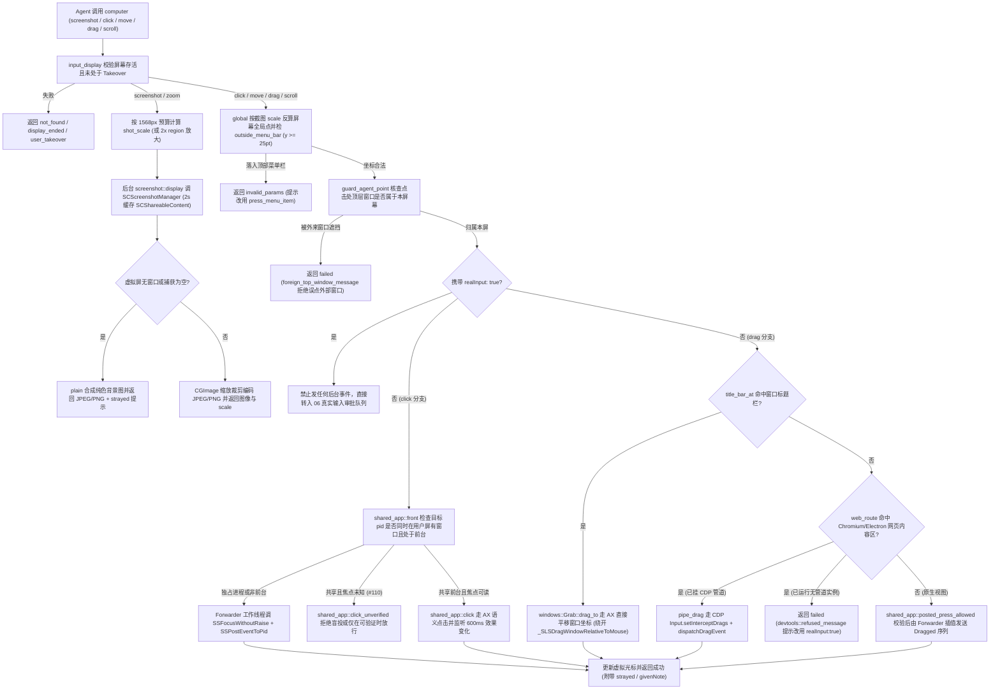
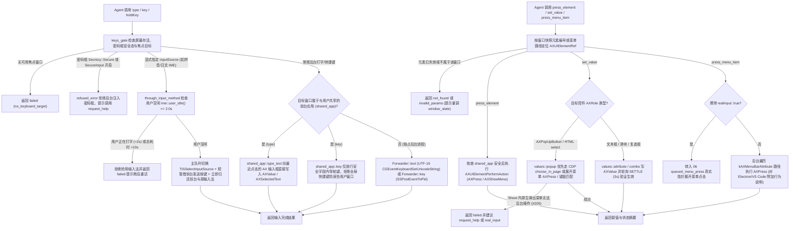

# 05. `computer` 动作路由、后台 SkyLight 投递、共享进程隔离与语义元素操作

Agent Screen 的核心承诺是 Agent 绝不移动用户鼠标、绝不抢占前台键盘焦点 (`ADR 0001`)。`computer` 工具及 `press_element` / `set_value` / `press_menu_item` 语义工具在后台完成全部点击、拖拽、滚动、打字、按键与截图。由于 macOS `AppKit` (`-[NSWindow _handleMouseDownEvent:isDelayedEvent:]` 与 `performWindowDragWithEvent:`)、Chromium 多进程事件分发、输入法 `TIS` 路由以及同一进程同时拥有用户窗口与 Agent 窗口 (`shared_app`) 各有底层边界，系统将每一次输入细分为后台 `SkyLight` 直投、AX 语义读写、Chromium CDP 管道、输入法 `ime` 短暂借前台、以及真实输入队列 (`real_input`) 五条精确通道。

## 线程与队列分工

1. **GPUI 主线程 (`AsyncApp`)**：校验屏幕生命周期 (`input_display`)、缩放坐标转换 (`global` / `outside_menu_bar`)、查询 `Core` 共享应用与权限门控、更新虚拟光标预览 (`show_pointer`) (`apps/macos/src/control/agent.rs:360-990, 7266-7645`)。
2. **每屏幕专用输入工作线程 (`Forwarder` worker thread)**：`Core::forwarder(id)` (`apps/macos/src/core.rs:552-556`, `apps/macos/src/mac/input.rs:209-790`) 为每块 Agent Display 维护一个串行 OS 线程，按序消费 `Command` 队列，调用 `SkyLight.m` 桥接函数合成局部坐标鼠标事件与进程级键盘事件，杜绝多线程乱序。
3. **GPUI `background_executor` 工作池**：执行 `SCScreenshotManager` 截图与缩放编码 (`screenshot.rs`)、`shared_app` 前台/焦点核查、Chromium DevTools 管道 (`devtools::Drag` / `choose_option`)、以及 `AXUIElement` 语义动作 (`elementAction` / `values.rs`)。
4. **主队列 TIS 亲和调用 (`ime::on_main`)**：当携带 `inputSource` 走系统输入法打字时，`TISSelectInputSource` 严格派发在主队列执行 (`apps/macos/src/mac/ime.rs:99-108`)，避免触发 macOS `HIToolbox` 主队列断言崩溃。

---

## 图 1：截图、坐标变换、鼠标点击与四路拖拽分流

### 图 1 节点明细表

| 节点 | 线程与队列 | 我方代码与常量 | macOS 组件与内部行为 | 限制与关联缺陷 | Agent 侧返回 | 用户侧表现 | 验证来源 |
| :--- | :--- | :--- | :--- | :--- | :--- | :--- | :--- |
| `C1` | `mcp` -> GPUI 主线程 | `tools::computer` (`crates/mcp/src/tools.rs:1951-2201`), `agent.rs:360-806` | 将 MCP `computer` 的 `action` 拆解映射为 `screenshot`、`click`、`move`、`drag`、`scroll` 等控制协议方法 | 缺坐标或非法按钮名在 `tools.rs` / `Button::parse` 即被拦截 | 分发至具体分支 | 无变化 | [已验证: crates/mcp/src/tools.rs:1951-2201, apps/macos/src/control/agent.rs:360-806] |
| `C2` | GPUI 主线程 | `input_display` / `display` (`apps/macos/src/control/agent.rs:7242-7287`) | 校验屏幕存在、未 `Ended`、未处于 `Takeover`，且 `Forwarder::agent_stopped()` 为 `false` | 用户接管或屏幕关闭瞬间阻断一切后台动作 | 失败走 `CX1`，通过继续 | 无变化 | [已验证: apps/macos/src/control/agent.rs:7242-7287] |
| `CX1` | GPUI 主线程 | `usable` (`apps/macos/src/control/agent.rs:2695-2711`) | 返回标准生命周期错误 | 无 | `not_found` / `display_ended` / `user_takeover` | 无变化 | [已验证: apps/macos/src/control/agent.rs:2695-2711] |
| `S1` | GPUI 主线程 | `screenshot` 分支 (`apps/macos/src/control/agent.rs:360-405`) | 计算整屏缩放比 `shot_scale`（长边不超过 `1568 px`），若带 `region: [x0, y0, x1, y1]` 局部放大则校验边界并按最高 `2.0x` 采样；若 `settle: true` 先调 `settle_display` 等待画面静止 (`agent.rs:368, 6220-6251`) | `region` 越界或 `x0 >= x1` 报 `invalid_params` (`agent.rs:378-385`) | 计算目标像素宽高 | 无变化 | [已验证: apps/macos/src/control/agent.rs:360-405, apps/macos/src/control/agent.rs:6220-6251] |
| `S2` | 后台执行器 | `screenshot::display` / `filter` (`apps/macos/src/mac/screenshot.rs:38-188, 189-273`) | 复用 `CONTENT_AGE = 2s` 内的 `SCShareableContent` 缓存构建 `SCContentFilter`（排除桌面干扰项，仅保留归属窗口），调用 `SCScreenshotManager.captureImageWithFilter:configuration:completionHandler:` (`MacOSX.sdk SCScreenshotManager.h`) | 权限丢失或屏幕刚离线时刷新缓存重试一次 | 拿到 `CGImage` 或空屏状态 | 无系统快门声、无闪烁 | [已验证: apps/macos/src/mac/screenshot.rs:38-273, MacOSX.sdk SCScreenshotManager.h] |
| `S3` | 后台执行器 | `screenshot::display` (`apps/macos/src/mac/screenshot.rs:210-235`) | 检查虚拟屏上是否有可捕获窗口 | 空虚拟屏直接调 SCK 可能返回空图或桌面壁纸 | 空屏走 `S4`，有窗走 `S5` | 无变化 | [已验证: apps/macos/src/mac/screenshot.rs:210-235] |
| `S4` | 后台执行器 | `screenshot::plain` (`apps/macos/src/mac/screenshot.rs:484-522`) | 用 `CGBitmapContext` 合成指定尺寸的纯色底图并由 `CGImageDestination` 编码为 JPEG/PNG | 保证空屏截图始终返回合法图像 | Base64 图像块 + 可选 `strayed` 提示 | 无变化 | [已验证: apps/macos/src/mac/screenshot.rs:484-522, apps/macos/src/control/agent.rs:413-417] |
| `S5` | 后台执行器 | `screenshot::crop` / `encode` (`apps/macos/src/mac/screenshot.rs:363-398, 524-573`) | 按需 `CGImageCreateWithImageInRect` 裁剪 `region`，`CGImageDestinationFinalize` 编码为 JPEG (默认) 或 PNG | 坐标与后续 `global()` 严格使用同一 `scale` 对偶换算 | 返回 MCP `image` 内容块 | 无变化 | [已验证: apps/macos/src/mac/screenshot.rs:363-398, apps/macos/src/mac/screenshot.rs:524-573] |
| `C3` | GPUI 主线程 | `target` / `global` / `outside_menu_bar` (`apps/macos/src/control/agent.rs:7549-7597`) | 将截图坐标除以 `shot_scale` 加虚拟屏原点转为全局点；拒绝落入虚拟屏顶部 `y < 25pt` 系统菜单栏带的点击 | 后台 `SLEventPostToPid` 点击虚拟屏顶部菜单栏无法在非活跃进程展开 `NSMenu` | 菜单栏点击走 `CX2`，其余走 `C4` | 无变化 | [已验证: apps/macos/src/control/agent.rs:7549-7597] |
| `CX2` | GPUI 主线程 | `outside_menu_bar` (`apps/macos/src/control/agent.rs:7586-7597`) | 拦截顶部菜单栏坐标点击，指导 Agent 改用语义菜单工具 | 避免静默无效点击 | 错误码 `invalid_params`：`y=<y> is in the menu bar; use press_menu_item instead` | 无变化 | [已验证: apps/macos/src/control/agent.rs:7586-7597] |
| `C4` | 后台 + 主线程 | `guard_agent_point` (`apps/macos/src/control/agent.rs:4580-4604`), `input::foreign_window_at` (`apps/macos/src/mac/input.rs:2582-2642`) | 查 `CGWindowList` 确认该全局点最上层窗口属于当前 Agent Display（豁免属于本屏宿主的远程 XPC 面板如 ` NSOpenPanel` 及弹出菜单，但注意 `#205`/`#207` Sheet 内弹出菜单边界） | 若有外来窗口遮盖目标点，坚决拒绝穿透误点 | 被遮挡走 `CX3`，安全走 `C5` | 无变化 | [已验证: apps/macos/src/control/agent.rs:4580-4604, apps/macos/src/mac/input.rs:2582-2642, Issue #205] |
| `CX3` | GPUI 主线程 | `held::foreign_top_window_message` (`crates/model/src/held.rs:574-610`) | 报告遮挡窗口所属应用及持有者 | 防止误触其他会话或用户窗口 | 错误码 `failed` | 无变化 | [已验证: crates/model/src/held.rs:574-610] |
| `C5` | GPUI 主线程 | `click` / `drag` / `mouseDown` (`apps/macos/src/control/agent.rs:435, 550, 711`) | 检查参数 `realInput == true`：若显式请求真实指针，绝不先发任何后台事件，直接交由 `06` 真实输入队列 | 遵守 `ADR 0013` 显式升级规则 | `true` 转 `R_REAL`，`false` 继续后台路由 | 无变化 | [已验证: apps/macos/src/control/agent.rs:435, apps/macos/src/control/agent.rs:550, ADR 0013] |
| `K1` | 后台执行器 | `shared_app::front` / `user_window` (`apps/macos/src/control/shared_app.rs:43-67, 290-334`), `agent.rs:459-470` | 检查目标窗口所属 `pid` 是否同时在用户物理屏拥有可见窗口，以及该 `pid` 此刻是否正是用户的前台活跃应用 (`SSFrontPid`) | 若用户正在前台敲同一个应用（如 Safari / Dia），直接向该 `pid` 发 `SSFocusWithoutRaise` 会抢走用户正在打字窗口的 `keyWindow`！ | 三路分流 `K2` / `K3` / `K4` | 保护用户同应用前台窗口不丢焦点 | [已验证: apps/macos/src/control/shared_app.rs:43-67, apps/macos/src/control/shared_app.rs:290-334, apps/macos/src/control/agent.rs:459-470] |
| `K2` | 后台执行器 | `shared_app::click` / `press_at` / `Watcher` (`apps/macos/src/control/shared_app.rs:254-279, 460-743`) | 不发 SkyLight 焦点包，改用 `AXUIElementCopyElementAtPosition` 找到目标控件执行 `AXPress` / `AXFocused = true`，并在 `EFFECT_WAIT = 600ms` 内对比 DOM/AX 前后变化验证点击是否生效，同时记住点击的输入框 `note_click` 供后续 `type` 定向写入 | 共享前台应用时部分纯 Canvas 链接无 AX 动作会拒绝或提示无法验证 (`#110` Dia 浏览器现象根因之一) | 成功走 `R_OK`，无效果或高危控件返回 `failed` | 用户正在浏览的另一个同应用窗口完全无感 | [已验证: apps/macos/src/control/shared_app.rs:254-279, apps/macos/src/control/shared_app.rs:460-743, Issue #110] |
| `K3` | 后台执行器 | `shared_app::click_unverified` / `unknown_focus` (`apps/macos/src/control/shared_app.rs:113-118, 405-425`), `agent.rs:480-490` | 当目标应用不暴露 AX 焦点查询 (`FocusUnknown`) 且用户在同应用有窗口时，拒绝可能污染用户窗口的未知点击 | `#110`：Dia 浏览器 AX 树状态切换导致焦点不可知时触发安全拒绝 | 返回 `failed`（说明原因并提示 `place_window` 或 `real_input`） | 宁可报错也不篡改用户窗口 | [已验证: apps/macos/src/control/shared_app.rs:113-118, apps/macos/src/control/shared_app.rs:405-425, Issue #110] |
| `K4` | `Forwarder` 工作线程 | `Forwarder::mouse_down` / `mouse_up` (`apps/macos/src/mac/input.rs:579-686`), `SkyLight.m:69-148` | 1. 调 `SSFocusWithoutRaise(pid, wid)` 向目标 PSN 发送 `0xF8` 字节伪焦点记录 (`_SLPSPostEventRecordTo` `0x186ebc164`) 使目标窗口在进程内成为 `keyWindow` 而不提升层级；2. 写事件字段 `windowID` (field `0x33`)、窗口局部坐标 `_SLEventSetWindowLocation` (`0x186d8dff8`)；3. 附加 `SLSEventAuthenticationMessage` (`0x18707cf90`) 后调 `_SLEventPostToPid` (`0x187121048`) 直投目标进程 | `AppKit` 收到无真实 HID 状态的点击对普通按钮有效，但对自定义拖拽状态机可能因首次按下未捕获鼠标而忽略拖拽 | 投递完成走 `R_OK` | Peek/Viewer 闪现点击涟漪与虚拟光标，用户真鼠标纹丝不动 | [已验证: apps/macos/src/mac/input.rs:579-686, apps/macos/native/SkyLight.m:69-148, SkyLight 0x187121048, SkyLight 0x186ebc164] |
| `D1` | 后台执行器 | `title_bar_at` (`apps/macos/src/control/agent.rs:564, 7289-7294`), `windows::Grab::title_bar` (`apps/macos/src/mac/windows.rs:105-118`) | 检测拖拽起点是否落在窗口顶部标题栏可拖动区（排除关闭/最小化/缩放按钮与工具栏控件） | `AppKit` `-[NSWindow performWindowDragWithEvent:]` (`0x185673490`) 底层调用 `_SLSDragWindowRelativeToMouse` (`0x18710ca20`) 绑定硬件真实光标，后台 `SLEventPostToPid` 绝无可能拖动标题栏！ | 命中走 `D2`，未命中走 `D3` | 无变化 | [已验证: apps/macos/src/control/agent.rs:564, apps/macos/src/mac/windows.rs:105-118, AppKit 0x185673490, SkyLight 0x18710ca20] |
| `D2` | 后台执行器 | `drag_to` (`apps/macos/src/control/agent.rs:565-594, 7296-7302`), `Grab::drag_to` (`apps/macos/src/mac/windows.rs:188-196`) | 通过 `AXUIElementSetAttributeValue(kAXPositionAttribute)` 直接把窗口平移到终点，并用 `MIN_TITLE_STRIP = 60pt` (`viewer_press.rs:57`) 保证标题栏不被拖出虚拟屏丢失 | 直接绕开 WindowServer 硬件拖拽限制 | 走 `R_OK` | 虚拟屏内窗口平滑移位 | [已验证: apps/macos/src/control/agent.rs:565-594, apps/macos/src/mac/windows.rs:188-196, crates/model/src/viewer_press.rs:57] |
| `D3` | 后台执行器 | `web_route` (`apps/macos/src/control/agent.rs:596, 7345-7350`), `devtools::route` (`apps/macos/src/mac/devtools.rs:562-608`) | 检查起点窗口是否为 Chromium / Electron：若是且握有 `launch_app` 建立的 `FD 3/4` CDP 管道则定位 `Page`；若是外部已运行无管道的 Chromium 则返回拒绝路由 | Chromium 渲染进程处理 HTML5 Drag & Drop 依赖浏览器主进程系统拖拽会话，纯 `SLEventPostToPid` 鼠标流无法触发 `dragstart`/`drop` (`ADR 0009`) | 有管道走 `D4`，无管道走 `DX1`，原生应用走 `D5` | 无变化 | [已验证: apps/macos/src/mac/devtools.rs:562-608, ADR 0009] |
| `D4` | 后台执行器 | `pipe_drag` (`apps/macos/src/control/agent.rs:598, 7366-7437`), `devtools::Drag` (`apps/macos/src/mac/devtools.rs:610-728`) | 通过 CDP 发送 `Input.setInterceptDrags(enabled: true)` 拦截 HTML5 拖拽会话，发送 `Input.dispatchMouseEvent(mousePressed -> mouseMoved)`，若触发 `Input.dragIntercepted` 则改发 `Input.dispatchDragEvent(dragEnter -> dragOver -> drop)`，否则按普通指针滑块拖动释放 | 零前台抢占完成看板卡片、文件排序等复杂网页拖拽 | 走 `R_OK` | 网页内元素完成拖放 | [已验证: apps/macos/src/control/agent.rs:7366-7437, apps/macos/src/mac/devtools.rs:610-728] |
| `DX1` | GPUI 主线程 | `devtools::refused_message` (`apps/macos/src/mac/devtools.rs:858-872`), `agent.rs:600-635` | 明确告知该浏览器并非由 Agent Screen 冷启动故无 DevTools 管道，后台拖拽会被 Chromium 忽略 | 引导 Agent 传 `real_input: true` 走真实输入队列或由 Agent Screen 重启该浏览器 | 错误码 `failed` | 无变化 | [已验证: apps/macos/src/mac/devtools.rs:858-872, apps/macos/src/control/agent.rs:600-635] |
| `D5` | 后台 + `Forwarder` 线程 | `shared_app::posted_press_allowed` (`apps/macos/src/control/shared_app.rs:427-458`), `Forwarder::mouse_dragged` (`apps/macos/src/mac/input.rs:612-647`) | 确认非共享冲突后，由 `Forwarder` 发送 `LeftMouseDown`、多步插值 `LeftMouseDragged` 与 `LeftMouseUp` | 部分原生自定义视图若在 `mouseDown` 查全局硬件按键态 `CGEventSourceButtonState(HIDSystemState)` 会忽略后台拖拽，此时 Agent 可升级 `real_input: true` | 走 `R_OK` | 虚拟光标沿轨迹移动 | [已验证: apps/macos/src/control/shared_app.rs:427-458, apps/macos/src/mac/input.rs:612-647] |
| `R_REAL` | 转入文档 `06` | `queued_click` / `queued_drag` (`apps/macos/src/control/agent.rs:6841-7140`) | 构造真实输入计划入队等待用户单次批准 | 详见 `06-input-queue-and-real-input.md` | 挂起等待批准执行 | Input Bar 与红框亮起 | [已验证: apps/macos/src/control/agent.rs:6841-7140] |
| `R_OK` | GPUI 主线程 -> `mcp` | `show_pointer` / `adopt_opened` (`apps/macos/src/control/agent.rs:7439-7537, 7599-7625`) | 更新 Peek/Viewer 虚拟指针叠加层，调用 `adopt_opened` 捕获本次点击触发弹出的同应用新窗口，返回成功结果 | 无 | 返回动作完成文本 | 虚拟指针反馈 | [已验证: apps/macos/src/control/agent.rs:7439-7537, apps/macos/src/control/agent.rs:7599-7625] |

---

## 图 2：键盘输入 (`type` / `key`)、输入法 (`ime`) 与语义元素操作 (`press_element` / `set_value` / `press_menu_item`)

### 图 2 节点明细表

| 节点 | 线程与队列 | 我方代码与常量 | macOS 组件与内部行为 | 限制与关联缺陷 | Agent 侧返回 | 用户侧表现 | 验证来源 |
| :--- | :--- | :--- | :--- | :--- | :--- | :--- | :--- |
| `T1` | `mcp` -> GPUI 主线程 | `agent.rs:807-990` (`"type"`, `"key"`, `"holdKey"`) | 解析待输入字符串或按键序列（如 `"cmd+l"`, `"Return"`）及可选 `inputSource` | 校验按键名与修饰键合法性 (`keychord.rs`) | 进入 `T2` | 无变化 | [已验证: apps/macos/src/control/agent.rs:807-990] |
| `T2` | 后台 + 主线程 | `keys_gate` / `keys_allowed` (`apps/macos/src/control/agent.rs:6371-6407`), `Forwarder::secrecy` (`apps/macos/src/mac/input.rs:766-773`) | 查询目标窗口是否存在，并通过 AX 检查当前焦点控件是否为 `AXSecureTextField` 或系统开启了 `IsSecureEventInputEnabled()` (`Carbon/HIToolbox`) | 密码框安全边界：禁止 Agent 后台盲敲密码或触发安全输入拦截 | 无目标走 `TX1`，密码框走 `TX2`，带输入法走 `M1`，常规走 `T3` | 无变化 | [已验证: apps/macos/src/control/agent.rs:6371-6407, apps/macos/src/mac/input.rs:766-773] |
| `TX1` | GPUI 主线程 | `no_keyboard_target` (`apps/macos/src/control/agent.rs:6486-6498`) | 虚拟屏无窗口或焦点未知 | 无 | 错误码 `failed`：`no window on this display has keyboard focus...` | 无变化 | [已验证: apps/macos/src/control/agent.rs:6486-6498] |
| `TX2` | GPUI 主线程 | `keys_refused` / `refused_error` (`apps/macos/src/control/agent.rs:6463-6484`) | 拒绝向安全文本域注入按键 | 密码与系统授权凭据必须由用户本人在 Viewer / Takeover 输入 (`ADR 0008`) | 错误码 `failed`（提示调用 `request_help` 让用户输入密码） | 无变化 | [已验证: apps/macos/src/control/agent.rs:6463-6484, ADR 0008] |
| `M1` | 后台执行器 | `through_input_method` (`apps/macos/src/control/agent.rs:6415-6461`), `ime::user_idle` / `QUIET = 2s` / `LONGEST = 10s` (`apps/macos/src/mac/ime.rs:20-25, 72-82`) | 调 `CGEventSourceSecondsSinceLastEventType` 检测用户物理键鼠空闲是否满 `2.0 s` | macOS 系统级 `IMKInputSession` 仅对当前前台进程运行输入法引擎，因此必须等用户空闲才能瞬时借前台 (`ADR 0014`) | 用户忙走 `MX1`，空闲走 `M2` | 若用户正操作电脑绝不打断 | [已验证: apps/macos/src/control/agent.rs:6415-6461, apps/macos/src/mac/ime.rs:20-82] |
| `MX1` | GPUI 主线程 | `ime::Typed` 拒绝分支 (`apps/macos/src/mac/ime.rs:84-90`, `agent.rs:6440-6460`) | 报告用户正在输入或找不到请求的输入源 ID | 最长占用硬上限 `LONGEST = 10s` (`ime.rs:22`) | 错误码 `failed` | 用户输入零干扰 | [已验证: apps/macos/src/mac/ime.rs:22, apps/macos/src/mac/ime.rs:84-90] |
| `M2` | 主队列 (`on_main`) + 后台 | `ime::type_keys` / `give_back` (`apps/macos/src/mac/ime.rs:99-108, 180-317`) | 在主队列保存原 `TISCopyCurrentKeyboardInputSource` 并切换至目标输入源 (`MacOSX.sdk TextInputSources.h`)，保存原前台 `pid`，短暂将目标进程设为前台按 `PER_KEY = 40ms` 节拍发键驱动 IME 组字上屏；一旦检测到用户触碰键鼠或输完，立即在 `give_back` 还原原输入法与原前台进程 | 主队列路由避免 macOS 26 `HIToolbox` `_dispatch_assert_queue_fail` 崩溃 | 走 `TR1` | 用户空闲时瞬时完成组字并恢复原状 | [已验证: apps/macos/src/mac/ime.rs:24, apps/macos/src/mac/ime.rs:99-317, MacOSX.sdk TextInputSources.h] |
| `T3` | 后台执行器 | `shared_app` 分流 (`apps/macos/src/control/agent.rs:835-870, 905-955`) | 判断目标 `pid` 是否与用户物理屏共享且容易串扰焦点 | 若直接向共享前台进程调 `SLEventPostToPid` 发快捷键（如 `Cmd+W`），`AppKit` 会把快捷键路由给用户正在看的活动窗口！ | 共享走 `S_TYPE` / `S_KEY`，独占走 `T4` | 防止误关或污染用户同应用窗口 | [已验证: apps/macos/src/control/agent.rs:835-955, apps/macos/src/control/shared_app.rs:745-945] |
| `S_TYPE` | 后台执行器 | `shared_app::type_text` (`apps/macos/src/control/shared_app.rs:745-798`) | 取出上次 `click` 在本屏锁定的 `AXTextField` / `AXTextArea` (`Picked`)，通过 AX 替换选区或设 `kAXValueAttribute` 插入文本 | 若此前未点击聚焦具体输入框，返回 `nothing_picked` 错误提示先点击目标输入框 (`shared_app.rs:187-193`) | 走 `TR1` 或报 `failed` | 用户窗口焦点不受影响 | [已验证: apps/macos/src/control/shared_app.rs:187-193, apps/macos/src/control/shared_app.rs:745-798] |
| `S_KEY` | 后台执行器 | `shared_app::key` (`apps/macos/src/control/shared_app.rs:800-945`) | 对 `Tab` 等字段导航走 AX 焦点推进；对可能作用于全局/活动窗口的修饰键组合（如 `Cmd+*`）或未知焦点直接返回 `refusal` (`shared_app.rs:102-112`) | `#110`：Dia 等多窗口共享浏览器在焦点状态跳变时触发按键安全拒绝 | 允许键走 `TR1`，危险键返回 `failed` | 绝对保护用户窗口安全 | [已验证: apps/macos/src/control/shared_app.rs:102-112, apps/macos/src/control/shared_app.rs:800-945, Issue #110] |
| `T4` | `Forwarder` 工作线程 | `Forwarder::text` / `Forwarder::key` (`apps/macos/src/mac/input.rs:707-725, 178-205`), `KEY_SETTLE = 90ms`, `KEY_GAP = 300ms` | 文本按字符构造 `CGEventCreateKeyboardEvent` + `CGEventKeyboardSetUnicodeString`；快捷键设置 `CGEventFlags` 后通过 `SSFocusWithoutRaise` + `SSPostEventToPid(..., authenticate=true)` 注入目标 `pid` | `Cmd+Q` 等退出应用快捷键不会影响其它进程，但 `NSMenu` 菜单快捷键在部分非活跃 Cocoa 应用中不触发菜单项，此时应改用 `press_menu_item` | 走 `TR1` | 后台窗口内文字实时上屏 | [已验证: apps/macos/src/mac/input.rs:170-205, apps/macos/src/mac/input.rs:707-725, apps/macos/native/SkyLight.m:69-94] |
| `TR1` | GPUI 主线程 -> `mcp` | `adopt_opened` (`apps/macos/src/control/agent.rs:871, 968, 7439-7537`) | 检查回车或快捷键是否打开了同应用新对话框/新窗口并自动纳管，返回执行摘要 | 无 | 返回成功文本 | Peek 画面更新 | [已验证: apps/macos/src/control/agent.rs:871, apps/macos/src/control/agent.rs:7439-7537] |
| `E1` | `mcp` -> GPUI 主线程 | `tools.rs` -> `elementAction` (`apps/macos/src/control/agent.rs:1408-1618`) | 统一处理 `press_element`、`set_value` 与 `press_menu_item` | 依托上次 `window_state` 缓存的元素引用表 (`Control::last_tree`) 或菜单路径 | 进入 `E2` | 无变化 | [已验证: apps/macos/src/control/agent.rs:1408-1618] |
| `E2` | GPUI 主线程 + 后台 | `ax::belongs` (`apps/macos/src/mac/ax.rs:1306-1364`), `agent.rs:1420-1455` | 从缓存表检出 `AXUIElementRef`，在后台验证该元素仍然存活且隶属于目标窗口（含附着 Sheet 与弹出层判定） | `#205`：Sheet 模态框内展开的 `NSPopUpButton` 弹出菜单窗口因层级与宿主关系特殊，曾不被视为会话归属窗口 | 失效走 `EX1`，有效按动作分流 | 无变化 | [已验证: apps/macos/src/control/agent.rs:1420-1455, apps/macos/src/mac/ax.rs:1306-1364, Issue #205] |
| `EX1` | GPUI 主线程 | `ControlError::not_found` / `invalid` (`apps/macos/src/control/agent.rs:1425-1454`) | 界面重绘后旧元素句柄失效，提示 Agent 重新调用 `window_state` 获取最新元素树 | 无 | `not_found` 或 `invalid_params` | 无变化 | [已验证: apps/macos/src/control/agent.rs:1425-1454] |
| `E3` | 后台执行器 | `elementAction("press" \| "show_menu")` (`apps/macos/src/control/agent.rs:1457-1510`) | 过 `shared_app::element_refusal` 检查后，调用 `AXUIElementPerformAction(kAXPressAction)`，无需计算坐标即可触发按钮或链接 | 不受局部滚动遮挡或 HiDPI 算偏影响 | 走 `ER1` | 控件在后台被直接触发 | [已验证: apps/macos/src/control/agent.rs:1457-1510, apps/macos/src/control/shared_app.rs:375-403] |
| `E4` | 后台执行器 | `values::set_value` (`apps/macos/src/control/values.rs:96-195`), `agent.rs:4782-4964` | 读取目标控件 `AXRole` 分流下拉选单与普通值控件 | 针对不同控件采用高成功率设值策略 | 下拉框走 `E5`，其余走 `E6` | 无变化 | [已验证: apps/macos/src/control/values.rs:96-195, apps/macos/src/control/agent.rs:4782-4964] |
| `E5` | 后台执行器 | `values::popup` (`apps/macos/src/control/values.rs:196-314`), `devtools::choose_option` (`apps/macos/src/mac/devtools.rs:765-856`) | 若为挂有 CDP 管道的网页 `<select>`，注入 `CHOOSE` JS 脚本直接选中 `option` 并派发 `input`/`change` 事件；若为原生 `AXPopUpButton`，尝试展开菜单匹配标题执行 `AXPress` 或发方向键/首字母选择 | `#205`：原生 Cocoa Sheet 内的 `AXPopUpButton` 或无管道浏览器的原生系统弹窗无法在后台完成选择 | 失败走 `EX2`，成功走 `ER1` | 网页下拉框无弹窗直接切换选中项 | [已验证: apps/macos/src/control/values.rs:196-314, apps/macos/src/mac/devtools.rs:765-856, Issue #205] |
| `EX2` | GPUI 主线程 | `values::refusal_message` / `INSTEAD` (`apps/macos/src/control/values.rs:160-186`) | 明确解释为什么该下拉列表无法在后台修改，并给出 `Call request_help for the user to choose it` 指引 | 不假装成功（必读回真实选中文本对比） | 错误码 `failed` | 无变化 | [已验证: apps/macos/src/control/values.rs:160-186] |
| `E6` | 后台执行器 | `values::attribute` / `combo` / `settle` (`apps/macos/src/control/values.rs:157, 316-460`) | 写入 `kAXValueAttribute`（必要时辅以 `kAXConfirmAction`），在 `SETTLE = 3s` 内轮询读回确认值已更新 | 只读控件直接报不可写错误 | 走 `ER1` | 文本框/滑块数值立即变更 | [已验证: apps/macos/src/control/values.rs:157, apps/macos/src/control/values.rs:316-460] |
| `E7` | GPUI 主线程 | `press_menu_item` 入口 (`apps/macos/src/control/agent.rs:1515-1615`) | 检查是否显式携带 `realInput: true` | 部分应用（如动态在菜单即将展开 `menuNeedsUpdate:` 时才填充子项的应用）后台 AX 看不全子菜单，需真实点击展开 | `true` 走 `E8`，`false` 走 `E9` | 无变化 | [已验证: apps/macos/src/control/agent.rs:1515-1615, apps/macos/src/control/agent.rs:7155-7240] |
| `E8` | 转入文档 `06` | `queued_menu_press` (`apps/macos/src/control/agent.rs:7155-7240`) | 入队申请借用真实指针点击菜单栏展开并拾取菜单项 | 详见 `06-input-queue-and-real-input.md` | 等待用户批准执行 | Input Bar 显示菜单操作审批 | [已验证: apps/macos/src/control/agent.rs:7155-7240] |
| `E9` | 后台执行器 | `elementAction` 菜单分支 (`apps/macos/src/control/agent.rs:1518-1615`), `VS_CODE_MENU_NOTE` / `ELECTRON_MENU_NOTE` (`agent.rs:6335-6349`) | 校验 `AXEnabled` 后对 `AXMenuItem` 执行 `AXPress`；针对 Electron / VS Code 菜单项在非前台触发时的特殊表现附加精确 `note` 提示 Agent 核验结果 | 禁用菜单项 (`AXEnabled == false`) 直接返回 `failed` 说明菜单项当前灰色不可点 | 走 `ER1` | 用户屏幕顶部菜单栏绝不闪现下拉菜单 | [已验证: apps/macos/src/control/agent.rs:1518-1615, apps/macos/src/control/agent.rs:6335-6349] |
| `ER1` | GPUI 主线程 -> `mcp` | `adopt_opened` + 结果序列化 (`apps/macos/src/control/agent.rs:1610-1618`) | 纳管菜单或按钮弹出的新窗口（如“另存为”或设置窗），返回执行后控件状态文本 | 无 | 返回成功 JSON | Peek 反映最新界面变化 | [已验证: apps/macos/src/control/agent.rs:1610-1618] |
