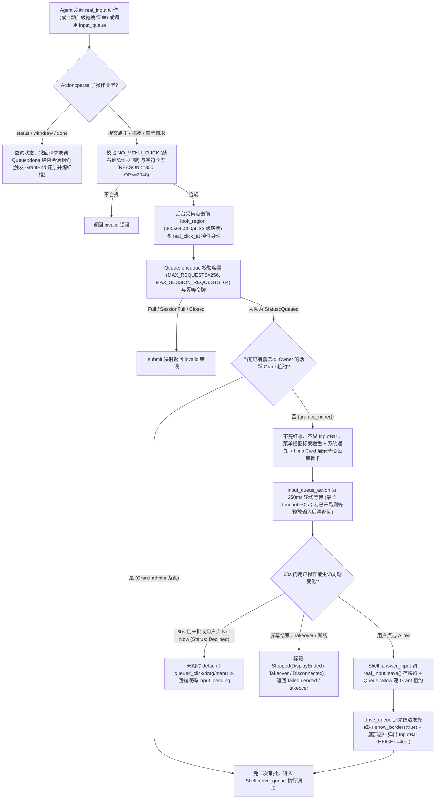
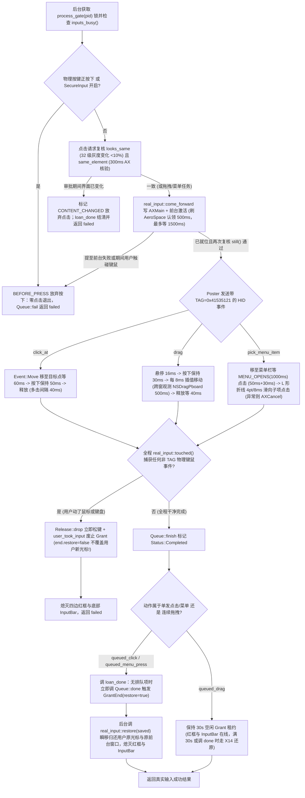

# 06. 真实输入队列 (`input_queue`) 与物理指针借用 (`real_input`) 流水线

少数 macOS 交互在 `WindowServer` 或应用框架层强绑定物理鼠标与前台进程，后台 `SLEventPostToPid` 无法替代：跨窗口系统拖拽 (`CoreDrag`)、未挂 CDP 管道浏览器的网页拖拽、Electron 输入框聚焦时的菜单栏点击 (`#39`)、以及忽略非前台事件的特殊控件 (`ADR 0013`)。此时请求进入全局串行 `InputQueue`。系统遵循两阶段隔离：**等待审批阶段 (`grant.is_none()`) 不点亮屏幕红框也不显示底部 Input Bar**，而是将菜单栏图标切换为橙色待审态并在其下方弹出 **Help Card (`queue_view`)** 琥珀色请求卡供用户点击允许或暂不；**仅当用户点击允许建立 `Grant` 租约后 (`grant.is_some()`)**，`Shell` 才保存用户光标与前台快照、在物理屏幕四周点亮裁切圆角与刘海的发光红框 (`native::show_borders(true)`, `#206`)、在屏幕底部居中显示 **Input Bar**（提示动鼠标即可收回并提供停止按钮），等用户松手静置满 `1.0s` 后瞬移物理指针完成动作，且全程一遇任何真实键鼠事件即刻中止并放弃覆盖用户新位置。

## 线程与队列分工

1. **GPUI 主线程 (`Core` / `InputQueue` / `Shell`)**：维护纯模型 `input_queue::Queue` (`crates/model/src/input_queue.rs`) 排队状态与 `IDLE_MS = 30_000` (`30s`) 租约；审批前驱动菜单栏图标与顶部 Help Card (`apps/macos/src/ui/help_card.rs`)，获批后由 `Shell::drive_queue` (`apps/macos/src/ui/shell.rs:1258-1455`) 驱动四边发光红框 `native::show_borders` (`apps/macos/src/mac/native.rs:772-875`) 与底部 `InputBar` (`apps/macos/src/ui/input_bar.rs:1-167`)。
2. **全局硬件监听回调 (`real_input::watch`)**：通过 `CGEventTap` 监听一切 `event_user_data != TAG` (`0x4153_5121` `"ASQ!"`) 的真实物理鼠标移动、按键与键盘事件 (`apps/macos/src/mac/real_input.rs:46, 175-271`)；一旦在已挂载 (`arm(true)`) 期间检测到真实输入，立即置位 `touched()` 撤销整份 `Grant` 租约。
3. **进程门控与真实输入执行任务 (`background_executor` + `process_gate`)**：获取目标 `pid` 锁 `real_input::process_gate` (`apps/macos/src/mac/real_input.rs:27-44`)，执行 `inputs_busy` 与像素/AX 防篡改复核、`come_forward` 提至前台（同时每帧刷新 AeroSpace 认领文件 `TOUCHING = 500ms`）、发送带 `TAG` 的 HID 事件，并在租约正常结束时调 `real_input::restore(saved)` 还原原光标与原前台应用。

---

## 图 1：入队校验、Help Card 审批、获批后红框与底部 Input Bar 点亮 (`#206`) 及租约管理

### 图 1 节点明细表

| 节点 | 线程与队列 | 我方代码与常量 | macOS 组件与内部行为 | 限制与关联缺陷 | Agent 侧返回 | 用户侧表现 | 验证证据 |
| :--- | :--- | :--- | :--- | :--- | :--- | :--- | :--- |
| `Q1` | `mcp` -> GPUI 主线程 | `tools::run("input_queue")` (`crates/mcp/src/tools.rs:1076-1100`), `input_queue_action` / `queued_click` / `queued_drag` / `queued_menu_press` (`apps/macos/src/control/agent.rs:6720-7238`) | 统一入口：既承接 `computer(..., real_input: true)`、跨窗/无管道浏览器拖拽与 Electron 菜单栏点击的自动入队等待，也支持显式调用 `input_queue` | 要求录屏与辅助功能权限均已生效 | 进入 `Q2` | 无变化 | 已验证：`crates/mcp/src/tools.rs:1076` `"input_queue" => {`；`apps/macos/src/control/agent.rs:6720` `async fn input_queue_action(` |
| `Q2` | GPUI 主线程 | `Action::parse` (`crates/model/src/input_queue.rs:149-175`) | 解析 `request`、`wait`、`status`、`withdraw`、`done` 五种动作；`wait`/`withdraw` 必带 `requestId`，`done` 禁止带 `requestId` | 参数不匹配直接报 `invalid` | 控制动作走 `QR1`，新请求走 `Q3` | 无变化 | 已验证：`crates/model/src/input_queue.rs:156,169` `pub fn parse(name: &str, request: Option<RequestId>) -> Result<Self, &'static str>` / `_ => Err("action is request, wait, status, withdraw or done")` |
| `QR1` | GPUI 主线程 | `Queue::withdraw` / `Queue::done` (`crates/model/src/input_queue.rs:267-297, 517-528`), `agent.rs:6764-6782` | `withdraw` 取消本会话 `Queued` 请求（若正 `Running` 则置 `Stopping(Stop::Withdrawn)`）；`done` 将本会话所有显示器标记完成，若无其它参与会话未完则由 `tick` 触发 `GrantEnd { restore: true }` 立即归还鼠标并熄灭红框 | 免去等待 `30s` 空闲超时 | 返回队列当前状态 JSON | `done` 后底部 Input Bar 收起、光标还原、红框熄灭 | 已验证：`crates/model/src/input_queue.rs:267,517` `pub fn withdraw(&mut self, id: RequestId, owner: &Owner, now: u64) -> bool` / `pub fn done(&mut self, owner: &Owner, now: u64)` |
| `Q3` | GPUI 主线程 | `real_click::opens_menu` / `NO_MENU_CLICK` (`crates/model/src/real_click.rs:39-51`), `REASON_CHARS = 300` / `OPERATION_CHARS = 2048` (`apps/macos/src/input_queue.rs:14-15`) | 拦截右键或 `Ctrl+左键` 点击（真实右键弹出的上下文菜单会在归还用户前台时关闭或卡住模态循环），并校验 `reason` 与 `operation` 长度上限 | 上下文菜单需改走语义动作或 `request_help` | 违规走 `QX1`，合规走 `Q4` | 无变化 | 已验证：`crates/model/src/real_click.rs:39,46` `pub const NO_MENU_CLICK: &str = ...` / `pub fn opens_menu(button: Button, control: bool) -> bool`；`apps/macos/src/input_queue.rs:14-15` `const REASON_CHARS: usize = 300; const OPERATION_CHARS: usize = 2048;` |
| `QX1` | GPUI 主线程 | `ControlError::invalid` (`apps/macos/src/control/agent.rs:441-443, 6760, 6975`) | 返回参数违规错误，零指针副作用 | 无 | 错误码 `invalid` | 无变化 | 已验证：`apps/macos/src/control/agent.rs:442` `return Err(ControlError::invalid(real_click::NO_MENU_CLICK));` |
| `Q4` | 后台执行器 | `real_click::look_region` (`crates/model/src/real_click.rs:53-116`), `screenshot::samples` (`apps/macos/src/mac/screenshot.rs:275-331`), `input::real_click_at` (`apps/macos/src/mac/input.rs:2738-2749`) | 采集点击点周围 `300 x (64..200) pt` 区域的 `32` 级灰度采样与顶层归属窗口控件身份（`#205`：`real_click_at` 允许 `layer 0..=8` Sheet/面板及归属本屏进程的 `layer == 101` 弹出菜单窗，单元测试已覆盖） | 若目标点无本会话窗口则返回 `not_found` (`agent.rs:6999`) | 生成前置指纹进入 `Q5` | 无变化 | 已验证：`crates/model/src/real_click.rs:53,63` `pub const LOOK_WIDTH: f64 = 300.0;` / `pub const LOOK_LEVELS: u8 = 32;`；`apps/macos/src/mac/input.rs:2738` `pub fn real_click_at(` |
| `Q4_E2E` | 实机指针回归项 (`#205`) | `tests/e2e` `real_input` 套件 | 真实物理指针在虚拟屏 Sheet 与 `layer == 101` 弹出层上的端到端点击验证 | 实跑会移动本机真实物理鼠标，本轮按硬约束跳过 | 同 `Q4` | 待空闲实跑 | 未验证：`real_click_at` 层级放行代码与单测已核实，真实物理指针端到端点击需在允许移动真实指针时运行 `AGENTSCREEN_INSTANCE=e2e cargo e2e run real_input` 验证 (`docs/research/root-causes-2026-11.md` §5) |
| `Q5` | GPUI 主线程 | `Queue::enqueue` (`crates/model/src/input_queue.rs:10-13, 140-148, 300-390`) | 校验 `MAX_REQUESTS = 256` 与 `MAX_SESSION_REQUESTS = 64`；相同 `(owner, operation)` 重试复用最新非撤回/非替换记录（因此用户拒绝后同操作重试直接命中原 `Declined` 记录，绝不静默重弹审批） | 防止异常循环塞满队列或骚扰用户 | 报错走 `QX2`，成功走 `Q6` | 无变化 | 已验证：`crates/model/src/input_queue.rs:10-13,140-146` `pub const MAX_REQUESTS: usize = 256;` / `pub const MAX_SESSION_REQUESTS: usize = 64;` / `pub enum EnqueueError { Full, SessionFull, Invalid, Closed }` |
| `QX2` | GPUI 主线程 | `InputQueue::submit` -> `ControlError::invalid` (`apps/macos/src/control/agent.rs:6760, 6904, 7066, 7190`) | 将 `EnqueueError` 文本映射为控制层 `invalid` 错误返回 | 无 | 错误码 `invalid` | 无变化 | 已验证：`apps/macos/src/control/agent.rs:6760` `.map_err(ControlError::invalid)?` |
| `Q6` | GPUI 主线程 | `Grant::admits` (`crates/model/src/input_queue.rs:115-122`) | 判断当前是否存在活跃 `Grant` 租约且覆盖当前 `Owner`（审批时已在等待或租约期内新到达的请求） | 同一租约期内后续拖拽等操作免重复弹窗 | 命中走 `Q10`，无租约走 `Q7` | 租约存续期红框与底部 InputBar 在线 | 已验证：`crates/model/src/input_queue.rs:118-120` `pub fn admits(&self, owner: &Owner) -> bool { self.participants.contains(owner) }` |
| `Q7` | GPUI 主线程 | `Shell::drive_queue` (`apps/macos/src/ui/shell.rs:1298-1301`), `HelpCard` (`apps/macos/src/ui/help_card.rs`) | 当 `!granted` 时，显式执行 `native::show_borders(false)` 与 `sync_bar(false)`（**审批等待期绝不显示屏幕红框、无全屏底色染色、也不显示底部 Input Bar**）；菜单栏图标变为橙色待审态、发系统通知并在图标下方弹出 Help Card 琥珀色请求卡 (`#206`, `ADR 0013`) | 把待审批提问与鼠标正被借用在视觉上严格区分 (`#206`) | 请求处于 `Status::Queued` | 菜单栏下弹出琥珀色审批卡片（无屏幕红框） | 已验证：`apps/macos/src/ui/shell.rs:1298-1301` `if !granted { native::show_borders(false); self.sync_bar(false, cx); real_input::arm(false);` |
| `Q8` | GPUI 异步轮询 | `input_queue_action` (`apps/macos/src/control/agent.rs:6790-6839`) | 默认最多等待 `timeout = 60.0s`（钳制于 `0.0..=60.0`），每 `250ms` 检查队列状态；若截止时刻该请求已处于 `Running` 或 `Stopping`，必须继续等待其释放硬件输入后才允许返回，否则调 `detach(r)` 挂起脱离 | 杜绝调用超时返回后后台仍在移动鼠标 | 状态就绪或满 `60s` 进入 `Q9` | 等待用户点击 Allow / Not Now | 已验证：`apps/macos/src/control/agent.rs:6792,6816-6825` `p.number("timeout").unwrap_or(60.0).clamp(0.0, 60.0)` / `matches!(r.status, Status::Running \| Status::Stopping(_))` / `c.input_queue.detach(r);` |
| `Q9` | GPUI 主线程 | `queued_click` / `queued_drag` / `queued_menu_press` 状态分支 (`apps/macos/src/control/agent.rs:6915-6945, 7075-7105, 7200-7220`) | 区分 `completed`、`stopped`、以及未决/被拒 (`queued` / `declined`) | 见各出口节点 | 分流至 `QX3` / `QX4` / `Q_ALLOW` | 随用户操作切换 | 已验证：`apps/macos/src/control/agent.rs:7076-7093` `match r["state"].as_str() { Some("completed") => true, Some("stopped") ... state_now =>` |
| `QX3` | GPUI 主线程 | `ControlError { code: "input_pending" }` (`apps/macos/src/control/agent.rs:6935, 7086, 7210`), `Queue::decline` (`crates/model/src/input_queue.rs:502-514`) | 若 60s 到期仍处于 `"queued"`，或用户点击 Not Now 置为顶层状态 `Status::Declined` (`"declined"`)，均返回专用错误码 `"input_pending"`（消息内区分仍在等待还是已被用户拒绝，并说明未发送任何后台点击） | 明确告知 Agent 请求未执行，避免误判为已点击 | 错误码 `input_pending` | 点击 Not Now 时审批卡收起，全程无红框 | 已验证：`apps/macos/src/control/agent.rs:7079,7085-7087` `if state_now == Some("declined")` / `return Err(ControlError { code: "input_pending", message: ... });` |
| `QX4` | GPUI 主线程 | `Queue::end_display` / `takeover` / `disconnect` (`crates/model/src/input_queue.rs:530-563`) | 屏幕关闭、进入 `Takeover` 或连接断开时将未决项置为 `Status::Stopped(Stop::DisplayEnded \| Takeover \| Disconnected)` | 清理挂起请求并按需结束租约 | 返回 `ended` / `takeover` / `failed` | 按需清理指示器 | 已验证：`crates/model/src/input_queue.rs:546,556` `pub fn disconnect(&mut self, connection: u64, now: u64)` / `pub fn end_display(&mut self, display: DisplayId, now: u64)` |
| `Q_ALLOW` | GPUI 主线程 | `Shell::answer_input` (`apps/macos/src/ui/shell.rs:1222-1236`), `Queue::allow` (`crates/model/src/input_queue.rs:392-424`) | **在租约起点调用一次 `real_input::save()`** 将用户此刻的光标全局坐标、前台 `pid` 与主窗口存入 `shell.real_saved`，随后调 `Queue::allow` 建立 `Grant` 租约 | 快照在整个租约期保留，直至租约正常结束时一次性还原 | 转入 `Q_IND` | Help Card 审批项转为已允许 | 已验证：`apps/macos/src/ui/shell.rs:1222-1235` `pub fn answer_input(&mut self, approval: u64, allow: bool, cx: &mut Context<Self>) { let saved = crate::mac::real_input::save(); ... if granted { self.real_saved = Some(saved); }` |
| `Q_IND` | GPUI 主线程 | `Shell::drive_queue` (`apps/macos/src/ui/shell.rs:1316-1320`), `native::show_borders` (`apps/macos/src/mac/native.rs:143, 765, 772, 869-870`), `InputBar` (`apps/macos/src/ui/input_bar.rs:28, 80-165`), `screen_edge` (`crates/model/src/screen_edge.rs`) | 核验 `real_input::watching()` 在线后，调用 `native::show_borders(true)` 在所有物理屏顶层 (`BORDER_LEVEL = 1000`) 绘制贴合屏幕圆角与 MacBook Pro 14/16 刘海贝塞尔曲线的红色发光描边（线宽 `EDGE = 2.0pt`，外发光半径 `GLOW_RADIUS = 7.0pt`，透明度 `GLOW_OPACITY = 0.45`，点击穿透，`#206`），同时在主屏**底部居中**弹出非激活 `InputBar`（高 `HEIGHT = 40.0pt`，显示动鼠标即可收回提示、30s 倒计时与停止按钮） | 若 `watching()` 或 `show_borders(true)` 失败，立即调 `revoke_input` 拒绝在无监控或无红框下移动真鼠标 | 转入 `Q10` | 物理屏四周亮起贴边红框，屏幕底部居中浮现停止条 | 已验证：`apps/macos/src/ui/shell.rs:1312-1320` `if !real_input::watching() { self.revoke_input(cx); return; } if !native::show_borders(true) { return; } self.sync_bar(true, cx);`；`apps/macos/src/mac/native.rs:143,765` `pub const BORDER_LEVEL: isize = 1000;` / `const EDGE: f64 = 2.0;` |
| `Q10` | GPUI 主线程 | `Shell::drive_queue` 静置门控与 `start_loan` (`apps/macos/src/ui/shell.rs:1325-1365`) | 用户刚点完允许按钮时手还在鼠标上：首次挂载 `real_input::arm(true)` 前必须等待 `ime::user_idle() >= 1.0` (`1.0s`)，随后挂载硬件监听并调 `start_loan` (`Queue::start`) 将队首请求置为 `Status::Running` | 防止用户点完 Allow 松手瞬间的余动误废止刚批准的租约 | 转入图 2 | 底部 Input Bar 显示正在执行 | 已验证：`apps/macos/src/ui/shell.rs:1329-1350` `if !real_input::armed() { ... let idle = crate::mac::ime::user_idle(); if idle < 1.0 { ... return; } real_input::arm(true); }` |

---

## 图 2：防篡改复核、物理指针瞬移执行、硬件抢占中断与租约结算还原

### 图 2 节点明细表

| 节点 | 线程与队列 | 我方代码与常量 | macOS 组件与内部行为 | 限制与关联缺陷 | Agent 侧返回 | 用户侧表现 | 验证证据 |
| :--- | :--- | :--- | :--- | :--- | :--- | :--- | :--- |
| `X1` | 后台执行器 | `real_input::process_gate` (`apps/macos/src/mac/real_input.rs:27-44`), `inputs_busy` (`real_input.rs:653-672`) | 获取目标 `pid` 锁，检查 `CGEventSourceButtonState(HIDSystemState)` 鼠标按键态、修饰键态及 `IsSecureEventInputEnabled()` | 若上次监听被系统超时禁用，在无活跃租约时由 `recover_observer()` 恢复 (`shell.rs:1306`) | 进入 `X2` | 无变化 | 已验证：`apps/macos/src/mac/real_input.rs:27,653` `pub fn process_gate(pid: i32)` / `fn inputs_busy() -> Option<&'static str> {` |
| `X2` | 后台执行器 | `inputs_busy` 分支 (`apps/macos/src/mac/real_input.rs:653-672`) | 判断用户是否正按住物理按键或系统处于安全输入态 | 绝不在物理按键按下或密码框保护期抢指针 | 忙走 `XX1`，空闲走 `X3` | 无变化 | 已验证：`apps/macos/src/mac/real_input.rs:653` `fn inputs_busy() -> Option<&'static str> {` |
| `XX1` | 后台 -> 主线程 | `BEFORE_PRESS` (`apps/macos/src/mac/real_input.rs:757-762`) | 按下鼠标按键前干净退出，承诺零点击副作用 | 若排队中另一条曾获批请求尚未运行而租约已失效，状态中附带 `LAPSED_NEXT` 说明 (`apps/macos/src/input_queue.rs:16`) | 错误码 `failed`：`nothing was pressed: before the press...` | 鼠标不乱跳 | 已验证：`apps/macos/src/mac/real_input.rs:757` `const BEFORE_PRESS: &str = "nothing was pressed: before the press, the approval ended..."` |
| `X3` | 后台执行器 | `real_click::looks_same` (`LOOK_LEVELS = 32`, `LOOK_PERCENT = 10`, `crates/model/src/real_click.rs:63-78, 118-145`), `same_element` (`apps/macos/src/ui/shell.rs:1416-1435`) | 重新采集点击区域像素样本核验变化率 `< 10%`，并以 `300ms` AX 超时复核目标控件身份一致；在 `come_forward` 完成后还会二次复核 `still()` (`real_input.rs:952`) | 防止等待审批期间弹窗或滚动导致误点新按钮 (`ADR 0013`) | 已变化走 `XX2`，一致走 `X4` | 无变化 | 已验证：`crates/model/src/real_click.rs:63,69,118` `pub const LOOK_LEVELS: u8 = 32;` / `pub const LOOK_PERCENT: usize = 10;` / `pub fn looks_same(` |
| `XX2` | GPUI 主线程 | `CONTENT_CHANGED` (`crates/model/src/real_click.rs:73-78`), `agent.rs:7096-7135` | 拒绝在已变更界面上点击，调 `loan_done` 结清并返回提示要求重新截图确认 | 保护用户免受陈旧坐标误点 | 错误码 `failed` | 光标不发生点击 | 已验证：`crates/model/src/real_click.rs:73` `pub const CONTENT_CHANGED: &str = ...`；`agent.rs:7096` `let changed = r["failure"].as_str() == Some(real_click::CONTENT_CHANGED);` |
| `X4` | 后台执行器 | `real_input::come_forward` (`apps/macos/src/mac/real_input.rs:361-472`), `TOUCHING = 500ms` / `SETTLED = 300ms` / `SETTLE_LIMIT = 1500ms` | 若 `bobko.aerospace` 正在运行，持续刷新认领文件 (`TOUCHING = 500ms`) 防止 AeroSpace 抢抓窗口；随后设 `kAXMainAttribute = true` 并调 `_SLPSSetFrontProcessWithOptions` (`0x186ebad94`) 将虚拟屏目标窗口提至前台，最多等 `SETTLE_LIMIT = 1500ms`（稳定 `SETTLED = 300ms`） | 目标窗口坐标仍停留在屏外虚拟屏，不会搬到用户物理屏遮挡视线 | 失败或用户触碰走 `XX1`，就位走 `X5` | 物理屏无窗口弹出 | 已验证：`apps/macos/src/mac/real_input.rs:361-364,418` `const TOUCHING: Duration = Duration::from_millis(500); const SETTLED: Duration = Duration::from_millis(300); const SETTLE_LIMIT: Duration = Duration::from_millis(1500);` / `pub fn come_forward(` |
| `X5` | 后台执行器 | `Poster` / `TAG = 0x4153_5121` (`apps/macos/src/mac/real_input.rs:46, 548-635`) | 构造写入 `EventSourceUserData = 0x4153_5121` (`"ASQ!"`) 的 `CGEvent`，通过 `CGEventPost(CGEventTapLocation::HIDEventTap, ...)` (`CGEvent.h:353`) 发送系统级 HID 事件；RAII 守卫 `Release` 保证任何提前退出路径自动补发松键事件 | 使 `real_input::watch` 精确区分我方事件与真实硬件输入 | 分流至 `X6` / `X7` / `X8` | 物理指针短暂移至虚拟屏 | 已验证：`apps/macos/src/mac/real_input.rs:46,548` `pub const TAG: i64 = 0x4153_5121;` / `struct Poster`；`MacOSX.sdk CGEvent.h:353` `CGEventPost` |
| `X6` | 后台执行器 | `real_input::click_at` (`apps/macos/src/mac/real_input.rs:892-1015`), `HOLD_MS = 50` / `GAP_MS = 40` (`crates/model/src/real_click.rs:20-24`) | 通过 `Poster` 发送 `Event::Move` (`MouseMoved`) 移至目标点并等待 `60ms` (`real_input.rs:974-979`)，再发送按下保持 `HOLD_MS = 50ms` 与释放（多击间隔 `GAP_MS = 40ms`） | 单次点击耗时约 `110ms` | 进入 `X9` 核查中断 | 鼠标短暂借用约 `0.1s` | 已验证：`apps/macos/src/mac/real_input.rs:892,974-979` `pub fn click_at(` / `sleep(Duration::from_millis(60))`；`crates/model/src/real_click.rs:20-21` `pub const HOLD_MS: u64 = 50; pub const GAP_MS: u64 = 40;` |
| `X7` | 后台执行器 | `real_input::drag` (`apps/macos/src/mac/real_input.rs:674-686, 709-890`) | 起点悬停 `HOVER = 16ms` -> 按下保持 `PRESS_HOLD = 30ms` -> 沿 `real_drag::travel` 轨迹按 `STEP_GAP = 8ms` 插值拖动（跨窗拖拽观测 `NSPasteboardNameDrag` 计数变化最多 `SESSION_WAIT = 500ms`） -> 终点停顿后释放并等待 `AFTER_RELEASE = 40ms` | 真实激活 macOS `CoreDrag` 与 Chromium 系统拖拽会话 | 进入 `X9` 核查中断 | 每 `8ms` 一步均可被物理鼠标打断 | 已验证：`apps/macos/src/mac/real_input.rs:674,677,709` `const HOVER: Duration = Duration::from_millis(16);` / `const STEP_GAP: Duration = Duration::from_millis(8);` / `pub fn drag(` |
| `X8` | 后台执行器 | `real_input::pick_menu_item` / `close_menu` / `glide` (`apps/macos/src/mac/real_input.rs:1017-1241, 1278-1299`) | 移至虚拟屏菜单栏标题等待最多 `MENU_OPENS = 1000ms` 后点击（`50ms` 按住 + `30ms`），沿 L 形折线 `corner` 按 `STEP = 4.0pt`、`8ms`/步滑向子菜单项停 `60ms` 后点击；若中途失败或中断则调 `close_menu` (`AXCancel`) 收起菜单 | 解决 Electron 输入框聚焦时快捷键菜单失效 (`#39`) | 进入 `X9` 核查中断 | 菜单在虚拟屏内展开并收起 | 已验证：`apps/macos/src/mac/real_input.rs:1017,1032,1089` `const MENU_OPENS: Duration = Duration::from_millis(1000);` / `fn close_menu(` / `pub fn pick_menu_item(` |
| `X9` | 原子标志读取 | `real_input::touched` (`apps/macos/src/mac/real_input.rs:98-102, 175-200`) | 检查执行期间是否捕获到任何非 `TAG` 的真实硬件键鼠事件 | 物理键鼠拥有无条件抢占权 | 被打断走 `X10`，未打断走 `X11` | 用户一动鼠标即刻收回控制权 | 已验证：`apps/macos/src/mac/real_input.rs:98` `pub fn touched() -> bool` |
| `X10` | 后台 + 主线程 | `Release::drop` (`apps/macos/src/mac/real_input.rs:618-635`), `Queue::user_input` (`crates/model/src/input_queue.rs:492-500`), `Shell::drive_queue` (`apps/macos/src/ui/shell.rs:1271-1275, 1244-1250`) | 1. `Release::drop` 立即释放按下的按键；2. `Queue::user_input` 废止整份 `Grant` 租约并将 `pending_end.restore` 置为 **`false`**；3. `drive_queue` 因 `end.restore == false` **不调用 `restore(saved)`**，让光标与前台留在用户刚刚亲手移去的位置！ | 绝不把用户刚挪走的鼠标拽回旧快照位置 (`input_queue.rs:492-495`) | 转 `XX3` | 红框与底部 InputBar 立即消失，鼠标留在用户手下 | 已验证：`crates/model/src/input_queue.rs:492-498` `pub fn user_input(&mut self) { ... self.end_grant(false); if let Some(end) = self.pending_end.as_mut() { end.restore = false; }`；`shell.rs:1274` `.filter(\|_\| end.restore && !real_input::touched())` |
| `XX3` | GPUI 主线程 | 中断错误出口 (`apps/macos/src/control/agent.rs:6925-6933, 7120-7138`) | 报告真实输入中途因用户操作或窗口变动已停止且按键已松开 | 下次真实输入须重新经用户批准 | 错误码 `failed` | 零后续干扰 | 已验证：`apps/macos/src/control/agent.rs:6926` `"The drag with the user's pointer stopped partway..."` |
| `X11` | GPUI 主线程 | `Queue::finish` (`crates/model/src/input_queue.rs:470-490`) | 确认 `active == Some(id)` 后将状态置为 `Status::Completed`，刷新 `idle_since_ms` | 过期完成事件无法释放其它会话的租约 | 进入 `X12` | 单次借用完成 | 已验证：`crates/model/src/input_queue.rs:470,479` `pub fn finish(&mut self, id: RequestId, now: u64) -> bool` / `Status::Running => Status::Completed,` |
| `X12` | GPUI 主线程 | 单发操作与连续拖拽结算分流 (`apps/macos/src/control/agent.rs:6915-6923, 7106, 7220`) | `queued_click` 与 `queued_menu_press` 执行完立即调 `loan_done` 归还鼠标；`queued_drag` 则保留 `30s` 租约供后续连续拖拽复用 | 见 `X13` 与 `X15` | 点击/菜单走 `X13`，拖拽走 `X15` | 拖拽后底部 InputBar 显示 30s 倒计时 | 已验证：`apps/macos/src/control/agent.rs:6920,7106,7220` `"The drag ran with the user's pointer, which stays on this display until the approval ends. Call input_queue done..."` / `c.input_queue.loan_done(&owner, request);` |
| `X13` | GPUI 主线程 | `InputQueue::loan_done` (`apps/macos/src/input_queue.rs:260-278`) | 清理已完成请求记录；若同会话在所有显示器上均无排队或运行中的请求，立即调用 `queue.done(owner, now)` 与 `tick()` 生成 `GrantEnd { restore: true }` | 点击与菜单选择用完即还，无需等 `30s` | 转入 `X14` | 立即触发光标与前台还原 | 已验证：`apps/macos/src/input_queue.rs:260,273-275` `pub fn loan_done(&mut self, owner: &Owner, id: RequestId)` / `self.queue.done(owner, now); self.tick();` |
| `X14` | 后台 + 主线程 | `Shell::drive_queue` 清理分支 (`apps/macos/src/ui/shell.rs:1268-1296`), `real_input::restore` (`apps/macos/src/mac/real_input.rs:307-356`) | 先收起底部 `InputBar` (`sync_bar(false)`)，若 `end.restore && !touched()` 则在后台调 `real_input::restore(saved)` 执行 `CGWarpMouseCursorPosition(saved.cursor)` + `CGAssociateMouseAndMouseCursorPosition(true)` + 恢复原前台进程，完成后调 `arm(false)` 与 `native::show_borders(false)` 熄灭红框 | 红框一直保持到光标彻底还原完毕才熄灭 (`shell.rs:1277, 1287`) | 走 `XR1` | 光标回原位、原前台恢复、红框熄灭 | 已验证：`apps/macos/src/ui/shell.rs:1277-1288` `self.sync_bar(false, cx); ... real_input::restore(saved) ... real_input::arm(false); native::show_borders(false);` |
| `X15` | GPUI 主线程 | `Queue::tick` / `IDLE_MS = 30_000` (`crates/model/src/input_queue.rs:9, 565-576`) | 拖拽完成后租约进入 `30s` 空闲窗口，后续同会话拖拽免审批直接执行；满 `30s` 无新请求或 Agent 调 `input_queue(action: "done")` 时触发 `end_grant(true)` 转 `X14` 还原 | 兼顾多步连续拖放体验与及时归还 | 走 `XR1` | 红框与底部 InputBar 维持提示直至 `done` 或 `30s` 到期 | 已验证：`crates/model/src/input_queue.rs:9,570-574` `pub const IDLE_MS: u64 = 30_000;` / `now.saturating_sub(idle) >= IDLE_MS \|\| grant.participants.is_subset(&grant.done)` |
| `XR1` | GPUI 主线程 -> `mcp` | 成功结果返回 (`apps/macos/src/control/agent.rs:6916-6924, 7110-7120, 7224-7235`) | 更新虚拟指针位置并返回 `{"route": "real_input", ...}`（点击与拖拽在 `computer` 层随后自动跑 `settle` 截图与 `adopt_opened`） | 无 | 返回动作完成 JSON | Peek/Viewer 画面更新 | 已验证：`apps/macos/src/control/agent.rs:6918,7225` `"route": "real_input"` |
