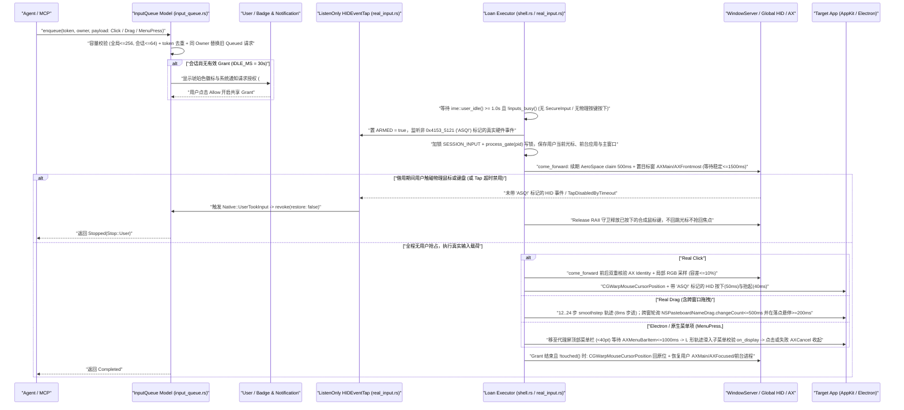

# 操作 06：Input Queue 与真实输入借用路径（ADR 0013）

当目标操作受 macOS 或应用框架限制无法在后台合成完成时（跨窗口拖拽、无 CDP 管道的网页或 Electron 拖拽、原生应用菜单栏遍历、以及代理显式声明 `realInput`），请求进入 `Input Queue`。在用户授权与空闲门控全部满足后，执行器短暂借用全局 HID 光标与前台焦点，一旦监测到用户真实触碰键鼠立即撤权止损。

## 端到端流程

## 节点明细表

| 节点 | 我方代码 | macOS 组件与内部行为 | 限制与故障模式 | 关联问题 | 验证状态 |
| --- | --- | --- | --- | --- | --- |
| 1. 队列准入、去重与覆盖 | `crates/model/src/input_queue.rs:1-380`、`apps/macos/src/input_queue.rs:1-290` | 纯模型状态管理：全局上限 `MAX_REQUESTS = 256`，单连接上限 `MAX_SESSION_REQUESTS = 64`。相同 `token` 幂等返回既有请求（被用户拒绝过的 `token` 绝不静默重问）；同一 `Owner` 提交新请求时将旧的 `Queued` 请求置为 `Stopped(Stop::Replaced)`。 | 恶意或死循环代理刷爆单连接配额时第 65 个请求直接报队列已满；`Grant` 在连续空闲 `IDLE_MS = 30_000 ms` 后自动过期。 | `#206`、ADR 0013 | `[已验证]` `crates/model/src/input_queue.rs:1-380` |
| 2. 非侵入式排队提醒与执行红框分离 | `apps/macos/src/ui/shell.rs:1260-1360`、`apps/macos/src/input_queue.rs:120-240` | 请求处于待批 `Queued` 状态时仅展示琥珀色状态徽标与通知横幅，不遮挡用户屏幕边框；仅当 `Grant` 生效进入真实借用（Loan）期间才点亮提示视觉态。 | 修复了早期请求一入队就全屏亮红框干扰用户阅读的问题（`#206`）。若用户关闭系统通知权限，仅菜单栏徽标可见。 | `#206` | `[已验证]` `apps/macos/src/ui/shell.rs:1260-1360` |
| 3. `ListenOnly` 全局 HID 抢占监听器 | `apps/macos/src/mac/real_input.rs:80-295` | 在主线程 `CFRunLoop` 安装 `CGEventTapCreate(kCGHIDEventTap, kCGHeadInsertEventTap, kCGEventTapOptionListenOnly, ...)`。执行器自己发出的 `CGEvent` 均在字段 `kCGEventSourceUserData`（`CGEventTypes.h:356`，字段号 `42`）打上魔数 `0x4153_5121`（`"ASQ!"`）。回调一旦见到无魔数的物理事件，或收到 `kCGEventTapDisabledByTimeout`（`0xFFFFFFFE`）/ `kCGEventTapDisabledByUserInput`（`0xFFFFFFFF`，`CGEventTypes.h:130-131`），立即置位 `TOUCHED` 并投递 `Native::UserTookInput` 执行 `revoke()`。 | 1. 主线程卡顿超过系统阈值导致 Tap 超时被禁用时，代码按最保守策略直接视同用户接管并撤权；2. 缺少 Accessibility / Input Monitoring 权限时 `CGEventTapCreate` 返回 `NULL`，执行器拒绝启动真实借用。 | ADR 0013、TCC 权限门控 | `[已验证]` `CGEventTypes.h:130-131,356`、`apps/macos/src/mac/real_input.rs:80-295` |
| 4. 空闲与忙碌门控（`inputs_busy`）及锁获取 | `apps/macos/src/ui/shell.rs:1330-1410`、`apps/macos/src/mac/real_input.rs:300-415` | 执行前要求 `ime::user_idle() >= 1.0 s`（已剔除 `_CGSTickleActivityMonitor` 后台伪活跃），获取 `SESSION_INPUT` 全局互斥锁与目标 `process_gate(pid).try_write()`（跨窗拖拽同时锁落点 `drop.pid`），并检查 `!IsSecureEventInputEnabled()`、无物理鼠标键按下（`CGEventSourceButtonState(CombinedSessionState)`）且无修饰键按住。 | 任一终端、1Password 或系统授权弹窗开启 `SecureEventInput` 期间，键盘相关借用持续等待或报错；用户按住修饰键思考时绝不抢走光标。 | ADR 0013 | `[已验证]` `apps/macos/src/mac/real_input.rs:300-415` |
| 5. 目标前置稳定（`come_forward`） | `apps/macos/src/mac/real_input.rs:420-545` | 预先刷新 AeroSpace `claims/<pid>.json` 时间戳（保护 `500 ms`），对目标窗口写入 `AXMain = true` 与应用 `AXFrontmost = true`，轮询等待目标成为前台且窗口几何稳定满 `300 ms`（总超时 `1500 ms`）。 | 若目标应用正被系统模态框卡死，或 AeroSpace 未启用 claims 协作强行把刚激活的后台应用窗口抓回用户工作区，`come_forward` 检测到几何跳变会中止点击（修复 `#121`）。 | `#121`、AeroSpace 协作 | `[已验证]` `apps/macos/src/mac/real_input.rs:420-545` |
| 6. 真实点击双重一致性核验（`real_click`） | `crates/model/src/real_click.rs:1-210`、`apps/macos/src/ui/shell.rs:1385-1500` | 在 `come_forward` 之前记录点击处的 AX `Identity`（`[role, subrole, title, desc, item_name]`，跳过易变时间戳）与局部 RGB 像素采样（`LOOK_LEVELS = 32`，容差 `LOOK_PERCENT = 10%`）；`come_forward` 完成后二次采集并调用 `still()` 比对，防止窗口激活瞬间弹出横幅或重排按钮导致误点。预先构造 `Release` RAII 守卫，发送带 `"ASQ!"` 标记的真实左键按下（保持 `50 ms`）与抬起（间隔 `40 ms`）；显式拒绝右键、中键与 Ctrl 单击（`NO_MENU_CLICK`）。 | 目标按钮在获得前台焦点时若发生重绘变色超过 `10%` 像素比例且无稳定语义 `Identity`，会被安全门控判为目标变化而中止点击。 | 安全防误触门控 | `[已验证]` `crates/model/src/real_click.rs:1-210`、`apps/macos/src/ui/shell.rs:1385-1500` |
| 7. 真实拖拽与跨窗口 `NSPasteboardNameDrag` 同步 | `crates/model/src/real_drag.rs:1-190`、`apps/macos/src/mac/real_input.rs:709-883` | 生成 `12..=24` 步 smoothstep 插值轨迹（步间 `8 ms`，起点悬停 `16 ms`，按下保持 `30 ms`）。跨窗口拖拽越过 `6 pt` 阈值后轮询 AppKit `NSPasteboard(NSPasteboardNameDrag).changeCount`（上限 `500 ms`）确认原生 `NSDraggingSession` 已建立，并在落点窗口上方至少移动 `MOVES_OVER_DROP = 3` 次、停留 `>= 200 ms`，等待 Chromium 渲染进程完成异步 `dragover` IPC 后再发 `LeftMouseUp` 并静置 `40 ms`。 | 若源窗口并未真正启动 Cocoa 拖放会话（例如只是普通文本选区），`changeCount` 超时后仍按普通指针拖拽收尾；若 Chromium 页面极度繁忙超过 `200 ms` 未响应 `dragover`，落点可能丢弃 drop。 | `#37`、`#166` | `[已验证]` `apps/macos/src/mac/real_input.rs:709-883` |
| 8. 代理屏原生与 Electron 菜单点击（`menu_press`） | `crates/model/src/menu_press.rs:1-220`、`apps/macos/src/mac/real_input.rs:1089-1240` | 将真实光标移至代理显示器顶部菜单栏区（距顶 `< 40 pt`），等待最多 `1000 ms` 直至该屏菜单栏实例化目标应用的 `AXMenuBarItem`；点击顶层菜单后沿 L 形折线（先横/纵至 `corner` 再入子项，避免斜穿关闭相邻父菜单）逐级展开子菜单，每步用 `menu_press::on_display` 过滤 Electron 未展开时的 `10x10` 占位假矩形；中止或失败时对打开的菜单执行 `AXCancel`（绝不发 Escape 以免误关业务弹窗）。 | **硬性系统前提**：要求 macOS 系统设置开启"显示器具有单独的空间"（Displays have separate Spaces）；若用户关闭该系统选项，副屏顶部根本不存在菜单栏，`1000 ms` 等待必然超时失败（`#39`）。 | `#39` | `[已验证]` `crates/model/src/menu_press.rs:1-220`、`apps/macos/src/mac/real_input.rs:1089-1240` |
| 9. 光标与焦点归还（`GrantEnd`） | `apps/macos/src/ui/shell.rs:1505-1560`、`apps/macos/src/mac/real_input.rs:550-640` | 仅当 `active.is_none()` 且全程 `!touched()` 时执行归还：`CGWarpMouseCursorPosition` 将物理光标跳回借用前坐标，紧接调用 `CGAssociateMouseAndMouseCursorPosition(true)` 消除 CoreGraphics `250 ms` 跳变冻结期，恢复用户原窗口 `AXMain`、焦点元素 `AXFocused` 及原前台进程（`ime::return_front_unless`）。若因用户抢占中止（`restore: false`），绝不把用户刚移走的光标拽回旧位。 | 若用户在归还动作发出的微秒级竞态窗口内恰好开始移动鼠标，可能感知到一次瞬时光标回拉。 | ADR 0013 | `[已验证]` `apps/macos/src/mac/real_input.rs:550-640` |
