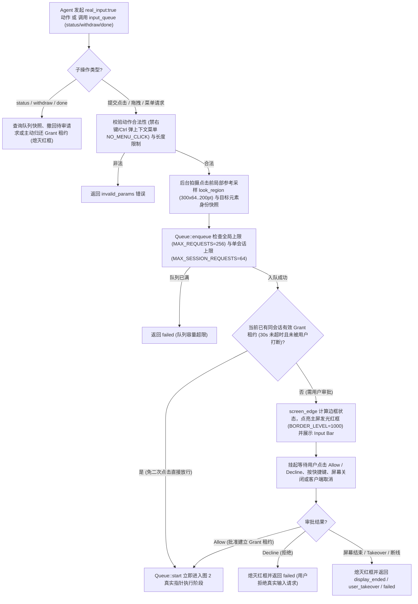
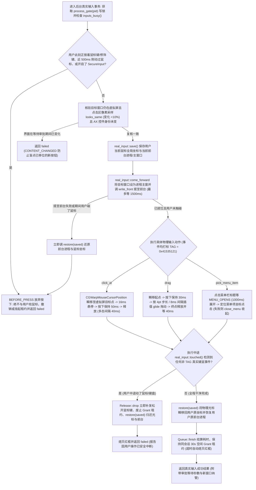

# 06. 真实输入队列 (`input_queue`) 与物理指针借用 (`real_input`) 流水线

少数 macOS 操作在内核或 `WindowServer` 层面强绑定物理鼠标与活跃会话，后台 `SLEventPostToPid` 无法跨越：例如未挂 CDP 管道浏览器的 HTML5 拖拽、读取全局 HID 按键状态的自定义画布拖拽、必须在真实展开时才构建子项的原生菜单、以及部分拒绝非前台点击的特殊控件 (`ADR 0013`)。此时 Agent 通过 `computer(..., real_input: true)`、`press_menu_item(..., real_input: true)` 或 `input_queue` 显式申请短暂借用真实指针。系统绝不自动偷抢指针：所有请求进入全局串行 `InputQueue`，在用户屏幕边缘点亮发光红框 (`#206`) 并在顶部弹出 **Input Bar**，仅当用户点击“允许”且当前未握住物理键鼠时，才以毫秒级事务保存现场、将目标窗口临时提至前台、瞬移物理光标完成动作，并在任何用户触碰键鼠的瞬间 (`CGEventTap` 硬件监听) 立即中止并恢复原光标位置与原前台窗口。

## 线程与队列分工

1. **GPUI 主线程 (`Core` / `InputQueue` / `Shell`)**：维护纯模型 `input_queue::Queue` (`crates/model/src/input_queue.rs`) 审批批次与 `IDLE_MS = 30_000` 授权租约、驱动顶部 Input Bar (`apps/macos/src/ui/input_bar.rs`) 与屏幕边缘发光红框 `native::set_screen_edge` (`apps/macos/src/mac/native.rs:765-950`) (`apps/macos/src/input_queue.rs:33-900`)。
2. **全局硬件监听回调 (`real_input::watch`)**：在独立 `CGEventTap` / 事件监控上监听非我方合成 (`event_user_data != TAG 0x4153_5121`) 的一切真实鼠标移动、按键按下与键盘敲击 (`apps/macos/src/mac/real_input.rs:46, 175-271`)，一经检测到真实用户动作立即置位原子标志 `touched()` 打断执行。
3. **进程门控与真实输入执行任务 (`background_executor` + `process_gate`)**：获取每 `pid` 读写锁 `real_input::process_gate` (`real_input.rs:27-44`)，执行 `save()` -> `come_forward()` -> `click_at` / `drag` / `pick_menu_item` -> `restore(Saved)` 完整事务序列 (`apps/macos/src/mac/real_input.rs:285-1325`)。

---

## 图 1：入队校验、Input Bar 审批、发光红框 (`#206`) 与会话租约管理

### 图 1 节点明细表

| 节点 | 线程与队列 | 我方代码与常量 | macOS 组件与内部行为 | 限制与关联缺陷 | Agent 侧返回 | 用户侧表现 | 验证来源 |
| :--- | :--- | :--- | :--- | :--- | :--- | :--- | :--- |
| `Q1` | `mcp` -> GPUI 主线程 | `input_queue_action` / `queued_click` / `queued_drag` / `queued_menu_press` (`apps/macos/src/control/agent.rs:6720-7240`) | 统一入口：既支持单步 `computer(..., real_input: true)` 自动包装入队并等待结果，也支持显式调用 `input_queue` 管理队列与批次租约 | 要求辅助功能与录屏权限均就绪 | 进入 `Q2` | 无变化 | [已验证: apps/macos/src/control/agent.rs:6720-7240] |
| `Q2` | GPUI 主线程 | `Action::parse` (`crates/model/src/input_queue.rs:150-176`) | 区分队列控制命令 (`status`、`withdraw`、`done`) 与实际指针借用请求 | 未知动作名直接报 `invalid_params` | 分流至 `QR1` 或 `Q3` | 无变化 | [已验证: crates/model/src/input_queue.rs:150-176, apps/macos/src/control/agent.rs:6735-6839] |
| `QR1` | GPUI 主线程 | `Queue::withdraw` / `Queue::done` (`crates/model/src/input_queue.rs:267-297, 517-528`) | Agent 调 `done` 主动结束本轮连续真实输入时，立即销毁 `Grant` 租约并调用 `native::hide_screen_edge` 熄灭屏幕红框 | 养成用完即还习惯，不必傻等 `30s` 自动过期 | 返回队列当前 JSON 状态 | 红框与 Input Bar 立即收起 | [已验证: crates/model/src/input_queue.rs:267-297, crates/model/src/input_queue.rs:517-528] |
| `Q3` | GPUI 主线程 | `real_click::opens_menu` / `NO_MENU_CLICK` (`crates/model/src/real_click.rs:39-51`), `REASON_CHARS = 300` / `OPERATION_CHARS = 2048` (`apps/macos/src/input_queue.rs:14-15`) | 拒绝在 `real_input` 中发送右键点击或 `Ctrl+左键`（上下文菜单一旦弹出并挂起 `AppKit` 模态循环，将无法安全归还鼠标指针！） | 上下文菜单应走语义动作或 `request_help` | 违规走 `QX1`，合规走 `Q4` | 无变化 | [已验证: crates/model/src/real_click.rs:39-51, apps/macos/src/input_queue.rs:14-15] |
| `QX1` | GPUI 主线程 | `ControlError::invalid` (`apps/macos/src/control/agent.rs:6968-6985`) | 返回 `NO_MENU_CLICK` 或参数超长错误 | 零指针副作用 | 错误码 `invalid_params` | 无变化 | [已验证: apps/macos/src/control/agent.rs:6968-6985, crates/model/src/real_click.rs:39] |
| `Q4` | 后台执行器 | `real_click::look_region` (`crates/model/src/real_click.rs:53-116`), `screenshot::samples` (`apps/macos/src/mac/screenshot.rs:275-331`), `input::real_click_at` (`apps/macos/src/mac/input.rs:2738-2749`) | 在入队瞬间采集点击点周围 `300 x (64..200) pt` 区域的 `32` 级灰度采样数组，以及目标控件的 AX `Identity` (`role`, `title`, `value`) | 用于图 2 用户耗时数秒审批后核验按钮是否已移位或界面已剧变 (`CONTENT_CHANGED`, `real_click.rs:73-78`) | 生成前置指纹进入 `Q5` | 无变化 | [已验证: crates/model/src/real_click.rs:53-164, apps/macos/src/mac/screenshot.rs:275-331] |
| `Q5` | GPUI 主线程 | `Queue::enqueue` / `MAX_REQUESTS = 256` / `MAX_SESSION_REQUESTS = 64` (`crates/model/src/input_queue.rs:10-13, 299-390`) | 分配递增 `RequestId` 入队，校验全局与单会话排队上限 | 防止异常循环塞爆内存队列 | 满走 `QX2`，成功走 `Q6` | 无变化 | [已验证: crates/model/src/input_queue.rs:10-13, crates/model/src/input_queue.rs:299-390] |
| `QX2` | GPUI 主线程 | `EnqueueError` (`crates/model/src/input_queue.rs:140-148`) | 拒绝超额入队 | 无 | 错误码 `failed` | 无变化 | [已验证: crates/model/src/input_queue.rs:140-148] |
| `Q6` | GPUI 主线程 | `Grant::admits` / `IDLE_MS = 30_000` (`crates/model/src/input_queue.rs:9, 115-132, 449-468`) | 检查当前是否存在同一 `sessionKey` 刚获批且空闲未超 `30s`、期间用户未触碰物理键鼠的活跃 `Grant` 租约 | 允许同一会话在一次用户批准后连贯完成紧邻的几步真实输入，无需每步重复点“允许” | 已获批走 `Q10`，未获批走 `Q7` | 租约存续期内屏幕边缘保持红框提示 | [已验证: crates/model/src/input_queue.rs:9, crates/model/src/input_queue.rs:115-132] |
| `Q7` | GPUI 主线程 | `screen_edge` (`crates/model/src/screen_edge.rs:1-120`), `native::set_screen_edge` (`apps/macos/src/mac/native.rs:143, 765-950`), `ui::input_bar` (`apps/macos/src/ui/input_bar.rs:1-167`) | 在用户物理屏幕四边创建穿透点击 (`ignoresMouseEvents = true`) 的顶层覆盖窗 (`BORDER_LEVEL = 1000`，线宽 `EDGE = 2.0pt`，外发光半径 `GLOW_RADIUS = 7.0pt`，发光透明度 `GLOW_OPACITY = 0.45`，淡红底色着色 `#206`)，并在顶部展示双语 Input Bar 列出待执行的点击/拖拽目标与理由 | 醒目告知用户 Agent 正在申请借用鼠标或正处于真实输入租约期 (`#206`) | 请求挂起等待 | 物理屏幕四周亮起柔和红色发光边框，顶部浮现审批条 | [已验证: apps/macos/src/mac/native.rs:143, apps/macos/src/mac/native.rs:765-950, apps/macos/src/ui/input_bar.rs:1-167, Issue #206] |
| `Q8` | GPUI 异步挂起 | `InputQueue` 等待通道 (`apps/macos/src/input_queue.rs:280-395`) | 监听 Input Bar 按钮、通知点击、连接断开与屏幕状态变更；同时 `Queue::tick` 维护 `30s` 空闲过期 | 挂起期间不移动鼠标、不改变任何窗口层级 | 阻塞当前工具调用 | 等待用户空闲并点击允许 | [已验证: apps/macos/src/input_queue.rs:280-395, crates/model/src/input_queue.rs:565-576] |
| `Q9` | GPUI 主线程 | `Queue::allow` / `Queue::decline` (`crates/model/src/input_queue.rs:392-424, 502-515`) | 根据用户选择分支处理 | 无 | 三路分流 | 点击拒绝时红框与审批条立即消失 | [已验证: crates/model/src/input_queue.rs:392-424, crates/model/src/input_queue.rs:502-515] |
| `QX3` | GPUI 主线程 | 拒绝出口 (`apps/macos/src/input_queue.rs:360-385`) | 返回用户明确拒绝说明 | 引导 Agent 停止重试真实输入或改调 `request_help` | 错误码 `failed`：`the user declined the real-input request` | 界面恢复常态 | [已验证: apps/macos/src/input_queue.rs:360-385] |
| `QX4` | GPUI 主线程 | `Queue::end_display` / `takeover` / `disconnect` (`crates/model/src/input_queue.rs:530-563`) | 会话或屏幕状态中断时清理挂起项 | 无 | `display_ended` / `user_takeover` / `failed` | 红框熄灭 | [已验证: crates/model/src/input_queue.rs:530-563] |
| `Q10` | GPUI 主线程 -> 后台 | `Queue::start` (`crates/model/src/input_queue.rs:426-447`), `InputQueue` 执行器 (`apps/macos/src/input_queue.rs:480-760`) | 锁定队首请求为 `Active`，启动硬件观察器 `real_input::arm(true)`，转入图 2 物理指针执行事务 | 同一时刻全机最多只有 `1` 个真实输入动作在跑 | 转入图 2 | Input Bar 显示正在执行状态 | [已验证: crates/model/src/input_queue.rs:426-447, apps/macos/src/mac/real_input.rs:84-97] |

---

## 图 2：防篡改复核、物理指针瞬移事务、`CGEventTap` 硬件抢占中断与现场还原

### 图 2 节点明细表

| 节点 | 线程与队列 | 我方代码与常量 | macOS 组件与内部行为 | 限制与关联缺陷 | Agent 侧返回 | 用户侧表现 | 验证来源 |
| :--- | :--- | :--- | :--- | :--- | :--- | :--- | :--- |
| `X1` | 后台执行器 | `real_input::process_gate` (`apps/macos/src/mac/real_input.rs:27-44`), `inputs_busy` (`real_input.rs:653-672`) | 获取目标进程锁，采样 `CGEventSourceButtonState(HIDSystemState)` 三键状态、`CGEventSourceFlagsState` 修饰键、`TOUCHING = 500ms` 内真实事件记录、以及 `IsSecureEventInputEnabled()` | 硬件事件监控器若被 macOS 超时禁用，由 `recover_observer()` 自动重挂 (`real_input.rs:124-161`) | 进入 `X2` 判定 | 无变化 | [已验证: apps/macos/src/mac/real_input.rs:27-44, apps/macos/src/mac/real_input.rs:124-161, apps/macos/src/mac/real_input.rs:361, apps/macos/src/mac/real_input.rs:653-672] |
| `X2` | 后台执行器 | `inputs_busy` 结果分支 (`apps/macos/src/mac/real_input.rs:653-672`) | 判断用户此刻是否正占用物理键鼠或系统处于安全输入保护期 | 绝不在用户手握鼠标时争抢指针 | 忙走 `XX1`，空闲走 `X3` | 无变化 | [已验证: apps/macos/src/mac/real_input.rs:653-672] |
| `XX1` | 后台 -> 主线程 | `BEFORE_PRESS` (`apps/macos/src/mac/real_input.rs:757-762`), `LAPSED_NEXT` (`apps/macos/src/input_queue.rs:16-19`) | 在按下任何按键前干净退出，保证零误点 | 哪怕用户刚刚点完“允许”后手立刻继续晃动鼠标，也会被 `500ms` 静默保护拦下 | 错误码 `failed`：`nothing was pressed: before the press, the approval ended, the user moved the pointer...` | 光标不乱跳 | [已验证: apps/macos/src/mac/real_input.rs:757-762, apps/macos/src/input_queue.rs:16-19] |
| `X3` | 后台执行器 | `real_click::looks_same` (`LOOK_LEVELS = 32`, `LOOK_PERCENT = 10%`, `crates/model/src/real_click.rs:63-78, 118-145`), `real_click_still_under` (`apps/macos/src/mac/input.rs:2751-2798`) | 重新截取 `Q4` 同一局部矩形对比像素变化比例是否 `< 10%`，且目标点下的 AX 控件 `same_element` 身份一致 | 防止等待用户审批的十几秒内页面弹窗或滚动导致点击落到错误的危险按钮上 (`ADR 0013`) | 界面已变走 `XX2`，一致走 `X4` | 无变化 | [已验证: crates/model/src/real_click.rs:63-145, crates/model/src/real_click.rs:261-276, apps/macos/src/mac/input.rs:2751-2798] |
| `XX2` | GPUI 主线程 | `CONTENT_CHANGED` (`crates/model/src/real_click.rs:73-78`), `agent.rs:7065-7095` | 拒绝执行过期的坐标点击，提示 Agent 重新截图确认新界面 | 租约仍保留，Agent 确认新坐标后可直接重发 | 错误码 `failed`（说明审批等待期间目标区域内容已改变） | 光标未移动 | [已验证: crates/model/src/real_click.rs:73-78, apps/macos/src/control/agent.rs:7065-7095] |
| `X4` | 后台执行器 | `real_input::save` (`apps/macos/src/mac/real_input.rs:273-305`) | 读取当前全局鼠标位置 (`CGEventGetLocation(CGEventCreate(NULL))`)、当前前台进程 `pid` (`SSFrontPid`) 及该进程当前主窗口/焦点窗口 | 形成不可变快照 `Saved` 供 `restore` 精确回滚 | 快照完成 | 无变化 | [已验证: apps/macos/src/mac/real_input.rs:273-305] |
| `X5` | 后台执行器 | `real_input::come_forward` (`apps/macos/src/mac/real_input.rs:362-472`), `SETTLED = 300ms` / `SETTLE_LIMIT = 1500ms` | 调用 `write_main` (`kAXMainAttribute = true`) 与 `write_front` (`_SLPSSetFrontProcessWithOptions` / `activate`) 将虚拟屏上的目标窗口设为前台活动窗口（窗口本身仍在虚拟屏坐标，不搬到用户屏！），最多等待 `1500ms` 确认就位 | 虚拟屏位于物理屏外，提升目标窗口为前台不会在用户物理屏遮挡视线，只会短暂改变顶部应用菜单名百余毫秒 | 失败或被打断走 `X6`，就位走 `X7` | 物理屏无窗口弹出 | [已验证: apps/macos/src/mac/real_input.rs:362-472, SkyLight 0x186ebad94] |
| `X6` | 后台执行器 | `real_input::restore` (`apps/macos/src/mac/real_input.rs:307-359`) | 尚未按下鼠标即失败，立刻还原原前台应用与原光标坐标 | 无残留状态 | 转 `XX1` 返回 `failed` | 原前台焦点立即恢复 | [已验证: apps/macos/src/mac/real_input.rs:307-359] |
| `X7` | 后台执行器 | `Poster` / `TAG = 0x4153_5121` (`apps/macos/src/mac/real_input.rs:46, 548-607`) | 创建带 `kCGEventSourceUserData = 0x4153_5121` (`"ASQ!"`) 标记的 `CGEvent` 通过 `CGEventPost(kCGHIDEventTap, ...)` 发送系统级 HID 事件，使 `real_input::watch` 能区分我方合成事件与用户真实硬件输入 | RAII 守卫 `Release` (`real_input.rs:609-635`) 确保任何提前退出路径都会补发 `MouseUp` 绝不留卡死按键 | 按动作走 `X8`/`X9`/`X10` | 鼠标短暂闪去虚拟屏完成动作 | [已验证: apps/macos/src/mac/real_input.rs:46, apps/macos/src/mac/real_input.rs:548-635, MacOSX.sdk CGEvent.h] |
| `X8` | 后台执行器 | `real_input::click_at` (`apps/macos/src/mac/real_input.rs:674, 892-1015`), `HOLD_MS = 50` / `GAP_MS = 40` (`crates/model/src/real_click.rs:20-24`) | `CGWarpMouseCursorPosition` 瞬移光标到虚拟屏目标点 -> 发 `MouseMoved` 悬停 `HOVER = 16ms` -> 发 `LeftMouseDown` 保持 `50ms` -> 发 `LeftMouseUp`（双击/三击间隔 `40ms`，编译期断言 `HOLD_MS + GAP_MS < 150ms` 满足 macOS 多击阈值） -> 尾停 `AFTER_RELEASE = 40ms` | 单次点击总占用物理指针仅约 `110 ms` | 进入 `X11` 检查中断 | 光标消失约 `0.1 秒` 即回原处 | [已验证: apps/macos/src/mac/real_input.rs:674-685, apps/macos/src/mac/real_input.rs:892-1015, crates/model/src/real_click.rs:20-24] |
| `X9` | 后台执行器 | `real_input::drag` / `glide` (`apps/macos/src/mac/real_input.rs:49, 677-755, 709-890, 1278-1325`) | 瞬移起点悬停 `16ms` -> `MouseDown` 保持 `PRESS_HOLD = 30ms` -> 按每步 `STEP = 4.0pt`、步间 `STEP_GAP = 8ms` 插值移动并持续观测 `NSPasteboard(NSDragPboard)` 变更计数确认系统拖拽会话已激活 (`SESSION_WAIT = 500ms`) -> 抵达终点 `MouseUp` 并等待 `40ms` | 真实激活 `CoreDrag` / Chromium 系统拖拽会话，100% 兼容所有原生与网页拖拽 | 进入 `X11` 检查中断 | 拖拽期间每 `8ms` 一步均可被用户碰鼠标瞬时打断 | [已验证: apps/macos/src/mac/real_input.rs:49, apps/macos/src/mac/real_input.rs:677-890, apps/macos/src/mac/real_input.rs:1278-1325] |
| `X10` | 后台执行器 | `real_input::pick_menu_item` (`apps/macos/src/mac/real_input.rs:1017-1241`) | 定位虚拟屏顶部菜单栏对应标题坐标点击，最多轮询 `MENU_OPENS = 1000ms` 等待子菜单展开并校验位于虚拟屏内，随后逐级悬停/点击目标菜单项；若中途找不到目标项则调用 `close_menu` 收起菜单防止悬挂模态循环 | 解决动态延迟填充菜单项无法后台 AX 触发的难题 | 进入 `X11` 检查中断 | 菜单在虚拟屏内展开，不出现在用户物理屏 | [已验证: apps/macos/src/mac/real_input.rs:1017-1241] |
| `X11` | 原子标志读取 | `real_input::touched()` (`apps/macos/src/mac/real_input.rs:98-102, 175-200`) | 检查事务全程 `CGEventTap` 是否捕获到任何非 `TAG` 的真实物理键鼠输入 | 硬件抢占最高优先级铁律 | 被打断走 `X12`，未打断走 `X13` | 用户一碰鼠标即刻夺回控制权 | [已验证: apps/macos/src/mac/real_input.rs:98-102, apps/macos/src/mac/real_input.rs:175-200] |
| `X12` | 后台 + 主线程 | `Release::drop` + `Queue::user_input` + `restore` (`apps/macos/src/mac/real_input.rs:307-359, 618-635`, `crates/model/src/input_queue.rs:492-500`) | 立即释放按下的鼠标键，调用 `Queue::user_input` 废止当前 `Grant` 租约，恢复用户前台进程（若用户打断动作不是点其它窗口则还原原光标） | 绝不把半截拖拽留在按下状态 | 转 `XX3` | 红框立即熄灭，鼠标归还用户 | [已验证: apps/macos/src/mac/real_input.rs:618-635, crates/model/src/input_queue.rs:492-500] |
| `XX3` | GPUI 主线程 | 中断错误出口 (`apps/macos/src/control/agent.rs:6890-6945, 7095-7138`) | 如实报告动作执行中途因用户移动鼠标或按键而已中断 | 下次若仍需真实输入须重新经用户批准 | 错误码 `failed` | 零后续干扰 | [已验证: apps/macos/src/control/agent.rs:6890-6945, apps/macos/src/control/agent.rs:7095-7138] |
| `X13` | 后台执行器 | `real_input::restore` (`apps/macos/src/mac/real_input.rs:307-359`) | 调用 `CGWarpMouseCursorPosition` 将物理指针瞬移回 `saved.cursor` 原点，调用 `CGAssociateMouseAndMouseCursorPosition(true)`，并将原前台进程与原主窗口切回活动态 | 整个借还周期恢复如初 | 进入 `X14` | 光标回到原处，原前台窗口焦点恢复 | [已验证: apps/macos/src/mac/real_input.rs:76-77, apps/macos/src/mac/real_input.rs:307-359] |
| `X14` | GPUI 主线程 | `Queue::finish` (`crates/model/src/input_queue.rs:470-490`) | 标记该 `RequestId` 完成并记录 `Times` (`approval_ms`, `run_ms`)；保留同会话 `Grant` 租约（若后续 `30s` 无新请求，`Queue::tick` 自动过期并熄灭红框） | 兼顾安全可见性与连续多步操作流畅度 | 进入 `XR1` | 红框在租约期内维持提示，超时或 `done` 后自动熄灭 | [已验证: crates/model/src/input_queue.rs:84-113, crates/model/src/input_queue.rs:470-490, crates/model/src/input_queue.rs:565-576] |
| `XR1` | 宿主 -> `mcp` 进程 | `queued_click` / `queued_drag` / `queued_menu_press` 返回 (`apps/macos/src/control/agent.rs:6920-6946, 7115-7140`) | 调用 `adopt_opened` 纳管真实点击弹出的新窗口，返回执行结果与 `waited_seconds` | 无 | 返回动作完成 JSON | Peek / Viewer 同步更新画面 | [已验证: apps/macos/src/control/agent.rs:6920-6946, apps/macos/src/control/agent.rs:7115-7140] |
