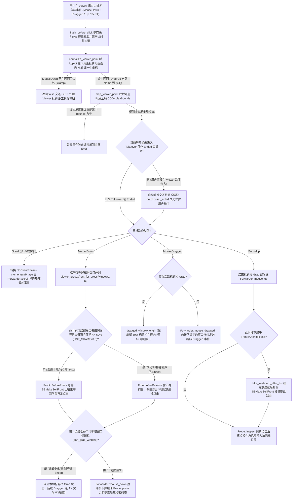
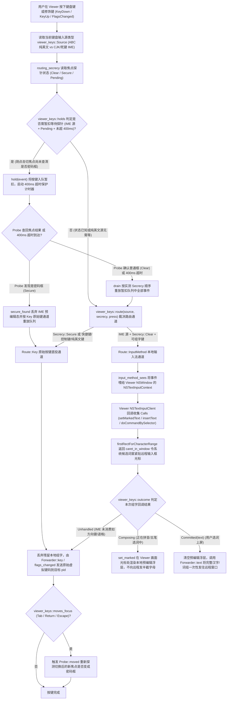

# 07. Viewer 实时交互输入、IME 组字与密码框安全路由 (`viewer_input`)

Viewer 是用户观察并直接动手操作 Agent Display 的实时画面窗口 (`ADR 0008`, `ADR 0014`)。用户在 Viewer 画面上的每一次鼠标点击、拖拽、滚轮与键盘敲击都不会移动物理指针去虚拟屏，而是在本地完成归一化坐标映射后投递给虚拟屏上的目标应用。这里存在三大棘手挑战：第一，有些应用（如 aTrust，`#41`）自居前台进程时会丢弃所有后台投递点击，必须在按下前先让 Agent Screen 夺回前台 (`BeforePress`)，而另一些应用（如企业微信搜索下拉列表或 Qt 工具面板）一旦失去前台就会立刻收起浮层列表，必须等松开按键后再夺回前台 (`AfterRelease`)；第二，用户在 Viewer 用中文/日文输入法打字时，必须由 Viewer 本地的 `NSTextInputClient` 承载候选词框与预编辑下划线 (`markedText`)，但在目标控件是密码框 (`Secrecy::Secure`) 时又必须绕开本地 IME 直接发原始按键防止明文回显；第三，点击切换焦点后的前几百毫秒内 AX 密码框查询尚未返回 (`Secrecy::Pending`)，必须暂扣按键最多 `400ms` 等查明安全态后再决定路由，杜绝密码首字母泄漏给输入法。

## 线程与队列分工

1. **AppKit 主线程事件钩子与私有事件监听 (`viewer_input::install` / `PrivateTap`)**：拦截落在 Viewer 画面矩形内的 `NSEvent`（左/右键按下、拖拽、释放、滚轮、按键、修饰键以及 `NSTextInputClient` 的 `insertText:` / `setMarkedText:`），执行 `normalize_viewer_point` 坐标映射与 `HOLD_MS = 400ms` 按键暂扣队列 (`apps/macos/src/mac/viewer_input.rs:42-970, 1287-2150`)。
2. **每屏幕 `Forwarder` 工作线程 (`apps/macos/src/mac/input.rs`)**：串行执行 `SSMakeSelfFront` / `SSFocusWithoutRaise` / `SSPostEventToPid` 事件投递，并在每次点击或焦点移动键后运行 `Probe` 异步读取目标控件 AX 角色、密码框状态 (`AXSecureTextField`) 与光标插入点矩形 (`caret`) (`apps/macos/src/mac/input.rs:224-360, 726-790`)。
3. **GPUI Viewer 渲染层 (`apps/macos/src/ui/viewer.rs`)**：绘制 `SCStream` 帧画面、IME 候选框跟随锚点 (`caret_in_window`)、预编辑 `marked` 浮层及 Takeover 横幅。

---

## 图 1：Viewer 鼠标坐标归一化、前台时机裁决 (`front_for_press`) 与三类拖拽处理

### 图 1 节点明细表

| 节点 | 线程与队列 | 我方代码与常量 | macOS 组件与内部行为 | 限制与关联缺陷 | Agent 侧影响 | 用户侧表现 | 验证来源 |
| :--- | :--- | :--- | :--- | :--- | :--- | :--- | :--- |
| `V1` | AppKit 主线程 | `viewer_input::handle` / `private_taken` (`apps/macos/src/mac/viewer_input.rs:1348-1392, 2057-2131`) | 通过应用级事件拦截与 `PrivateTap` 捕获 Viewer `NSWindow` 内的鼠标按下、拖拽、释放与滚轮 | 若 Viewer 处于 `blocked` 模态确认遮罩下则不向虚拟屏转发 (`viewer_input.rs:1216`) | 无 | 用户直接在画面上操作 | [已验证: apps/macos/src/mac/viewer_input.rs:1216-1233, apps/macos/src/mac/viewer_input.rs:1348-1392] |
| `V2` | AppKit 主线程 | `flush_before_click` (`apps/macos/src/mac/viewer_input.rs:510-529`) | 新点击改变焦点前，先将 `NSTextInputContext` 中未上屏的预编辑词提交或丢弃，防止旧词串入新输入框 | 符合原生 macOS 点击切焦点时的输入法结算习惯 | 无 | 预编辑下划线在切焦点前结算 | [已验证: apps/macos/src/mac/viewer_input.rs:510-529] |
| `V3` | AppKit 主线程 | `viewer_press::normalize_viewer_point` (`crates/model/src/viewer_press.rs:64-89`), `viewer_input.rs:1338-1346` | 翻转 AppKit 视图左下角 Y 轴，按等比缩放画面区 `content: [cx, cy, cw, ch]` 归一化为 `[0.0, 1.0]`；按下 (`!clamp`) 越界返回 `None`，拖拽与释放 (`clamp`) 夹紧到 `[0.0, 1.0]` | 保证用户拖着滑块滑出 Viewer 窗口边框时，远程光标干净停在虚拟屏边缘而非断掉 | 无 | 点击工具栏按钮正常响应，画面内点击精准对齐 | [已验证: crates/model/src/viewer_press.rs:64-89, apps/macos/src/mac/viewer_input.rs:1338-1346] |
| `VX1` | AppKit 主线程 | `handle` 返回 `false` (`apps/macos/src/mac/viewer_input.rs:1360-1375`) | 不消费事件，交回 GPUI 视图树处理关闭、归还控制权等按钮 | 无 | 若点了“交还控制权”将唤醒 `wait_for_control` | Viewer 顶部按钮正常可点 | [已验证: apps/macos/src/mac/viewer_input.rs:1360-1375] |
| `V4` | AppKit 主线程 | `viewer_press::map_viewer_point` (`crates/model/src/viewer_press.rs:91-104`), `remote_point` (`viewer_input.rs:1321-1336`) | 将 `[0.0, 1.0]` 映射到 `CGDisplayBounds(display)`；若 `bounds.width < 1.0` 或 `height < 1.0`（离线或重配置瞬态返回 `(0,0,0,0)`）则返回 `None` | 彻底堵死重配置瞬间把点击映射到用户物理主屏左上角 `(0, 0)` 的隐患 (`viewer_press.rs:91-95`) | 无 | 重配置瞬态零误触主屏 | [已验证: crates/model/src/viewer_press.rs:91-104, apps/macos/src/mac/viewer_input.rs:1321-1336] |
| `VX2` | AppKit 主线程 | 空 `bounds` 保护出口 | 静默吞掉重配置瞬间的无效坐标映射 | 无 | 无 | 无异常点击 | [已验证: crates/model/src/viewer_press.rs:91-104] |
| `V5` | AppKit 主线程 | `Shell` / `viewer_input` 状态同步 (`apps/macos/src/mac/viewer_input.rs:262-285`, `apps/macos/src/ui/viewer.rs:420-490`) | 检查当前屏幕处于 `Active`、`Takeover` 还是 `Ended` | 用户在 Viewer 主动点击 `Active` 屏幕时，`catch::user_acted` 记录用户意愿并可进入 `Takeover` 暂停 Agent 并发抢点 | 若触发 `Takeover`，在途 Agent 工具收到 `user_takeover` | Viewer 顶栏显示“你正在控制”状态 | [已验证: apps/macos/src/mac/viewer_input.rs:262-285, apps/macos/src/mac/catch.rs:111-127] |
| `V6` | AppKit 主线程 | `catch::user_acted` / `Core::take_over` (`apps/macos/src/mac/catch.rs:111-127`, `apps/macos/src/core.rs:1049-1057`) | 登记用户对此屏幕及目标 `pid` 的操作，暂停 Agent 输入 (`stop_agent_input(id, true)`) | 遵守 `ADR 0004`：人机绝不同时抢同一块屏 | Agent 操作被 `user_takeover` 拦住 | 用户顺滑接手画面 | [已验证: apps/macos/src/core.rs:1049-1057, ADR 0004] |
| `V7` | AppKit 主线程 | `handle_in` 事件路由 (`apps/macos/src/mac/viewer_input.rs:1473-1727`) | 按 `NSEventType` 分发滚轮、按下、拖拽、释放 | 无 | 无 | 实时响应 | [已验证: apps/macos/src/mac/viewer_input.rs:1473-1727] |
| `S1` | 主线程 -> `Forwarder` 线程 | `scroll_phase` / `momentum_phase` (`apps/macos/src/mac/viewer_input.rs:1256-1285`), `Forwarder::scroll` (`apps/macos/src/mac/input.rs:695-705`) | 完整保留触控板双指滚动的像素级连续增量 (`hasPreciseScrollingDeltas`)、`NSEventPhase` 与惯性滑动阶段 `momentumPhase`，合成平滑滚轮事件直投目标窗口 | 触控板惯性滚动与橡皮筋回弹手感与原生窗口一致 | 无 | 画面平滑滚动 | [已验证: apps/macos/src/mac/viewer_input.rs:1256-1285, apps/macos/src/mac/input.rs:695-705] |
| `M1` | AppKit 主线程 | `press_hits_list` (`apps/macos/src/mac/viewer_input.rs:1394-1405`), `viewer_press::front_for_press` (`crates/model/src/viewer_press.rs:39-54`) | 读取点击点下方从前到后的窗口栈 `(pid, bounds)` | 区分常规窗口与依附母窗的瞬态浮层 (`ADR 0008`, `ADR 0014`) | 无 | 无变化 | [已验证: crates/model/src/viewer_press.rs:39-54, apps/macos/src/mac/viewer_input.rs:1394-1405] |
| `M2` | 纯模型函数 | `LIST_SHARE = 0.6` (`crates/model/src/viewer_press.rs:45-54`) | 若最顶层命中窗下方存在同一 `pid` 的更大窗口，且顶层窗面积 `<= 0.6 * 母窗面积`，判定为下拉列表/搜索结果浮层/Sheet，返回 `Front::AfterRelease`；否则返回 `Front::BeforePress` | 同时兼容 `#41` (aTrust 占前台时丢弃点击) 与企业微信/Qt 失焦即关列表两类极端应用；注意 `#207`：当模态 Sheet 内再套一层已展开的 `NSPopUpButton` 菜单时，菜单窗口归属与层级拦截曾导致点击无响应 | 无 | 搜索候选框与弹出列表一点即中不闪退 | [已验证: crates/model/src/viewer_press.rs:39-54, Issue #207] |
| `M3` | 主线程 -> `Forwarder` | `SSMakeSelfFront` (`apps/macos/native/SkyLight.m:160-171`, `apps/macos/src/mac/input.rs:32, 2865-2874`) | 调用 `_SLPSSetFrontProcessWithOptions` 将 Agent Screen 自身与 Viewer `windowNumber` 设为前台进程，确保后续键盘按键稳定流入 Viewer 的 `NSTextInputClient`，且把自居前台的远程应用退回后台以便其正常接收 `SLEventPostToPid` | Viewer 本就是用户正在点击的窗口，设自身为前台完全符合用户直觉 | 无 | Viewer 保持活跃窗口 | [已验证: apps/macos/native/SkyLight.m:160-171, apps/macos/src/mac/input.rs:2865-2874] |
| `M4` | AppKit 主线程 | `AfterList` 暂缓前台 (`apps/macos/src/mac/viewer_input.rs:1407-1435`) | 按下与拖拽期间保持远程应用现状不夺前台，等 `MouseUp` 送达后再执行 `U3` | 防止浮层在点击落上前先因 `ApplicationDidResignActive` 自毁 | 无 | 下拉菜单项成功被点中 | [已验证: apps/macos/src/mac/viewer_input.rs:1407-1435] |
| `M5` | 主线程 / 后台查询 | `viewer_press::can_grab_window` (`crates/model/src/viewer_press.rs:106-124`), `windows::Grab::on_display` (`apps/macos/src/mac/windows.rs:91-118`) | 检查点击点是否命中非最小化、非全屏、非 Sheet (`!is_sheet`) 归属窗口的标题栏空白拖拽区 | Sheet 窗口依附母窗标题栏，禁止单独拖走 | 标题栏走 `G1`，内容区走 `G2` | 无变化 | [已验证: crates/model/src/viewer_press.rs:106-124, apps/macos/src/mac/windows.rs:91-118] |
| `G1` | AppKit 主线程 | 本地 `Grab` 记录 (`apps/macos/src/mac/viewer_input.rs:1530-1565`) | 记录抓取起点与窗口初始 `Rect`，不依赖 `_SLSDragWindowRelativeToMouse` | 绕开 macOS 窗口服务器仅允许真硬件鼠标拖标题栏的死限制 | 无 | 用户可在 Viewer 里直接拖动远程窗口位置 | [已验证: apps/macos/src/mac/viewer_input.rs:1530-1565] |
| `G2` | `Forwarder` 工作线程 | `Forwarder::mouse_down` + `Probe::press` (`apps/macos/src/mac/input.rs:278-287, 579-610`) | 递增 `Probe` 代数使旧焦点缓存进入 `Pending` 待查态，向目标窗口发送 `SSFocusWithoutRaise` + 局部坐标 `MouseDown` | 留意 Viewer 后台拖拽限制：对未挂 CDP 管道的网页 HTML5 拖拽或校验硬件按键态的原生 `CustomDrag`，首次后台 `MouseDown` 无法激活系统 `CoreDrag` 会话 | 无 | 按钮按下态实时反馈在画面上 | [已验证: apps/macos/src/mac/input.rs:278-287, apps/macos/src/mac/input.rs:579-610] |
| `D1` | AppKit 主线程 | `handle_in` 拖拽分支 (`apps/macos/src/mac/viewer_input.rs:1590-1645`) | 判断当前是否握有标题栏 `Grab` | 无 | 分流 `D2` / `D3` | 无变化 | [已验证: apps/macos/src/mac/viewer_input.rs:1590-1645] |
| `D2` | 主线程 -> 后台 AX | `viewer_press::dragged_window_origin` (`MIN_TITLE_STRIP = 60.0`, `crates/model/src/viewer_press.rs:57, 174-219`) | 计算新窗口原点并限制至少保留 `60pt` 标题栏留在虚拟屏内，调用 `Grab::drag_to` 实时移动窗口 | 即使超大窗口也不会被用户失手彻底拖出虚拟屏边界失联 | 无 | 窗口跟随鼠标在画面内顺滑移动 | [已验证: crates/model/src/viewer_press.rs:57, crates/model/src/viewer_press.rs:174-219] |
| `D3` | `Forwarder` 工作线程 | `Forwarder::mouse_dragged` (`apps/macos/src/mac/input.rs:612-647`) | 锁定按下时的目标 `window_id`（即便拖出窗口边缘仍发给原捕获窗口并换算局部负/超界坐标），连续投递 `LeftMouseDragged` | 原生文本选区涂抹、画板涂鸦、普通滑块拖动正常生效 | 无 | 选区高亮实时跟随 | [已验证: apps/macos/src/mac/input.rs:612-647] |
| `U1` | 主线程 + `Forwarder` | `Forwarder::mouse_up` (`apps/macos/src/mac/input.rs:649-686`), `viewer_input.rs:1650-1710` | 释放标题栏 `Grab` 或发送 `MouseUp` | 严保 `MouseDown` 与 `MouseUp` 成对送达同一目标进程 | 无 | 点击或拖拽完成 | [已验证: apps/macos/src/mac/input.rs:649-686, apps/macos/src/mac/viewer_input.rs:1650-1710] |
| `U2` | AppKit 主线程 | `AfterList` 检查 (`apps/macos/src/mac/viewer_input.rs:1420-1435, 1695-1710`) | 检查本次按下是否因命中浮层列表而推迟了夺回前台 | 无 | 是走 `U3`，否走 `U4` | 无变化 | [已验证: apps/macos/src/mac/viewer_input.rs:1420-1435] |
| `U3` | `Forwarder` -> 主线程 | `take_keyboard_after_list` (`apps/macos/src/mac/viewer_input.rs:1420-1435`) | 通过 `Forwarder::after` 排在 `MouseUp` 投递完之后调用 `SSMakeSelfFront` 把前台取回 Viewer | 既让列表项吃到了完整点击，又保证选完后用户紧接着打字能进 Viewer | 无 | 选完搜索项后可直接继续打字 | [已验证: apps/macos/src/mac/viewer_input.rs:1420-1435] |
| `U4` | `Forwarder` 工作线程 | `Forwarder::inspect` (`apps/macos/src/mac/input.rs:726-764`), `viewer_keys::settled` (`SETTLE_AWAY_MS = 300`, `crates/model/src/viewer_keys.rs:54-83`) | 异步查询新焦点元素的 `AXRole`、`AXSecureTextField` 状态与屏幕插入点 `AXBoundsForRange`；若焦点在 `300ms` 内仍在跳变则补查一次，完成后调用 `viewer_input::lookup_answered()` 唤醒暂扣按键队列 | 为图 2 键盘与 IME 路由提供权威安全态 | 无 | 若点中文本框，IME 候选框定位锚点自动对齐远程光标 | [已验证: apps/macos/src/mac/input.rs:726-764, crates/model/src/viewer_keys.rs:54-83, apps/macos/src/mac/viewer_input.rs:495-508] |

---

## 图 2：Viewer 键盘暂扣队列 (`HOLD_MS = 400ms`)、密码框防泄漏与本地 `NSTextInputClient` 组字流水线

### 图 2 节点明细表

| 节点 | 线程与队列 | 我方代码与常量 | macOS 组件与内部行为 | 限制与关联缺陷 | Agent 侧影响 | 用户侧表现 | 验证来源 |
| :--- | :--- | :--- | :--- | :--- | :--- | :--- | :--- |
| `K1` | AppKit 主线程 | `viewer_input::handle_in` (`apps/macos/src/mac/viewer_input.rs:1473-1525`) | 拦截聚焦在 Viewer 上的 `KeyDown`、`KeyUp` 与 `FlagsChanged` | 记录 `catch::user_pressed_key()` 防止 Agent 冷启动窗口抢戏 | 无 | 用户直接敲击物理键盘 | [已验证: apps/macos/src/mac/viewer_input.rs:1473-1525, apps/macos/src/mac/catch.rs:129-159] |
| `K2` | AppKit 主线程 | `source_now` (`apps/macos/src/mac/viewer_input.rs:202-209`), `ime::current_kind` (`apps/macos/src/mac/ime.rs:117-135`) | 调用 `TISCopyCurrentKeyboardInputSource` 读取 `kTISPropertyInputSourceType` 区分纯键盘布局 (`Source::Keyboard`, 如 ABC/US) 与输入法 (`Source::InputMethod`, 如简体拼音) | 纯英文布局从不弹候选窗，无需因为 `Pending` 暂扣普通字母键 | 无 | 自动跟随用户系统当前输入法 | [已验证: apps/macos/src/mac/viewer_input.rs:202-209, apps/macos/src/mac/ime.rs:117-135] |
| `K3` | AppKit 主线程 | `routing_secrecy` (`apps/macos/src/mac/viewer_input.rs:686-710`) | 综合本地 `IsSecureEventInputEnabled()` 与 `Forwarder::secrecy()` (`Secrecy::Clear` / `Secure` / `Pending`) | 双重保险识别系统级安全输入与 AX 级 `AXSecureTextField` | 无 | 无变化 | [已验证: apps/macos/src/mac/viewer_input.rs:667-710, crates/model/src/viewer_keys.rs:173-186] |
| `K4` | 纯模型函数 | `viewer_keys::holds` / `holds_modifier` / `HOLD_MS = 400` (`crates/model/src/viewer_keys.rs:201-241`) | 当用户开着中文等 IME、刚点击新位置且 AX 探针尚未答复 (`Secrecy::Pending`) 且距暂扣开始未满 `400 ms` 时返回 `true` | 若不暂扣，用户在点中密码框后 `50ms` 内敲下的密码首字母会先被喂给本地拼音输入法以明文显示在候选框里！(`ADR 0008`) | 无 | 消除极速盲打密码时的首字母明文泄漏 | [已验证: crates/model/src/viewer_keys.rs:201-241, ADR 0008] |
| `K5` | AppKit 主线程 | `hold` / `start_wait` (`apps/macos/src/mac/viewer_input.rs:431-462`) | 克隆 `NSEvent` 压入 `State.held` 双端队列，启动 `400ms` 唤醒定时器 | 连同其后的 `KeyUp` 与 `Shift` 修饰键保序入队 (`holds_modifier`) | 无 | 正常 AX 探针仅需 `5~30ms` 即返回，人体完全无延迟感 | [已验证: apps/macos/src/mac/viewer_input.rs:431-462] |
| `K6` | 主线程回调 | `lookup_answered` / `secure_found` / 超时回调 (`apps/macos/src/mac/viewer_input.rs:470-508, 712-736`) | 任一条件先到即触发出队 | 目标应用卡死无 AX 响应时最多等 `400ms` (`given_up = true`) 自动放行不吞键 | 无 | 应用无响应时仍不丢键 | [已验证: apps/macos/src/mac/viewer_input.rs:197-200, apps/macos/src/mac/viewer_input.rs:470-508, apps/macos/src/mac/viewer_input.rs:712-736] |
| `K7` | AppKit 主线程 | `secure_found` / `discard_in_input_context` (`apps/macos/src/mac/viewer_input.rs:641-653, 712-736`) | 一旦探明新焦点是密码框，立即调用 `discardMarkedText` 销毁输入法上下文缓存，将队列按键全部按 `Route::Key` 原始键发走 | `secure_found_count` 计数器可供端到端测试精确断言 (`viewer_input.rs:191`) | 无 | 密码框内只出圆点掩码，绝不弹出中文输入法条 | [已验证: apps/macos/src/mac/viewer_input.rs:191-195, apps/macos/src/mac/viewer_input.rs:641-653, apps/macos/src/mac/viewer_input.rs:712-736] |
| `K8` | AppKit 主线程 | `drain` / `replay` (`apps/macos/src/mac/viewer_input.rs:531-616`) | 按严格 FIFO 顺序重放暂扣事件进入 `K9` 路由 | `retag_held` 防止代数错乱 | 无 | 按键顺序零错位 | [已验证: apps/macos/src/mac/viewer_input.rs:531-616] |
| `K9` | 纯模型函数 | `viewer_keys::route` (`crates/model/src/viewer_keys.rs:153-199`) | 裁决走 `Route::Key`（`Secrecy::Secure`、`Source::Keyboard`、含 `Cmd`/`Ctrl` 快捷键、功能键/方向键且当前无预编辑串）还是 `Route::InputMethod` | 纯函数覆盖全部组合 (`viewer_keys.rs:320-679`) | 无 | 快捷键与中文组字各行其道 | [已验证: crates/model/src/viewer_keys.rs:153-199] |
| `R_KEY` | AppKit 主线程 | 原始键路由标记 (`note_route(..., "key")`, `apps/macos/src/mac/viewer_input.rs:172-182`) | 选定直接虚拟键码投递 | 无 | 无 | 无变化 | [已验证: apps/macos/src/mac/viewer_input.rs:172-182] |
| `P1` | 主线程 -> `Forwarder` 线程 | `Forwarder::key` / `flags_changed` (`apps/macos/src/mac/input.rs:707-715`) | 构造带准确 `keycode`、`down` 与 `CGEventFlags` 的键盘事件，经 `SSFocusWithoutRaise` + `SSPostEventToPid` 投递给虚拟屏目标窗口 | Viewer 窗口内标准编辑快捷键（`Cmd+C/V/X/A/Z`）经 `watch_commands` 拦截同样转为向远程窗口发对应按键而非操作本地空菜单 (`viewer_input.rs:886-939`) | 无 | 复制粘贴、全选撤销直接作用于远程应用 | [已验证: apps/macos/src/mac/input.rs:707-715, apps/macos/src/mac/viewer_input.rs:886-939] |
| `P2` | 纯模型函数 | `viewer_keys::moves_focus` (`crates/model/src/viewer_keys.rs:243-247`) | 检测 `Tab` (`48`)、`Return` (`36`)、`Enter` (`76`)、`Escape` (`53`) 等可能把焦点从用户名框切进密码框的按键 | 用户名输完按 `Tab` 进密码框是最常见场景，必须立即重探安全态！ | 是走 `P3`，否走 `P4` | 按 `Tab` 进密码框后下一键即受密码保护 | [已验证: crates/model/src/viewer_keys.rs:243-247] |
| `P3` | `Forwarder` 工作线程 | `Probe::moved` + `Forwarder::inspect` (`apps/macos/src/mac/input.rs:288-295, 726-764`) | 将焦点安全态重新置为 `Pending` 并在按键投递后探测新焦点控件 | 与 `K4` 暂扣门控无缝衔接 | 无 | 跨字段切换零泄漏 | [已验证: apps/macos/src/mac/input.rs:288-295, apps/macos/src/mac/input.rs:726-764] |
| `P4` | 主线程结束处理 | 事件消费返回 `true` | 阻止 macOS 发出“咚”的未处理按键警告音 (`NSBeep`) | 无 | 无 | 安静顺畅 | [已验证: apps/macos/src/mac/viewer_input.rs:1510-1525] |
| `R_IME` | AppKit 主线程 | 输入法路由标记 (`note_route(..., "ime")`) | 选定本地 `NSTextInputContext` 代理组字 (`ADR 0014`) | 无需把远程进程提至前台即可在任何时候流畅使用用户自己的中文/日文输入法词库 | 无 | 与本地原生窗口打字体验完全一致 | [已验证: apps/macos/src/mac/viewer_input.rs:801-869, ADR 0014] |
| `I1` | AppKit 主线程 | `through_input_method` / `input_method_sees` (`apps/macos/src/mac/viewer_input.rs:801-869, 1729-1771`) | 调用 `-[NSTextInputContext handleEvent:]` 将 `NSEvent` 交给系统输入法服务 | 在回调窗口期内清空并收集 `NSTextInputClient` 协议方法调用序列 | 无 | 激活系统输入法引擎 | [已验证: apps/macos/src/mac/viewer_input.rs:801-869, apps/macos/src/mac/viewer_input.rs:1729-1771] |
| `I2` | AppKit 主线程 (ObjC 协议回调) | `viewer_input` / `native` `NSTextInputClient` 实现 (`crates/model/src/viewer_keys.rs:249-262`) | 记录 `Call::SetMarked(str)`、`Call::Unmark`、`Call::Insert(str)`、`Call::DoCommand(selector)` | 某些输入法一次敲击会连调 `setMarkedText("")` + `insertText("好")`，由纯模型 `outcome` 统一归一化 | 无 | 无变化 | [已验证: crates/model/src/viewer_keys.rs:249-318] |
| `I3` | AppKit 主线程 | `caret_in_window` / `caret_on_image` (`apps/macos/src/mac/viewer_input.rs:941-970`), `viewer_keys::caret_in` (`LINE = 18.0`, `crates/model/src/viewer_keys.rs:119-151`) | 响应 `firstRectForCharacterRange:actualRange:`，将 `Probe` 查到的远程输入框光标矩形按 Viewer 缩放比换算为屏幕全局 `NSRect` 返回给 macOS 输入法服务 | 若远程应用未暴露光标坐标（如自定义 Canvas），自动降级停靠在上次点击位置或画面底部 | 无 | 系统拼音候选词窗精准浮在 Viewer 里远程输入框的打字光标正下方 | [已验证: apps/macos/src/mac/viewer_input.rs:941-970, crates/model/src/viewer_keys.rs:119-151] |
| `I4` | 纯模型函数 | `viewer_keys::outcome` (`crates/model/src/viewer_keys.rs:264-318`) | 综合回调列表裁定本键结果为 `Composing`、`Committed(text)` 或 `Unhandled` | 严谨处理组字中途按回车确认英文原串、按 Esc 取消组字等全部边界 | 三路分流 | 无变化 | [已验证: crates/model/src/viewer_keys.rs:264-318] |
| `I5` | AppKit 主线程 + GPUI Viewer | `set_marked` (`apps/macos/src/mac/viewer_input.rs:226-250`), `ui::viewer` 预编辑绘制 (`apps/macos/src/ui/viewer.rs:980-1055`) | 更新 `marked` 字符串并通知 GPUI 重绘，在远程光标坐标处叠加带下划线的预编辑文本胶囊；此时绝不向远程窗口发半截拼音字母 | 远程网页/应用不会收到乱跳的未完成拼音串触发错误的实时搜索请求 | 无 | 画面光标处实时显示拼音预编辑串 | [已验证: apps/macos/src/mac/viewer_input.rs:226-250, apps/macos/src/ui/viewer.rs:980-1055] |
| `I6` | 主线程 -> `Forwarder` 线程 | `commit` / `send_text` (`apps/macos/src/mac/viewer_input.rs:738-799`), `Forwarder::text` (`apps/macos/src/mac/input.rs:717-725`) | 清除本地预编辑浮层，将选定的完整词组通过 Unicode 键盘事件流一次性投递到远程窗口并触发 `inspect` 更新新光标坐标 | 下一个字候选窗自动跟着右移 | 无 | 汉字词组干净上屏，候选窗随光标右移 | [已验证: apps/macos/src/mac/viewer_input.rs:738-799, apps/macos/src/mac/input.rs:717-725] |
