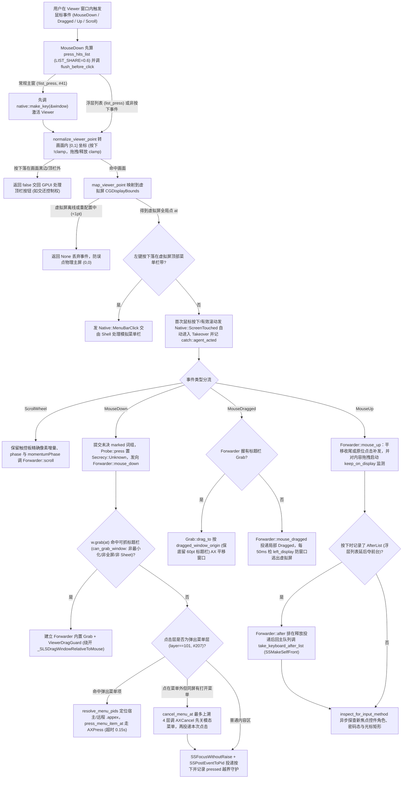
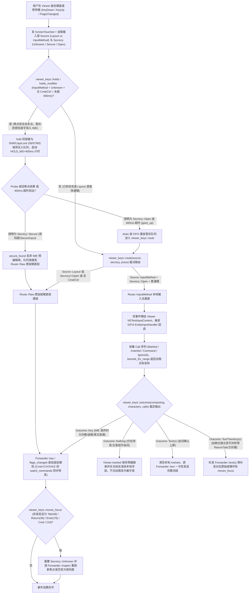

# 07. Viewer 实时交互输入、IME 组字与密码框安全路由 (`viewer_input`)

Viewer 是用户观察并亲自操作 Agent Display 的实时画面窗口 (`ADR 0008`, `ADR 0014`)。用户在 Viewer 画面上的鼠标点击、拖拽、滚轮与键盘敲击不会移动物理指针前往虚拟屏，而是在本地归一化映射后经后台投递给虚拟屏上的目标应用。系统在三条关键边界上精确协调：第一，夺回前台时机裁决 (`front_for_press`)：常规主窗按下前先让 Agent Screen 夺回前台 (`Front::BeforePress`, `#41` aTrust 占前台时丢弃后台点击)，而覆盖母窗面积 `<= 60%` (`LIST_SHARE = 0.6`) 的下拉列表或搜索浮层必须推迟到松开按键送达后再夺回前台 (`Front::AfterRelease`)，防止浮层失焦即关；第二，输入法本地代理：中文/日文/韩文等 `Source::InputMethod` 由 GPUI `EntityInputHandler` (`NSTextInputClient`) 在本地完成组字与候选窗锚定，密码框 (`Secrecy::Secure`) 则强制走 `Route::Raw` 原始键直投；第三，未知焦点暂扣队列：刚点击或按 `Tab`/`Return`/`Cmd` 切焦点后焦点安全态处于 `Secrecy::Unknown`，对 IME 按键暂扣最多 `HOLD_MS = 400ms` 等待 AX 探针查明是否密码框，杜绝密码首字母泄漏给输入法候选窗。

## 线程与队列分工

1. **AppKit 主线程事件钩子与私有按压监听 (`viewer_input::install` / `install_private_press`)**：拦截 Viewer `NSWindow` 内的鼠标按下、拖拽、释放、滚轮、按键与修饰键，执行 `normalize_viewer_point` 坐标映射、顶部菜单栏转发 `Native::MenuBarClick`、首次交互触发接管 `Native::ScreenTouched`、以及 `HOLD_MS = 400ms` 按键暂扣队列 (`apps/macos/src/mac/viewer_input.rs:431-653, 1348-1830, 2133`)。
2. **每屏幕专用输入与焦点线程 (`agent-screen-input` / `agent-screen-focus`)**：`Forwarder` (`apps/macos/src/mac/input.rs:422, 434, 579-775`) 在输入线程执行标题栏 `Grab` 平移、弹出菜单 `press_menu_item_at` / `cancel_menu_at` (`#207`)、`SSFocusWithoutRaise` + `SSPostEventToPid` 投递；在焦点线程运行 `Probe` 查询 `AXSecureTextField` 与光标插入点矩形 (`caret_in`)。
3. **GPUI Viewer 视图与 `EntityInputHandler` (`apps/macos/src/ui/viewer.rs:725-830`)**：渲染 `SCStream` 画面、接管状态顶栏与本地预编辑 `marked` 文本，并通过 `bounds_for_range` 将远程输入框光标坐标返回给系统输入法候选词窗。

---

## 图 1：Viewer 鼠标坐标归一化、前台时机裁决 (`front_for_press`)、弹出菜单 (`#207`) 与标题栏拖拽

### 图 1 节点明细表

| 节点 | 线程与队列 | 我方代码与常量 | macOS 组件与内部行为 | 限制与关联缺陷 | Agent 侧影响 | 用户侧表现 | 验证证据 |
| :--- | :--- | :--- | :--- | :--- | :--- | :--- | :--- |
| `V1` | AppKit 主线程 | `viewer_input::handle` / `install_private_press` (`apps/macos/src/mac/viewer_input.rs:1348-1392, 1815, 2133`) | 应用级事件钩子与私有按压 Tap 拦截 Viewer `NSWindow` 内的鼠标按下、拖拽、释放、移动与滚轮 | 若 Viewer 处于 `blocked == true` 模态确认遮罩态则不转发 (`viewer_input.rs:1216`) | 无 | 用户直接在 Viewer 画面操作 | 已验证：`apps/macos/src/mac/viewer_input.rs:1216,1348,2133` `pub fn layout(content: Option<[f64; 4]>, blocked: bool,` / `fn handle(event: &NSEvent, mtm: MainThreadMarker) -> bool` / `pub fn install()` |
| `V2` | AppKit 主线程 | `press_hits_list` / `flush_before_click` (`apps/macos/src/mac/viewer_input.rs:510-529, 1362-1371, 1394-1405`), `viewer_press::front_for_press` (`LIST_SHARE = 0.6`, `crates/model/src/viewer_press.rs:39-54`) | 若顶层命中窗口下方存在同 `pid` 更大母窗且面积 `<= 0.6 * 母窗面积`，判定为浮层列表 (`list_press = true`)；同时调 `flush_before_click` 结算旧焦点未决输入法状态 | 兼顾 `#41`（aTrust 自居前台时丢弃点击）与企业微信搜索浮层/Qt 工具窗失焦即关两类行为 | 无 | 浮层列表不因点按瞬间失焦而消失 | 已验证：`crates/model/src/viewer_press.rs:39,53` `pub fn front_for_press(windows: &[Window], at: (f64, f64)) -> Front` / `const LIST_SHARE: f64 = 0.6;` |
| `M_PRE` | AppKit 主线程 | `native::make_key` / `note_viewer_press` (`apps/macos/src/mac/viewer_input.rs:1367-1369, 1532`), `SSMakeSelfFront` (`apps/macos/native/SkyLight.m:163-171`) | 非浮层常规窗口按下时先激活 Viewer 为 keyWindow 并由输入线程按需调 `SSMakeSelfFront` (`_SLPSSetFrontProcessWithOptions(..., 0x200)`) 让宿主接管前台 | 将自居前台的远程进程退回非前台，使其正常接收 `SSPostEventToPid` (`#41`) | 无 | Viewer 立即成为键盘焦点窗 | 已验证：`apps/macos/src/mac/viewer_input.rs:1367-1369` `if !list_press { native::make_key(&window); }`；`SkyLight.m:163` `bool SSMakeSelfFront(CGWindowID windowID)` |
| `V3` | AppKit 主线程 | `viewer_press::normalize_viewer_point` (`crates/model/src/viewer_press.rs:64-84`) | 翻转 AppKit 左下角 Y 轴，换算为画面区 `content` 内 `[0.0, 1.0]` 归一化坐标；按下时不夹紧越界返回 `None`，拖拽/释放夹紧至 `[0.0, 1.0]` | 拖出 Viewer 窗口边框时远程拖动干净停在虚拟屏边缘 | 无 | 画面外按钮与画面内区域互不干扰 | 已验证：`crates/model/src/viewer_press.rs:64,77` `pub fn normalize_viewer_point(` / `if clamp { nx = nx.clamp(0.0, 1.0);` |
| `VX1` | AppKit 主线程 | `handle_in` 返回 `false` (`apps/macos/src/mac/viewer_input.rs:1518-1522`) | 画面区域外点击不消费，交回 GPUI 响应 Viewer 顶栏交还控制权、关闭等按钮 | 无 | 点击交还按钮将结束 `Takeover` | Viewer 顶栏按钮正常响应 | 已验证：`apps/macos/src/mac/viewer_input.rs:1518-1522` `let Some(at) = diagnostics::within(click, Phase::Down, \|\| { ... }) else { return false; };` |
| `V4` | AppKit 主线程 | `viewer_press::map_viewer_point` (`crates/model/src/viewer_press.rs:91-99`) | 将 `[0.0, 1.0]` 映射到 `CGDisplayBounds(display)`；若宽高 `< 1.0` 返回 `None` | 防止显示器离线或重配置返回 `(0,0,0,0)` 时误点用户物理主屏左上角 | 无 | 重配置瞬态零误触主屏 | 已验证：`crates/model/src/viewer_press.rs:91-93` `pub fn map_viewer_point(normalized: (f64, f64), bounds: Rect) -> Option<(f64, f64)> { if bounds.width < 1.0 \|\| bounds.height < 1.0 { return None; }` |
| `VX2` | AppKit 主线程 | 空 `bounds` 保护返回 | 丢弃重配置瞬态无效映射 | 无 | 无 | 无异常点击 | 已验证：`crates/model/src/viewer_press.rs:92-93` `return None;` |
| `V5` | AppKit 主线程 | 菜单栏带检测 (`apps/macos/src/mac/viewer_input.rs:1543-1552`) | 检查左键按下是否落在虚拟屏顶部 `menubar_height(display)` 区域内 | 只有真正点开菜单的菜单栏点击才触发接管，由 `Shell::menu_bar` 裁决 | 无 | 点击模拟菜单栏弹出应用菜单 | 已验证：`apps/macos/src/mac/viewer_input.rs:1543-1546` `if button == Button::Left && at.1 - cg::display_bounds(display).y < menubar_height(display) { native::send(Native::MenuBarClick {` |
| `VX_MB` | GPUI 主线程 | `Shell::menu_bar` (`apps/macos/src/ui/shell.rs:808`) | 处理 Viewer 顶栏模拟菜单栏交互 | 无 | 按菜单打开情况决定是否接管 | 展示目标应用菜单项 | 已验证：`apps/macos/src/ui/shell.rs:808` `Native::MenuBarClick { display, x } => self.menu_bar(display, x, cx),` |
| `V6` | 主线程 -> `Shell` | `Native::ScreenTouched` (`apps/macos/src/mac/viewer_input.rs:1561-1562, 1630-1632`), `Shell::user_input` (`apps/macos/src/ui/shell.rs:803, 2668-2670`) | 用户首次在 Viewer 画面点击、按键或产生有效滚动（排除触控板静置 `MayBegin`）即发送 `ScreenTouched` 调 `Core::take_over` 自动接管屏幕，并调 `catch::agent_acted(display)` 使本次点击打开的新窗口归入该 Agent Display | 遵守 `ADR 0004`：用户一动手立即冻结 Agent 后台动作 | 在途 Agent 输入收到 `takeover` 错误 | Viewer 自动切入接管模式 | 已验证：`apps/macos/src/mac/viewer_input.rs:1561-1562` `native::send(Native::ScreenTouched { display }); super::catch::agent_acted(display);`；`apps/macos/src/ui/shell.rs:2668-2669` `pub fn user_input(&mut self, id: DisplayId, cx: &mut Context<Self>) { self.core.update(cx, \|core, cx\| core.take_over(id, cx));` |
| `V7` | AppKit 主线程 | `handle_in` 事件分支 (`apps/macos/src/mac/viewer_input.rs:1513-1645`) | 分发鼠标按下、拖拽、释放与滚轮 | 无 | 无 | 实时响应 | 已验证：`apps/macos/src/mac/viewer_input.rs:1513` `match kind {` |
| `S1` | 主线程 -> `agent-screen-input` | `Forwarder::scroll` (`apps/macos/src/mac/input.rs:695-705`), `viewer_input.rs:1622-1642` | 保留 `hasPreciseScrollingDeltas`、`scroll_phase` 与 `momentum_phase` 连续滚轮相位直投目标窗口 | 触控板双指滚动与惯性滑行与本地窗口一致 | 无 | 画面平滑滚动 | 已验证：`apps/macos/src/mac/input.rs:695` `pub fn scroll(`；`apps/macos/src/mac/viewer_input.rs:1634` `forwarder.scroll(` |
| `G0` | 主线程 -> `agent-screen-input` | `take_for_commit` + `Forwarder::mouse_down` (`apps/macos/src/mac/viewer_input.rs:1555-1570`, `input.rs:579-609`) | 点击切焦点前先把未决 `MARKED` 组字文本发往原焦点，调 `Probe::press` 将焦点安全态置回 `Secrecy::Unknown`，再派发 `mouse_down` | 防止旧输入框预编辑词串入新点击位置 | 无 | 切焦点前自动提交原组字 | 已验证：`apps/macos/src/mac/viewer_input.rs:1555-1569` `if MARKED.with(\|m\| m.borrow().is_some()) ... forwarder.text(text, cg::display_bounds(display)); ... forwarder.mouse_down(at, button, event.clickCount() as i64, flags(event), click);` |
| `G1` | `agent-screen-input` 线程 | `Worker::grab` (`apps/macos/src/mac/input.rs:590-596`), `viewer_press::can_grab_window` (`crates/model/src/viewer_press.rs:106-120`) | 在 `Forwarder` 输入线程内检测按下点是否命中非最小化、非全屏、非 Sheet 归属窗口的标题栏拖拽区 | Sheet 依附母窗，禁止单独拖离 | 标题栏走 `G2`，内容区走 `G3` | 无变化 | 已验证：`apps/macos/src/mac/input.rs:591` `let grabbed = w.grab(at, button);`；`crates/model/src/viewer_press.rs:106` `pub fn can_grab_window(` |
| `G2` | `agent-screen-input` 线程 | `ViewerDragGuard` + `w.grab` (`apps/macos/src/mac/input.rs:592-595`) | 在 `Forwarder` 内记录抓取窗口与起点（若原位松开未移动则在 `mouse_up` 补发标题栏点击以支持双击缩放窗口，`input.rs:668-672`） | 绕开 `_SLSDragWindowRelativeToMouse` 硬件光标绑定 | 无 | 支持拖移窗口与双击标题栏缩放 | 已验证：`apps/macos/src/mac/input.rs:592-594,670-671` `w.drag_guard = Some(ViewerDragGuard::new(grab.target.window_id));` / `w.mouse_down(grab.from(), ...); w.mouse_up(grab.from(), ...);` |
| `G3` | `agent-screen-input` 线程 | 弹出菜单层路由 (`apps/macos/src/mac/input.rs:1766-1786`) | 检测左键按下是否命中 `layer == popup_menu` (`101`)，或同屏存在已展开弹出菜单而点击落在菜单外 (`#207`) | AppKit / `.appex` 打开的模态 `NSMenu` 跟踪循环忽略后台鼠标点击或外部点击 (`#207`) | 三路分流 `G_MENU` / `G_CANCEL` / `G4` | 修复弹出菜单在 Viewer 内选不中与关不掉问题 | 已验证：`apps/macos/src/mac/input.rs:1766-1778` `if hit.layer == popup_menu && matches!(button, Button::Left) && super::ax::press_menu_item_at(...)` / `if hit.layer != popup_menu ...` |
| `G_MENU` | `agent-screen-input` 线程 | `resolve_menu_pids` (`apps/macos/src/mac/input.rs:2602-2635`), `ax::press_menu_item_at` (`apps/macos/src/mac/ax.rs:1306-1335`) | 解析菜单所属进程及 `48pt` 内宿主/远程视图服务 (`.appex`) `pid` 列表，以 `0.15s` AX 超时最多向上遍历 2 层 `AXParent` 对 `AXMenuItem` 执行 `AXPress`（单元测试已覆盖） | `#207`：直接触发菜单项选择而不发失效鼠标流 | 无 | Viewer 内点击原生弹出菜单项直接生效 | 已验证：`apps/macos/src/mac/ax.rs:1306,1313` `pub fn press_menu_item_at(pids: &[i32], at: (f64, f64)) -> bool` / `// At most 2 AXParent hops` |
| `G_MENU_APPEX` | 实机人工回归项 (`#207`) | 系统 `NSOpenPanel` (`.appex`) 远程面板下拉菜单 | 真实 `.appex` 远程视图服务进程打开的弹出菜单在 Viewer `Takeover` 内点击验证 | 实跑需新建虚拟显示器并启动窗口，本轮按硬约束跳过 | 无 | 待人工复测 | 未验证：`press_menu_item_at` 与 `resolve_menu_pids` 代码及单测已核实，真实 `.appex` 远程面板弹出菜单人工 Takeover 点击需在允许建屏时打开 Viewer 手工验证 (`docs/research/root-causes-2026-11.md` §6) |
| `G_CANCEL` | `agent-screen-input` 线程 | `ax::cancel_menu_at` (`apps/macos/src/mac/ax.rs:1340-1363`), `input.rs:1745, 1783` | 以 `0.15s` AX 超时最多向上遍历 4 层找到 `AXMenu` 执行 `AXCancel` 先关闭模态菜单，再继续投递外部点击（若点在空白处则直接返回宿主） | `#207`：防止模态菜单挂死外部点击 | 无 | 点击菜单外部正常收起弹出菜单 | 已验证：`apps/macos/src/mac/ax.rs:1340,1347` `pub fn cancel_menu_at(pids: &[i32], at: (f64, f64)) -> bool` / `for _ in 0..4 {` |
| `G4` | `agent-screen-input` 线程 | `Worker::mouse_down` (`apps/macos/src/mac/input.rs:597-604`) | 向目标窗口发送 `SSFocusWithoutRaise` + 局部坐标按下事件；注意已知未解决限制：若远程窗口未激活，首次后台 `MouseDown` 在检查全局硬件按键态的自定义拖拽视图 (`CustomDrag`) 或无管道 HTML5 拖拽上无法启动拖拽会话 (`docs/research/root-causes-2026-11.md` §2) | 自定义拖拽首次后台按下受限（已复现未解决） | 无 | 普通按钮与输入框即时响应 | 已验证：`apps/macos/src/mac/input.rs:598-599` `w.user_press = true; let target = w.mouse_down(at, button, clicks, flags);` |
| `D1` | `agent-screen-input` 线程 | `Forwarder::mouse_dragged` (`apps/macos/src/mac/input.rs:612-647`) | 区分标题栏 `w.grab` 与内容区拖拽 | 无 | 分流至 `D2` / `D3` | 无变化 | 已验证：`apps/macos/src/mac/input.rs:612-613` `pub fn mouse_dragged(&self, to: (f64, f64), button: Button, flags: CGEventFlags) { self.send(move \|w\| match &w.grab {` |
| `D2` | `agent-screen-input` 线程 | `Grab::drag_to` (`apps/macos/src/mac/windows.rs:188-196`), `dragged_window_origin` (`MIN_TITLE_STRIP = 60.0`, `crates/model/src/viewer_press.rs:57, 174-214`) | 按位移计算新窗口原点，钳制至少保留 `60pt` 标题栏在虚拟屏内（支持重配置中途 `rebase_grab_for_display` 纠偏），调 AX 移动窗口 | 杜绝把窗口彻底拖出虚拟屏边界 | 无 | 窗口在 Viewer 画面内跟随指针平移 | 已验证：`crates/model/src/viewer_press.rs:57,139,174` `const MIN_TITLE_STRIP: f64 = 60.0;` / `pub fn rebase_grab_for_display(` / `pub fn dragged_window_origin(` |
| `D3` | `agent-screen-input` 线程 | `Worker::mouse_dragged` + `left_display` 逃逸拉回 (`apps/macos/src/mac/input.rs:620-644`) | 投递局部 `Dragged` 事件；若内容区拖动（如无标题栏自绘拖动窗）导致窗口逃离虚拟屏，每 `50ms` 检测 `press.left_display()`，一旦越界立即补发 `MouseUp` 并调 `restore_to` 转为受控 `Grab` 拉回虚拟屏内！ | 防止无标题栏应用自绘拖拽把窗口拖到用户物理屏上 | 无 | 选区涂抹顺滑且自绘窗不逃出虚拟屏 | 已验证：`apps/macos/src/mac/input.rs:631-637` `.is_none_or(\|t\| t.elapsed() >= Duration::from_millis(50))` / `if press.left_display() { w.mouse_up(...); press.restore_to(to);` |
| `U1` | `agent-screen-input` 线程 | `Forwarder::mouse_up` + `keep_on_display` (`apps/macos/src/mac/input.rs:649-686`), `should_watch_after_release` (`crates/model/src/viewer_press.rs:221-228`) | 结束标题栏 `Grab` 或发送 `MouseUp`；对位移 `>= 3.0pt` 的非抓取拖拽启动 `keep_on_display` 释放后异步监测，防止 AppKit/Chromium 延迟几十毫秒后把窗口移出虚拟屏 | 兜底拦截释放后异步跨屏逃逸 | 无 | 点击或拖拽收尾 | 已验证：`apps/macos/src/mac/input.rs:649,679` `pub fn mouse_up(` / `keep_on_display(press, at, drag_moved);`；`viewer_press.rs:227` `(release_at.0 - from.0).hypot(release_at.1 - from.1) >= 3.0` |
| `U2` | AppKit 主线程 | `s.front_after_release.take()` (`apps/macos/src/mac/viewer_input.rs:1598-1608`) | 检查按下时是否推迟了浮层列表的前台切换 | 期间 `KeyHold` 暂扣紧随其后的按键直到释放投递完成 | 有 `AfterList` 走 `U3`，否则走 `U4` | 无变化 | 已验证：`apps/macos/src/mac/viewer_input.rs:1598` `if let Some(after) = s.front_after_release.take() {` |
| `U3` | `agent-screen-input` -> 主队列 | `Forwarder::after` -> `take_keyboard_after_list` (`apps/macos/src/mac/viewer_input.rs:1420-1435, 1602-1607`) | 排在 `MouseUp` 投递完之后派回主队列，先设 Viewer 为 keyWindow 再调 `SSMakeSelfFront` 取回前台并释放 `KeyHold` | 既让浮层列表完整吃到点击，又让后续打字流入 Viewer | 无 | 点选下拉搜索项后可直接继续打字 | 已验证：`apps/macos/src/mac/viewer_input.rs:1420` `fn take_keyboard_after_list(after: &AfterList)`；`apps/macos/src/mac/viewer_input.rs:1602-1603` `forwarder.after(move \|\| { dispatch2::DispatchQueue::main().exec_async(` |
| `U4` | `agent-screen-focus` 线程 | `Forwarder::inspect` (`apps/macos/src/mac/input.rs:726-764`), `viewer_keys::settled` (`SETTLE_AWAY_MS = 300`, `crates/model/src/viewer_keys.rs:54-75`) | 异步查询新焦点的 `Focus` (`Text` / `Secure` / `Other` / `Unanswered`) 与光标矩形 `caret_in`；稳定后调 `viewer_input::lookup_answered()` 唤醒暂扣按键队列 | 解决 Chrome 等渲染进程延迟百余毫秒才迁移焦点的问题 | 无 | 输入法候选框锚点自动对齐远程光标 | 已验证：`crates/model/src/viewer_keys.rs:54,67` `pub const SETTLE_AWAY_MS: u64 = 300;` / `pub fn settled(`；`viewer_input.rs:495` `pub fn lookup_answered()` |

---

## 图 2：Viewer 键盘暂扣队列 (`HOLD_MS = 400ms`)、密码框防泄漏与 `EntityInputHandler` 组字流水线

### 图 2 节点明细表

| 节点 | 线程与队列 | 我方代码与常量 | macOS 组件与内部行为 | 限制与关联缺陷 | Agent 侧影响 | 用户侧表现 | 验证证据 |
| :--- | :--- | :--- | :--- | :--- | :--- | :--- | :--- |
| `K1` | AppKit 主线程 | `viewer_input::handle_in` (`apps/macos/src/mac/viewer_input.rs:1644-1725`) | 拦截聚焦在 Viewer 上的 `KeyDown`、`KeyUp` 与 `FlagsChanged` | 首次敲击同样发 `ScreenTouched` 进入 `Takeover` | 在途 Agent 输入收到 `takeover` | 用户直接敲击物理键盘 | 已验证：`apps/macos/src/mac/viewer_input.rs:1644-1646` `NSEventType::KeyDown => { ... native::send(Native::ScreenTouched { display });` |
| `K2` | AppKit 主线程 | `source_now` / `routing_secrecy` (`apps/macos/src/mac/viewer_input.rs:202-209, 698-710`), `viewer_keys::{Source, Secrecy}` (`crates/model/src/viewer_keys.rs:14-19, 173-181`) | 读取输入源 `Source::Layout`（纯键盘布局如 ABC/U.S.）或 `Source::InputMethod`（拼音/日文/韩文等），结合 `IsSecureEventInputEnabled()` 与 `Forwarder::secrecy()` 得出 `Secrecy::{Unknown, Secure, Open}` | 双层识别系统级 `SecureInput` 与 AX 级 `AXSecureTextField` | 无 | 自动跟随系统当前输入法 | 已验证：`crates/model/src/viewer_keys.rs:14-19` `pub enum Source { ... Layout, ... InputMethod, }`；`crates/model/src/viewer_keys.rs:173-181` `pub enum Secrecy { ... Unknown, ... Secure, ... Open, }` |
| `K3` | 纯模型函数 | `viewer_keys::holds` / `holds_modifier` / `HOLD_MS = 400` (`crates/model/src/viewer_keys.rs:201-233`) | 当 `source == Source::InputMethod && secrecy == Secrecy::Unknown && !press.command && !press.control && !gave_up` 时暂扣按键；同时暂扣切换中英模式的 `Shift` (`56`/`60`) 与 `Caps Lock` (`57`) 修饰键保持时序 | 若不暂扣，点中密码框后前百毫秒敲下的首字母会进拼音候选框以明文暴露 (`ADR 0008`, `#117`) | 无 | 消除极速盲打密码首字母泄漏 | 已验证：`crates/model/src/viewer_keys.rs:201` `pub const HOLD_MS: u64 = 400;`；`crates/model/src/viewer_keys.rs:208-221` `pub fn holds( ... matches!(code, 56 \| 57 \| 60)` |
| `K4` | AppKit 主线程 | `hold` (`apps/macos/src/mac/viewer_input.rs:431-462`) | 将 `NSEvent` 压入暂扣队列并启动 `400ms` 超时保护（e2e 实测探针中位数 `118ms`、最大 `267ms` 返回） | 无 | 无 | 常规探针百毫秒内返回，无感知延迟 | 已验证：`apps/macos/src/mac/viewer_input.rs:431` `fn hold(s: &mut State, event: &NSEvent)`；`crates/model/src/viewer_keys.rs:198-199` `118 ms at the /// median and 267 ms at most.` |
| `K5` | 主线程回调 | `lookup_answered` / `secure_found` / 超时回调 (`apps/macos/src/mac/viewer_input.rs:470-508, 712-736`) | 探针完成或 `400ms` 到期唤醒队列 | 目标无 AX 响应时最多等 `400ms` (`gave_up = true`) 自动按 `Route::Raw` 放行不吞键 | 无 | 目标卡死时也不丢键 | 已验证：`apps/macos/src/mac/viewer_input.rs:495` `pub fn lookup_answered()`；`apps/macos/src/mac/viewer_input.rs:712` `pub fn secure_found()` |
| `K6` | AppKit 主线程 | `secure_found` (`apps/macos/src/mac/viewer_input.rs:191-195, 712-736`) | 一旦确认为密码框，丢弃输入法上下文未决组字并递增测试断言计数 `secure_found_count`，将队列事件按 `Route::Raw` 发走 | 密码框严禁经过本地输入法 | 无 | 密码框内仅显示掩码圆点，不弹输入法条 | 已验证：`apps/macos/src/mac/viewer_input.rs:191` `pub fn secure_found_count() -> u64`；`apps/macos/src/mac/viewer_input.rs:712` `pub fn secure_found()` |
| `K7` | AppKit 主线程 | `drain` (`apps/macos/src/mac/viewer_input.rs:531-616`) | 按严格 FIFO 顺序重放暂扣事件 | 代数标记防止串入旧会话 | 无 | 按键与中英切换顺序零错乱 | 已验证：`apps/macos/src/mac/viewer_input.rs:531` `fn drain()` |
| `K8` | 纯模型函数 | `viewer_keys::route` (`crates/model/src/viewer_keys.rs:153-158, 188-194`) | `source == Source::Layout \|\| secrecy != Secrecy::Open \|\| press.command \|\| press.control` 返回 `Route::Raw`，其余返回 `Route::InputMethod` | 未知焦点超时后也保守走 `Route::Raw` 防明文上屏 | 无 | 快捷键与组字精确分流 | 已验证：`crates/model/src/viewer_keys.rs:188-194` `pub fn route(source: Source, secrecy: Secrecy, press: Press) -> Route` |
| `R_RAW` | AppKit 主线程 | 原始键路由 (`ROUTED = Some("raw")`, `crates/model/src/viewer_keys.rs:154-155`) | 选定直接虚拟键码投递 | 无 | 无 | 无变化 | 已验证：`crates/model/src/viewer_keys.rs:153-158` `pub enum Route { ... Raw, ... InputMethod, }` |
| `P1` | 主线程 -> `agent-screen-input` | `Forwarder::key` / `flags_changed` (`apps/macos/src/mac/input.rs:707-715`), `watch_commands` (`apps/macos/src/mac/viewer_input.rs:886-939`) | 发送带虚拟键码与修饰标志的键盘事件；同时拦截本地菜单编辑快捷键（`Cmd+C/V/X/A/Z`）转发给远程窗口 | 编辑快捷键直接作用于远程应用而非本地空菜单 | 无 | 复制粘贴、全选撤销正常工作 | 已验证：`apps/macos/src/mac/input.rs:707,711` `pub fn key( ... pub fn flags_changed(`；`apps/macos/src/mac/viewer_input.rs:886` `fn watch_commands(window: &NSWindow)` |
| `P2` | 纯模型函数 | `viewer_keys::moves_focus` (`crates/model/src/viewer_keys.rs:243-245`) | 检测非连发 (`!press.repeat`) 的 `Return` (`36`)、`Tab` (`48`)、`Enter` (`76`) 或任意含 `Command` / `Control` 的快捷键（方向键与 `Escape` 不触发重探，避免长按方向键卡住后续按键） | 输完用户名按 `Tab` 或 `Return` 跳入密码框时必须重查焦点安全态 | 是走 `P3`，否走 `P4` | 按 `Tab` 进密码框后下一键即受保护 | 已验证：`crates/model/src/viewer_keys.rs:243-245` `pub fn moves_focus(press: Press) -> bool { !press.repeat && (press.command \|\| press.control \|\| matches!(press.code, 36 \| 48 \| 76)) }` |
| `P3` | `agent-screen-focus` 线程 | `Forwarder::inspect(..., moved: true)` (`apps/macos/src/mac/input.rs:726-751`) | 将焦点安全态置回 `Secrecy::Unknown` 并在按键投递后重新运行 AX 焦点探测 | 与 `K3` 暂扣门控前后衔接 | 无 | 跨字段跳转零泄漏 | 已验证：`apps/macos/src/mac/input.rs:726` `pub fn inspect(&self, within: Rect, moved: bool)` |
| `P4` | AppKit 主线程 | 消费事件返回 `true` | 阻止系统播放未处理按键警告音 (`NSBeep`) | 无 | 无 | 敲击无杂音 | 已验证：`apps/macos/src/mac/viewer_input.rs:1715` `true` |
| `R_IME` | AppKit 主线程 | 输入法路由 (`Route::InputMethod`, `crates/model/src/viewer_keys.rs:157`) | 选定经 Viewer 输入上下文处理 (`ADR 0008`) | 无需将远程进程提至前台即可使用系统输入法 | 无 | 本地输入法体验一致 | 已验证：`crates/model/src/viewer_keys.rs:157` `InputMethod,` |
| `I1` | AppKit 主线程 | `through_input_method` / `input_method_sees` (`apps/macos/src/mac/viewer_input.rs:801-869, 1729-1771`), `impl EntityInputHandler for Viewer` (`apps/macos/src/ui/viewer.rs:725-830`) | 将 `NSEvent` 交给 `NSTextInputContext`，驱动 GPUI `Viewer` 实现的 `replace_and_mark_text_in_range`、`replace_text_in_range` 与 `unmark_text` | 若输入法试图回改已发往远程的历史字符 (`!composing && range non-empty`)，记录 `viewer_input::ignored()` 避免重打一遍 (`viewer.rs:787-790`) | 无 | 激活系统输入法引擎 | 已验证：`apps/macos/src/ui/viewer.rs:725,778,795` `impl EntityInputHandler for Viewer ... fn replace_text_in_range( ... fn replace_and_mark_text_in_range(` |
| `I2` | AppKit 主线程 | `viewer_keys::Call` (`crates/model/src/viewer_keys.rs:249-260`), `caret_in_window` (`apps/macos/src/mac/viewer_input.rs:941-970`), `Viewer::bounds_for_range` (`apps/macos/src/ui/viewer.rs:808-820`) | 收集 `Call::{Marked, Inserted, Command, Ignored}`；响应 `bounds_for_range` 将远程输入框光标矩形（无高时默认行高 `LINE = 18.0`，`viewer_keys.rs:149`）换算为 Viewer 窗口坐标返回给系统候选词框 | 候选框精准跟随远程打字光标 | 无 | 拼音候选框浮在远程光标正下方 | 已验证：`crates/model/src/viewer_keys.rs:149` `const LINE: f64 = 18.0;`；`crates/model/src/viewer_keys.rs:249-259` `pub enum Call { ... Marked(String), ... Inserted(String), ... Command, ... Ignored, }`；`apps/macos/src/ui/viewer.rs:808` `fn bounds_for_range(` |
| `I3` | 纯模型函数 | `viewer_keys::outcome` (`crates/model/src/viewer_keys.rs:264-320`) | 根据组字前是否已有 `marked` 及本次 `Call` 序列，裁定为 `Outcome::{Nothing, Text, TextThenKey, Key}` | 覆盖拼音回车直出字母、Esc 取消组字、韩文提交音节连带方向键/回车移动等边界 | 四路分流 | 无变化 | 已验证：`crates/model/src/viewer_keys.rs:264-274` `pub enum Outcome { ... Key, ... Text(String), ... TextThenKey(String), ... Nothing, }`；`crates/model/src/viewer_keys.rs:297` `pub fn outcome(` |
| `I4` | GPUI Viewer 视图 | `Viewer.marked` + `viewer_input::set_marked` (`apps/macos/src/ui/viewer.rs:105, 803-805`, `viewer_input.rs:226-244`) | 在本地保存并绘制带下划线的预编辑串，不向远程窗口发送未完成的拼音字母 | 防止远程网页搜索框因半截拼音触发错误实时联想 | 无 | 画面光标处实时显示预编辑下划线文本 | 已验证：`apps/macos/src/ui/viewer.rs:803-804` `self.marked = (!text.is_empty()).then(\|\| (text.to_string(), selected)); viewer_input::set_marked((!text.is_empty()).then_some(text));` |
| `I5` | 主线程 -> `agent-screen-input` | `viewer_input::commit` (`apps/macos/src/mac/viewer_input.rs:738-799`), `Forwarder::text` (`apps/macos/src/mac/input.rs:717-725`) | 清空本地 `marked`，将确认词组通过 Unicode 事件流一次性发往远程窗口并刷新光标坐标 | 候选框自动随新字右移 | 无 | 选定词组干净上屏 | 已验证：`apps/macos/src/mac/viewer_input.rs:738` `pub fn commit(text: &str)`；`apps/macos/src/mac/input.rs:717` `pub fn text(&self, text: String, within: Rect)` |
| `I6` | 主线程 -> `agent-screen-input` | `Outcome::TextThenKey` 处理 (`crates/model/src/viewer_keys.rs:271, 319`, `viewer_input.rs:835-865`) | 先调用 `Forwarder::text` 提交已组好的音节/文字，紧接着将触发提交的控制键（如 `Return`、`Tab`、方向键）作为原始键投递并检查 `moves_focus` | 完整兼容韩文 2-Set 等提交当前音节并继续执行按键动作的输入法协议 (`#117`) | 无 | 韩文输完直接按回车或 Tab 既不丢尾字也不吞回车 | 已验证：`crates/model/src/viewer_keys.rs:269-271` `/// Text it composed, then the key itself, as Korean input commits a /// syllable and then moves on with Return, Tab or an arrow. TextThenKey(String),` |
