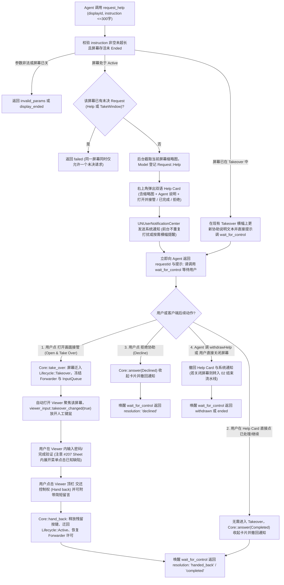
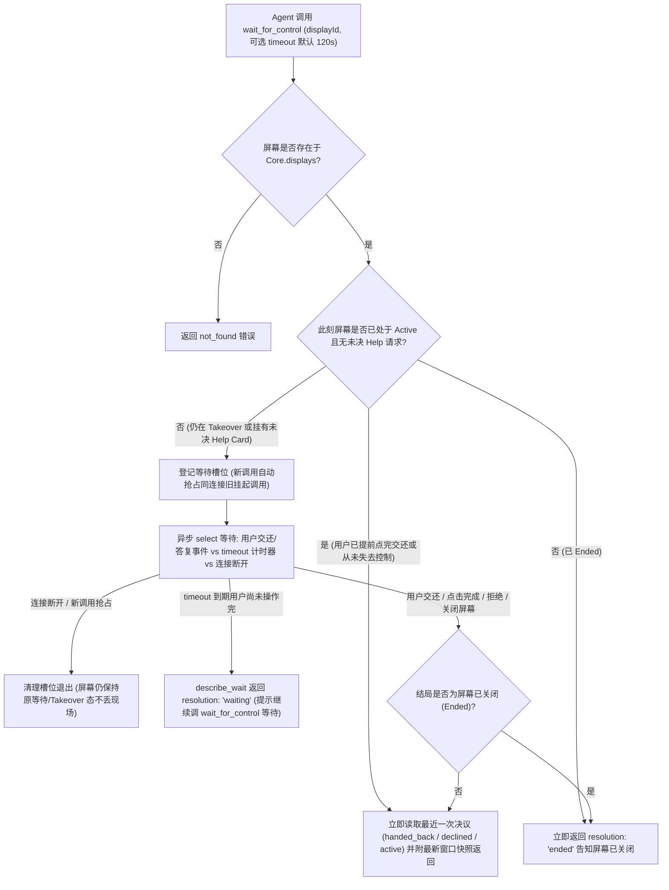

# 08. 人工协助请求 (`request_help`)、用户接管 (`Takeover`) 与 `wait_for_control` 交接流水线

当 Agent 遇到登录输入密码、双因素认证、人机验证码 (CAPTCHA)、支付确认或后台无法操作的特殊原生弹层 (`#205`) 时，调用 `request_help` 请用户介入；用户也可随时在 Peek 或 Viewer 主动点击“接管 (Take over)”暂停 Agent (`ADR 0004`, `ADR 0010`)。系统的核心铁律是：**一旦进入 `Takeover`，只有用户本人点击“交还控制权 (Hand back)”（或关闭屏幕）才能结束接管，Agent 没有任何工具可以自行夺回控制权**。在协助与接管等待期间，Agent 通过 `wait_for_control` 阻塞等待最终结论；`wait_for_control` 内置每屏幕单槽位抢占注册表与 `EARLY_CANCEL = 30s` 早期取消检测，确保即使客户端工具超时重调也不会漏接用户的交还信号。

## 线程与队列分工

1. **GPUI 主线程 (`Core` / `Model` / `Shell`)**：管理纯状态机 `request::Requests` (`crates/model/src/request.rs`) 与 `Display` 生命周期迁移 (`Active <-> Takeover`)、执行 `Core::stop_agent_input` 冻结后台 `Forwarder`、渲染右上角 **Help Card** (`apps/macos/src/ui/help_card.rs`) 与 Viewer 顶部接管横幅 (`apps/macos/src/ui/viewer.rs`)。
2. **系统通知代理 (`mac::notify`)**：通过 `UNUserNotificationCenter` (`MacOSX.sdk UNUserNotificationCenter.h`) 发送带快捷操作按钮的系统横幅通知，并在用户已从界面处理或请求撤回时调用 `removeDeliveredNotificationsWithIdentifiers:` 自动撤回通知 (`apps/macos/src/mac/notify.rs:34-260`)。
3. **等待槽位协调器 (`WaitSlot` 静态互斥表 + `AsyncApp`)**：`register_wait` / `wait_for_change` / `waitForControl` (`apps/macos/src/control/agent.rs:1655-1835, 7713-7950`) 管理挂起 `oneshot` 通道与超时结算。

---

## 图 1：`request_help` 发起、双路通知展示与用户四类响应路径

### 图 1 节点明细表

| 节点 | 线程与队列 | 我方代码与常量 | macOS 组件与内部行为 | 限制与关联缺陷 | Agent 侧返回 | 用户侧表现 | 验证来源 |
| :--- | :--- | :--- | :--- | :--- | :--- | :--- | :--- |
| `H1` | `mcp` -> GPUI 主线程 | `tools::run("request_help")` (`crates/mcp/src/tools.rs:1060-1105`), `agent.rs:1655-1688` | 传入目标 `displayId` 与面向人类阅读的 `instruction` 说明文本；`needs_permissions` 豁免 `requestHelp` 使其在受阻时始终能呼救 (`agent.rs:2612`) | `instruction` 限制 `INSTRUCTION_CHARS = 300` 字符 (`access.rs:14-31`) | 进入校验 | 无变化 | [已验证: crates/mcp/src/tools.rs:1060-1105, apps/macos/src/control/agent.rs:1655-1688, crates/model/src/access.rs:14-31] |
| `H2` | GPUI 主线程 | `access::user_instruction` + `usable` (`apps/macos/src/control/agent.rs:1658-1668, 2686-2713`) | 检查文本非空、字符数 `<= 300`，确认屏幕存在且未 `Ended` | 空说明或超长文本直接报 `invalid_params` | 非法走 `HX1`，已接管走 `H3`，活跃走 `H4` | 无变化 | [已验证: apps/macos/src/control/agent.rs:1658-1668] |
| `HX1` | GPUI 主线程 | `ControlError::invalid` / `ended` (`apps/macos/src/control/agent.rs:1659, 2707-2710`) | 拒绝无效调用 | 无 | `invalid_params` 或 `display_ended` | 无变化 | [已验证: apps/macos/src/control/agent.rs:1659, apps/macos/src/control/agent.rs:2707-2710] |
| `H3` | GPUI 主线程 | `Model::request_help` 在 `Takeover` 态分支 (`crates/model/src/request.rs:290-345`) | 若用户早已主动接管了该屏幕，不重复弹新卡，而是把说明更新到 Viewer 接管横幅上 | 平滑衔接用户主动接管与 Agent 请求协助 | 进入 `H8` 正常返回 | Viewer 顶栏显示 Agent 补充的说明文字 | [已验证: crates/model/src/request.rs:290-345] |
| `H4` | GPUI 主线程 | `Model::request_help` 互斥检查 (`crates/model/src/request.rs:295-320`) | 检查该 `displayId` 是否已挂有未决 `Help` 或 `TakeWindow` 请求 | 防止连续刷屏弹窗轰炸用户 | 冲突走 `HX2`，空闲走 `H5` | 无变化 | [已验证: crates/model/src/request.rs:295-320] |
| `HX2` | GPUI 主线程 | `ControlError::failed` (`apps/macos/src/control/agent.rs:1675-1682`) | 告知已有挂起请求，引导直接调用 `wait_for_control` | 无 | 错误码 `failed` | 无变化 | [已验证: apps/macos/src/control/agent.rs:1675-1682] |
| `H5` | 后台 + GPUI 主线程 | `screenshot::display` + `Model::request_help` (`apps/macos/src/control/agent.rs:1665-1685`) | 截取当前虚拟屏缩略图供卡片预览，分配递增请求编号登记入 `Core.displays` | `request_help` 是非阻塞发起调用，真正等待在 `wait_for_control` 进行 (`ADR 0010`) | 生成请求单 | 无变化 | [已验证: apps/macos/src/control/agent.rs:1665-1685, ADR 0010] |
| `H6` | GPUI 主线程 | `ui::help_card` (`apps/macos/src/ui/help_card.rs:47, 120-560`), `Core::apply` (`apps/macos/src/core.rs:1094-1117`) | 在物理主屏右上角弹出无焦点抢占 (`NSWindowStyleMaskNonActivatingPanel`) 的双语 Help Card，展示虚拟屏实时缩略图 (`MAX_PICTURE = 184pt`)、客户端名称与 Agent 请求说明 | 弹出面板绝不抢走用户正在打字窗口的键盘焦点 | 无 | 右上角浮现精致协助卡片 | [已验证: apps/macos/src/ui/help_card.rs:47, apps/macos/src/ui/help_card.rs:120-560, apps/macos/src/core.rs:1094-1117] |
| `H7` | 后台 / 通知中心代理 | `notify::post` (`apps/macos/src/mac/notify.rs:60-182, 260-360`) | 若宿主拥有 Bundle 签名且获得通知授权，通过 `UNUserNotificationCenter` 投递带交互动作 (`Action`) 的系统通知；当用户在全屏其它应用中也能收到提醒 | 未授权通知时静默降级仅保留界面内 Help Card + 菜单栏徽标闪烁 | 无 | 系统通知横幅同步提醒 | [已验证: apps/macos/src/mac/notify.rs:60-182, MacOSX.sdk UNUserNotificationCenter.h] |
| `H8` | 宿主 -> `mcp` 进程 | `requestHelp` 返回 (`apps/macos/src/control/agent.rs:1680-1687`, `crates/mcp/src/tools.rs:1085-1104`) | 立即返回请求已送达确认，明确指示下一步调用 `wait_for_control` 等待用户完成 | 两段式设计允许 Agent 先向对话输出一句向用户解释的话，再调 `wait_for_control` 挂起 (`ADR 0010`) | 返回请求状态 JSON | 等待用户响应 | [已验证: apps/macos/src/control/agent.rs:1680-1687, crates/mcp/src/tools.rs:1085-1104, ADR 0010] |
| `U0` | 用户交互 / 控制端 | Help Card 按钮 / 系统通知 `did_receive` (`apps/macos/src/mac/notify.rs:125-181`) / `withdrawHelp` (`agent.rs:1689-1702`) | 四条分支汇集全部结束方式 | 任一入口响应后另一入口自动联动关闭 | 挂起中的 `wait_for_control` 等待唤醒 | 无变化 | [已验证: apps/macos/src/mac/notify.rs:125-181, apps/macos/src/control/agent.rs:1689-1724] |
| `U1` | GPUI 主线程 | `Core::take_over` (`apps/macos/src/core.rs:1049-1057`), `Core::stop_agent_input` (`core.rs:1119-1133`), `InputQueue::takeover` (`crates/model/src/input_queue.rs:530-543`) | 屏幕状态切为 `Lifecycle::Takeover`；令 `Forwarder::stop_agent(true)` 立即掐断所有在途后台输入；取消 `InputQueue` 中该屏幕全部待执行真实输入并熄灭该屏红框 | 接管期间 Agent 调用除 `wait_for_control` / `end_display` 外的任何动作工具均立即报 `ControlError::takeover` (`user_takeover`) | 并发工具调用立即返回 `user_takeover` | Help Card 收起，切换至 Viewer | [已验证: apps/macos/src/core.rs:1049-1057, apps/macos/src/core.rs:1119-1133, crates/model/src/input_queue.rs:530-543] |
| `U2` | GPUI 主线程 | `Shell::open_viewer` (`apps/macos/src/ui/shell.rs:2510-2590`), `viewer_input::takeover_changed` (`apps/macos/src/mac/viewer_input.rs:262-285`) | 打开或前置 Viewer 窗口聚焦该虚拟屏，将 `SCStream` 帧率提升至交互档 (`30/60 fps`)，激活本地键盘与 IME 转发 | 用户无需去虚拟屏找窗口，在物理屏的 Viewer 窗口内即可全权操作 | 无 | Viewer 窗口打开，顶栏显示醒目的接管条与“交还控制权”按钮 | [已验证: apps/macos/src/ui/shell.rs:2510-2590, apps/macos/src/mac/viewer_input.rs:262-285] |
| `U3` | 用户在 Viewer 内操作 | 完整走文档 `07` (`viewer_input.rs`) 键鼠与密码安全路由 | 用户输入账号密码、拖动滑块或点击确认 | 关联缺陷 `#207`：若应用弹出模态 Sheet 且其中又展开了原生 `NSPopUpButton` 菜单，因菜单窗口层级归属过滤边界可能导致点击菜单项无反应，需按键盘上下键或回车选择 | Agent 在 `wait_for_control` 安静等待 | 用户完成人工步骤 | [已验证: apps/macos/src/mac/viewer_input.rs:1348-1727, Issue #207] |
| `U4` | GPUI 主线程 | Viewer 顶栏交还按钮 (`apps/macos/src/ui/viewer.rs:510-590`) / `answerHelp` | 用户确认操作完毕，点击“交还控制权 (Hand back)” | 唯一合法退出 `Takeover` 回到 `Active` 的途径 (`ADR 0004`) | 即将唤醒等待方 | 接管横幅收起 | [已验证: apps/macos/src/ui/viewer.rs:510-590, ADR 0004] |
| `U5` | GPUI 主线程 | `Core::hand_back` (`apps/macos/src/core.rs:1059-1067`), `release_after_takeover` (`apps/macos/src/mac/viewer_input.rs:296-314`) | 释放用户在接管结束瞬间可能尚未松开的按下键与 IME 预编辑串，调用 `Model::hand_back` 将屏幕恢复为 `Lifecycle::Active`，解除 `Forwarder::stop_agent(false)` | 干净清理人工输入尾态，防止卡住 `Shift`/`Command` 污染后续 Agent 按键 | 进入 `R_DONE` | Viewer 恢复常规观察模式（或按需收起） | [已验证: apps/macos/src/core.rs:1059-1067, apps/macos/src/mac/viewer_input.rs:296-314] |
| `U6` | GPUI 主线程 | `Core::answer(..., Answer::Done)` (`apps/macos/src/core.rs:1069-1092`) | 针对仅需口头确认或已在外部处理完的场景，直接结案无需进出 `Takeover` | 自动调用 `notify::retract` 撤回通知中心残留通知 | 进入 `R_DONE` | 卡片与系统通知双双消失 | [已验证: apps/macos/src/core.rs:1069-1092, apps/macos/src/mac/notify.rs:220-258] |
| `U7` | GPUI 主线程 | `Core::answer(..., Answer::Declined)` (`apps/macos/src/core.rs:1069-1092`) | 记录用户明确拒绝本次协助请求 | Agent 收到 `declined` 后不得原地死循环重发同一 `request_help` | 进入 `R_DEC` | 卡片与通知消失 | [已验证: apps/macos/src/core.rs:1069-1092] |
| `U8` | GPUI 主线程 | `withdrawHelp` (`apps/macos/src/control/agent.rs:1689-1702`) / `Core::end` | Agent 发现页面已自行跳转无需人工时撤回请求，或用户直接关掉整块屏幕 | 无 | 进入 `R_END` | 卡片与通知撤回 | [已验证: apps/macos/src/control/agent.rs:1689-1702] |
| `R_DONE` | GPUI 主线程 -> 图 2 | `Model` 唤醒事件广播 (`crates/model/src/request.rs:419-444, 621-658`) | 记录 `Resolution::HandedBack` 或 `Completed` 到 `unheard` 并唤醒挂起的 `wait_for_control` | 即使用户在 `request_help` 与 `wait_for_control` 间隙秒点完成，决议也会保存在 `unheard` 中不丢失 | 转入图 2 返回控制权已恢复 | 交接完成 | [已验证: crates/model/src/request.rs:419-444, crates/model/src/request.rs:621-658] |
| `R_DEC` | GPUI 主线程 -> 图 2 | `Model::answer_help_with(..., Declined)` (`crates/model/src/request.rs:660-741`) | 记录 `Resolution::Declined` 到 `unheard` 并唤醒挂起的 `wait_for_control` | 明确区分用户拒绝协助与正常完成 | 转入图 2 返回 `resolution: "declined"` | 卡片关闭 | [已验证: crates/model/src/request.rs:660-741, crates/mcp/src/tools.rs:1520-1627] |
| `R_END` | GPUI 主线程 -> 图 2 | `Model::withdraw_help` / `Model::end` (`crates/model/src/request.rs:503-519`, `crates/model/src/model.rs:1060-1125`) | 记录请求已撤回 (`withdrawn`) 或屏幕已结束 (`ended`) 并广播唤醒 | 防止屏幕关闭后 `wait_for_control` 死等 | 转入图 2 返回 `withdrawn` 或 `ended` | 界面清理完毕 | [已验证: crates/model/src/request.rs:503-519, crates/model/src/model.rs:1060-1125] |

---

## 图 2：`wait_for_control` 等待循环、超时续航与单槽抢占 (`WaitSlot`) 子流程

### 图 2 节点明细表

| 节点 | 线程与队列 | 我方代码与常量 | macOS 组件与内部行为 | 限制与关联缺陷 | Agent 侧返回 | 用户侧表现 | 验证来源 |
| :--- | :--- | :--- | :--- | :--- | :--- | :--- | :--- |
| `W1` | `mcp` -> GPUI 主线程 | `tools::run("wait_for_control")` (`crates/mcp/src/tools.rs:1106-1148`), `agent.rs:1760-1835` | 接收 `displayId` 与可选等待秒数；豁免权限检查与 `Ended`/`Takeover` 拦截 (`agent.rs:2615, 2707`) | 允许在 `Takeover` 和 `Ended` 状态下合法调用以查询结局 | 进入 `W2` | 无变化 | [已验证: crates/mcp/src/tools.rs:1106-1148, apps/macos/src/control/agent.rs:1760-1835, apps/macos/src/control/agent.rs:2707] |
| `W2` | GPUI 主线程 | `Core.displays.get(id)` (`apps/macos/src/control/agent.rs:1763-1770`) | 检查屏幕句柄是否存在 | 仅当已被彻底 `remove_with` 销毁时才报 `not_found` | 不存在走 `WX1`，存在走 `W3` | 无变化 | [已验证: apps/macos/src/control/agent.rs:1763-1770] |
| `WX1` | GPUI 主线程 | `ControlError::not_found` (`apps/macos/src/control/agent.rs:2695`) | 未知 `displayId` | 无 | 错误码 `not_found` | 无变化 | [已验证: apps/macos/src/control/agent.rs:2695] |
| `W3` | GPUI 主线程 | `waitForControl` 状态即刻判定 (`apps/macos/src/control/agent.rs:1771-1798`) | 检查屏幕此刻是否仍有挂起协助或处于 `Takeover` | 解决两步调用 (`request_help` -> `wait_for_control`) 之间用户手快先点完按钮的竞态 | 已就绪走 `WR1`，已结束走 `WR2`，等待中走 `W4` | 无变化 | [已验证: apps/macos/src/control/agent.rs:1771-1798] |
| `WR1` | 后台快照 + `mcp` | `wait_outcome` (`crates/mcp/src/tools.rs:1520-1627`) | 汇总 `resolution` (`"handed_back"` / `"completed"` / `"declined"` / `"active"`)、用户留言，并自动在 `tools.rs` 补拍当前屏幕窗口列表或状态摘要交给 Agent 接续工作 | 若 `resolution == "declined"`，明确告知用户拒绝了请求 | 返回富上下文状态 JSON | 控制权平稳回到 Agent | [已验证: crates/mcp/src/tools.rs:1520-1627] |
| `WR2` | GPUI 主线程 -> `mcp` | `wait_outcome` `ended` 分支 (`crates/mcp/src/tools.rs:1541-1575`) | 告知等待期间屏幕已被关闭（区分用户主动关闭与其它原因） | 指导 Agent 结束任务而非盲目新建屏幕 | 返回 `resolution: "ended"` | 无变化 | [已验证: crates/mcp/src/tools.rs:1541-1575] |
| `W4` | GPUI 主线程 | 等待通知订阅 (`apps/macos/src/control/agent.rs:1799-1818`) | 订阅该屏幕的状态变更通道（类似 `wait_for_change` 的 `WaitSlot` 单槽机制，`EARLY_CANCEL = 30s`，`agent.rs:7713-7774`） | 防止客户端重试堆积僵尸等待任务 | 进入异步等待 `W5` | Help Card 或 Viewer 接管横幅持续等待用户 | [已验证: apps/macos/src/control/agent.rs:1799-1818, apps/macos/src/control/agent.rs:7713-7774] |
| `W5` | GPUI 异步任务 | 计时器与状态通道 `select` (`apps/macos/src/control/agent.rs:1810-1834`) | 非阻塞挂起直至状态变化或单轮 `timeout` 到达 | 人工输二次验证或手机扫码常超 1 分钟，单轮超时绝不自动取消用户的 Help Card 或中断用户的 `Takeover`！ | 三路分流 | 用户可以从容不迫完成手机验证，不会被超时踢出 | [已验证: apps/macos/src/control/agent.rs:1810-1834] |
| `WX2` | Drop 清理守卫 | `CallGuard::drop` / `Waiting::drop` (`apps/macos/src/control/agent.rs:57-68, 7755-7774`) | 客户端取消单次 RPC 时仅释放本次等待协程，保留屏幕上的 Help Card / `Takeover` 现场供下次重调继续等 | 若整个 MCP 会话彻底断线超 `2000ms` 则由文档 `02` `connection_closed` 统一清理 | 连接已断无返回 | 短暂取消不闪退用户正在输入的 Viewer | [已验证: apps/macos/src/control/agent.rs:57-68, apps/macos/src/control/agent.rs:7755-7774] |
| `WR3` | 宿主 -> `mcp` 进程 | `describe_wait` (`IDLE_HINT_SECONDS = 15`, `crates/mcp/src/tools.rs:1487-1518`) | 返回 `resolution: "waiting"`，准确报告当前是“卡片仍待用户点击”还是“用户已打开 Viewer 正在亲自操作（距上次按键 N 秒）”，提示继续调用 `wait_for_control` | 给 Agent 透明的实时进展而非报错失败 | 返回仍在等待状态说明 | 用户操作完全不受影响 | [已验证: crates/mcp/src/tools.rs:1487-1518] |
| `W6` | GPUI 主线程 | 唤醒后终态复核 (`apps/macos/src/control/agent.rs:1825-1834`) | 判断唤醒原因是屏幕被关还是控制权交回/答复 | 无 | 被关走 `WR2`，其余走 `WR1` | 无变化 | [已验证: apps/macos/src/control/agent.rs:1825-1834] |
