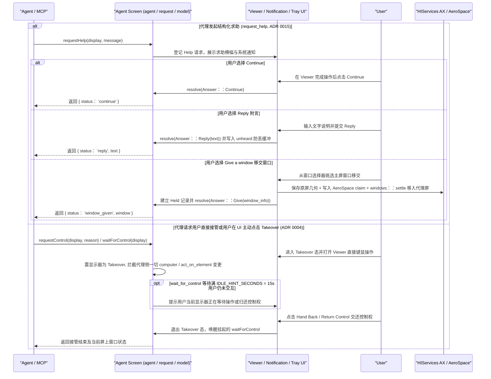

# 操作 08：Takeover 接管与协作请求（request_help / request_control）

当代理遇到登录验证码、双因素认证、权限弹窗或缺少目标窗口时，通过 `request_help` 或 `request_control` 请求用户介入。根据 ADR 0004 与 ADR 0015，`Takeover` 期间代理的后台写操作被全面挂起，仅当用户显式交还控制权或提交答复（`Continue`、`Reply`、`Give a window`）后代理方可继续。

## 端到端流程

## 节点明细表

| 节点 | 我方代码 | macOS 组件与内部行为 | 限制与故障模式 | 关联问题 | 验证状态 |
| --- | --- | --- | --- | --- | --- |
| 1. `request_help` 挂起与通知投递 | `crates/mcp/src/tools.rs:1717-1785`、`crates/model/src/request.rs:1-190`、`apps/macos/src/control/agent.rs:762-845` | 在会话与显示器模型上登记待决 `Help` 请求，通过 GPUI 刷新卡片、横幅与菜单栏角标，并调用 `UNUserNotificationCenter` 发送本地通知；MCP 调用在异步通道上阻塞等待用户答复。 | 若用户未授予 Agent Screen 系统通知权限，仅菜单栏图标与已打开的界面可见，后台静默运行时用户可能延迟发现求助。 | `#206`、ADR 0015 | `[已验证]` `docs/adr/0015-help-requests.md`、`crates/model/src/request.rs:1-190` |
| 2. 三类求助答复与 `unheard` 断连重放 | `crates/model/src/request.rs:95-245`、`apps/macos/src/control/agent.rs:790-860` | 支持三种完成分支：`Continue`、`Reply(String)`、`Give(Window)`。若用户提交 `Reply` 时 MCP 控制连接恰好闪断，答复内容保存在会话的 `unheard` 队列中，待该会话在重连宽限期内恢复或下次调用时补发，防止用户输入白费。 | 若上游代理进程彻底崩溃且超过 `DISCONNECT_GRACE = 2000 ms` 会话过期，`unheard` 随会话销毁而不再投递。 | `#189`、ADR 0015 | `[已验证]` `crates/model/src/request.rs:150-245` |
| 3. `Give a window` 一步窗口移交 | `apps/macos/src/ui/shell.rs:910-1040`、`apps/macos/src/mac/windows.rs:180-340` | 用户在答复面板直接点选用户桌面上的现有窗口，系统原子执行：记录原屏 `CGRect`、写入 AeroSpace `claims/<pid>.json`、调用 `windows::settle` 将窗口移至当前代理屏、登记 `Held` 所有权，并将窗口元数据作为 `request_help` 返回值直接交给代理。 | 全屏独立 Space 窗口或受系统保护不可移动面板无法通过 `AXPosition` 迁入代理屏，操作会提示窗口不可移动。 | `#205`、`#110` | `[已验证]` `docs/adr/0015-help-requests.md`、`apps/macos/src/ui/shell.rs:910-1040` |
| 4. `Takeover` 排他门控（ADR 0004） | `apps/macos/src/core.rs:380-440`、`apps/macos/src/control/agent.rs:357-410`、`docs/adr/0004-takeover-and-review.md` | 显示器一旦进入 `Takeover`（无论由代理 `request_control` 触发还是用户在 Viewer 主动点按 Takeover 按钮），控制层对代理发往该显示器的 `computer`、`act_on_element`、`place_window` 等写操作统一拒绝并返回明确状态提示，仅允许 `wait_for_control` 等只读或等待调用。 | **单向归还约束**：代理绝对不能自行解除 `Takeover`；只有用户在 UI 点击归还按钮后状态才会退回代理控制，避免代理在用户输密码中途抢键。 | ADR 0004 | `[已验证]` `docs/adr/0004-takeover-and-review.md`、`apps/macos/src/control/agent.rs:357-410` |
| 5. `wait_for_control` 与 `15 s` 闲置提醒 | `crates/mcp/src/tools.rs:1787-1845`、`apps/macos/src/control/agent.rs:847-910` | 代理阻塞等待用户结束 `Takeover`；若进入等待后满 `IDLE_HINT_SECONDS = 15` 秒仍未检测到用户操作或交还，UI 更新温和提醒以防用户忘记点击归还。 | 若客户端 MCP 工具层配置了较短的请求级超时，`wait_for_control` 可能在用户操作完成前先返回超时，代理需再次调用 `wait_for_control` 续等。 | ADR 0004 | `[已验证]` `apps/macos/src/control/agent.rs:847-910` |
| 6. 调试控制入口（`debugShow` / `debugTakeover`） | `apps/macos/src/control/server.rs:220-310` | 在 `debug_methods()` 门控下暴露无点击驱动接口，供 `AGENTSCREEN_INSTANCE=e2e` 自动化脚本直接拉起求助面板、切换 `Takeover` 及注入模拟答复，无需移动真实物理鼠标。 | 仅在开启调试方法的实例或开发测试配置中响应，生产默认路径不向外部暴露测试注入风险。 | 测试可驱动性约束（AGENTS.md） | `[已验证]` `apps/macos/src/control/server.rs:220-310` |
