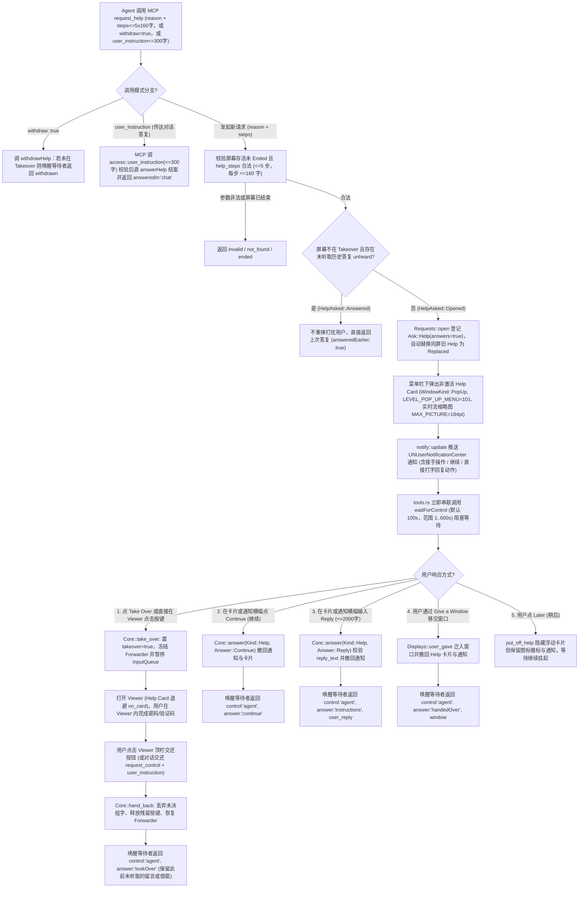
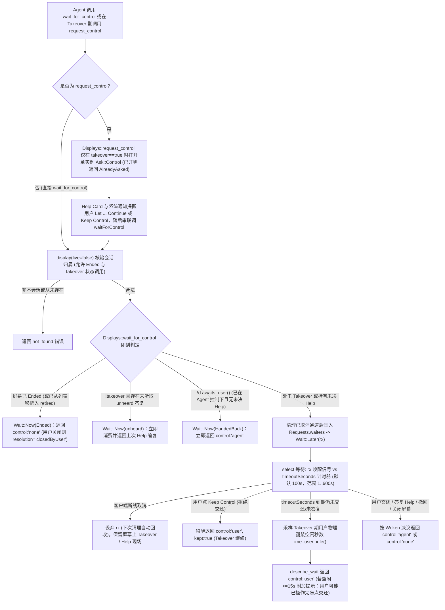

# 08. 人工协助请求 (`request_help`)、接管交接 (`Takeover` / `request_control`) 与 `wait_for_control` 流水线

当 Agent 遇到登录密码、双因素认证、人机验证码 (CAPTCHA)、支付确认或无法在不打开菜单的前提下选择的原生下拉框 (`#205`) 时，调用 `request_help` 请用户介入；用户也可随时在 Peek、Viewer 或系统通知点击接管 (`Take Over`)，或直接在 Viewer 画面敲击点击自动进入 `Takeover` (`ADR 0004`, `ADR 0013`, `ADR 0015`)。系统的核心约束是：**一旦进入 `Takeover`，只有用户本人点击交还按钮（或在对话中明确指令交还并由 Agent 通过 `user_instruction` 传达，或关闭屏幕）才能结束接管**。在 MCP 工具层，`request_help` 与 `request_control` 均采用组合式同步等待：发出控制命令登记请求后，若无未听取的历史答复 (`unheard`)，**立即在同一次工具调用内串联调用 `"waitForControl"` 等待最多 `timeout_seconds`（默认 `100s`，范围 `1..=600s`）**；仅当单轮超时返回 `{"control": "user", ...}` 时，Agent 才继续调用 `wait_for_control` 续航等待。

## 线程与队列分工

1. **GPUI 主线程 (`Core` / `Displays` / `Shell`)**：运行纯模型 `request::Requests` (`crates/model/src/request.rs`) 与 `Takeover` 状态切换、通过 `Core::stop_agent_input` 冻结后台 `Forwarder`、驱动菜单栏下方非激活弹出面板 **Help Card** (`WindowKind::PopUp, focus: false` + `LEVEL_POP_UP_MENU = 101`, `apps/macos/src/ui/shell.rs:378-393, 516-524`, `apps/macos/src/ui/help_card.rs`) 及 Viewer 顶部接管控制栏 (`apps/macos/src/ui/viewer.rs`)。
2. **系统通知中心代理 (`mac::notify`)**：通过 `UNUserNotificationCenter` (`UNUserNotificationCenter.h:39`) 运行 `notify::update` (`apps/macos/src/mac/notify.rs:294`) 推送带快捷按钮（`Take Over`、`Continue`、以及带文本输入框的 `Reply`）的系统横幅通知，并在结案或撤回时调用 `notify::withdraw_help` / `withdraw_control` (`notify.rs:468, 484`) 移除通知。
3. **每屏幕多等待者唤醒表 (`Requests.waiters: Vec<oneshot::Sender<Woken>>`)**：`Displays::wait_for_control` (`crates/model/src/request.rs:312, 761-780`) 清理已取消的 `oneshot` 发送端后将新等待者压入 `waiters`，并在无等待者在线时将 Help 答复暂存于 `unheard: Option<Woken>` 防止两步调用空档丢信号。

---

## 图 1：`request_help` 发起、Help Card 与系统通知四路应答 (`ADR 0015`) 及 `Takeover` 交接流程

### 图 1 节点明细表

| 节点 | 线程与队列 | 我方代码与常量 | macOS 组件与内部行为 | 限制与关联缺陷 | Agent 侧返回 | 用户侧表现 | 验证证据 |
| :--- | :--- | :--- | :--- | :--- | :--- | :--- | :--- |
| `H1` | `mcp` -> GPUI 主线程 | `tools::run("request_help")` (`crates/mcp/src/tools.rs:873-926`), `"requestHelp"` / `"withdrawHelp"` / `"answerHelp"` (`apps/macos/src/control/agent.rs:1655-1722`) | 支持三种调用模式：传 `reason`（及可选 `steps`）发起协助并自动等待；传 `withdraw: true` 撤回；传 `user_instruction` 将用户在聊天窗口给出的答复同步回宿主结案；`needs_permissions` 豁免 `requestHelp` 使其在缺权限时仍可呼救 (`agent.rs:2612`) | 缺 `reason` 返回错误码 `invalid` | 按模式进入分支 | 无变化 | 已验证：`crates/mcp/src/tools.rs:873-925` `"request_help" => { ... "answerHelp" ... "withdrawHelp" ... "requestHelp" ... "waitForControl"` |
| `H_WD` | GPUI 主线程 | `Displays::withdraw_help` (`crates/model/src/request.rs:503-518`), `agent.rs:1689-1699` | 将打开的 `Kind::Help` 结案为 `Resolution::Withdrawn` 并调 `notify::withdraw_help`；若当前用户已处于 `Takeover`，撤回 Help **绝不退出 `Takeover`** (`!d.takeover` 守卫) | Agent 无权通过撤回请求打断正在接管的用户 | 返回 `{"withdrawn": bool}` | 未接管时卡片与通知收起 | 已验证：`crates/model/src/request.rs:503,513-515` `pub fn withdraw_help(&mut self, id: DisplayId) -> bool` / `if !d.takeover { d.requests.wake(Woken::of(Some(Kind::Help), Resolution::Withdrawn)); }` |
| `H_CHAT` | `mcp` 进程 -> GPUI 主线程 | `access::user_instruction` (`INSTRUCTION_CHARS = 300`, `crates/model/src/access.rs:14-27`), `tools.rs:875-889`, `"answerHelp"` (`apps/macos/src/control/agent.rs:1703-1721`) | MCP 进程先调 `access::user_instruction` 校验引用的用户原话非空且 `<= 300` 字符，再调宿主 `"answerHelp"`；GPUI 主线程过滤非空白 (`!w.trim().is_empty()`)、调 `Core::answer(..., Answer::Continue)` 关闭卡片、清空 `unheard`、写入日志与录屏事件 `helpAnswered` 并回 `{"answered": true}`，最终由 MCP 组装返回 `"answeredIn": "chat"` (`ADR 0013`, `ADR 0015`) | 超 `300` 字或空白报 `invalid` | 返回 `{"control": "agent", "answer": "continue", "answeredIn": "chat", ...}` | 卡片与通知自动收起 | 已验证：`crates/model/src/access.rs:14-18` `pub const INSTRUCTION_CHARS: usize = 300; ... pub fn user_instruction(`；`crates/mcp/src/tools.rs:876-887` `let words = agent_screen_model::access::user_instruction(&words) ... "answeredIn": "chat",`；`apps/macos/src/control/agent.rs:1707-1720` `.filter(\|w\| !w.trim().is_empty()) ... c.answer(id, Kind::Help, None, Answer::Continue, cx) ... Ok(json!({ "answered": true }))` |
| `H2` | GPUI 主线程 | `display` (`apps/macos/src/control/agent.rs:1656`), `model::help_steps` (`HELP_STEPS = 5`, `HELP_STEP_CHARS = 160`, `crates/model/src/model.rs:544-565`) | 核验屏幕存活未 `Ended`，校验 `reason` 非空且可选 `steps` 不超过 `5` 条、每条修剪后非空且 `<= 160` 字符 | 步骤超限或为空返回 `invalid` | 失败走 `HX1`，通过走 `H3` | 无变化 | 已验证：`crates/model/src/model.rs:544-548` `pub const HELP_STEPS: usize = 5; pub const HELP_STEP_CHARS: usize = 160; ... pub fn help_steps(` |
| `HX1` | GPUI 主线程 | `ControlError::invalid` / `not_found` / `ended_error` (`apps/macos/src/control/agent.rs:1660, 1674, 7252-7260`) | 返回标准协议错误 | 无 | 错误码 `invalid` / `not_found` / `ended` | 无变化 | 已验证：`apps/macos/src/control/agent.rs:1660,1674` `ControlError::invalid("reason is required")` / `.map_err(ControlError::invalid)?` |
| `H3` | GPUI 主线程 | `Displays::request_help` (`crates/model/src/request.rs:474-498`) | 若 `answers == true && !d.takeover` 且 `d.requests.unheard` 存有上次等待超时后用户才提交的答复，直接取出返回 `HelpAsked::Answered(woken)` | 避免用户刚回答完又被新弹窗打扰 | 命中走 `H_EARLY`，否则走 `H4` | 无重复弹窗 | 已验证：`crates/model/src/request.rs:482-487` `if answers && !d.takeover && let Some(woken) = d.requests.unheard.take() { return Some(HelpAsked::Answered(woken)); }` |
| `H_EARLY` | `mcp` 进程 | `answeredEarlier` 分支 (`crates/mcp/src/tools.rs:909-918`) | 将先前未听取的用户答复格式化返回并标注 `"answeredEarlier": true` | 零延迟交付延迟到达的用户答复 | 返回上次答复详情 | 无变化 | 已验证：`crates/mcp/src/tools.rs:909,916` `if let Some(Value::Object(answered)) = asked.get("answered")` / `out["answeredEarlier"] = json!(true);` |
| `H4` | GPUI 主线程 | `Requests::open` (`crates/model/src/request.rs:391-402, 492-497`) | `Help`、`Control`、`Window` 三种 `Kind` 各自独立占一槽；若同屏已有旧 `Kind::Help` 打开，自动调 `resolve(Kind::Help, Resolution::Replaced)` 原地替换（**不报错拒绝**），即使处于 `Takeover` 也可登记新 `Help` 说明显示在 Viewer 顶栏 | 同屏不堆叠多张同类型请求卡 | 进入 `H5` | 若已在 Viewer 接管则更新顶栏步骤说明 | 已验证：`crates/model/src/request.rs:391-395` `fn open(&mut self, ask: Ask, ...) -> RequestId { let kind = ask.kind(); self.resolve(kind, Resolution::Replaced);` |
| `H5` | GPUI 主线程 | `panel_options` + `native::style_panel` (`apps/macos/src/ui/shell.rs:378-393, 516-524`, `apps/macos/src/mac/native.rs:1068, 1273`), `HelpCard` (`MAX_PICTURE = 184.0`, `apps/macos/src/ui/help_card.rs:47, 69`) | 通过 GPUI `WindowKind::PopUp, focus: false` 创建透明面板，由 `native::style_panel(&card_ns, LEVEL_POP_UP_MENU)` (`level = 101`, `CanJoinAllSpaces \| FullScreenAuxiliary \| IgnoresCycle`) 与 `set_keyable_while_typing` 样式化，展示 `Streams` 实时画面缩略图（非静态截图，`MAX_PICTURE = 184pt`）、原因、步骤及操作按钮（注：Help 请求**无拒绝 Decline 按钮**，提供接手操作、继续、回复、移交窗口与稍后） | 弹出时不抢夺用户当前前台窗口键盘焦点；仅当用户点开卡片回复框打字时才临时接键 | 无 | 菜单栏图标下浮现双语协助卡片 | 已验证：`apps/macos/src/ui/shell.rs:384-385` `kind: WindowKind::PopUp, focus: false,`；`apps/macos/src/ui/shell.rs:523-524` `native::style_panel(&card_ns, native::LEVEL_POP_UP_MENU); native::set_keyable_while_typing(&card_ns);`；`apps/macos/src/ui/help_card.rs:47` `const MAX_PICTURE: f32 = 184.;` |
| `H6` | 主线程 -> 通知中心 | `notify::update` / `install` (`apps/macos/src/mac/notify.rs:221-258, 294`), `UNUserNotificationCenter` (`UNUserNotificationCenter.h:39`) | 推送类别为 `ANSWERS_CATEGORY` 的系统横幅通知，附带 `Take Over`（前台激活）、`Continue`（后台免打开结案）与 `UNTextInputNotificationAction` `Reply`（直接在通知横幅内打字发送）三个原生按钮 | 未授权通知时静默降级为菜单栏徽标与 Help Card | 无 | 全屏其它空间中也可直接在系统通知横幅点继续或打字回复 | 已验证：`apps/macos/src/mac/notify.rs:221` `pub fn install()`；`apps/macos/src/mac/notify.rs:235` `let reply = UNTextInputNotificationAction::actionWithIdentifier_title_options_textInputButtonTitle_textInputPlaceholder(`；`apps/macos/src/mac/notify.rs:294` `pub fn update(display: u32, agent: &str, task: &str, note: Option<Note>)`；`/Library/Developer/CommandLineTools/SDKs/MacOSX.sdk/System/Library/Frameworks/UserNotifications.framework/Versions/A/Headers/UNUserNotificationCenter.h:39` `@interface UNUserNotificationCenter : NSObject` |
| `H7` | `mcp` -> GPUI 主线程 | `tools.rs:920-925` 串联 `"waitForControl"` (`apps/macos/src/control/agent.rs:1760-1811`) | `request_help` 在登记成功后立即在同一工具调用内调用 `"waitForControl"`（默认 `100.0s`，钳制 `1.0..=600.0s`）进入挂起等待 | 省去多余往返，在用户 100s 内处理完时一次工具调用直接拿回结果 | 阻塞等待用户响应或超时 | 等待用户处理 | 已验证：`crates/mcp/src/tools.rs:920-925` `let reply = control .call( "waitForControl", json!({ "displayId": display, "timeoutSeconds": a.int("timeout_seconds")? }), ) .await?;`；`apps/macos/src/control/agent.rs:1764-1765` `.unwrap_or(100.0) .clamp(1.0, 600.0);` |
| `U0` | 用户交互入口 | Help Card / Viewer / 系统通知 `Delegate::did_receive` (`apps/macos/src/mac/notify.rs:124-135`) | 汇聚五种用户动作路径 | 任一入口响应后同步刷新卡片与通知状态 | 等待唤醒 | 无变化 | 已验证：`apps/macos/src/mac/notify.rs:124-125` `#[unsafe(method(userNotificationCenter:didReceiveNotificationResponse:withCompletionHandler:))] fn did_receive(` |
| `U1` | GPUI 主线程 | `Core::take_over` (`apps/macos/src/core.rs:1049-1054`), `Core::stop_agent_input` (`core.rs:1119-1133`), `Queue::takeover` (`crates/model/src/input_queue.rs:530-543`) | 将 `d.takeover` 置为 `true`；调 `Forwarder::stop_agent(true)` 停止后台事件并释放拖拽按压；调 `InputQueue::takeover(id, true)` 中止正在运行的真实输入并暂停该屏排队项 | 接管期间并发动作类工具统一在 `input_display` 被拦截返回错误码 `"takeover"` (`agent.rs:7273`) | 并发动作工具返回错误码 `takeover` | Help Card 对该屏退避 (`on_card`)，切入 Viewer | 已验证：`apps/macos/src/core.rs:1049-1053,1119` `pub fn take_over(&mut self, id: DisplayId, cx: &mut Context<Self>) -> bool` / `fn stop_agent_input(` |
| `U2` | GPUI 主线程 | `Shell::open_viewer` (`apps/macos/src/ui/shell.rs:2458`), `viewer_input::takeover_changed` (`apps/macos/src/mac/viewer_input.rs:262-285`) | 打开并前置 Viewer 窗口聚焦该虚拟屏，更新输入代数，放开文档 `07` 全部本地鼠标、键盘与输入法组字路由（`#207` 原生弹出菜单点击已通过 `press_menu_item_at` / `cancel_menu_at` 修复，真实 `.appex` 人工回归见文档 `07`） | 用户无需寻找屏外虚拟屏，直接在 Viewer 内操作 | `waitForControl` 持续等待 | Viewer 顶栏显示接管状态、Agent 步骤与交还按钮 | 已验证：`apps/macos/src/ui/shell.rs:2458` `pub fn open_viewer(`；`apps/macos/src/mac/viewer_input.rs:262` `pub fn takeover_changed(display: u32, active: bool)` |
| `U3` | 用户交互 / 对话传达 | `Shell::primary` (`apps/macos/src/ui/shell.rs:2673-2690`) 或 `request_control(user_instruction)` (`crates/mcp/src/tools.rs:931-943`) | 用户点击 Viewer 顶栏交还按钮；或者用户在对话中明确告知已完成并让 Agent 继续，由 Agent 调 `request_control(user_instruction: ...)` 触发 `chat_control` 执行交还 (`ADR 0004`, `ADR 0013`) | Agent 不能无凭据自行退出 `Takeover` | 触发 `end_takeover` | 接管横幅收起 | 已验证：`apps/macos/src/ui/shell.rs:2685-2686` `else if takeover { self.core.update(cx, \|core, cx\| core.hand_back(id, cx)); }`；`crates/mcp/src/tools.rs:931` `if let Some(words) = a.string("user_instruction")?` |
| `U4` | GPUI 主线程 | `Core::hand_back` (`apps/macos/src/core.rs:1059-1064`), `Displays::end_takeover` (`crates/model/src/request.rs:621-648`), `viewer_input::takeover_changed(..., false)` (`viewer_input.rs:281-284, 296-314`) | 丢弃未上屏 IME 预编辑串 `drop_composition()`，调用 `release_after_takeover()` 补发尚未松开的按键释放，恢复 `Forwarder::stop_agent(false)`，同时一并结案打开的 `Control` 与 `Help` 请求并调 `notify::withdraw_help` / `withdraw_control` | 若用户在接管前曾提交过未听取的 `Reply` 或 `Give`，`Woken::took_over` 将其装入 `superseded` 随交还一并带给 Agent (`request.rs:175-183`) | 进入 `R_TOOK` | 干净交回控制权 | 已验证：`crates/model/src/request.rs:621,638-640` `pub fn end_takeover(&mut self, id: DisplayId) -> Vec<Effect>` / `let woken = if help \|\| unheard.is_some() { Woken::took_over(unheard) }` |
| `R_TOOK` | `mcp` 进程 | `wait_outcome("tookOver")` (`crates/mcp/src/tools.rs:1582-1600`) | 返回 `{"control": "agent", "answer": "tookOver", ...}`（若含 `superseded` 留言或窗口则一并附上 `user_reply` / `window`），提示先截图查看用户改动后再继续 | 无 | 返回接管完成 JSON | 屏幕回到 Agent 控制 | 已验证：`crates/mcp/src/tools.rs:1582-1583` `("tookOver", _) => { let mut out = json!({ "control": "agent", "answer": "tookOver", ... });` |
| `U5` | GPUI 主线程 | `Displays::answer(..., Answer::Continue)` (`crates/model/src/request.rs:685`), `notify::withdraw_help` (`notify.rs:468`) | 用户无需接管直接放行：结案为 `Resolution::Continue` 并撤回通知与卡片 | 无 | 进入 `R_CONT` | 卡片与通知立即收起 | 已验证：`crates/model/src/request.rs:685` `(Kind::Help, Answer::Continue) => Resolution::Continue,` |
| `R_CONT` | `mcp` 进程 | `wait_outcome("continue")` (`crates/mcp/src/tools.rs:1543-1545`) | 返回 `{"control": "agent", "answer": "continue", ...}` | 无 | 返回继续执行 JSON | 无变化 | 已验证：`crates/mcp/src/tools.rs:1543-1544` `("continue", _) => { json!({ "control": "agent", "answer": "continue", ... }) }` |
| `U6` | GPUI 主线程 | `Displays::answer(..., Answer::Reply(text))` (`REPLY_CHARS = 2000`, `crates/model/src/request.rs:22, 461-463, 686-688`) | 校验回复非空白且 `<= 2000` 字符，结案为 `Resolution::Instructions(text)` 并撤回通知 | 空白或超 `2000` 字返回 `Unanswered::Unfit` | 进入 `R_INST` | 卡片与通知收起 | 已验证：`crates/model/src/request.rs:22,461,687` `pub const REPLY_CHARS: usize = 2000;` / `pub fn reply_text(` / `Resolution::Instructions(reply_text(&text).ok_or(Unanswered::Unfit)?)` |
| `R_INST` | `mcp` 进程 | `wait_outcome("instructions")` (`crates/mcp/src/tools.rs:1546-1557`) | 返回 `{"control": "agent", "answer": "instructions", "user_reply": text, ...}` 原样传达用户文字指令 | 无 | 返回用户文字回复 JSON | 无变化 | 已验证：`crates/mcp/src/tools.rs:1546,1552-1554` `("instructions", _) =>` / `"control": "agent", "answer": "instructions", "user_reply": text` |
| `U7` | GPUI 主线程 | `Displays::user_gave` (`crates/model/src/request.rs:725-739`) | 用户在卡片选择移交某个自身窗口代替接管：迁入窗口并将 Help 结案为 `Resolution::HandedOver(window)` | 与文档 `04` 窗口归属 `Origin::HandedOver` 协同 | 进入 `R_WIN` | 目标窗口移入虚拟屏，卡片收起 | 已验证：`crates/model/src/request.rs:725-726` `pub(crate) fn user_gave(&mut self, id: DisplayId, window: NamedWindow) -> bool { self.answer_help_with(id, Resolution::HandedOver(window)) }` |
| `R_WIN` | `mcp` 进程 | `wait_outcome("handedOver")` (`crates/mcp/src/tools.rs:1558-1581`) | 返回 `{"control": "agent", "answer": "handedOver", "window": {"window_id", "app", "title"}, ...}` | 无 | 返回获赠窗口元数据 JSON | 无变化 | 已验证：`crates/mcp/src/tools.rs:1558,1576-1578` `("handedOver", _) =>` / `"control": "agent", "answer": "handedOver", "window": ...` |
| `U8` | GPUI 主线程 | `Displays::put_off_help` / `recall_help` (`crates/model/src/request.rs:521-541`) | 用户点 Later 将 `request.put_off` 置为 `true` 收起浮动卡片，但请求本身保持打开，菜单栏徽标与系统通知仍在；后续从通知回复或点击图标经 `recall_help` 重新展开 | 不打断用户当前手头工作，也不向 Agent 误报拒绝 | `waitForControl` 继续等待直至超时或用户回头处理 | 卡片暂退，菜单栏保留待办提示 | 已验证：`crates/model/src/request.rs:521,528,534` `pub fn put_off_help(&mut self, id: DisplayId) -> bool` / `request.put_off = true;` / `pub fn recall_help(` |

---

## 图 2：`request_control` 请求交还与 `wait_for_control` 等待续航及空闲检测 (`IDLE_HINT_SECONDS = 15s`)

### 图 2 节点明细表

| 节点 | 线程与队列 | 我方代码与常量 | macOS 组件与内部行为 | 限制与关联缺陷 | Agent 侧返回 | 用户侧表现 | 验证证据 |
| :--- | :--- | :--- | :--- | :--- | :--- | :--- | :--- |
| `W1` | `mcp` -> GPUI 主线程 | `tools::run("wait_for_control")` / `"request_control"` (`crates/mcp/src/tools.rs:864-872, 928-975`) | `wait_for_control` 豁免权限检查 (`needs_permissions`, `agent.rs:2615`) 与 `Ended`/`Takeover` 拦截 (`usable`, `agent.rs:2707`)；`request_control` 用于在用户接管期间礼貌请求归还屏幕 | 支持在接管与审阅期合法查询状态 | 按工具分流 | 无变化 | 已验证：`crates/mcp/src/tools.rs:864,928` `"wait_for_control" =>` / `"request_control" =>`；`apps/macos/src/control/agent.rs:2707` `!matches!(method, "endDisplay" \| "waitForControl")` |
| `RC1` | GPUI 主线程 | `Displays::request_control` (`crates/model/src/request.rs:575-587`), `"requestControl"` (`apps/macos/src/control/agent.rs:1725-1747`) | 仅当屏幕存活且 `d.takeover == true` 时登记 `Ask::Control { reason }` 返回 `ControlAsk::Asked`；若已有打开的 `Control` 请求则保持原状返回 `AlreadyAsked`，绝不重复发第二次通知打扰用户 | 非接管期调用返回 `ControlAsk::NotNeeded` | 进入 `RC2` | 首次请求弹出归还提示卡与通知 | 已验证：`crates/model/src/request.rs:575-586` `pub fn request_control(&mut self, id: DisplayId, reason: String) -> ControlAsk` |
| `RC2` | `mcp` 进程 | `tools.rs:963-974` 串联 `"waitForControl"` | 发出归还请求后立即串联等待用户选择 `Let ... Continue` (`Answer::Continue` -> `end_takeover`) 或 `Keep Control` (`Answer::Keep` -> `Resolution::Kept`) | 同样支持 `withdraw: true` 调 `withdrawControlRequest` 取消催促而不打断接管 | 转入 `W2` | 等待用户决定归还或继续持有 | 已验证：`crates/mcp/src/tools.rs:964-974` `.call("waitForControl", ...)` / `if asked.get("alreadyAsked") == Some(&Value::Bool(true))` |
| `W2` | GPUI 主线程 | `display(&core, &p, false, cx)` (`apps/macos/src/control/agent.rs:1761, 7246-7264`) | `live = false`：只要屏幕仍在 `Displays` 中（含 `Ended` 审阅态）即放行；注意若屏幕已无残留窗被 `remove_with` 彻底销毁记入 `retired`，`display()` 会在入口直接返回 `ended_error` | 非本会话屏幕在 `usable` 返回 `not_found` | 非法走 `WX1`，通过走 `W3` | 无变化 | 已验证：`apps/macos/src/control/agent.rs:1761` `let id = display(&core, &p, false, cx)?;`；`apps/macos/src/control/agent.rs:7252-7254` `None if c.displays.retired.contains(&id) => { Err(ended_error(id, c.displays.closed_by_user.contains(&id))) }` |
| `WX1` | GPUI 主线程 | `ControlError::not_found` (`apps/macos/src/control/agent.rs:2702, 7255`) | 未知或跨会话 `displayId` | 无 | 错误码 `not_found` | 无变化 | 已验证：`apps/macos/src/control/agent.rs:7255` `None => Err(ControlError::not_found(format!(` |
| `W3` | GPUI 主线程 | `Displays::wait_for_control` (`crates/model/src/request.rs:761-780`) | 按序检查：`d.is_ended()` -> `!d.takeover && unheard.take()` -> `!d.awaits_user()` -> 否则注册异步通道 `Wait::Later(rx)`（注：此处返回 `Wait::Now` / `Wait::Later`，而非 `WaitSlot`；`WaitSlot` 与 `EARLY_CANCEL` 仅属于文档 `10` 的 `waitForChange`） | 彻底消除发起请求与开始等待之间的竞态窗口 | 四路分流 | 无变化 | 已验证：`crates/model/src/request.rs:302-305` `pub enum Wait { Now(Woken), Later(oneshot::Receiver<Woken>), }`；`crates/model/src/request.rs:761` `pub fn wait_for_control(&mut self, id: DisplayId) -> Wait` |
| `WR_END` | GPUI 主线程 -> `mcp` | `closed` 判定 (`apps/macos/src/control/agent.rs:1784-1790`), `wait_outcome` (`crates/mcp/src/tools.rs:1619-1623`) | 若 `EndReason::ClosedByUser` 或在 `closed_by_user` 集合中，序列化为 `resolution: "closedByUser"`，MCP 层返回 `{"control": "none", "note": "The user closed the display, so stop working on screen..."}`；其余结束原因返回 `"The display has ended."` | 防止用户主动关屏后 Agent 自作主张重建屏幕 | 返回 `control: "none"` | 无变化 | 已验证：`apps/macos/src/control/agent.rs:1784-1785` `let closed = woken.resolution == Resolution::Ended &&`；`crates/mcp/src/tools.rs:1619-1621` `("closedByUser", _) => { json!({ "control": "none", ... }) }` |
| `WR_UNHEARD` | GPUI 主线程 -> `mcp` | `d.requests.unheard.take()` (`crates/model/src/request.rs:768-772`) | 零延迟取出无人接听期间到达的 Help 答复（用户还在 `Takeover` 时则暂不消费，留待交还时合并为 `TookOver`） | 接管优先级高于未听取答复 | 返回对应 `control: "agent"` 答复 | 无变化 | 已验证：`crates/model/src/request.rs:768-771` `if !d.takeover && let Some(woken) = d.requests.unheard.take() { return Wait::Now(woken); }` |
| `WR_AGENT` | GPUI 主线程 -> `mcp` | `!d.awaits_user()` (`crates/model/src/request.rs:773-775`), `tools.rs:1601-1603` | 屏幕既不在 `Takeover` 也无未决 `Help`，立即返回 `Resolution::HandedBack` | 幂等安全，随时可调 | 返回 `{"control": "agent", "note": "You have control..."}` | 无变化 | 已验证：`crates/model/src/request.rs:773-775` `if !d.awaits_user() { return Wait::Now(Woken::of(None, Resolution::HandedBack)); }` |
| `W4` | GPUI 主线程 | `d.requests.waiters` (`crates/model/src/request.rs:312, 776-779`) | 先调 `waiters.retain(\|w\| !w.is_canceled())` 清理过期的取消端，再压入新 `oneshot::Sender<Woken>` | 支持多路等待同时被 `Requests::wake` 广播唤醒 | 进入 `W5` | 界面保持原等待或接管状态 | 已验证：`crates/model/src/request.rs:776-779` `d.requests.waiters.retain(\|w\| !w.is_canceled()); let (tx, rx) = oneshot::channel(); d.requests.waiters.push(tx);` |
| `W5` | GPUI 异步任务 | `futures::select!` (`apps/macos/src/control/agent.rs:1770-1781`) | 同时等待 `rx` 唤醒与 `timeoutSeconds` 定时器（默认 `100.0s`，范围 `1.0..=600.0s`）；单轮超时**绝不取消**用户的 Help Card，也**绝不中断**用户的 `Takeover` | 留给用户充裕时间做手机双因素认证或扫码 | 按唤醒原因分流 | 用户从容操作不被超时踢出 | 已验证：`apps/macos/src/control/agent.rs:1770-1780` `let timer = cx.background_executor().timer(Duration::from_secs_f64(seconds)); futures::select! {` |
| `WX2` | 通道自动丢弃 | `rx` Drop (`apps/macos/src/control/agent.rs:1774`, `request.rs:776`) | 单次 RPC 取消仅丢弃本次 `rx`；若随后用户答复了 Help 而无其它活跃等待者，`Requests::wake` (`!heard`) 会自动将答复存入 `unheard` 留给下次重连调用！ | 取消重试绝不丢用户答复 | 连接取消无返回 | Viewer 与卡片现场完好保留 | 已验证：`crates/model/src/request.rs:420-431` `let mut heard = false; for waiter in self.waiters.drain(..) { heard \|= waiter.send(woken.clone()).is_ok(); } ... self.unheard = (!heard).then_some(woken);` |
| `WR_KEPT` | GPUI 主线程 -> `mcp` | `(Kind::Control, Answer::Keep) => Resolution::Kept` (`crates/model/src/request.rs:689`), `tools.rs:1607-1609` | 用户点击 `Keep Control` 明确表示还没操作完：`Control` 请求结案但 `Takeover` 持续，返回 `{"control": "user", "kept": true, ...}` | 指导 Agent 不要立刻重复发 `request_control`，改调 `wait_for_control` 安静等待 | 返回 `control: "user", kept: true` | 用户继续持有 Viewer 控制权 | 已验证：`crates/model/src/request.rs:689` `(Kind::Control, Answer::Keep) => Resolution::Kept,`；`crates/mcp/src/tools.rs:1607-1609` `("kept", _) => { json!({ "control": "user", "kept": true, ... }) }` |
| `W6` | GPUI 主线程 | `waiting_on` + `ime::user_idle()` (`apps/macos/src/control/agent.rs:1777-1778, 1803-1809`) | 超时生成 `Woken::of(open, Resolution::TimedOut)`（序列化为 `"resolution": "timedOut"`），若处于 `Takeover` 则附带 `userIdleSeconds`（物理键鼠已静置的整秒数） | 识别用户输完通行密钥后离开、未点击顶栏交还按钮的场景 (`agent.rs:1800-1802`) | 进入 `WR_TIME` | 无变化 | 已验证：`apps/macos/src/control/agent.rs:1777-1778,1803-1805` `Woken::of(open, Resolution::TimedOut)` / `.then(\|\| crate::mac::ime::user_idle().floor() as u64)` |
| `WR_TIME` | GPUI 主线程 -> `mcp` 进程 | `"waitForControl"` (`apps/macos/src/control/agent.rs:1803-1809`), `describe_wait` (`IDLE_HINT_SECONDS = 15`, `crates/mcp/src/tools.rs:1487-1516, 1610-1618`) | 宿主仅在 `d.takeover` 为真时采样物理键鼠空闲秒数写入 `userIdleSeconds` (`agent.rs:1803-1805`)；MCP `describe_wait` 在 `resolution == "timedOut"` 时返回 `{"control": "user", ...}`（区分仍在等 Help 答复、等 Control 归还还是用户正在接管），若含 `userIdleSeconds` 且 `>= IDLE_HINT_SECONDS` (`15`)，追加提示建议在聊天窗口询问用户是否已完成并用 `request_control(user_instruction)` 接回 | 不把超时当错误，提供可操作的下一步指引 | 返回 `control: "user"` 及可选 `userIdleSeconds` | 用户操作不受干扰 | 已验证：`apps/macos/src/control/agent.rs:1803-1805` `let idle = core .read_with(cx, \|c, _\| c.displays.get(id).is_some_and(\|d\| d.takeover)) .then(\|\| crate::mac::ime::user_idle().floor() as u64);`；`crates/mcp/src/tools.rs:1487` `const IDLE_HINT_SECONDS: u64 = 15;`；`crates/mcp/src/tools.rs:1495-1501` `if resolution == "timedOut" && let Some(idle) = idle { if idle >= IDLE_HINT_SECONDS { let quiet = format!( "The user still has control, but hasn't touched the mouse or keyboard for {idle} s` |
| `WR_WAKE` | `mcp` 进程 | `describe_wait` / `wait_outcome` (`crates/mcp/src/tools.rs:1491-1624`) | 将唤醒的 `Woken` JSON 转换为面向 Agent 的 `control` (`"agent"` 或 `"none"`)、`answer` 与操作提示（提示恢复控制后先拍一张 `screenshot` 观察界面变化，不自动后台抓快照） | 轻量返回，由 Agent 按需截图或读树 | 返回最新控制权状态 JSON | 交接完成 | 已验证：`crates/mcp/src/tools.rs:1491,1541` `fn describe_wait(reply: &Object) -> Value` / `fn wait_outcome(reply: &Object, resolution: &str, request: Option<&str>) -> Value` |
