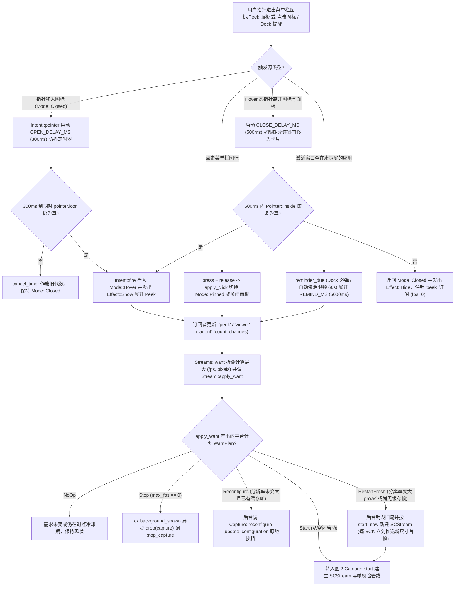
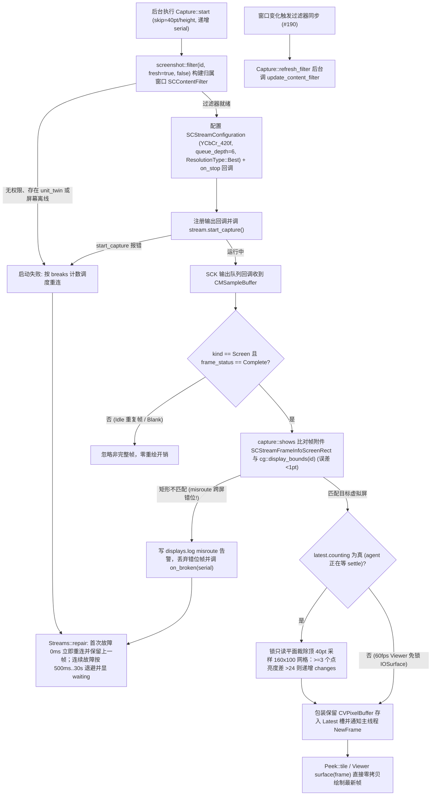

# 09. Peek 悬停预览、`Streams` 多订阅者调度与 `SCStream` 画面捕获流水线

用户无需常驻打开独立大窗口即可查看每块 Agent Display 的实时画面：指针移入菜单栏图标停留 `OPEN_DELAY_MS = 300ms` 展开 **Peek** 浮动面板，点击缩略图则升级为高帧率 **Viewer**。底层由 `ui::stream::Streams` 为每块虚拟屏维护单一 `SCStream` 实例，聚合三类订阅者（`"peek"` 低清低帧率、`"viewer"` 全清交互帧率、`"agent"` 动作后 `settle` 静止检测）的最大帧率与最大像素需求，所有启停与重配置调用均移出主线程，并在每帧回调中核对 `SCStreamFrameInfoScreenRect` 拦截虚拟屏拓扑重排引发的跨屏画面错位 (`misroute`)。

## 线程与队列分工

1. **GPUI 主线程 (`Shell` / `Peek` / `Streams`)**：运行纯模型状态机 `peek::Intent` (`OPEN_DELAY_MS = 300`, `CLOSE_DELAY_MS = 500`, `REMIND_MS = 5000`, `crates/model/src/peek.rs:6-10`)、计算订阅计划 `Stream::apply_want` (`WantPlan`)、通过 GPUI `surface(frame)` 零拷贝绘制最新 `420f` `CVPixelBuffer` (`apps/macos/src/ui/peek.rs:19-20, 503`, `apps/macos/src/ui/stream.rs:68-307`, `apps/macos/src/ui/viewer.rs:865`)。
2. **后台流控制任务 (`cx.background_spawn`)**：执行阻塞耗时的 `Capture::start`、`Capture::reconfigure`、`Capture::refresh_filter` 与 `drop(capture)` (`apps/macos/src/ui/stream.rs:270-365`)，避免阻塞主线程渲染。
3. **ScreenCaptureKit 输出回调队列 (`SCStream` 内部 GCD 队列)**：接收 `CMSampleBuffer`，执行 `shows()` 屏幕矩形校验、按需采样 `160x100` 亮度网格变化计数 (`luma_grid`)，写入最新帧槽 `Latest` 并通知主线程重绘 (`apps/macos/src/mac/capture.rs:60-270`)。

---

## 图 1：Peek 菜单栏悬停/钉住状态机 (`peek::Intent`) 与 `Streams::want` 聚合调度

### 图 1 节点明细表

| 节点 | 线程与队列 | 我方代码与常量 | macOS 组件与内部行为 | 限制与关联缺陷 | Agent 侧影响 | 用户侧表现 | 验证证据 |
| :--- | :--- | :--- | :--- | :--- | :--- | :--- | :--- |
| `P1` | GPUI 主线程 | `Shell` 指针与激活监听 (`apps/macos/src/ui/shell.rs:413, 805`), `peek::Pointer` (`crates/model/src/peek.rs:39-47`) | 跟踪物理指针在 `StatusIcon` 与 Peek 面板内的布尔状态 `{ icon, peek }` 及点击、外部点击 (`outside_press`) 与应用激活事件 | 纯模型状态机无 OS 依赖，单测覆盖全部时序 (`crates/model/src/peek.rs:251-490`) | 无 | 监听菜单栏交互 | 已验证：`crates/model/src/peek.rs:39-46` `pub struct Pointer { pub icon: bool, pub peek: bool, } impl Pointer { pub fn inside(self) -> bool { self.icon \|\| self.peek } }` |
| `P2` | GPUI 主线程 | `peek::Intent` 方法集 (`crates/model/src/peek.rs:111-248`) | 分发 `pointer`、`press`/`release`、`activate`、`remind` 与 `outside_press` | 无 | 无 | 无变化 | 已验证：`crates/model/src/peek.rs:77,111` `pub struct Intent` / `pub fn pointer(&mut self, pointer: Pointer, now: u64, timing: Timing)` |
| `P3` | GPUI 主线程 | `OPEN_DELAY_MS = 300` (`crates/model/src/peek.rs:6, 120-122`) | 递增 `generation` 调度 `300ms` 开启定时器 | 防止鼠标路过右上角菜单栏点时钟/控制中心时误弹面板 | 无 | 路过图标无弹窗 | 已验证：`crates/model/src/peek.rs:6` `pub const OPEN_DELAY_MS: u64 = 300;`；`crates/model/src/peek.rs:120-122` `Mode::Closed if pointer.icon && !self.suppressed => { self.schedule(Kind::Open, now, timing.open_ms) }` |
| `P4` | GPUI 主线程 | `Intent::fire` (`crates/model/src/peek.rs:127-143`) | 核对 `self.timer == Some(timer)` 且 `now >= timer.due_ms` 及 `self.pointer.icon` | 提前移出时已在 `pointer()` 内由 `cancel_timer()` 作废 | 无 | 滑过走 `PX1`，停留走 `P5` | 已验证：`crates/model/src/peek.rs:127-135` `pub fn fire(&mut self, timer: Timer, now: u64) -> Effect` |
| `PX1` | GPUI 主线程 | `Effect::None` (`crates/model/src/peek.rs:49-53, 129`) | 无 UI 动作返回 | 无 | 无 | 面板保持收起 | 已验证：`crates/model/src/peek.rs:49-53` `pub enum Effect { None, Show, Hide, }` |
| `P5` | GPUI 主线程 | `Mode::Hover` + `Effect::Show` (`crates/model/src/peek.rs:32-37, 134-135`), `ui::peek` (`TILE_WIDTH = 208.0`, `THUMB_HEIGHT = 130.0`, `apps/macos/src/ui/peek.rs:19-20`) | 展开非激活 Peek 面板，按 `208 x 130 pt` 缩略卡片排列各虚拟屏实时画面；屏多放不下时卡片宽度最小缩到 `MIN_TILE = 120pt` (`apps/macos/src/ui/peek.rs:22, 247-254`) | 不抢夺用户当前前台窗口焦点 | 无 | 菜单栏下方展开实时多屏预览 | 已验证：`apps/macos/src/ui/peek.rs:19-20` `pub const TILE_WIDTH: f32 = 208.; pub const THUMB_HEIGHT: f32 = 130.;` |
| `P6` | GPUI 主线程 | `Intent::press` / `release` / `apply_click` (`crates/model/src/peek.rs:144-188`) | 点击图标在 `Mode::Pinned`（常驻钉住，指针移开不收起）与 `Mode::Closed`（并置 `suppressed = true` 防松手后又被悬停打开）之间切换 | 支持用户边工作边常驻监看后台屏幕 | 无 | 面板常驻钉住或收起 | 已验证：`crates/model/src/peek.rs:146-150,174` `if self.mode == Mode::Pinned { Click::Close } else { Click::Pin }` / `fn apply_click(` |
| `P7` | GPUI 主线程 | `REMIND_MS = 5000` / `reminder_due` / `Intent::remind` (`crates/model/src/peek.rs:10-16, 201-217`) | 用户在 Dock 显式点击窗口全在虚拟屏上的应用时必弹提醒（非 Dock 自动激活限频 `60_000ms` 即 `60s` 一次），保持展开 `5000ms` 指示窗口所在虚拟屏 | 防止用户误以为点击的应用未打开窗口 | 无 | 弹出 `5s` 位置提醒卡片 | 已验证：`crates/model/src/peek.rs:10,14-16` `pub const REMIND_MS: u64 = 5000;` / `pub fn reminder_due(elapsed_ms: Option<u64>, docked: bool) -> bool { docked \|\| elapsed_ms.is_none_or(\|elapsed\| elapsed >= 60_000) }` |
| `P8` | GPUI 主线程 | `CLOSE_DELAY_MS = 500` (`crates/model/src/peek.rs:7, 123`) | `Hover` 态指针离开图标跨缝移向面板时，启动 `500ms` 关闭宽限期 | 给斜向移入下方卡片留出容差 | 无 | 移入卡片途中不闪退 | 已验证：`crates/model/src/peek.rs:7,123` `pub const CLOSE_DELAY_MS: u64 = 500;` / `Mode::Hover if !pointer.inside() => self.schedule(Kind::Close, now, timing.close_ms)` |
| `P9` | GPUI 主线程 | `Pointer::inside` (`crates/model/src/peek.rs:44-46, 124, 137`) | `500ms` 内进入面板则命中默认分支 `cancel_timer()` 维持展示，否则触发关闭 | 无 | 无 | 进入卡片走 `P5`，离开走 `P10` | 已验证：`crates/model/src/peek.rs:137-139` `Kind::Close if self.mode == Mode::Hover && !self.pointer.inside() => { self.mode = Mode::Closed; Effect::Hide }` |
| `P10` | GPUI 主线程 | `Effect::Hide` + `Streams::want(..., 0, ...)` (`apps/macos/src/ui/stream.rs:249-274`) | 隐藏 Peek 并撤销 `"peek"` 帧率需求 | 无其它订阅者时立即进入 `S4` 停流省电 | 无 | 面板收起 | 已验证：`apps/macos/src/ui/stream.rs:270` `WantPlan::Stop =>` |
| `S1` | GPUI 主线程 | 三路 `Streams::want` 订阅 (`apps/macos/src/ui/stream.rs:68-95`, `agent.rs:6260-6292`) | `"peek"` 订缩略尺寸与低帧率，`"viewer"` 订高分辨率与交互帧率，`"agent"` 在动作后 `settle` 期间订 `30fps` `416px` 缩略流并开启 `count_changes(true)` | 单屏共享同一 `SCStream`，不重复建流 | 支撑 `settle` 静止检测 | 按可见性弹性伸缩 | 已验证：`apps/macos/src/mac/capture.rs:51` `pub fn count_changes(&self, on: bool)` |
| `S2` | GPUI 主线程 | `Stream::apply_want` (`apps/macos/src/ui/stream.rs:68-125`) | 折叠 `wants` 求最大 `(fps, (w, h))` 并对比 `running` | 纯函数覆盖全部转移组合 | 无 | 无变化 | 已验证：`apps/macos/src/ui/stream.rs:68` `fn apply_want(` |
| `S3` | GPUI 主线程 | `WantPlan` 分发 (`apps/macos/src/ui/stream.rs:37-44, 267-306`) | 生成 `NoOp`、`Start`、`Stop`、`RestartFresh`、`Reconfigure` 五种执行计划 | 全部阻塞操作经 `cx.background_spawn` 脱离主线程 | 无 | 主线程无卡顿 | 已验证：`apps/macos/src/ui/stream.rs:267-293` `match plan { WantPlan::NoOp => {} WantPlan::Start => ... WantPlan::Stop => ... WantPlan::RestartFresh { start_now } => ... WantPlan::Reconfigure =>` |
| `SX1` | GPUI 主线程 | `WantPlan::NoOp` (`apps/macos/src/ui/stream.rs:268`) | 目标参数未变或仍在退避等待中 | 防止重复调起 SCK | 无 | 保持当前缓存帧 | 已验证：`apps/macos/src/ui/stream.rs:268` `WantPlan::NoOp => {}` |
| `S4` | 后台任务 | `WantPlan::Stop` (`apps/macos/src/ui/stream.rs:270-274`), `Capture::drop` (`apps/macos/src/mac/capture.rs:332-336`) | 后台 `drop(capture)` 调用 `self.stream.stop_capture()` | 避免 `stop_capture` 百毫秒阻塞卡住收起动画 | 无 | 彻底释放后台捕获开销 | 已验证：`apps/macos/src/mac/capture.rs:333-335` `fn drop(&mut self) { let _ = self.stream.stop_capture(); }` |
| `S5` | 后台任务 | `WantPlan::Reconfigure` (`apps/macos/src/ui/stream.rs:292-304`), `Capture::reconfigure` (`apps/macos/src/mac/capture.rs:290-298`) | 分辨率缩小（如关 Viewer 留 Peek）或仅改帧率且已有首帧时，持 `turn` 互斥锁调 `stream.update_configuration` 原地切换 | 免重建流，平滑降档 | 无 | 关 Viewer 退回 Peek 无闪烁 | 已验证：`apps/macos/src/mac/capture.rs:290-295` `pub fn reconfigure(&self, target: &Mutex<(i32, (u32, u32))>) -> anyhow::Result<()> { ... self.stream.update_configuration(&configuration(pixels, fps))?;` |
| `S6` | 后台任务 | `WantPlan::RestartFresh` (`apps/macos/src/ui/stream.rs:275-291, 523-541`) | 当请求像素变大（如从 Peek 点开 Viewer）或尚无缓存帧时，销毁旧流并立即新建 `SCStream` | `ScreenCaptureKit` 在静止画面上原地调大分辨率不会主动重发新帧；重建流迫使 SCK 立即吐出全清首帧 (`stream.rs:279-283`) | 无 | 打开 Viewer 立即呈现清晰大图 | 已验证：`apps/macos/src/ui/stream.rs:279` `// ScreenCaptureKit sends a frame only when the picture changes:` |
| `S7` | GPUI 主线程 -> 后台 | `Streams::start` (`apps/macos/src/ui/stream.rs:312-412`) | 置 `stream.starting = true`，派发后台任务进入图 2 | 合并并发启动请求 | 无 | 转入图 2 | 已验证：`apps/macos/src/ui/stream.rs:312,316` `fn start(&mut self, id: DisplayId, cx: &mut Context<Self>)` / `stream.starting = true;` |

---

## 图 2：`Capture::start`、`SCStream` 帧矩形防错位 (`misroute`)、过滤器刷新 (`#190`) 与自愈重连

### 图 2 节点明细表

| 节点 | 线程与队列 | 我方代码与常量 | macOS 组件与内部行为 | 限制与关联缺陷 | Agent 侧影响 | 用户侧表现 | 验证证据 |
| :--- | :--- | :--- | :--- | :--- | :--- | :--- | :--- |
| `C1` | 后台任务 | `Capture::start` (`apps/macos/src/mac/capture.rs:167-181`) | 计算顶部跳过比例 `skip = 40.0 / height`，原子递增 `SERIAL` | 跳过顶部 `40pt` 菜单栏带，防止用户菜单栏时钟跳秒干扰 `settle` 静止计数 (`capture.rs:175-177`) | 保障 `settle` 准确收敛 | 无变化 | 已验证：`apps/macos/src/mac/capture.rs:177,180` `let skip = 40.0 / super::cg::display_bounds(display_id).height.max(1.0);` / `let serial = SERIAL.fetch_add(1, Ordering::Relaxed);` |
| `C2` | 后台任务 | `screenshot::filter(display_id, true, false)` (`apps/macos/src/mac/screenshot.rs:88-187`) | 刷新 `SCShareableContent` 构建 `SCContentFilter`（若目标屏存在 `unit_twin` 撞号则直接拒绝，排除非归属窗口与状态栏项） | `#190`：新窗刚出现时需及时更新过滤器，否则流中缺新窗内容 | 无 | 失败走 `CX1`，成功走 `C3` | 已验证：`apps/macos/src/mac/capture.rs:6-7` `refuses a display with a //! twin`；`apps/macos/src/mac/capture.rs:178-179` `super::screenshot::filter(display_id, true, false)`；`/Library/Developer/CommandLineTools/SDKs/MacOSX.sdk/System/Library/Frameworks/ScreenCaptureKit.framework/Versions/A/Headers/SCStream.h:448` `@interface SCStream : NSObject` |
| `CX1` | 后台 -> GPUI 主线程 | `Streams::start` 失败处理 (`apps/macos/src/ui/stream.rs:365-405`) | 清除 `starting`，递增 `breaks` 并按退避曲线计划重试 | 防止屏幕离线期死循环刷启动 | 无 | 连续失败后显示 `peek::waiting` 占位 (`peek.rs:926`) | 已验证：`apps/macos/src/ui/peek.rs:926` `pub fn waiting(id: DisplayId, size: f32) -> gpui::Div` |
| `C3` | 后台任务 | `configuration` + `StreamCallbacks` (`apps/macos/src/mac/capture.rs:186-195, 314-330`) | 设 `PixelFormat::YCbCr_420f`、`shows_cursor(false)`、`queue_depth(6)` 与 `SCCaptureResolutionType::Best`（强制虚拟屏按 2x 清晰度渲染而非 1x 放大模糊）；注册 `on_stop` 写 `stream-stopped` 日志并触发 `on_broken(serial)` | 解决虚拟屏默认 `Automatic` 分辨率模糊问题 (`capture.rs:322-326`) | 无 | Viewer 呈现 2x Retina 清晰度 | 已验证：`apps/macos/src/mac/capture.rs:189,318-325` `crate::lifecycle::note("stream-stopped", display_id, &error);` / `.with_pixel_format(PixelFormat::YCbCr_420f)` / `SCCaptureResolutionType::Best` |
| `C4` | 后台任务 | `stream.start_capture()` (`apps/macos/src/mac/capture.rs:262`) | 启动 `SCStream` 异步帧投递（调试构建在 `AGENTSCREEN_INSTANCE=e2e` 且设 `AGENTSCREEN_TEST_MISROUTE` 时支持注入拓扑变更后的错位自愈测试，`capture.rs:156-160`） | 测试注入宏受 `cfg!(debug_assertions)` 与 `e2e` 实例双重门控 | 无 | 流开始推送 | 已验证：`apps/macos/src/mac/capture.rs:156-160,262` `fn misroute_test() -> bool { cfg!(debug_assertions) && std::env::var_os("AGENTSCREEN_TEST_MISROUTE").is_some() && ... }` / `stream.start_capture()?;` |
| `F1` | SCK 输出回调队列 | `stream.add_output_handler` (`apps/macos/src/mac/capture.rs:200-261`) | 在 SCK 内部队列处理每帧 `CMSampleBuffer` | 不占用主线程 | 无 | 无变化 | 已验证：`apps/macos/src/mac/capture.rs:200` `stream.add_output_handler(` |
| `F2` | SCK 输出回调队列 | `SCFrameStatus::Complete` 过滤 (`apps/macos/src/mac/capture.rs:204-208`) | 丢弃非 `Screen` 类型及 `Idle` / `Blank` 状态帧 | 静止画面零纹理交换与零重绘 | 无 | 静止时省电 | 已验证：`apps/macos/src/mac/capture.rs:204-207` `if kind != SCStreamOutputType::Screen \|\| sample.frame_status() != Some(SCFrameStatus::Complete) { return; }` |
| `FX1` | SCK 输出回调队列 | 提前返回 (`apps/macos/src/mac/capture.rs:207`) | 空帧直接返回 | 无 | 无 | 维持上一帧画面 | 已验证：`apps/macos/src/mac/capture.rs:207` `return;` |
| `F3` | SCK 输出回调队列 | `capture::shows` (`apps/macos/src/mac/capture.rs:122-137, 209`) | 读取帧附件 `SCStreamFrameInfoScreenRect` (`SCStream.h:431`)，校验 `x`、`y`、`width`、`height` 与 `cg::display_bounds(display_id)` 偏差均 `< 1.0 pt` | 实测日志记录了虚拟屏重排、模式切换与 `unit_twin` 撞号引发的真实跨屏错位：`displays.log:3154` 记录 `twin=Some(425)` 撞号错位，`:2935` 记录拓扑平移错位（`at=4288,-900` 而帧显示在 `shows=1728,-900`，偏移 `2560pt`）；`displays-e2e.log:180,249` 记录 e2e 虚拟屏重设尺寸期间停泊区虚拟屏矩形 (`8576,-500 2560x1600` 与 `8576,-800 800x500`) 错位 | 错位走 `FX2`，匹配走 `F4` | 拦截其它虚拟屏或 AeroSpace 隐藏屏画面混入 | 已验证：`~/Library/Logs/Agent Screen/displays.log:3154` `misroute display=381 unit=11 at=10016,-800 size=1280x800 shows=5568,-1700 1280x800 twin=Some(425)`；`~/Library/Logs/Agent Screen/displays-e2e.log:180` `misroute display=562 unit=9 at=8576,-800 size=1280x800 shows=8576,-500 2560x1600 twin=None`；`apps/macos/src/mac/capture.rs:122-133` `fn shows(sample: &CMSampleBuffer, display_id: u32) -> Result<(), CGRect>`；`/Library/Developer/CommandLineTools/SDKs/MacOSX.sdk/System/Library/Frameworks/ScreenCaptureKit.framework/Versions/A/Headers/SCStream.h:431` `extern SCStreamFrameInfo const SCStreamFrameInfoScreenRect` |
| `FX2` | SCK 输出回调队列 | `misroute` 丢帧与报障 (`apps/macos/src/mac/capture.rs:222-237`) | 首次检测到错位时原子置位 `misrouted = true`，写 `lifecycle::note("misroute", ...)`，丢弃该帧并调 `on_broken(serial)` 触发重建 | 错位帧绝不写入 `Latest` 槽 | 无 | 丢弃错位帧并触发流重建 | 已验证：`apps/macos/src/mac/capture.rs:233-235` `crate::lifecycle::note("misroute", display_id, &at); on_broken(serial);` |
| `F4` | SCK 输出回调队列 | `latest.counting.load` (`apps/macos/src/mac/capture.rs:31-35, 247`) | 仅在 `agent` 等待画面静止期间开启 CPU 亮度采样 | 平时 60fps Viewer 观看时免去 `CVPixelBuffer` CPU 锁存开销 (`capture.rs:32-33`) | 按需计数 | 高帧率观看更省 CPU | 已验证：`apps/macos/src/mac/capture.rs:247` `if latest.counting.load(Ordering::Relaxed) {` |
| `F5` | SCK 输出回调队列 | `luma_grid` / `changed` (`GRID = (160, 100)`, `LEVELS = 24`, `SAMPLES = 3`, `apps/macos/src/mac/capture.rs:60-107, 248-253`) | 锁只读基址 (`READ_ONLY = 1`) 抽样 `160x100` 亮度网格；仅当至少 `SAMPLES = 3` 个采样点的亮度绝对差 `> LEVELS` (`24`) 时才判定画面变化并递增 `changes`（首帧仅作基准不计变化） | 过滤动态壁纸全屏轻微漂移与编码噪点 (`capture.rs:25-27, 343-359`) | 精准驱动动作后 `settle` | 无变化 | 已验证：`apps/macos/src/mac/capture.rs:60-64` `const GRID: (usize, usize) = (160, 100); ... const LEVELS: u8 = 24; ... const SAMPLES: usize = 3;`；`apps/macos/src/mac/capture.rs:104-106` `.filter(\|(a, b)\| a.abs_diff(**b) > LEVELS) .nth(SAMPLES - 1) .is_some()` |
| `F6` | SCK 回调 -> GPUI 主线程 | `CVPixelBuffer::wrap_under_get_rule` + `Latest` (`apps/macos/src/mac/capture.rs:246, 255-258`) | Retain 保留图像缓冲区覆盖写入 `latest.frame`（旧未读帧自动释放，不积压队列延迟），递增 `delivered` 并回调 `on_frame()` 唤醒主线程 | 最新帧优先，零队列积压延迟 | 无 | 唤醒 UI 刷新 | 已验证：`apps/macos/src/mac/capture.rs:246,256-258` `CVPixelBuffer::wrap_under_get_rule(raw as CVPixelBufferRef)` / `*latest.frame.lock().unwrap() = Some(Frame(buffer)); ... on_frame();` |
| `F7` | GPUI 主线程 | `Peek::tile` (`apps/macos/src/ui/peek.rs:503`), `Viewer::render` -> `surface(frame)` (`apps/macos/src/ui/viewer.rs:184, 865`) | GPUI `surface` 元素直接绘制 `420f` `CVPixelBuffer` 无需 CPU 像素拷贝 (`capture.rs:1-2`) | 零拷贝上屏 | 无 | Peek 与 Viewer 实时流畅显示 | 已验证：`apps/macos/src/ui/viewer.rs:865` `Some(frame) => surface(frame)`；`apps/macos/src/ui/peek.rs:503` `fn tile(` |
| `W1` | GPUI 主线程 | `Streams::refresh_filters` (`apps/macos/src/ui/stream.rs:224-232`) | 窗口归属或状态栏项变化时触发过滤器刷新 | 解决 `#190` 新窗口纳入与状态栏项剔除 | 无 | 触发后台热更新 | 已验证：`apps/macos/src/ui/stream.rs:224` `pub fn refresh_filters(` |
| `W2` | 后台任务 | `Capture::refresh_filter` (`apps/macos/src/mac/capture.rs:304-311`) | 持 `turn` 锁重算 `screenshot::filter(display_id, false, false)` 并调 `stream.update_content_filter(&filter)` | 不断流热更新捕获窗口集 | 无 | 新窗口即时可见 | 已验证：`apps/macos/src/mac/capture.rs:304-307` `pub fn refresh_filter(&self, display_id: u32) { ... self.stream.update_content_filter(&filter)` |
| `R1` | GPUI 主线程 | `Streams::repair` / `restart_misrouted` (`apps/macos/src/ui/stream.rs:414-489`) | 校验故障 `serial` 仍为当前活跃流后后台销毁旧流：**首次故障 (`breaks == 0`) 等待 `Duration::ZERO` (`0ms`) 立即重连并保留上一帧正确画面不闪黑**；若再次连续故障则清除旧帧并按 `backoff(breaks - 1)` (`500ms` 倍增封顶 `30s`) 退避重连；收到 `ScreensChanged` 时 `restart_misrouted` 主动巡检自愈 | 兼顾解锁/重排后的瞬时无感恢复与持久故障限频保护 | 无 | 单次重排无黑屏闪烁自动恢复 | 已验证：`apps/macos/src/ui/stream.rs:460-463` `let wait = match stream.breaks { 0 => std::time::Duration::ZERO, n => backoff(n - 1), };` |
