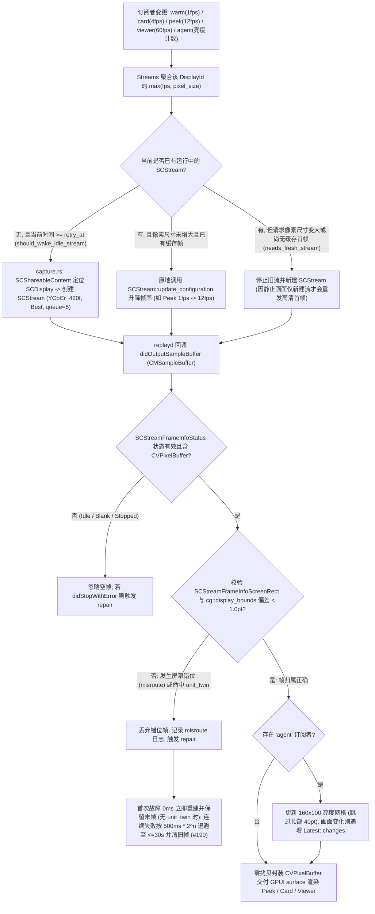

# 操作 09：Peek 预览与 ScreenCaptureKit 视频流管线

`Streams` 为每块虚拟显示器最多维护一条底层 `ScreenCaptureKit`（`SCStream`）捕获流，按多路订阅者的最高帧率与最大分辨率动态档位运行，直接向 GPUI 交付零拷贝 `YCbCr_420f` `CVPixelBuffer`，并内置 `misroute` 屏幕错位自检与指数退避自愈机制。

## 端到端流程

## 节点明细表

| 节点 | 我方代码 | macOS 组件与内部行为 | 限制与故障模式 | 关联问题 | 验证状态 |
| --- | --- | --- | --- | --- | --- |
| 1. 多订阅者单流档位聚合 | `apps/macos/src/ui/stream.rs:1-238`、`apps/macos/src/ui/peek.rs:1-260` | 纯内存调度器按 `DisplayId` 汇总五类消费者需求：`"warm"`（`1 fps` 缩略图常驻保活）、`"card"`（`4 fps` 列表卡片）、`"peek"`（鼠标悬停菜单栏或卡片时 `12 fps` 浮窗预览）、`"viewer"`（`60 fps` 原始 Retina 全尺寸）、`"agent"`（开启帧差计数供 `settle` 与 `wait_for_change` 使用）。每块屏最多实例化一个 `SCStream`。 | 若为每个 UI 组件各自开 `SCStream`，`replayd` 进程 CPU 与 IOSurface 显存占用成倍上升，且多流启停更容易诱发 `ScreenCaptureKit` 内部竞态报错。 | `#190` | `[已验证]` `apps/macos/src/ui/stream.rs:1-238` |
| 2. 创建 `SCStream` 与零拷贝像素格式 | `apps/macos/src/mac/capture.rs:140-255` | 调用 `SCShareableContent` 查找目标 `SCDisplay`，构建 `SCContentFilter` 与 `SCStreamConfiguration`：像素格式设为 `kCVPixelFormatType_420YpCbCr8BiPlanarFullRange`（`YCbCr_420f`），分辨率策略设为 `SCCaptureResolutionTypeBest`（`SCStream.h:77`，保证 2x HiDPI 清晰度），帧队列深度 `queue_depth = 6`，并关闭音频捕获。系统后台守护进程 `replayd` 从 `WindowServer` 合成器抓取帧缓冲并通过 Mach 端口传递 `IOSurface` 支持的 `CVPixelBuffer`。 | 1. 未授予 TCC 屏幕录制权限时 `SCShareableContent` 或 `start_capture` 立即失败；2. 虚拟显示器刚新建或刚改分辨率瞬间，`SCShareableContent` 列表可能尚未同步该 `displayID`。 | `#190` | `[已验证]` `SCStream.h:77,325`、`apps/macos/src/mac/capture.rs:140-255` |
| 3. 原地调参 vs 重建流（`needs_fresh_stream`） | `apps/macos/src/ui/stream.rs:240-345` | 当用户悬停触发 `Peek`（仅帧率从 `1 fps` 升至 `12 fps`、目标像素尺寸未变大且已有 `warm` 缓存帧）时，直接调用 `SCStream::update_configuration` 原地调速；当用户点开全尺寸 `Viewer`（请求像素宽高增大）或当前无缓存帧时，强制销毁旧流并新建 `SCStream`。 | **ScreenCaptureKit 机制限制**：`SCStream` 是脏矩形事件驱动流，若目标屏幕画面完全静止，`update_configuration` 调大输出分辨率后 `replayd` 不会主动重发一帧新尺寸图像，导致 `Viewer` 一直糊在缩略图分辨率，只有新建流才会强制推送首帧。 | Viewer 静止画面清晰度 | `[已验证]` `apps/macos/src/ui/stream.rs:240-345` |
| 4. `SCStreamFrameInfoScreenRect` 错位检测（`misroute`） | `apps/macos/src/mac/capture.rs:120-137, 209-240`、`apps/macos/src/ui/stream.rs:414-471` | 每收到一帧 `Complete` 状态的样本，读取附件字典中的 `SCStreamFrameInfoScreenRect`（`SCStream.h:395-431`），与实时查询的 `cg::display_bounds(display_id)` 逐分量比对（容差 `< 1.0 pt`）。同时在 `ScreensChanged` 时主动扫描全部活动流调用 `restart_misrouted`。 | **macOS 故障模式**：物理屏热插拔、睡眠唤醒或虚拟屏重停放后，`WindowServer` 与 `replayd` 内部的显示器路由表偶发错乱，使原本绑定虚拟屏 A 的 `SCStream` 开始投递主屏或虚拟屏 B 的画面（`ScreenRect` 暴露真实来源坐标）。若不拦截，用户会在 Peek / Viewer 中看到错位屏幕甚至代理间串屏。 | `misroute`、`unit twin`、`#204` | `[已验证]` `SCStream.h:395-431`、`apps/macos/src/mac/capture.rs:120-137` |
| 5. 故障自愈与指数退避（`repair` / `retry_at`） | `apps/macos/src/ui/stream.rs:346-471` | 遇到 `didStopWithError`、`start_capture` 失败或 `misroute` 时进入修复状态机：首次故障若不存在 `unit_twin`，保留上一帧有效 `warm` 画面防闪烁并按 `0 ms` 立即重建；若连续失败，按 `500 ms * 2^n`（封顶 `30 s`）设置 `retry_at` 退避时间并清除过期旧帧。`should_wake_idle_stream` 阻止鼠标反复划过 Peek 时在退避期内打爆 `replayd`。 | 修复了 `#190` 中流断开后 Peek 永久黑屏或悬停风暴拖垮 `replayd` 的问题；但在退避窗口内若 `replayd` 自身崩溃重启，画面恢复最多延迟至当前退避周期结束。 | `#190`、`misroute`、`unit twin` | `[已验证]` `apps/macos/src/ui/stream.rs:346-471` |
| 6. 亮度网格帧差计数（`Latest::changes`） | `apps/macos/src/mac/capture.rs:60-107` | 当存在 `"agent"` 订阅者时，对帧缓冲下采样为 `160x100` 亮度网格（跳过顶部 `40 pt` 系统菜单栏区域以滤除右上角时钟跳秒），按 `LEVELS = 24` 阶量化比对上一帧；一旦网格变化则原子递增 `Latest::changes` 并唤醒等待者。 | 极小局部像素变化（小于单个网格采样点或亮度阶差不足 `1/24`）不会递增计数，属于有意抑制光标微闪与抗锯齿噪声的设计折中。 | 操作 05 `settle`、操作 10 `wait_for_change` | `[已验证]` `apps/macos/src/mac/capture.rs:60-107` |
