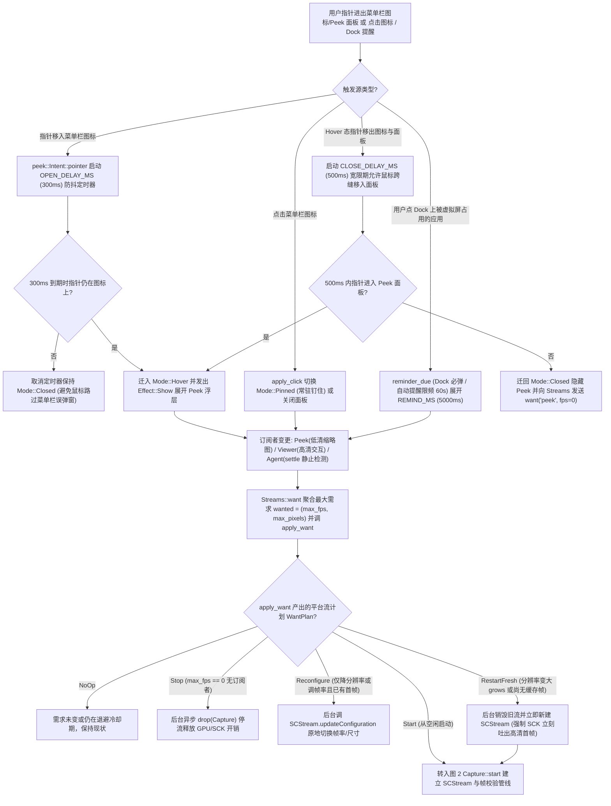
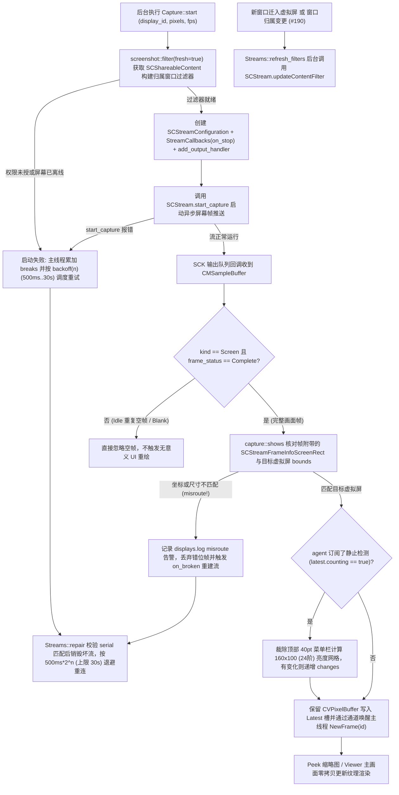

# 09. Peek 悬停预览、`Streams` 多订阅者调度与 `SCStream` 画面捕获流水线

用户无需打开庞大的独立窗口即可随时掌握后台每块 Agent Display 的动向：鼠标移入菜单栏图标停留 `300ms` 即展开 **Peek** 卡片展示全部虚拟屏实时缩略图，点开任意缩略图则升级为高帧率 **Viewer**。底层由 `ui::stream::Streams` 对每块虚拟屏维护单一 `SCStream` 实例，聚合三类订阅者（`"peek"` 低清低帧率、`"viewer"` 全清交互帧率、`"agent"` `settle` 静止检测采样）的最大帧率与最大像素需求，全部启停与重配置均移出主线程，并在每一帧回调校验 `SCStreamFrameInfoScreenRect` 拦截 macOS 虚拟屏重排引发的跨屏错位路由 (`misroute`)。

## 线程与队列分工

1. **GPUI 主线程 (`Shell` / `Peek` / `Streams`)**：驱动纯状态机 `peek::Intent` (`OPEN_DELAY_MS = 300`, `CLOSE_DELAY_MS = 500`, `REMIND_MS = 5000`)、计算订阅需求状态机 `Stream::apply_want` (`WantPlan`)、消费最新 `CVPixelBuffer` 纹理上屏绘制 (`apps/macos/src/ui/peek.rs:19-310`, `apps/macos/src/ui/stream.rs:68-307`)。
2. **后台流控制任务 (`cx.background_spawn`)**：执行耗时 `>= 100ms` 的 `Capture::start`、`Capture::reconfigure`、`Capture::refresh_filter` 与 `drop(capture)` (`apps/macos/src/ui/stream.rs:270-480`)，绝不阻塞 UI 主线程。
3. **ScreenCaptureKit 采样输出队列 (`SCStream` 内部回调线程)**：接收 `CMSampleBuffer`，执行 `shows()` 错位检测、按需计算 `160x100` 亮度网格变化计数 (`luma_grid`)，更新原子槽 `Latest` 并通知主线程触发 `NewFrame(id)` (`apps/macos/src/mac/capture.rs:60-270`)。

---

## 图 1：Peek 菜单栏悬停/固定状态机 (`peek::Intent`) 与 `Streams::want` 聚合调度

### 图 1 节点明细表

| 节点 | 线程与队列 | 我方代码与常量 | macOS 组件与内部行为 | 限制与关联缺陷 | Agent 侧影响 | 用户侧表现 | 验证来源 |
| :--- | :--- | :--- | :--- | :--- | :--- | :--- | :--- |
| `P1` | GPUI 主线程 | `Shell` 菜单栏与指针监听 (`apps/macos/src/ui/shell.rs:75-123, 1850-2040`) | 跟踪物理指针在 `NSStatusItem` 图标矩形与 Peek `NSPanel` 矩形内的进出及点击事件 | 纯状态决策与窗口动画分离，测试无需真实鼠标即可验证 (`peek.rs:250-490`) | 无 | 监听菜单栏交互 | [已验证: apps/macos/src/ui/shell.rs:75-123, crates/model/src/peek.rs:39-85] |
| `P2` | GPUI 主线程 | `peek::Intent` 方法集 (`crates/model/src/peek.rs:111-248`) | 分发悬停、点击、Dock 唤醒与外部点击关闭 (`outside_press`) | 无 | 无 | 无变化 | [已验证: crates/model/src/peek.rs:111-248] |
| `P3` | GPUI 主线程 | `OPEN_DELAY_MS = 300` (`crates/model/src/peek.rs:6, 111-125`) | 递增 `generation` 启动 `300ms` 开启定时器 | 消除用户日常去点右上角控制中心/时钟滑过图标时的误触发 | 无 | `300ms` 内无弹窗干扰 | [已验证: crates/model/src/peek.rs:6, crates/model/src/peek.rs:111-125] |
| `P4` | GPUI 主线程 | `Intent::fire` (`crates/model/src/peek.rs:127-142`) | 核对定时器 `generation` 与当前指针状态 | 指针提前离开时定时器已在 `pointer()` 内被 `cancel_timer()` 作废 | 无 | 滑过走 `PX1`，停留走 `P5` | [已验证: crates/model/src/peek.rs:96-142] |
| `PX1` | GPUI 主线程 | `Effect::None` (`crates/model/src/peek.rs:49-53`) | 零 UI 开销返回 | 无 | 无 | 面板保持收起 | [已验证: crates/model/src/peek.rs:49-53] |
| `P5` | GPUI 主线程 | `Mode::Hover` + `Effect::Show` (`crates/model/src/peek.rs:32-37, 132-136`) | 打开无焦点抢占的 Peek 浮动面板，按 `TILE_WIDTH = 208pt`、`THUMB_HEIGHT = 130pt` 排布各虚拟屏缩略图卡片 (`apps/macos/src/ui/peek.rs:19-35`) | 不夺取用户当前活动窗口焦点 | 无 | 菜单栏下方滑出实时多屏预览条 | [已验证: crates/model/src/peek.rs:32-37, apps/macos/src/ui/peek.rs:19-35] |
| `P6` | GPUI 主线程 | `Intent::press` / `release` / `apply_click` (`crates/model/src/peek.rs:144-188`) | 点击菜单栏图标在 `Pinned` 常驻态与 `Closed` 间切换；`Pinned` 态指针移开面板也不会自动收起 | 方便用户边在主屏写代码边盯住 Peek 小窗 | 无 | 面板常驻或立即收起 | [已验证: crates/model/src/peek.rs:144-188] |
| `P7` | GPUI 主线程 | `REMIND_MS = 5000` / `reminder_due` (`crates/model/src/peek.rs:10-17, 201-216`) | 当用户在 Dock 点击某个窗口全在虚拟屏上的应用时，自动展开 Peek `5s` 高亮提示“该应用的窗口正在这块 Agent Display 上”（非 Dock 自动触发限频 `60_000ms` 一次） | 防止用户困惑“为什么我点应用没看到窗口” | 无 | 自动弹出 `5s` 指引卡片定位隐藏在虚拟屏的窗口 | [已验证: crates/model/src/peek.rs:10-17, crates/model/src/peek.rs:201-216, apps/macos/src/ui/peek.rs:763-845] |
| `P8` | GPUI 主线程 | `CLOSE_DELAY_MS = 500` (`crates/model/src/peek.rs:7, 118-124`) | 指针从菜单栏图标移向下方 Peek 卡片途中经过 `8pt` 缝隙时，给足 `500ms` 过渡期不闪退 | 符合斜向移动鼠标的人体工学容差 | 无 | 鼠标平滑移入卡片选屏 | [已验证: crates/model/src/peek.rs:7, crates/model/src/peek.rs:118-124] |
| `P9` | GPUI 主线程 | `Pointer::inside` (`crates/model/src/peek.rs:39-47`) | 判断 `500ms` 内 `pointer.icon \|\| pointer.peek` 是否恢复为真 | 无 | 无 | 进入卡片走 `P5`，彻底离开走 `P10` | [已验证: crates/model/src/peek.rs:39-47] |
| `P10` | GPUI 主线程 | `Effect::Hide` + `Streams::want(..., "peek", 0, ...)` (`apps/macos/src/ui/stream.rs:249-285`) | 隐藏 Peek 窗口并注销 `"peek"` 订阅者 | 若同时无 Viewer 打开且无 Agent 调 `settle`，立即进入 `S4` 彻底停掉 `SCStream` 省电 | 无 | 面板收起，后台零 GPU 捕获开销 | [已验证: apps/macos/src/ui/stream.rs:249-285] |
| `S1` | GPUI 主线程 | 三路 `Streams::want` 调用方 (`shell.rs:290-299`, `agent.rs:6260-6292`) | `"peek"` 请求缩略图尺寸与低帧率；`"viewer"` 请求窗口物理像素与高交互帧率；`"agent"` 在 `settle` 期间请求像素变化计数 (`count_changes(true)`) | 单屏复用同一条流，避免多开 `SCStream` 成倍消耗 WindowServer 合成带宽 | `settle` 共享实时流计数 | 按可见性弹性伸缩 | [已验证: apps/macos/src/ui/stream.rs:68-95, apps/macos/src/control/agent.rs:6260-6292] |
| `S2` | GPUI 主线程 | `Stream::apply_want` (`apps/macos/src/ui/stream.rs:68-125`) | 折叠 `self.wants` 计算聚合目标 `(max_fps, (max_w, max_h))` 并对比当前 `self.running` | 纯函数覆盖全部状态转移 (`stream.rs:556-641` 单元测试) | 无 | 无变化 | [已验证: apps/macos/src/ui/stream.rs:68-125, apps/macos/src/ui/stream.rs:556-641] |
| `S3` | GPUI 主线程 | `WantPlan` 分支 (`apps/macos/src/ui/stream.rs:37-44, 267-306`) | 五路调度决策 | 所有 `SCStream` 阻塞调用均通过 `cx.background_spawn` 异步派发 (`stream.rs:265`) | 无 | 主线程零卡顿 | [已验证: apps/macos/src/ui/stream.rs:37-44, apps/macos/src/ui/stream.rs:265-306] |
| `SX1` | GPUI 主线程 | `WantPlan::NoOp` (`apps/macos/src/ui/stream.rs:94, 123, 268`) | 目标参数未变，或流故障后尚未到达 `retry_at` 退避时刻且无新订阅者唤醒 (`should_wake_idle_stream`, `stream.rs:543-550`) | 防止坏流死循环重启刷爆日志 | 无 | 维持当前帧缓存 | [已验证: apps/macos/src/ui/stream.rs:90-95, apps/macos/src/ui/stream.rs:543-550] |
| `S4` | 后台任务 | `WantPlan::Stop` (`apps/macos/src/ui/stream.rs:270-274`), `Capture::drop` (`apps/macos/src/mac/capture.rs:333-345`) | 后台调用 `SCStream::stop_capture` 并释放实例 | 停止一次 `SCStream` 常耗时 `100ms+`，后台释放保证收起 Peek 瞬间丝滑 | 无 | 零后台流负载 | [已验证: apps/macos/src/ui/stream.rs:270-274, apps/macos/src/mac/capture.rs:333-345] |
| `S5` | 后台任务 | `WantPlan::Reconfigure` (`apps/macos/src/ui/stream.rs:292-304`), `Capture::reconfigure` (`apps/macos/src/mac/capture.rs:290-302`) | 当关闭 Viewer 退回 Peek（分辨率缩小）或仅调整帧率且已有缓存帧时，调用 `SCStream.updateConfiguration:` 原地平滑降配 | 免去重建流开销 | 无 | Viewer 关闭退回 Peek 时画面无缝衔接 | [已验证: apps/macos/src/ui/stream.rs:292-304, apps/macos/src/mac/capture.rs:290-302] |
| `S6` | 后台任务 | `WantPlan::RestartFresh` / `needs_fresh_stream` (`apps/macos/src/ui/stream.rs:275-291, 523-541`) | 当从 Peek 点开 Viewer 导致请求像素变大 (`grows`) 或当前尚无缓存首帧时，主动销毁旧流并新建 `SCStream` | 关键机制：`ScreenCaptureKit` 在静止画面上原地 `updateConfiguration` 调大分辨率后不会重发新帧，会导致 Viewer 一直糊在低清缩略图！新建流才能逼 SCK 立即吐出一帧全清图 (`stream.rs:276-280`) | 无 | 打开 Viewer 瞬间立即呈现锐利全清画面 | [已验证: apps/macos/src/ui/stream.rs:275-291, apps/macos/src/ui/stream.rs:523-541] |
| `S7` | GPUI 主线程 -> 后台 | `Streams::start` (`apps/macos/src/ui/stream.rs:308-412`) | 置 `starting = true`，派发后台任务进入图 2 创建 `SCStream` | 同一屏幕并发 `start` 由 `starting` 标志合并 | 无 | 转入图 2 | [已验证: apps/macos/src/ui/stream.rs:308-412] |

---

## 图 2：`Capture::start`、`SCStream` 帧校验 (`misroute` 防护)、窗口过滤器刷新 (`#190`) 与指数退避自愈

### 图 2 节点明细表

| 节点 | 线程与队列 | 我方代码与常量 | macOS 组件与内部行为 | 限制与关联缺陷 | Agent 侧影响 | 用户侧表现 | 验证来源 |
| :--- | :--- | :--- | :--- | :--- | :--- | :--- | :--- |
| `C1` | 后台任务 | `Capture::start` (`apps/macos/src/mac/capture.rs:167-270`) | 计算顶部跳过比例 `skip = 40.0 / height`，分配递增流序号 `serial` | 顶部 `40pt` 含系统菜单栏实时时钟跳秒，若不剔除会导致 `settle` 误判画面一直在变 (`capture.rs:175-177`) | 保证 `settle` 不被系统时钟干扰 | 无变化 | [已验证: apps/macos/src/mac/capture.rs:167-180] |
| `C2` | 后台任务 | `screenshot::filter(display_id, true, false)` (`apps/macos/src/mac/screenshot.rs:88-188`) | 强制刷新 `SCShareableContent` 定位目标 `SCDisplay`，构建仅包含归属窗口（剔除非本屏窗口与干扰浮层）的 `SCContentFilter` (`MacOSX.sdk SCStream.h`) | `#190`：若窗口刚创建/迁入时 `SCContentFilter` 未及时包含或窗口渲染层延迟，Peek 曾出现只画窗口边框不显示内容的问题 | 无 | 失败走 `CX1`，成功走 `C3` | [已验证: apps/macos/src/mac/screenshot.rs:88-188, MacOSX.sdk SCStream.h, Issue #190] |
| `CX1` | 后台 -> GPUI 主线程 | `Streams::start` 失败分支 (`apps/macos/src/ui/stream.rs:365-405`), `backoff` (`stream.rs:127-131`) | 清除 `starting`，递增 `breaks` 计数，计算 `500ms * 2^min(breaks, 6)`（封顶 `30s`）设置 `retry_at` 并调 `start_after` | 避免屏幕重配置瞬态失败引发忙等风暴 | 无 | Peek 卡片暂显等待占位 (`peek::waiting`) | [已验证: apps/macos/src/ui/stream.rs:127-131, apps/macos/src/ui/stream.rs:365-405, apps/macos/src/ui/peek.rs:926-970] |
| `C3` | 后台任务 | `Capture::configuration` + `StreamCallbacks` (`apps/macos/src/mac/capture.rs:182-196, 314-331`) | 配置像素尺寸、`minimumFrameInterval = 1/fps`、隐藏系统光标（Viewer 自行绘制交互光标），注册 `on_stop` 回调写 `stream-stopped` 生命周期日志 | 当 macOS 因显示器重排主动掐断流时，`on_stop` 立即通过 `on_broken(serial)` 通知自愈 | 无 | 无变化 | [已验证: apps/macos/src/mac/capture.rs:182-196, apps/macos/src/mac/capture.rs:314-331] |
| `C4` | 后台任务 | `stream.start_capture()` (`apps/macos/src/mac/capture.rs:255-268`) | 启动 `ScreenCaptureKit` 硬件合成捕获管线 | 若启动期订阅需求已变（例如刚启完用户已关掉 Peek），`Streams::start` 落地后立即检查 `running` 自动补停或重配 (`stream.rs:340-364`) | 无 | 流正式激活 | [已验证: apps/macos/src/mac/capture.rs:255-268, apps/macos/src/ui/stream.rs:340-364] |
| `F1` | SCK 输出回调队列 | `add_output_handler` (`apps/macos/src/mac/capture.rs:201-254`) | 每帧异步到达独立 GCD 队列 | 不占用 GPUI 主线程 | 无 | 无变化 | [已验证: apps/macos/src/mac/capture.rs:201-254] |
| `F2` | SCK 输出回调队列 | `SCFrameStatus::Complete` 过滤 (`apps/macos/src/mac/capture.rs:205-209`) | 过滤 `Idle`、`Blank`、`Suspended` 状态帧以及非 `Screen` 音频样本 | 画面静止时零纹理上传、零主线程唤醒 | 无 | 静止时省电零重绘 | [已验证: apps/macos/src/mac/capture.rs:205-209] |
| `FX1` | SCK 输出回调队列 | 提前返回 | 丢弃非完整帧 | 无 | 无 | 保持上一帧清晰画面 | [已验证: apps/macos/src/mac/capture.rs:205-209] |
| `F3` | SCK 输出回调队列 | `capture::shows` (`apps/macos/src/mac/capture.rs:122-137, 210-235`) | 读取帧附件字典中的 `SCStreamFrameInfoScreenRect`，与 `cg::display_bounds(display_id)` 核对原点与尺寸 | 核心防隐私泄露屏障：实测日志 `displays-e2e.log:180, 249` 证明 macOS 重排多块虚拟屏瞬间，`SCStream` 可能错误吐出另一块屏幕甚至 `2560x1600` 物理屏的画面！ | 错位走 `FX2`，正常走 `F4` | 绝不在 Viewer/Peek 误显其它屏幕画面 | [已验证: apps/macos/src/mac/capture.rs:122-137, ~/Library/Logs/Agent Screen/displays-e2e.log:180, ~/Library/Logs/Agent Screen/displays-e2e.log:249] |
| `FX2` | SCK 输出回调队列 | `misroute` 拦截 (`apps/macos/src/mac/capture.rs:221-235`) | 原子置位 `misrouted = true`，写 `displays[-e2e].log`：`misroute display=<id> unit=<u> at=<x>,<y> size=<w>x<h> shows=<sx>,<sy> <sw>x<sh> twin=<t>`，丢弃该帧并调用 `on_broken(serial)` | 彻底阻断错位帧污染缓存槽 | 无 | 丢弃异常帧并毫秒级自愈重建流 | [已验证: apps/macos/src/mac/capture.rs:221-235, ~/Library/Logs/Agent Screen/displays-e2e.log:249] |
| `F4` | SCK 输出回调队列 | `latest.counting` 原子检查 (`apps/macos/src/mac/capture.rs:244`) | 判断当前是否有 `settle_display` / `wait_until_still` 在等待画面动画静止 | 无 Agent 调用 `settle` 时跳过 CPU 像素采样计算 | 是走 `F5`，否走 `F6` | 无变化 | [已验证: apps/macos/src/mac/capture.rs:244] |
| `F5` | SCK 输出回调队列 | `luma_grid` / `changed` (`GRID = 160x100`, `LEVELS = 24`, `apps/macos/src/mac/capture.rs:60-107, 245-251`) | 锁定只读基址 (`CVPixelBufferLockBaseAddress(..., READ_ONLY=1)`)，在 `y >= skip` 区域均匀抽样 `160x100` 网格并量化为 `24` 级亮度，与上一帧对比若有差异则原子递增 `latest.changes` | 量化 `24` 级消除视频压缩噪点微颤，同时灵敏捕捉加载转圈与动画 (`agent.rs:6220-6330`) | 驱动 `settle` 精确感知动画结束 | 无变化 | [已验证: apps/macos/src/mac/capture.rs:60-107, apps/macos/src/control/agent.rs:6220-6330] |
| `F6` | SCK 回调 -> GPUI 主线程 | `Latest` 帧交换 + `NewFrame(id)` (`apps/macos/src/mac/capture.rs:252-265`, `apps/macos/src/ui/stream.rs:165-208`) | `CFRetain` 包装 `CVPixelBuffer` 存入无锁/轻量互斥最新帧槽（未消费的中间帧自动覆盖丢弃不积压延迟），向主线程发送事件合并通知 | 严格最新帧语义 (Latest-frame wins)，杜绝高负载帧队列延迟累积 | 无 | 触发视图刷新 | [已验证: apps/macos/src/ui/stream.rs:165-208] |
| `F7` | GPUI 主线程 | `Peek::tile` / `Viewer::screen` (`apps/macos/src/ui/peek.rs:503-694`, `apps/macos/src/ui/viewer.rs:847-938`) | GPUI Metal 渲染器直接绑定最新 `CVPixelBuffer` 绘制圆角屏幕卡片 | 低 CPU 拷贝开销 | 无 | Peek 与 Viewer 呈现流畅实时画面 | [已验证: apps/macos/src/ui/peek.rs:503-694, apps/macos/src/ui/viewer.rs:847-938] |
| `W1` | GPUI 主线程 | 窗口归属或列表变化通知 (`apps/macos/src/core.rs`, `apps/macos/src/ui/shell.rs`) | 当 `launch_app`、`place_window` 或子窗口弹出改变屏幕归属窗口集时触发 | 修复 `#190` 新窗口未纳入流过滤器导致缩略图空白的问题 | 无 | 触发过滤器热更新 | [已验证: apps/macos/src/ui/stream.rs:224-232, Issue #190] |
| `W2` | 后台任务 | `Streams::refresh_filters` (`apps/macos/src/ui/stream.rs:224-232`), `Capture::refresh_filter` (`apps/macos/src/mac/capture.rs:304-312`) | 在后台重新构建 `SCContentFilter` 并调用 `SCStream.updateContentFilter:` 热更新捕获窗口集，无需中断流 | 兼顾零闪烁与新窗口即时可见 | 无 | 新窗口内容立即出现在 Peek/Viewer | [已验证: apps/macos/src/mac/capture.rs:304-312] |
| `R1` | GPUI 主线程 | `Streams::repair` / `restart_misrouted` (`apps/macos/src/ui/stream.rs:414-489`) | 核对故障流 `serial` 仍是当前活跃流后，后台释放旧流，若仍有订阅需求则按 `backoff(breaks)` (`500ms -> 1s -> 2s -> 4s -> 8s -> 16s -> 30s`) 延时自动重连 | 显示器重排广播后 `restart_misrouted` 也会主动巡检修复 | 无 | 屏幕重排后流自动恢复正常 | [已验证: apps/macos/src/ui/stream.rs:414-489] |
