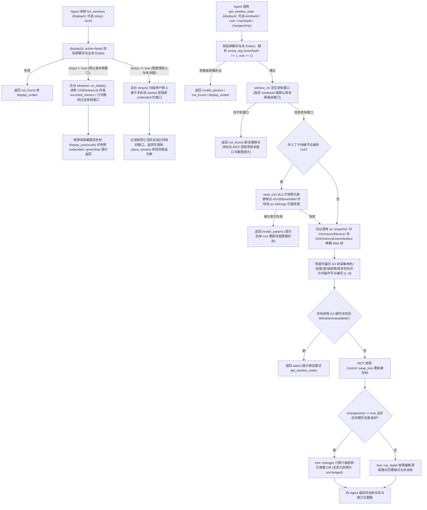
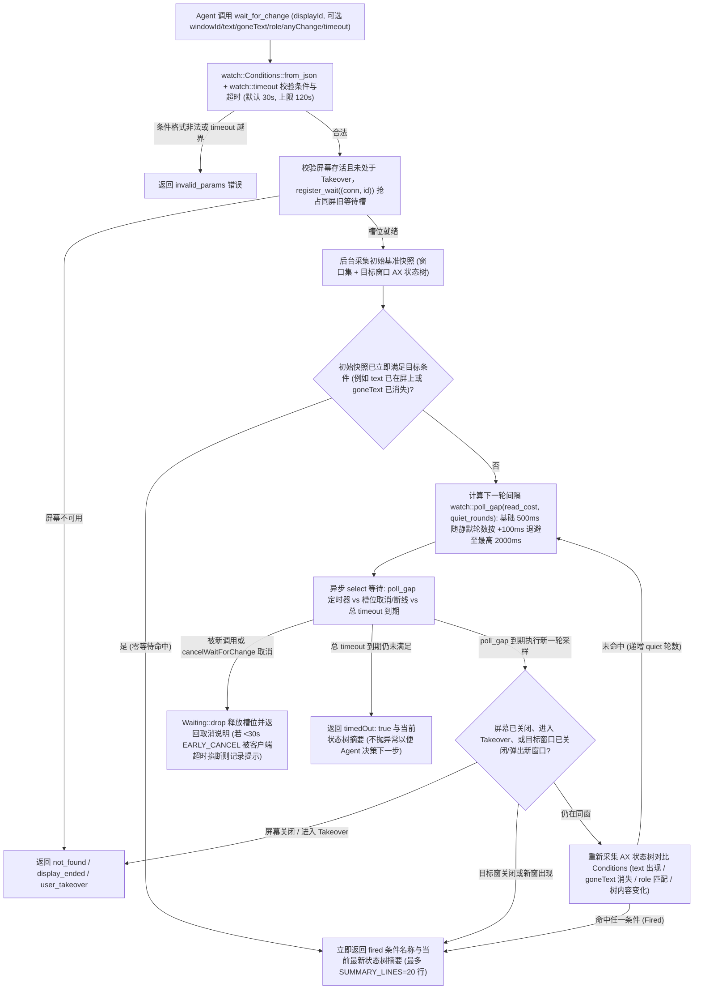

# 10. 窗口枚举 (`list_windows`)、无障碍状态树 (`get_window_state`) 与条件等待 (`wait_for_change`)

Agent 依靠三个只读/观测工具建立对虚拟屏界面的结构化感知，避免盲目高频截图消耗上下文：`list_windows` 列出当前屏幕上全部归属窗口（或通过 `strays: true` 检索散落在用户桌面的重启遗留孤儿与归属未决窗口）；`get_window_state` 遍历目标窗口的 macOS Accessibility (`AXUIElement`) 层级树，唤醒 Chromium 懒加载 Web AX 树，为可交互元素分配稳定短编号并支持只返回上次调用后的增量差异 (`changes_only`)；`wait_for_change` 则以自适应退避轮询 (`500ms -> 2000ms`) 在服务端阻塞等待指定文本/角色出现、消失或界面发生变化，消除客户端 `sleep` 轮询循环。

## 线程与队列分工

1. **`AgentScreen mcp` 进程 (`crates/mcp/src/tools.rs` / `control.rs`)**：维护每屏幕最近一次无障碍树快照缓存 `Control::swap_tree` (`control.rs:113-145`)，用于计算 `tree::changes` 增量 diff 并在 `window_state` 超长时按 `max_depth` 裁剪 (`tools.rs:1701-1949`)。
2. **GPUI 主线程 (`AsyncApp`)**：校验屏幕状态、读取 `Core` 归属账本与 `undecided` 列表、管理每 `(connection, displayId)` 唯一下挂槽位 `WaitSlot` (`apps/macos/src/control/agent.rs:1021-1407, 7713-7945`)。
3. **GPUI `background_executor` 工作池**：执行 `CGWindowListCopyWindowInfo` 遍历、Chromium `AXManualAccessibility` 树唤醒 (`publish_web_tree`, `REPUBLISH_TIMEOUT = 0.1s`)、`ax::snapshot` 深度受限遍历及 `wait_for_change` 周期采样。

---

## 图 1：`list_windows`（含 `strays` 孤儿检索）与 `get_window_state` 无障碍树快照及增量 Diff

### 图 1 节点明细表

| 节点 | 线程与队列 | 我方代码与常量 | macOS 组件与内部行为 | 限制与关联缺陷 | Agent 侧返回 | 用户侧表现 | 验证来源 |
| :--- | :--- | :--- | :--- | :--- | :--- | :--- | :--- |
| `L1` | `mcp` -> GPUI 主线程 | `tools::run("list_windows")` (`crates/mcp/src/tools.rs:876-940`), `agent.rs:1021-1055` | 支持常规本屏查询与 `strays: true` 散落窗口找回模式（设 `READ_ONLY` 工具提示） | 允许在 `Takeover` 期间只读查看窗口列表 (`active = false`) | 进入 `L2` | 无变化 | [已验证: crates/mcp/src/tools.rs:876-940, apps/macos/src/control/agent.rs:1021-1055] |
| `L2` | GPUI 主线程 | `display(&core, &p, false, cx)` (`apps/macos/src/control/agent.rs:1022, 7242-7264`) | 检查屏幕未 `Ended`（若已 `Ended` 则返回 `display_ended`） | 无 | 失败走 `LX1`，分流 `L3` / `L5` | 无变化 | [已验证: apps/macos/src/control/agent.rs:1022, apps/macos/src/control/agent.rs:2707] |
| `LX1` | GPUI 主线程 | `usable` (`apps/macos/src/control/agent.rs:2695-2710`) | 返回 `not_found` 或 `display_ended` | 无 | 标准错误码 | 无变化 | [已验证: apps/macos/src/control/agent.rs:2695-2710] |
| `L3` | 后台执行器 | `windows::on_display` (`apps/macos/src/mac/windows.rs:272-320, 382-389`) | 调 `CGWindowListCopyWindowInfo` 获取在屏窗口，结合 `recorded_owners` 与 `arrangement::window_belongs_to_area` 筛出属于本虚拟屏的窗口（排除 AeroSpace `0x4145/1` closet 屏窗口） | Z 序按从前到后排列，方便 Agent 判断最顶层活动窗 | 输出 `Vec<Window>` | 无变化 | [已验证: apps/macos/src/mac/windows.rs:272-320, apps/macos/src/mac/windows.rs:382-389] |
| `L4` | GPUI 主线程 -> `mcp` | `Window::display_json` (`apps/macos/src/mac/windows.rs:48-75`), `add_strayed` / `add_given` (`agent.rs:1045-1054, 3187-3216`) | 将全局坐标转换为与 `screenshot` 完全一致的局部缩放坐标，附上 `windowId`、`app`、`title`、`bounds` 以及任何未决 `strayed` 或被转走窗口 `givenNote` | Agent 拿到的坐标可直接原样喂给 `computer` | 返回窗口数组 JSON | 无变化 | [已验证: apps/macos/src/mac/windows.rs:48-75, apps/macos/src/control/agent.rs:1045-1054] |
| `L5` | 后台执行器 | `strays` (`apps/macos/src/control/agent.rs:1025-1035, 3281-3349`) | 扫描用户物理屏窗口，挑出属于本会话 `Display.started`（例如宿主重启后被 macOS 弹回物理屏的窗口）或 `Catch` 标为 `undecided` 的窗口 | 配合 `RESTARTED` 恢复指引 (`tools.rs:740`) 实现崩溃/重启后无损找回工作现场 | 候选集进 `L6` | 无变化 | [已验证: apps/macos/src/control/agent.rs:3281-3349, crates/mcp/src/tools.rs:740] |
| `L6` | GPUI 主线程 -> `mcp` | `strays` 过滤返回 (`apps/macos/src/control/agent.rs:3310-3348`) | 剔除已被其它会话正式持有的窗口，输出窗口 `windowId`、应用名与标题 | 随后对目标 `windowId` 调 `place_window` 即可免弹窗（若属 `started`）拉回本屏 | 返回 `strays` 数组 JSON | 无变化 | [已验证: apps/macos/src/control/agent.rs:3310-3348] |
| `S1` | `mcp` -> GPUI 主线程 | `tools::window_state` (`crates/mcp/src/tools.rs:1899-1949`), `agent.rs:1343-1399` | 解析 `windowId`、局部子树根编号 `root`、最大遍历深度 `maxDepth` 与增量标志 `changesOnly` | 设 `READ_ONLY` 注解 | 进入 `S2` | 无变化 | [已验证: crates/mcp/src/tools.rs:1899-1949, apps/macos/src/control/agent.rs:1343-1399] |
| `S2` | `mcp` + GPUI 主线程 | `scope_arg` / `max_depth_arg` (`crates/mcp/src/tools.rs:1677-1699`), `read_scope` (`agent.rs:7658-7673`) | 校验 `maxDepth >= 1`、`root >= 1`，屏幕未 `Ended` | 深度 `< 1` 直接报 `invalid_params` | 非法走 `SX1`，合法走 `S3` | 无变化 | [已验证: crates/mcp/src/tools.rs:1677-1699, apps/macos/src/control/agent.rs:7658-7673] |
| `SX1` | `mcp` / GPUI 主线程 | `ControlError::invalid` / `not_found` / `ended` | 立即拒绝非法范围请求 | 无 | 标准错误码 | 无变化 | [已验证: crates/mcp/src/tools.rs:1677-1699] |
| `S3` | 后台 + 主线程 | `window_on` (`apps/macos/src/control/agent.rs:7627-7644`) | 指定了 `windowId` 则核验其在本虚拟屏上，未指定则默认选取本屏最顶层标准窗口 | 空屏无任何窗口时无法读取状态树 | 无窗口走 `SX2`，命中走 `S4` | 无变化 | [已验证: apps/macos/src/control/agent.rs:7627-7644] |
| `SX2` | GPUI 主线程 -> `mcp` | `closed_window_text` (`crates/mcp/src/tools.rs:1629-1639, 1908-1928`) | 若 Agent 指定的 `windowId` 刚刚关闭（例如点“提交”后对话框自动关了），`tools.rs` 捕获 `not_found` 后自动补查当前屏幕剩余窗口与截图，友好告知“窗口已关闭，当前屏幕状态如下”而非硬报错中断推理！ | 极大提升对话框提交流程顺畅度 | 空屏报 `not_found`，对话框正常关闭则返回更新现场 | 无变化 | [已验证: crates/mcp/src/tools.rs:1629-1639, crates/mcp/src/tools.rs:1908-1928] |
| `S4` | GPUI 主线程 | `root` 分支检查 (`apps/macos/src/control/agent.rs:1348`) | 判断是否只展开某个大型容器节点（如长表格或侧边栏）的子树 | 节省巨型网页/IDE 窗口的上下文 Token | 有 `root` 走 `S5`，整窗走 `S6` | 无变化 | [已验证: apps/macos/src/control/agent.rs:1348] |
| `S5` | GPUI 主线程 + 后台 | `read_root` (`apps/macos/src/control/agent.rs:7675-7711`) | 从该窗口最近一次快照的元素表中检出 `root` 号 `AXUIElementRef`，在后台调 `ax::belongs` 验证元素仍挂载在该窗口内 | DOM 重建导致元素悬空时精准识别 | 失效走 `SX3`，有效走 `S6` | 无变化 | [已验证: apps/macos/src/control/agent.rs:7675-7711] |
| `SX3` | GPUI 主线程 | `SnapshotError::RootUnavailable` (`apps/macos/src/control/agent.rs:1364-1366, 7705-7710`) | 明确提示根元素已脱离窗口，请不带 `root` 重新调用 `get_window_state` | 无 | 错误码 `invalid_params` | 无变化 | [已验证: apps/macos/src/control/agent.rs:1364-1366, apps/macos/src/control/agent.rs:7705-7710] |
| `S6` | 后台执行器 | `ax::snapshot` / `publish_web_tree` (`REPUBLISH_TIMEOUT = 0.1s`, `apps/macos/src/mac/ax.rs:475-525, 1380-1690`) | 对 Chromium / Electron 进程设置 `AXManualAccessibility = true` / `AXEnhancedUserInterface = true`（短超时 `0.1s` 防阻塞）强制渲染进程构建完整 Web 无障碍树 (`AXWebArea`) | 默认情况下 Chrome/Electron 在未检测到读屏器时只暴露空壳外框，写该属性后才暴露全部网页按钮与输入框 | Web 树就绪 | 无读屏语音干扰 | [已验证: apps/macos/src/mac/ax.rs:475-525, apps/macos/src/mac/ax.rs:1380-1690] |
| `S7` | 后台执行器 | `ax::snapshot` 遍历与编号 (`apps/macos/src/mac/ax.rs:1450-1690`) | 深度优先遍历 AX 树（每个节点设消息超时保护），合并冗余纯布局容器，提取角色、名称、值、局部截图系矩形、禁用/选中态及当前打开的菜单项，为所有可交互元素分配递增序号并把 `AXUIElementRef` 存入窗口快照表供 `press_element` / `set_value` 直接索引 | 包含窗口附着的模态 Sheet 与已展开菜单 (`#205` 针对 Sheet 内弹出菜单补充了关联采集逻辑) | 生成文本树与句柄表 | 无变化 | [已验证: apps/macos/src/mac/ax.rs:1450-1690, Issue #205] |
| `S8` | 后台 -> 主线程 | `SnapshotError::WindowUnavailable` (`apps/macos/src/control/agent.rs:1360-1363`) | 目标进程主线程卡死（风火轮）未在 AX 超时内应答 | 绝不无限挂起宿主 | 超时走 `SX4`，正常走 `S9` | 无变化 | [已验证: apps/macos/src/control/agent.rs:1360-1363] |
| `SX4` | GPUI 主线程 | `ControlError::failed` (`apps/macos/src/control/agent.rs:1361-1363`) | 告知目标应用未及时响应无障碍查询，提示稍后重试 | 无 | 错误码 `failed` | 无变化 | [已验证: apps/macos/src/control/agent.rs:1361-1363] |
| `S9` | `mcp` 进程 | `Control::swap_tree` (`crates/mcp/src/control.rs:113-128`), `tools.rs:1930-1948` | 在 `mcp` 内存中按 `(displayId, windowId, root)` 存入最新完整树并取出上一版基准树 | 切换窗口或重连后自动重置基准 | 进入 `S10` | 无变化 | [已验证: crates/mcp/src/control.rs:113-128, crates/mcp/src/tools.rs:1930-1948] |
| `S10` | `mcp` 进程 | `WindowState::changes` vs `content` (`crates/mcp/src/tools.rs:1718-1767`) | 检查 `changesOnly == true` 且存在同窗口同根历史快照 | 首次调用传 `changesOnly: true` 时无历史基准，自动回退返回完整树保证安全 | 增量走 `S11`，全量走 `S12` | 无变化 | [已验证: crates/mcp/src/tools.rs:1718-1767] |
| `S11` | `mcp` 进程 | `tree::changes` (`crates/model/src/tree.rs:195-310`) | 对比前后两棵状态树，仅输出新增、消失或属性改变的节点行及其祖先上下文路径；完全一致时返回简短无变化说明 | 将数千行的复杂页面复查压缩到寥寥数行 (` Keeping context small `) | 进入 `SR1` | 无变化 | [已验证: crates/model/src/tree.rs:195-310] |
| `S12` | `mcp` 进程 | `tree::cut_depth` (`crates/model/src/tree.rs:165-193`) | 按请求 `maxDepth` 折叠深层子树并提示被折叠子节点数量 | 防止超深 DOM 撑爆上下文窗口 | 进入 `SR1` | 无变化 | [已验证: crates/model/src/tree.rs:165-193] |
| `SR1` | `mcp` -> Agent | 组装最终文本输出 (`crates/mcp/src/tools.rs:1718-1767`) | 返回窗口标题、几何信息、焦点元素及格式化元素树 | 编号可直接传给 `press_element` / `set_value` | 返回结构化文本 | 无变化 | [已验证: crates/mcp/src/tools.rs:1718-1767] |

---

## 图 2：`wait_for_change` 条件匹配、自适应轮询退避 (`watch::poll_gap`) 与早期取消保护

### 图 2 节点明细表

| 节点 | 线程与队列 | 我方代码与常量 | macOS 组件与内部行为 | 限制与关联缺陷 | Agent 侧返回 | 用户侧表现 | 验证来源 |
| :--- | :--- | :--- | :--- | :--- | :--- | :--- | :--- |
| `W1` | `mcp` -> GPUI 主线程 | `tools::run("wait_for_change")` (`crates/mcp/src/tools.rs:1150-1225`), `wait_for_change` (`apps/macos/src/control/agent.rs:7776-7944`) | 支持等待指定子串出现 (`text`)、加载提示消失 (`gone_text`)、特定控件出现 (`role`)、窗口切换或任意界面文本变化 | 避免 Agent 在客户端跑低效截图轮询 | 进入 `W2` | 无变化 | [已验证: crates/mcp/src/tools.rs:1150-1225, apps/macos/src/control/agent.rs:7776-7944] |
| `W2` | 纯模型函数 | `watch::Conditions::from_json` / `watch::timeout` (`DEFAULT_TIMEOUT = 30.0`, `MAX_TIMEOUT = 120.0`, `crates/model/src/watch.rs:13-38, 108-156`) | 解析匹配谓词与超时秒数（`<= 0` 或 `> 120s` 报错） | 硬上限 `120s` 防止单次工具调用永久挂死 | 非法走 `WX1`，合法走 `W3` | 无变化 | [已验证: crates/model/src/watch.rs:13-38, crates/model/src/watch.rs:108-156] |
| `WX1` | GPUI 主线程 | `ControlError::invalid` (`apps/macos/src/control/agent.rs:7783-7790`) | 参数格式错误 | 无 | 错误码 `invalid_params` | 无变化 | [已验证: apps/macos/src/control/agent.rs:7783-7790] |
| `W3` | GPUI 主线程 | `display(..., true)` + `register_wait` (`apps/macos/src/control/agent.rs:7724-7774, 7792-7805`) | 确认屏幕活跃未接管，以 `(connection, displayId)` 为键注册单槽 `oneshot` 取消通道；若旧调用仍在挂起则立即发信号挤掉旧调用 | 防止网络抖动重试在同一窗口上并发叠加多个 AX 轮询任务 | 不可用走 `WX2`，成功走 `W4` | 无变化 | [已验证: apps/macos/src/control/agent.rs:7724-7805] |
| `WX2` | GPUI 主线程 | `usable` / 循环内重检 (`apps/macos/src/control/agent.rs:2695-2711, 7855-7870`) | 若等待中途用户主动点进 Viewer 触发 `Takeover` 或关闭屏幕，立即打断等待返回对应状态码 | 让 Agent 第一时间感知用户已介入接管 | `not_found` / `display_ended` / `user_takeover` | 用户接管零延迟生效 | [已验证: apps/macos/src/control/agent.rs:7855-7870] |
| `W4` | 后台执行器 | 初始窗口列表与 `ax::snapshot` (`apps/macos/src/control/agent.rs:7808-7835`) | 记录进入等待时刻的窗口 ID 集合与目标窗口完整状态树文本 | 作为后续检测“新窗口弹出”、“旧窗口关闭”与“任意文本变化”的零点基准 | 进入 `W5` | 无变化 | [已验证: apps/macos/src/control/agent.rs:7808-7835] |
| `W5` | 纯模型函数 | `Conditions::check_initial` (`crates/model/src/watch.rs:158-245`) | 若指定了明确目标谓词（如等待 `"Build succeeded"` 出现或 `"Loading..."` 消失）且首帧即已满足，无需休眠直接命中 | 消除动作已完成在 `wait_for_change` 调用前的 `500ms` 冤枉等待 | 命中走 `WR1`，未命中走 `W6` | 无变化 | [已验证: crates/model/src/watch.rs:158-245] |
| `W6` | 纯模型函数 | `watch::poll_gap` (`POLL = 500ms`, `BACK_OFF = 100ms`, `MAX_QUIET_GAP = 2s`, `crates/model/src/watch.rs:19-24, 42-47`) | 动态计算休眠时长：基础 `500ms`，页面持续无变化时每轮加 `100ms` 退避直至上限 `2000ms`；若单次 AX 读取本身耗时长（大型重页面），自动拉长间隔不挤占目标进程主线程 | 兼顾短动画快响应与长编译/长下载期间极低 CPU 占用 | 算出本轮 `gap` | 目标应用保持流畅不卡顿 | [已验证: crates/model/src/watch.rs:19-24, crates/model/src/watch.rs:42-47] |
| `W7` | GPUI 异步定时器 | `select` 等待 (`apps/macos/src/control/agent.rs:7840-7865`) | 同时监听定时器、取消信号与总截止时刻 `deadline` | 全程异步非阻塞 | 三路唤醒 | 无变化 | [已验证: apps/macos/src/control/agent.rs:7840-7865] |
| `WX3` | Drop 清理 | `Waiting::drop` / `cancelWaitForChange` / `EARLY_CANCEL = 30s` (`apps/macos/src/control/agent.rs:1401-1407, 7720, 7740-7774`) | 移除 `WAIT_SLOTS` 槽位，释放后台轮询协程 | 客户端提前断开不残留孤儿轮询 | 返回取消错误或无接收方 | 无变化 | [已验证: apps/macos/src/control/agent.rs:1401-1407, apps/macos/src/control/agent.rs:7720-7774] |
| `WR2` | 宿主 -> `mcp` 进程 | `wait_output` 超时分支 (`crates/mcp/src/tools.rs:1769-1876`) | 满 `timeout` 仍未触发时返回结构化超时说明并附上此刻最新窗口变化摘要（同时用最新树更新 `Control::swap_tree`） | Agent 无需额外再调一次 `get_window_state` 即可看清卡在什么界面 | 返回超时说明 + 当前树摘要 | 无变化 | [已验证: crates/mcp/src/tools.rs:1769-1876] |
| `W8` | 后台 + 主线程 | 窗口集与屏幕存活重检 (`apps/macos/src/control/agent.rs:7855-7895`) | 检测屏幕是否结束/接管，或目标窗口已关闭（对话框消失）、同应用弹出了新窗口/新警告框 | 对话框关闭本身就是最强状态迁移信号 | 屏幕变更走 `WX2`，窗口变更走 `WR1`，同窗走 `W9` | 无变化 | [已验证: apps/macos/src/control/agent.rs:7855-7895] |
| `W9` | 后台执行器 + 纯模型 | `ax::snapshot` + `Conditions::check` (`crates/model/src/watch.rs:247-340`), `agent.rs:7896-7935` | 重新提取 AX 树检查 `Match` 条件或树 diff；若树有局部变化但尚未命中特定 `text`，重置 `quiet = 0` 恢复 `500ms` 高敏采样 | 界面开始动时自动提速，彻底静止时自动降频 | 命中走 `WR1`，未命中回 `W6` | 无变化 | [已验证: crates/model/src/watch.rs:247-340, apps/macos/src/control/agent.rs:7896-7935] |
| `WR1` | 宿主 -> `mcp` 进程 | `wait_output` (`SUMMARY_LINES = 20`, `crates/model/src/watch.rs:25`, `crates/mcp/src/tools.rs:1769-1876`) | 更新 `Control::swap_tree` 缓存，返回触发原因 (`Fired`)、耗时及不超过 `20` 行的关键增量变化摘要 | 一步到位完成“等待 + 获取新元素编号” | 返回命中事件与新状态摘要 | 无变化 | [已验证: crates/model/src/watch.rs:25, crates/mcp/src/tools.rs:1769-1876] |
