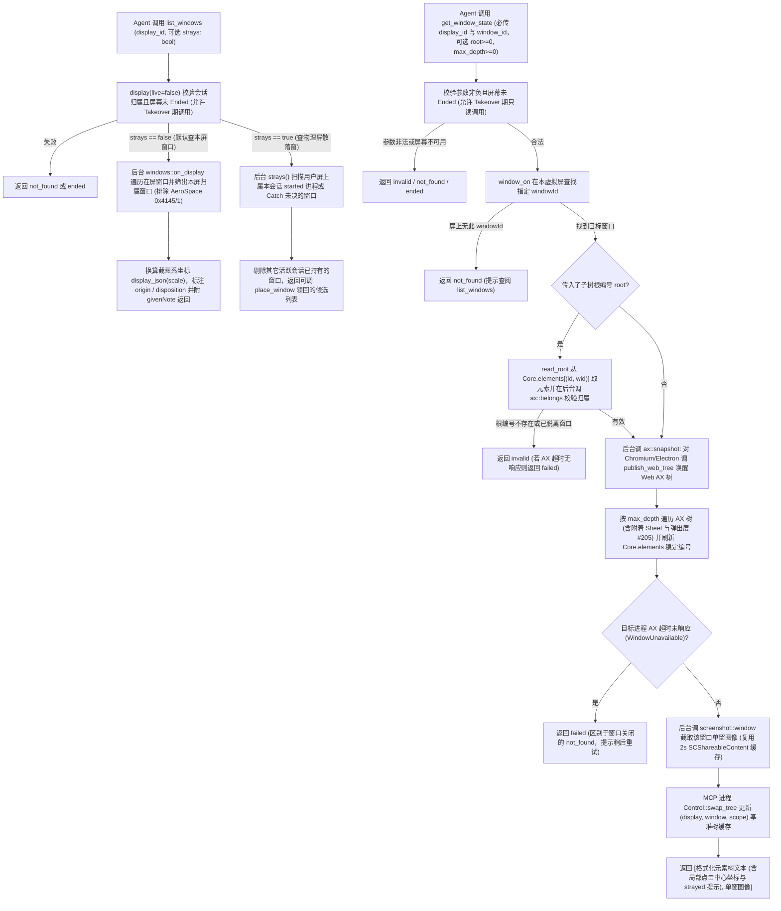
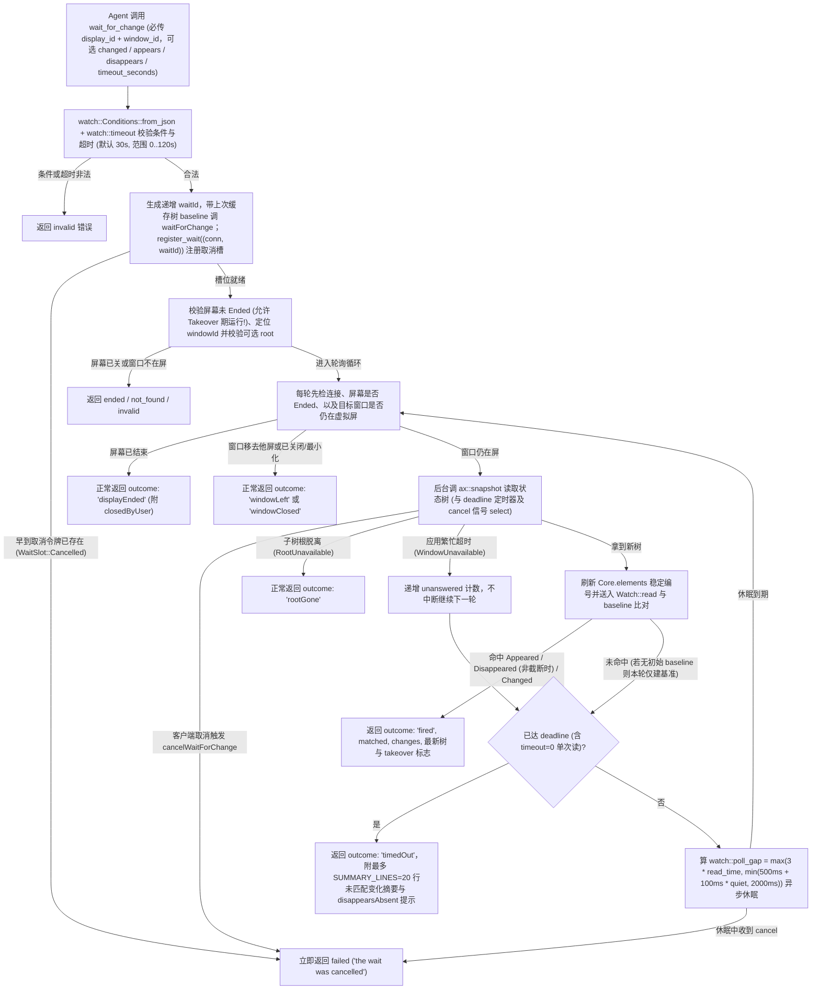

# 10. 窗口枚举 (`list_windows`)、无障碍状态树 (`get_window_state`) 与条件等待 (`wait_for_change`)

Agent 依靠三个只读工具建立对虚拟屏界面的结构化感知：`list_windows` 列出当前虚拟屏上的归属窗口（或通过 `strays: true` 扫描用户物理屏上属于本会话已启动进程或归属未决的散落窗口）；`get_window_state` 对指定 `window_id` 唤醒 Chromium Web 无障碍树、遍历 `AXUIElement` 分配稳定元素编号 `[1..N]`，并同步返回单窗口截图；`wait_for_change` 基于上次状态树基准 (`baseline`) 在服务端以自适应退避轮询 (`poll_gap`: `max(3 * read_time, 500ms..2000ms)`) 等待元素出现 (`appears`)、消失 (`disappears`) 或任意变化 (`changed`)，消除客户端 `sleep` 轮询循环。三者均允许在 `Takeover` 期间只读执行。

## 线程与队列分工

1. **`AgentScreen mcp` 进程 (`crates/mcp/src/tools.rs` / `control.rs`)**：按 `(displayId, windowId, scope)` 维护最近一次状态树缓存 `Control::swap_tree` / `last_tree` (`crates/mcp/src/control.rs:113-145`)，作为 `act_on_element(..., result: "changes")` 增量对比与 `wait_for_change` 零点基准；并在客户端取消 `wait_for_change` 时发送 `"cancelWaitForChange"` (`tools.rs:1127-1152`)。
2. **GPUI 主线程 (`AsyncApp`)**：校验屏幕状态、维护 `Core.elements` 元素引用表、管理线程局部等待取消表 `WAITS: HashMap<(u64, u64), WaitSlot>`（按 `(connection, waitId)` 索引，并用 `EARLY_CANCEL = 30s` 清理早到取消令牌）(`apps/macos/src/control/agent.rs:1013-1055, 1343-1407, 7705-7944`)。
3. **GPUI `background_executor` 工作池**：执行 `windows::on_display` 遍历、Chromium `publish_web_tree` (`REPUBLISH_TIMEOUT = 0.1s` / 首次 `1.0s`)、`ax::snapshot` 深度受限遍历、`screenshot::window` 单窗截图及 `wait_for_change` 周期采样。

---

## 图 1：`list_windows`（含 `strays` 散落窗检索）与 `get_window_state` 状态树及单窗截图

### 图 1 节点明细表

| 节点 | 线程与队列 | 我方代码与常量 | macOS 组件与内部行为 | 限制与关联缺陷 | Agent 侧返回 | 用户侧表现 | 验证证据 |
| :--- | :--- | :--- | :--- | :--- | :--- | :--- | :--- |
| `L1` | `mcp` -> GPUI 主线程 | `tools::run("list_windows")` (`crates/mcp/src/tools.rs:982-990`), `"listWindows"` (`apps/macos/src/control/agent.rs:1013-1055`) | 支持默认本屏枚举与 `strays: true` 散落窗检索两种模式 | 只读操作，允许在 `Takeover` 期间调用 | 进入 `L2` | 无变化 | 已验证：`crates/mcp/src/tools.rs:982-987` `"list_windows" => { let reply = control .call( "listWindows", json!({ "displayId": ... "strays": ... }), )` |
| `L2` | GPUI 主线程 | `usable` + `display(&core, &p, false, cx)` (`apps/macos/src/control/agent.rs:1014, 1022, 2707`) | `usable` 拦截已 `Ended` 屏幕返回 `ended_error`；未 `Ended` 时放行（不拦截 `takeover`） | 无 | 失败走 `LX1`，分流 `L3` / `L5` | 无变化 | 已验证：`apps/macos/src/control/agent.rs:1014,1022,2707` `let id = display(&core, &p, false, cx)?;` / `if d.is_ended() && !matches!(method, "endDisplay" \| "waitForControl") { return Err(ended_error(...)); }` |
| `LX1` | GPUI 主线程 | `ControlError::not_found` / `ended_error` (`apps/macos/src/control/agent.rs:2702, 2708, 7252-7256`) | 返回协议标准错误码 | 无 | 错误码 `not_found` 或 `ended` | 无变化 | 已验证：`apps/macos/src/control/agent.rs:7252-7256` `Err(ended_error(...))` / `Err(ControlError::not_found(...))` |
| `L3` | 后台执行器 | `windows::on_display` (`apps/macos/src/mac/windows.rs:272-320, 382-389`) | 调 `CGWindowListCopyWindowInfo` 按从前到后 Z 序筛出归属本虚拟屏的窗口（忽略 AeroSpace `0x4145/1` 隐藏屏） | 准确反映叠放层级 | 得到 `Vec<Window>` | 无变化 | 已验证：`apps/macos/src/control/agent.rs:1030` `let list: Vec<Value> = off(cx, move \|\| windows::on_display(id)).await` |
| `L4` | GPUI 主线程 -> `mcp` | `Window::display_json` + `origin` / `disposition` + `add_given` (`apps/macos/src/control/agent.rs:1033-1054`) | 输出与 `screenshot` 比例一致的局部坐标、窗口归属来源 (`launched` / `handedOver` / `placed` / `unknown`)、结束处置策略及被移交他方提示 `givenNote` | 坐标可直接传给 `computer` 点击 | 返回 `{windows, scale, ...}` | 无变化 | 已验证：`apps/macos/src/control/agent.rs:1042-1047` `json["origin"] = ...; json["disposition"] = ...; let mut reply = json!({ "windows": list, "scale": scale });` |
| `L5` | 后台执行器 | `strays` (`apps/macos/src/control/agent.rs:1013-1020, 3281-3349`) | 扫描用户物理屏窗口，找出属于本会话 `Display.started`（如宿主重启后散落回主屏的窗口）或 `Catch` 标为未决的窗口 | 配合重启恢复指引找回遗失窗口 | 进入 `L6` | 无变化 | 已验证：`apps/macos/src/control/agent.rs:1013-1019` `"listWindows" if p.0.get("strays").and_then(Value::as_bool) == Some(true) => { ... strays(&core, id, cx).await` |
| `L6` | GPUI 主线程 -> `mcp` | `strays` 过滤输出 (`apps/macos/src/control/agent.rs:3310-3348`) | 排除其它会话已持有的窗口，返回候选 `windows` 列表 | 对 `started` 窗口调 `place_window` 可免弹窗直接领回 | 返回 `{windows}` JSON | 无变化 | 已验证：`apps/macos/src/control/agent.rs:1019` `Ok(json!({ "windows": list }))` |
| `S1` | `mcp` -> GPUI 主线程 | `tools::run("get_window_state")` (`crates/mcp/src/tools.rs:1064-1075, 1900-1949`), `"windowState"` (`apps/macos/src/control/agent.rs:1343-1399`) | **必传 `display_id` 与 `window_id`**（可选非负整数 `root >= 0` 与 `max_depth >= 0`；注：`get_window_state` 无 `changesOnly` 参数，增量树输出位于 `act_on_element` 的 `result: "changes"` 分支） | 缺 `window_id` 直接报 `invalid` | 进入 `S2` | 无变化 | 已验证：`crates/mcp/src/tools.rs:1064-1072` `"get_window_state" => { let scope = scope_arg(&a)?; ... window_state( control, a.require_int("display_id")?, a.require_int("window_id")?, scope, )` |
| `S2` | `mcp` + GPUI 主线程 | `scope_arg` / `max_depth_arg` (`crates/mcp/src/tools.rs:1677-1698`), `read_scope` (`apps/macos/src/control/agent.rs:7658-7671`) | 校验 `root >= 0`（非负整数）且 `max_depth >= 0`（`0` 表示仅根节点），屏幕未 `Ended`（允许在 `Takeover` 期只读调用） | 负数或非整数返回错误码 `invalid` | 非法走 `SX1`，合法走 `S3` | 无变化 | 已验证：`crates/mcp/src/tools.rs:1679` `Some(d) if d < 0 => Err(ControlError::invalid("max_depth must be 0 or more")),`；`crates/mcp/src/tools.rs:1691` `.ok_or_else(\|\| ControlError::invalid("root must be a non-negative integer"))?,` |
| `SX1` | `mcp` / GPUI 主线程 | `ControlError::invalid` / `not_found` / `ended` | 拒绝非法参数或已结束屏幕 | 无 | 错误码 `invalid` / `not_found` / `ended` | 无变化 | 已验证：`apps/macos/src/control/agent.rs:7665` `ControlError::invalid(format!("{key} must be a non-negative integer"))` |
| `S3` | 后台 + 主线程 | `window_on` (`apps/macos/src/control/agent.rs:7627-7644`) | 在 `windows::on_display(id)` 中精确匹配传入的 `windowId`（不做隐式顶层窗口回退） | 窗口已关或移离本屏时返回 `not_found`（注：`closed_window_text` 仅在 `act_on_element` 动作关闭自身窗口时触发，`tools.rs:1626-1635`） | 未找到走 `SX2`，找到走 `S4` | 无变化 | 已验证：`apps/macos/src/control/agent.rs:7632-7643` `let window = p.int("windowId").ok_or_else(\|\| ControlError::invalid("windowId is required"))?; ... ControlError::not_found(format!("no window {window} on display {id}; see list_windows"))` |
| `SX2` | GPUI 主线程 | `ControlError::not_found` (`apps/macos/src/control/agent.rs:7639-7643`) | 提示该 `windowId` 不在此屏幕上，请查 `list_windows` | 无 | 错误码 `not_found` | 无变化 | 已验证：`apps/macos/src/control/agent.rs:7640` `"no window {window} on display {id}; see list_windows"` |
| `S4` | GPUI 主线程 | `scope.root` 检查 (`apps/macos/src/control/agent.rs:1347, 7682`) | 判断是否指定了子树根元素编号 `root` | 支持按需下钻巨型页面局部容器 | 有 `root` 走 `S5`，无 `root` 走 `S6` | 无变化 | 已验证：`apps/macos/src/control/agent.rs:7682` `let Some(number) = root else { return Ok(None) };` |
| `S5` | GPUI 主线程 + 后台 | `read_root` (`apps/macos/src/control/agent.rs:7675-7703`), `ax::belongs` (`apps/macos/src/mac/ax.rs:1060`) | 从 `Core.elements[(id, wid)]` 取出保留的 `AXUIElement` 并在后台沿父链校验 `ax::belongs` 仍隶属该窗口 | 区分元素失效 (`invalid`) 与应用繁忙超时 (`failed`)，绝不误报窗口已关闭 | 失败走 `SX3`，有效走 `S6` | 无变化 | 已验证：`apps/macos/src/control/agent.rs:7675,7689` `async fn read_root(` / `match off(cx, move \|\| ax::belongs(retained.get(), target, false)).await` |
| `SX3` | GPUI 主线程 | `read_root` / `RootUnavailable` 错误 (`apps/macos/src/control/agent.rs:1365-1367, 7685-7700`) | 编号未知或脱离窗口返回 `invalid` 提示去掉 `root` 重查；AX 超时返回 `failed` | 无 | 错误码 `invalid` 或 `failed` | 无变化 | 已验证：`apps/macos/src/control/agent.rs:7685,7697` `ControlError::invalid(format!("root element {number} is unavailable..."))` / `ControlError::failed("the app didn't answer accessibility in time...")` |
| `S6` | 后台执行器 | `ax::snapshot` / `publish_web_tree` (`REPUBLISH_TIMEOUT = 0.1s`, `apps/macos/src/mac/ax.rs:475, 502, 514, 566, 1699`) | 对 Chromium / Electron 进程写 `AXManualAccessibility` / `AXEnhancedUserInterface`（首次最长 `1.0s`，后续重刷 `REPUBLISH_TIMEOUT = 0.1s`）唤醒渲染进程暴露 `AXWebArea` | 解决浏览器默认懒加载不暴露网页 DOM 无障碍节点问题 | Web 树就绪 | 不开启系统读屏语音 | 已验证：`apps/macos/src/mac/ax.rs:475,502,514,1699` `const REPUBLISH_TIMEOUT: f32 = 0.1;` / `publish_web_tree(pid, REPUBLISH_TIMEOUT)` / `publish_web_tree(pid, 1.0)` / `pub fn snapshot(` |
| `S7` | 后台 + GPUI 主线程 | `ax::snapshot` + `numbers::relabel` (`apps/macos/src/control/agent.rs:1354-1378`) | 受 `max_depth` 与元素预算限制遍历窗口及附着 Sheet/弹出层 (`#205`)，通过 `Numbers::refresh` 复用已有元素的稳定编号并存入 `Core.elements` | 跨多次快照保持同一元素的编号稳定，支撑 `tree::changes` 按编号对比 | 产出格式化树与计数 | 无变化 | 已验证：`apps/macos/src/control/agent.rs:1372-1376` `let numbers = c.elements.entry((id, window.target.window_id)).or_default(); numbers::relabel( &snapshot.tree, &numbers.refresh(snapshot.elements, complete), )` |
| `S8` | 后台 -> 主线程 | `SnapshotError::WindowUnavailable` (`apps/macos/src/control/agent.rs:1361-1364`) | 目标应用主线程繁忙未响应 AX 查询或系统辅助功能权限被撤 | 用 `failed` 而非 `not_found`，防止 Agent 误以为窗口已关 | 超时走 `SX4`，正常走 `S9` | 无变化 | 已验证：`apps/macos/src/control/agent.rs:1361-1363` `ax::SnapshotError::WindowUnavailable => ControlError::failed( "the app didn't answer accessibility in time, or Accessibility isn't granted; call get_window_state again", ),` |
| `SX4` | GPUI 主线程 | `ControlError::failed` (`apps/macos/src/control/agent.rs:1362`) | 提示稍后重试 `get_window_state` | 无 | 错误码 `failed` | 无变化 | 已验证：`apps/macos/src/control/agent.rs:1362` `ControlError::failed` |
| `S9` | 后台执行器 | `screenshot::window` (`apps/macos/src/control/agent.rs:1380-1384`, `apps/macos/src/mac/screenshot.rs:423-482`) | 调用 `SCScreenshotManager` 单独截取该窗口图像（复用 `CONTENT_AGE = 2s` 内的 `SCShareableContent` 缓存） | 让 Agent 同时获得语义编号树与该窗口视觉画面 | 得到单窗图像 `Shot` | 无闪烁 | 已验证：`apps/macos/src/control/agent.rs:1382` `.spawn(async move { screenshot::window(target, size) })` |
| `S10` | `mcp` 进程 | `Control::swap_tree` (`crates/mcp/src/tools.rs:1938-1944`) | 将本次状态树与 `truncated` 标志存入 MCP 缓存，供后续 `wait_for_change` 或 `act_on_element(result: "changes")` 读取 | 按 `(display, window, scope)` 精确隔离基准 | 进入 `SR1` | 无变化 | 已验证：`crates/mcp/src/tools.rs:1938` `before: control.swap_tree(display, window, scope, tree.clone(), ...)` |
| `SR1` | `mcp` -> Agent | `WindowState::content` (`crates/mcp/src/tools.rs:1074, 1718-1742`), `tree::cut_depth` (`crates/model/src/tree.rs:165`) | 输出包含窗口头信息、`at (x,y)` 截图系点击中心说明、`strayed` 提示、状态树文本（旧版宿主由 `cut_depth` 兜底截断）及单窗图像块两个内容项 | 元素编号可直接传给 `act_on_element` | 返回 `[文本树, 窗口图像]` | 无变化 | 已验证：`crates/mcp/src/tools.rs:1074` `Ok(Output::Content(state.content(depth)))`；`crates/mcp/src/tools.rs:1734-1741` `vec![ text(format!( ... )), self.image.clone(), ]` |

---

## 图 2：`wait_for_change` 条件匹配、自适应退避 (`poll_gap`)、Takeover 兼容与早到取消令牌清理 (`EARLY_CANCEL = 30s`)

### 图 2 节点明细表

| 节点 | 线程与队列 | 我方代码与常量 | macOS 组件与内部行为 | 限制与关联缺陷 | Agent 侧返回 | 用户侧表现 | 验证证据 |
| :--- | :--- | :--- | :--- | :--- | :--- | :--- | :--- |
| `W1` | `mcp` -> GPUI 主线程 | `tools::run("wait_for_change")` (`crates/mcp/src/tools.rs:1113-1160`), `wait_for_change` (`apps/macos/src/control/agent.rs:7776-7944`) | **必传 `display_id` 与 `window_id`**；条件对象支持 `changed: bool`、`appears: {role, text}`、`disappears: {role, text}`（省略条件时默认 `changed = true`） | 不存在 `goneText` 或 `anyChange` 字段名；未知字段在 `from_json` 报错 | 进入 `W2` | 无变化 | 已验证：`crates/mcp/src/tools.rs:1114-1121` `let display = a.require_int("display_id")?; let window = a.require_int("window_id")?; ... "changed" ... "appears" ... "disappears"` |
| `W2` | 纯模型函数 | `watch::Conditions::from_json` / `watch::timeout` (`DEFAULT_TIMEOUT = 30.0`, `MAX_TIMEOUT = 120.0`, `crates/model/src/watch.rs:13-16, 29-35, 121-152`) | 校验至少存在一项有效等待条件；`timeout_seconds` 默认 `30.0s`，允许 `0.0`（只读一轮），负数报错，超过 `120.0s` 自动钳制为 `120.0s` | 上限 `120s` 避免无限占用单轮工具调用 | 非法走 `WX1`，合法走 `W3` | 无变化 | 已验证：`crates/model/src/watch.rs:13-16` `pub const DEFAULT_TIMEOUT: f64 = 30.0; ... pub const MAX_TIMEOUT: f64 = 120.0;`；`crates/model/src/watch.rs:32-33` `Some(s) if s.is_nan() \|\| s < 0.0 => Err("timeout_seconds must be 0 or more".into()), Some(s) => Ok(Duration::from_secs_f64(s.min(MAX_TIMEOUT))),` |
| `WX1` | `mcp` / GPUI 主线程 | `ControlError::invalid` (`crates/mcp/src/tools.rs:1124-1126`, `agent.rs:7796-7797`) | 在发起任何 AX 读取前拒绝非法参数 | 无 | 错误码 `invalid` | 无变化 | 已验证：`apps/macos/src/control/agent.rs:7796-7797` `.map_err(ControlError::invalid)?` |
| `W3` | `mcp` + GPUI 主线程 | `NEXT_WAIT` + `control.last_tree` (`crates/mcp/src/tools.rs:1127-1142`), `WAITS` / `register_wait` / `EARLY_CANCEL = 30s` (`apps/macos/src/control/agent.rs:7709-7737, 7786-7793`) | MCP 分配原子递增 `waitId` 并附带上次缓存树 `baseline`；主线程以 **`(connection, waitId)`** 为键存入线程局部表 `WAITS`，并顺带清理滞留超过 **`EARLY_CANCEL = 30s` 的早到取消记录**（即 `cancelWaitForChange` 比 `waitForChange` 先到主线程、或对应等待从未到达的陈旧 `WaitSlot::Cancelled(at)`，并非客户端超时提示！） | 消除异步取消与等待注册乱序到达的竞态泄漏 | 早到取消走 `WX3`，正常走 `W4` | 无变化 | 已验证：`apps/macos/src/control/agent.rs:7719-7729` `/// Forget early cancels older than this, as for a wait that never came. const EARLY_CANCEL: Duration = Duration::from_secs(30); ... waits.retain( \|_, slot\| !matches!(slot, WaitSlot::Cancelled(at) if at.elapsed() > EARLY_CANCEL), );` |
| `W4` | GPUI 主线程 + 后台 | `display(core, p, true, cx)` / `window_on` / `read_root` (`apps/macos/src/control/agent.rs:7774-7775, 7798-7801`) | 核验屏幕未 `Ended`、目标窗口在屏且 `root` 有效；**明确支持在用户 `Takeover` 期间正常工作**（不检查也不报错 `takeover`，而在返回 JSON 中附带 `"takeover": bool`） | 让 Agent 在用户协助操作或观察期仍可静默感知页面跳转 | 失败走 `WX2`，就绪进 `W5` | 与用户操作互不干扰 | 已验证：`apps/macos/src/control/agent.rs:7774-7775` `Reads work in a Takeover, as /// windowState's do.`；`apps/macos/src/control/agent.rs:7798` `let id = display(core, p, true, cx)?;` |
| `WX2` | GPUI 主线程 | `ended_error` / `not_found` / `invalid` (`apps/macos/src/control/agent.rs:7798-7801`) | 入口屏幕或窗口不存在时报错 | 无 | 错误码 `ended` / `not_found` / `invalid` | 无变化 | 已验证：`apps/macos/src/control/agent.rs:7799-7801` `let window = window_on(id, p, cx).await?; ... let root = read_root(core, id, target, scope.root, cx).await?;` |
| `W5` | GPUI 主线程 + 后台 | 循环存活与窗口在位检查 (`apps/macos/src/control/agent.rs:7824-7858`) | 每轮先检连接未断、屏幕未 `Ended`，再后台检查 `window_id` 是否仍在 `windows::on_display(id)` 或已移往其它屏幕 (`cg::on_screen_ids()`) | 精确区分窗口已关闭隐藏与窗口移往其它屏幕两种状态 | 屏关走 `WR_END`，窗离走 `WR_WIN`，在位走 `W6` | 无变化 | 已验证：`apps/macos/src/control/agent.rs:7836-7857` `if ended { return Ok(json!({ "outcome": "displayEnded", ... })); }` / `if !here { return Ok(json!({ "outcome": if elsewhere { "windowLeft" } else { "windowClosed" }, ... })); }` |
| `WR_END` | 宿主 -> `mcp` | `"displayEnded"` 分支 (`apps/macos/src/control/agent.rs:7837-7841`, `tools.rs:1866-1871`) | 返回结构化文本 `display_ended after X s`（若用户主动关屏则提示未经询问勿调 `create_display`） | 正常返回结果文本而非抛协议错误 | 返回 `display_ended` 说明 | 无变化 | 已验证：`crates/mcp/src/tools.rs:1866-1870` `Some("displayEnded") if reply.get("closedByUser") == Some(&Value::Bool(true)) =>` |
| `WR_WIN` | 宿主 -> `mcp` | `"windowLeft"` / `"windowClosed"` 分支 (`apps/macos/src/control/agent.rs:7854-7857`, `tools.rs:1857-1862`) | 对话框提交后自动关闭返回 `window_closed` 提示查 `list_windows`；移出虚拟屏返回 `window_left` 提示查 `list_windows(strays: true)` | 窗口消失本身即是重要业务完成信号 | 返回 `window_closed` 或 `window_left` 说明 | 无变化 | 已验证：`crates/mcp/src/tools.rs:1857-1861` `Some("windowClosed") => ... Some("windowLeft") =>` |
| `W6` | 后台执行器 | `ax::snapshot` + `futures::select!` (`apps/macos/src/control/agent.rs:7862-7878`) | 后台读取 AX 树并计时 `read_time`；与 `remaining.max(watch::POLL)` 截止定时器及 `cancel` 通道竞争 | 单次慢读取在到期时立即脱手返回超时 | 按结果分流 | 无变化 | 已验证：`apps/macos/src/control/agent.rs:7872-7877` `let timer = cx.background_executor().timer(remaining.max(watch::POLL)); let snapshot = futures::select! {` |
| `WX3` | `mcp` + Drop 守卫 | `cancelWaitForChange` (`crates/mcp/src/tools.rs:1148-1151`, `agent.rs:1401-1407`), `cancel_wait` / `Waiting::drop` (`agent.rs:7740-7768`) | MCP 侧检测到客户端取消时调 `call_open("cancelWaitForChange", {"waitId": wait})` 触发 `stop.send(())` 中止后台轮询，`Waiting::drop` 自动移除 `WAITS` 运行槽 | 客户端取消后宿主零残留轮询 | 错误码 `failed` (`"the call was cancelled"` / `"the wait was cancelled"`) | 无变化 | 已验证：`crates/mcp/src/tools.rs:1149` `control.call_open("cancelWaitForChange", json!({ "waitId": wait })).await;`；`apps/macos/src/control/agent.rs:7757` `impl Drop for Waiting` |
| `WR_ROOT` | 宿主 -> `mcp` | `SnapshotError::RootUnavailable` -> `"rootGone"` (`apps/macos/src/control/agent.rs:7912-7914`, `tools.rs:1863-1865`) | 等待期间局部子树根节点被页面销毁，返回 `root_gone` 引导去掉 `root` 重查 | 不抛异常，清晰说明原因 | 返回 `root_gone` 说明 | 无变化 | 已验证：`apps/macos/src/control/agent.rs:7912-7913` `Err(ax::SnapshotError::RootUnavailable) => { return Ok(json!({ "outcome": "rootGone", ... })); }` |
| `W_BUSY` | GPUI 主线程 | `SnapshotError::WindowUnavailable` -> `unanswered += 1` (`apps/macos/src/control/agent.rs:7916`) | 目标应用短时繁忙未响应 AX 时不报错退出，累加 `unanswered` 等待下一轮重试 | 容忍页面重负载加载期的瞬时无响应 | 进入 `W8` | 无变化 | 已验证：`apps/macos/src/control/agent.rs:7916` `Err(ax::SnapshotError::WindowUnavailable) => unanswered += 1,` |
| `W7` | GPUI 主线程 + 纯模型 | `Watch::read` / `watch::check` (`crates/model/src/watch.rs:193-211, 250-268`), `agent.rs:7885-7910` | 若带有上次 `get_window_state` 缓存的 `baseline`（且属本轮宿主运行编号），**首轮读取即与 `baseline` 比对并可零休眠立即触发**；若无 `baseline` 则首轮仅建立基准；按内容计数检测 `Appeared` / `Disappeared`（任一侧达元素上限 `truncated` 时禁用 `Disappeared` 防误报）与 `Changed` | 按元素角色+文本计数而非按句柄比对，列表重渲染不会误触发 (`watch.rs:185-192`) | 命中走 `WR1`，未命中走 `W8` | 无变化 | 已验证：`crates/model/src/watch.rs:193,201,250` `pub fn check(` / `if let Some(m) = conditions.disappears.as_ref().filter(\|_\| !truncated)` / `pub fn read(&mut self, read: Read) -> Vec<Fired>` |
| `WR1` | 宿主 -> `mcp` | `"fired"` 返回与缓存同步 (`apps/macos/src/control/agent.rs:7896-7909`, `tools.rs:1165-1172, 1775-1825`) | MCP 用返回的最新完整树更新 `Control::swap_tree` 缓存，向 Agent 输出命中的条件名、匹配元素行及结构化增量差异 | 命中后无需再调 `get_window_state` 即可直接操作新元素 | 返回命中详情与增量树 | 无变化 | 已验证：`apps/macos/src/control/agent.rs:7897` `"outcome": "fired"` |
| `W8` | GPUI 主线程 | `Instant::now() >= deadline` (`apps/macos/src/control/agent.rs:7918-7920`) | 判断总等待时长是否已耗尽 | 无 | 到期走 `WR2`，未到期走 `W9` | 无变化 | 已验证：`apps/macos/src/control/agent.rs:7918-7920` `if Instant::now() >= deadline { break "timedOut"; }` |
| `WR2` | 宿主 -> `mcp` | `"timedOut"` 返回 (`SUMMARY_LINES = 20`, `crates/model/src/watch.rs:25, 295`, `agent.rs:7929-7942`, `tools.rs:1826-1856`) | 同步最新树到 `swap_tree`，返回 `timed_out` 说明、`unanswered` 次数、若基准树原本就不含待消失元素则提示 `disappearsAbsent`、以及最多前 `SUMMARY_LINES = 20` 行未命中变化摘要 | 帮助 Agent 区分界面未发生变化与匹配词不符 | 返回超时诊断与 `<=20` 行变化摘要 | 无变化 | 已验证：`crates/model/src/watch.rs:25,295` `pub const SUMMARY_LINES: usize = 20;` / `pub fn disappears_absent(&self) -> bool` |
| `W9` | 纯模型 + 异步定时器 | `watch::poll_gap` (`POLL = 500ms`, `BACK_OFF = 100ms`, `MAX_QUIET_GAP = 2s`, `crates/model/src/watch.rs:19-23, 42-45`), `agent.rs:7921-7927` | 计算 `(read_time * 3).max((500ms + 100ms * quiet).min(2000ms))`：既随连续无变化轮数 `quiet` 线性退避至 `2s`（一旦树有变动 `quiet` 归零恢复 `500ms`），又保证休眠至少为单次 AX 读取耗时的 **3 倍**（最多占目标应用主线程 25% 时间） | 防止重型页面频繁 AX 遍历拖慢目标应用渲染 | 休眠后回 `W5` | 目标应用主线程保持流畅 | 已验证：`crates/model/src/watch.rs:19-23` `pub const POLL: Duration = Duration::from_millis(500); ... pub const MAX_QUIET_GAP: Duration = Duration::from_secs(2); ... pub const BACK_OFF: Duration = Duration::from_millis(100);`；`crates/model/src/watch.rs:42-45` `pub fn poll_gap(read: Duration, quiet: u32) -> Duration { let floor = (POLL + BACK_OFF * quiet).min(MAX_QUIET_GAP); (read * 3).max(floor) }` |
