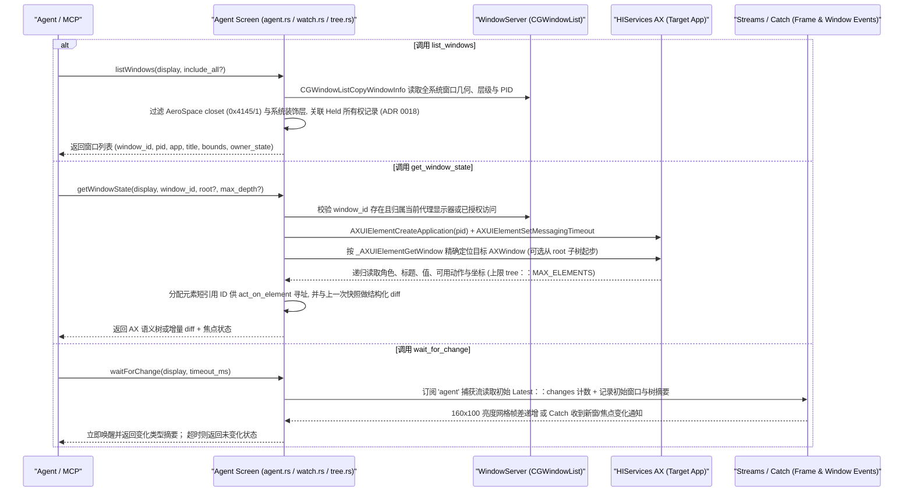

# 操作 10：list_windows、get_window_state 与 wait_for_change

这三个只读与观察工具为代理提供屏上窗口清单、带稳定引用编号的无障碍（AX）语义树及增量差异、以及跨像素帧差与窗口事件的阻塞式变化等待，减少高频全量轮询带来的上下文与 IPC 开销。

## 端到端流程

## 节点明细表

| 节点 | 我方代码 | macOS 组件与内部行为 | 限制与故障模式 | 关联问题 | 验证状态 |
| --- | --- | --- | --- | --- | --- |
| 1. 窗口枚举与所有权对账（`list_windows`） | `crates/mcp/src/tools.rs:1847-1895`、`apps/macos/src/mac/windows.rs:60-179`、`crates/model/src/held.rs:15-165` | 调用 `CGWindowListCopyWindowInfo` 获取窗口数组，剔除 `mac::cg::is_closet`（`0x4145/1`）及菜单栏/浮层装饰窗口；与内存 `Held` 所有权表执行 ADR 0018 对账，标注窗口属于当前会话、其他代理会话还是用户桌面。 | 1. `CGWindowListCopyWindowInfo` 在未获屏幕录制权限时对部分跨进程窗口不返回 `kCGWindowName`（标题为空需回退 AX `AXTitle` 读取）；2. 最小化或刚销毁窗口在 WindowServer 列表中存在短暂残留。 | `#205`、ADR 0018 | `[已验证]` `CGWindow.h:63,71,91`、`apps/macos/src/mac/windows.rs:60-179` |
| 2. 目标窗口精确 AX 绑定 | `apps/macos/src/mac/ax.rs:60-185` | 创建 `AXUIElementCreateApplication(pid)`，遍历 `AXWindows` 并调用私有符号 `_AXUIElementGetWindow` 与请求的 `CGWindowID` 精确比对，绝不用标题模糊猜测窗口。同时对元素设置 `AXUIElementSetMessagingTimeout` 防止死锁。 | 1. 跨非活跃 Space 的窗口常从进程的 `AXWindows` 数组中消失，导致 WindowServer 可见但 AX 无法解析；2. Electron / Chromium 应用若未开启 `AXManualAccessibility` / `AXEnhancedUserInterface`，首次读取只返回空壳容器。 | `#207`、Chromium 空树延迟 | `[已验证]` `AXUIElement.h:387-402`、`apps/macos/src/mac/ax.rs:60-185` |
| 3. 有界递归遍历与子树裁剪（`get_window_state`） | `crates/mcp/src/tools.rs:1897-1950`、`apps/macos/src/mac/ax.rs:186-318`、`crates/model/src/tree.rs:1-340` | 支持可选 `root` 元素引用与 `max_depth` 深度限制，按广度/深度优先遍历 `AXChildren`、`AXVisibleChildren` 等属性，达到 `tree::MAX_ELEMENTS` 上限时截断并提示代理使用 `root` 下钻子树；为每个可交互节点生成会话内元素 ID 缓存供 `act_on_element` 直接定位。 | **IPC 延迟瓶颈**：每个 AX 节点属性读取均跨越进程间 Mach IPC 到目标应用主线程执行；大型网页或复杂表格在深层遍历时单次耗时可达数百毫秒至数秒，若目标应用主线程正忙于重排则直接触发 `-25204`（`kAXErrorCannotComplete`）。 | `#207`、`AXError.h:49` | `[已验证]` `crates/model/src/tree.rs:1-340`、`AXError.h:49` |
| 4. 树快照增量比对（Tree Diff） | `crates/model/src/tree.rs:190-340`、`apps/macos/src/control/agent.rs:955-1018` | 保留同窗口最近一次 `get_window_state` 的规范化节点摘要，连续查询时输出新增、消失与属性变更的节点以及当前焦点元素，避免重复向大模型输出数千行未变静态 UI 结构。 | Canvas 编辑器（如 Monaco、Figma、WebGL 终端）内部内容变化不反映在 AX 节点上，树 diff 会显示"无变化"，此时代理必须结合 `screenshot` 像素核验。 | Canvas 表面盲区 | `[已验证]` `crates/model/src/tree.rs:190-340` |
| 5. 多源阻塞等待（`wait_for_change`） | `crates/mcp/src/tools.rs:2262-2330`、`crates/model/src/watch.rs:1-190`、`apps/macos/src/control/agent.rs:1020-1120` | 临时挂载 `"agent"` 捕获流订阅获取基准 `Latest::changes` 帧计数，同时订阅 `Catch` 线程的新窗创建、窗口关闭与焦点变更通知，在异步选择循环中阻塞直至任一信号触发或到达 `timeout_ms`。 | 1. 若当前捕获流正处于 `misroute` 或退避期（`#190`），像素帧差信号暂停产生，仅靠窗口/AX 事件触发唤醒；2. 页面存在常驻加载转圈动画时会在首帧立即满足像素变化而提前返回。 | `#190`、`misroute` | `[已验证]` `crates/model/src/watch.rs:1-190`、`apps/macos/src/control/agent.rs:1020-1120` |
