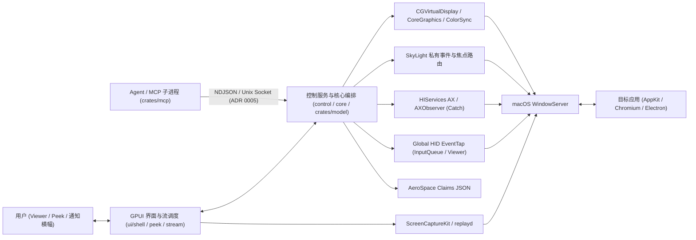

# Agent Screen 操作流与状态机全景图谱

本目录精确记录 Agent Screen（基于分支 `fanzzzd/root-causes` / PR #208）每一项核心操作与状态机的端到端执行路径，下探至 macOS 私有与公开框架内部行为（`CGVirtualDisplay`、CoreGraphics 显示配置、`WindowServer`、`SkyLight`、HIServices/AX、`ScreenCaptureKit`、AppKit、Spaces 与 AeroSpace）、系统边界限制以及已知缺陷根因。

## 一、系统参与者分层概览

## 二、文档索引

### 核心操作流（Operations 01 至 10）

1. [01-create-display.md](./01-create-display.md)：`create_display`、备用屏 `pick_spare` 复用、`unit`/序列号分配、对角停放、重停放与窗口跟随平移、`800x500` 模式守护。
2. [02-end-display-and-sessions.md](./02-end-display-and-sessions.md)：`end_display`、兄弟会话移交（ADR 0016）、`Review` 态与 `600 ms` 清扫、备用池整理、`2000 ms` 断连宽限与应用重启清理。
3. [03-launch-app-and-new-window.md](./03-launch-app-and-new-window.md)：`launch_app`、`open -g -j`、Chromium CDP 管道（ADR 0010）、`Catch` 线程 `AXObserver`、ADR 0007 新窗归属规则与 AeroSpace 声明。
4. [04-place-window-and-handover.md](./04-place-window-and-handover.md)：`place_window`、`window_access`、跨会话 `Window Request` 与 `HolderStatus`（ADR 0017）、用户 Handover 移入及 `give_back` 原位归还。
5. [05-computer-actions.md](./05-computer-actions.md)：`computer`（截图、单击、双击、滚轮、打字、按键、多路拖拽）、`act_on_element`、共享前台进程门控（`#110`）与 TIS 输入法借用（ADR 0008）。
6. [06-input-queue-and-real-input.md](./06-input-queue-and-real-input.md)：`Input Queue` 排队授权与真实硬件光标/键盘借用执行器（ADR 0013）、`0x4153_5121` 硬件抢占即时撤权、跨窗拖拽与副屏菜单遍历。
7. [07-viewer-input.md](./07-viewer-input.md)：`Viewer` 用户输入路由、`private-press` 前置拦截（ADR 0014）、标准标题栏 `Grab`、中文输入法组词与密码框回放、越界拖拽钳制与 `CustomDrag` 首按限制。
8. [08-takeover-and-help-requests.md](./08-takeover-and-help-requests.md)：`Takeover` 排他接管（ADR 0004）、`request_help`（`Continue` / `Reply` / `Give a window`，ADR 0015）、`unheard` 重放与 `wait_for_control`。
9. [09-peek-and-stream-pipeline.md](./09-peek-and-stream-pipeline.md)：`Peek` 悬停预览、单屏单 `SCStream` 档位聚合、零拷贝 `YCbCr_420f` 渲染、`misroute` 屏幕错位自检与指数退避自愈。
10. [10-window-queries-and-wait.md](./10-window-queries-and-wait.md)：`list_windows`、`get_window_state`（有界 AX 树、`root` 子树与增量 diff）及 `wait_for_change` 多源阻塞等待。

### 核心状态机（State Machines 01 至 05）

1. [sm-01-display-lifecycle.md](./sm-01-display-lifecycle.md)：显示器生命周期（Spare 创建、空闲复用、Active、Takeover、Review、Quarantined 隔离与 Retired 销毁）。
2. [sm-02-window-ownership.md](./sm-02-window-ownership.md)：窗口所有权记录 `Held` 与 `WindowServer` 实时屏幕几何对账状态机（ADR 0018）。
3. [sm-03-session-and-connection.md](./sm-03-session-and-connection.md)：MCP 控制会话、闪断宽限期与僵尸管道假活状态机。
4. [sm-04-request-lifecycle.md](./sm-04-request-lifecycle.md)：协作请求（Help、Takeover、WindowAccess、WindowRequest）与 `unheard` 缓冲状态机。
5. [sm-05-input-queue-lifecycle.md](./sm-05-input-queue-lifecycle.md)：`Input Queue` 队列项与 `30 s` 共享 `Grant` 借用状态机。

### 外部架构参照

- [cua-comparison.md](./cua-comparison.md)：与 `trycua/cua` 的逐操作机制对比、双方优劣边界及 6 项按优先级排序的收敛方案。

## 三、已知缺陷与系统限制交叉定位矩阵

| 问题标识 | 核心根因与涉及的 macOS 组件 | 关联操作与状态机文档 |
| --- | --- | --- |
| `#204` 物理/虚拟屏重排漂移 | `WindowServer` 在热插拔、唤醒或新建虚拟屏时重排原点；固定已连接代理屏坐标并通过 `run_repark_shifts` 平移归属窗口修复。 | [01](./01-create-display.md)、[04](./04-place-window-and-handover.md)、[sm-01](./sm-01-display-lifecycle.md)、[sm-02](./sm-02-window-ownership.md) |
| `#205` 窗口所有权与几何脱节 | 应用自发重置 `frame` 或跨屏夹紧导致实测位置偏离 `Held` 记录；按 ADR 0018 对账与 `guard_placed` 修复。 | [03](./03-launch-app-and-new-window.md)、[04](./04-place-window-and-handover.md)、[10](./10-window-queries-and-wait.md)、[sm-02](./sm-02-window-ownership.md) |
| `#206` 真实输入排队视觉打扰 | 排队待批阶段与实际借用阶段耦合导致过早亮全屏红框；拆分为琥珀色徽标排队态与活跃 `Grant` 态修复。 | [05](./05-computer-actions.md)、[06](./06-input-queue-and-real-input.md)、[sm-04](./sm-04-request-lifecycle.md)、[sm-05](./sm-05-input-queue-lifecycle.md) |
| `#207` AX 树大窗口性能与空树 | HIServices AX 跨进程主线程 IPC 慢，且 Electron 未开 `AXManualAccessibility` 时返回空树；由 `MAX_ELEMENTS`、`root`/`max_depth` 与增量 diff 缓解。 | [10](./10-window-queries-and-wait.md)、[cua-comparison](./cua-comparison.md) |
| `#189` 死会话悬空锁死窗口 | 宿主未关闭 `AgentScreen mcp` 的 `stdin` 管道时无套接字 EOF，导致 `HolderStatus` 假活并阻塞跨会话接管与显示器回收。 | [02](./02-end-display-and-sessions.md)、[04](./04-place-window-and-handover.md)、[sm-01](./sm-01-display-lifecycle.md)、[sm-03](./sm-03-session-and-connection.md)、[cua-comparison](./cua-comparison.md) |
| `#190` 预览流断流黑屏与风暴 | `replayd` 异常停流或虚拟屏未就绪时悬停反复拉流；通过缓存末帧、`retry_at` 指数退避与 `should_wake_idle_stream` 修复。 | [01](./01-create-display.md)、[09](./09-peek-and-stream-pipeline.md)、[10](./10-window-queries-and-wait.md) |
| `#110` 前台共享应用焦点串窗 | `SLEventPostToPid` 仅按进程投递键盘且点击会抢走同进程 `keyWindow`；由 `shared_app.rs` AX 直写 + `check_focus` 主窗恢复拦截。 | [03](./03-launch-app-and-new-window.md)、[05](./05-computer-actions.md)、[cua-comparison](./cua-comparison.md) |
| `unit twin` 逻辑单元镜像冲突 | `WindowServer` 偶发给虚拟屏分配与物理屏相同的 `CGDisplayUnitNumber` 造成硬件镜像；由最小 `unit` 优先挑屏与 `unit_twin` 隔离拦截。 | [01](./01-create-display.md)、[05](./05-computer-actions.md)、[09](./09-peek-and-stream-pipeline.md)、[sm-01](./sm-01-display-lifecycle.md) |
| `misroute` 捕获流串屏 | 重排后 `SCStream` 投递错误显示器的帧缓冲；核对 `SCStreamFrameInfoScreenRect` 与 `cg::display_bounds` 触发 `repair` 重建。 | [01](./01-create-display.md)、[09](./09-peek-and-stream-pipeline.md) |
| `800x500` 虚拟屏分辨率回退 | `WindowServer` 在重配置后将空闲虚拟屏重置为 `800x500`；由 `ScreensChanged -> hold_modes` 重刷 `CGVirtualDisplaySettings` 修复。 | [01](./01-create-display.md)、[sm-01](./sm-01-display-lifecycle.md) |
| `Viewer 拖拽越界/失步` | 原生 `performWindowDragWithEvent:` 绑定物理光标，且画布外拖移易越界；由标题栏 `Grab`、`[0.0,1.0]` 钳制、`ViewerDragGuard` 与 `keep_on_display` 处理。 | [07](./07-viewer-input.md)、[sm-02](./sm-02-window-ownership.md) |
| `CustomDrag 首按吞没` | 后台自绘标题栏窗口未处于真 `isKeyWindow` 且视图 `acceptsFirstMouse: == NO` 时，AppKit 吞掉首次按下；可借鉴 `cua` 成对 `0x01/0x02` make-key 记录改进。 | [05](./05-computer-actions.md)、[07](./07-viewer-input.md)、[cua-comparison](./cua-comparison.md) |
