# Agent Screen 与 Cua (`/tmp/cua`) macOS 桌面操控架构深度对比

> **第一轮核查勘误说明**：第一轮初稿曾引用不存在的 Python 路径 `libs/python/computer-server/computer_server/handlers/macos.py` 并留有 24 行未标注验证来源的推断。经对 `/tmp/cua` 全仓源码实测检索（`rg -l CGVirtualDisplay /tmp/cua` 命中 `0` 处），当前 Cua 代码库已移除旧 Python `computer-server`，且**全仓完全不使用 `CGVirtualDisplay` 虚拟显示器**。Cua 在 macOS 上实际由三套各司其职的 Rust / Swift 技术栈构成：`cua-driver`（宿主机单窗口后台操控引擎）、`cua-spacesd`（单窗口或物理屏 H.264 推流守护进程）与 `lume`（基于 Apple `Virtualization.framework` 的完整 macOS 虚拟机）。下文所有对比项均基于本仓库与 `/tmp/cua` 真实源码逐行核实。

---

## 核心架构路线结论

Agent Screen 与 Cua 为解决“智能体在 macOS 上操作 GUI 而不抢用户鼠标键盘”走了截然不同的三条隔离边界：

1. **Agent Screen（进程内对角停泊 `CGVirtualDisplay` 屏幕级隔离）**：在宿主机直接创建 `CGVirtualDisplay` 并对角停泊在物理显示器可达范围之外，将目标应用及衍生弹窗/菜单/Sheet 关进独立虚拟屏幕空间，配合 `SkyLight` 后台投递、Chromium `FD 3/4` 零端口 CDP 管道、Viewer 本地 IME 代理及发光红框 `InputQueue` 借用协议。零虚拟机内存开销，可直接经用户授权借用宿主机已登录浏览器/企业应用，同时保证窗口绝不在用户物理桌面闪现或堆叠。
2. **Cua `cua-driver`（宿主机物理桌面单窗口后台操控 + 反应式防抢焦点）**：不创建虚拟显示器，目标应用窗口直接留在用户真实的物理显示器或其它 macOS Space 上。每次输入通过 `WindowKeyScope` 发送 `SkyLight` 伪焦点包切换目标窗口为进程内 `keyWindow` 并在 `Drop` 时还原，辅以 `FocusStealPreventer` 监听 `NSWorkspaceDidActivateApplicationNotification` 在应用抢占前台后事后将焦点拉回原应用。优点是零虚拟屏重配置与零 ColorSync 膨胀开销；代价是窗口与用户在同一个桌面/Dock 混居，启动或弹窗会产生 `50ms~5s` 的焦点拉锯闪烁，且遇到原生标题栏拖拽或系统菜单时必须退化为 `delivery_mode: "foreground"` 直接抢占用户真实鼠标。
3. **Cua `lume`（`Virtualization.framework` 完整客体 macOS VM）**：通过 `VZVirtualMachine` 启动独立 macOS 客体系统，拥有彻底隔离的客体光标与全屏桌面，但每个 VM 消耗数 GB 内存与数十 GB 磁盘镜像，受限于 Apple 硬件许可同一台 Mac 最多同时运行 **2 个** macOS VM，且完全无法直接访问用户宿主机已登录的会话与应用。

---

## 图 1：Agent Screen 与 Cua 三套 macOS 方案架构拓扑对比

```mermaid
flowchart TD
    subgraph AS["Agent Screen: 宿主机虚拟显示器屏幕级隔离"]
        AS1["create_display: CGVirtualDisplay 对角停泊 + 3 块热备池 + ColorSync 40ms 预算"]
        AS2["窗口归属: Catch 专用 CFRunLoop + ADR 0007 因果裁决 + Help Card 借还/跨会话过户"]
        AS3["后台输入: Forwarder 线程 SLEventPostToPid + shared_app 焦点隔离 + FD 3/4 CDP 管道"]
        AS4["前台升级与交互: Viewer 本地 IME/密码暂扣 + Takeover 铁律 + 发光红框 InputQueue"]
        AS1 --> AS2 --> AS3 --> AS4
    end
    subgraph CD["Cua cua-driver + cua-spacesd: 宿主机物理桌面单窗口操控"]
        CD1["无虚拟屏: 窗口留在用户真实桌面/Space，tiny_skia 60fps 虚拟光标浮层"]
        CD2["截图与推流: SCScreenshotManager (2s 缓存) + SLSHWCaptureWindowList 跨 Space 兜底 + H.264 推流"]
        CD3["后台输入: WindowKeyScope (120msx2 焦点包) + MousePostMode + 16 UTF-16 批量打字 + CDP 拖拽"]
        CD4["防抢焦点与前台退化: FocusStealPreventer 反应式拉回 + foreground 模式直接占用物理鼠标"]
        CD1 --> CD2 --> CD3 --> CD4
    end
    subgraph LM["Cua lume: Virtualization.framework 客体虚拟机"]
        LM1["DarwinVM: IPSW 完整客体 macOS + 独立客体 WindowServer (受限于最多 2 台并发 VM)"]
    end
```

### 图 1 节点明细表

| 节点 | 所属项目与模块 | 关键源码位置 | 底层 macOS API 与运行机制 | 核心优势与硬性局限 | 验证来源 |
| :--- | :--- | :--- | :--- | :--- | :--- |
| `AS1` | Agent Screen 显示层 | `apps/macos/src/mac/display.rs:167-595`, `apps/macos/src/core.rs:24-40, 268-390` | `CGVirtualDisplay` (`0x5353/1`)、`CGConfigureDisplayOrigin`、`ColorSyncUnregisterDevice` | 彻底物理屏外隔离，零 VM 内存税；但新建虚拟屏触发 `WindowServer` 重排，需热备池与 `unit_twin` 规避保护 | [已验证: apps/macos/src/mac/display.rs:167-595, apps/macos/src/core.rs:268-390] |
| `AS2` | Agent Screen 窗口层 | `apps/macos/src/mac/catch.rs:300-665`, `crates/model/src/{new_window,held}.rs` | `AXObserver` 专用 `CFRunLoop` 线程、`AXUIElementSetAttributeValue`、`AeroSpace` CLI | 新弹窗毫秒级抓入虚拟屏不糊用户脸；借用窗口自动记 `Home` 结束必还 | [已验证: apps/macos/src/mac/catch.rs:300-665, crates/model/src/new_window.rs:11-75, crates/model/src/held.rs:244-438] |
| `AS3` | Agent Screen 输入层 | `apps/macos/src/mac/{input,devtools}.rs`, `apps/macos/src/control/shared_app.rs` | `_SLEventPostToPid`、`_SLPSPostEventRecordTo`、`posix_spawn` `--remote-debugging-pipe` | 识别同进程共享窗口 (`shared_app`) 防串焦点，零网络端口暴露驱动 Chromium 网页拖拽与 `<select>` | [已验证: apps/macos/src/mac/input.rs:579-725, apps/macos/src/mac/devtools.rs:106-246, apps/macos/src/control/shared_app.rs:254-945] |
| `AS4` | Agent Screen 协作层 | `apps/macos/src/mac/{viewer_input,real_input,native}.rs`, `crates/model/src/input_queue.rs` | `NSTextInputClient`、`CGWarpMouseCursorPosition` + `CGEventTap` 硬件抢占检测、顶层发光红框 | 人机权责边界绝对清晰：未获批绝不碰真鼠标，一碰真鼠标立即中止归还 | [已验证: apps/macos/src/mac/viewer_input.rs:431-869, apps/macos/src/mac/real_input.rs:285-1015, apps/macos/src/mac/native.rs:765-950] |
| `CD1` | Cua `cua-driver` + `cua-spacesd` | `/tmp/cua/libs/cua-driver/rust/crates/platform-macos/src/cursor/overlay.rs:1-160`, `/tmp/cua/libs/cua-spacesd/crates/cua-spacesd-desktop/src/macos_display.rs:1-87` | `CGDisplay::active_displays()` 仅枚举真实在线屏幕，`tiny_skia` 在用户桌面上画 `60 fps` 穿透点击光标浮层 | 零虚拟屏重配置开销；但目标窗口直接占用户屏幕空间或在后台 Space 容易被用户看到/误触 | [已验证: /tmp/cua/libs/cua-driver/rust/crates/platform-macos/src/cursor/overlay.rs:1-160, /tmp/cua/libs/cua-spacesd/crates/cua-spacesd-desktop/src/macos_display.rs:1-87] |
| `CD2` | Cua 捕获与推流层 | `/tmp/cua/libs/cua-driver/rust/crates/platform-macos/src/capture.rs:1-250`, `/tmp/cua/libs/cua-spacesd/crates/cua-spacesd-desktop/src/macos_capture.rs:1-220` | `SCScreenshotManager` (`2s` / `32` 条过滤器缓存) -> `_SLSHWCaptureWindowList` 跨 Space 硬捕获兜底 -> `screencapture -l` CLI 三级回退；`SCStream` + H.264 编码 (`200ms` 轮询窗口存活) | 单窗跨 Space 截图兜底链完整（`_SLSHWCaptureWindowList` 可抓非当前 Space 窗口）；但单窗捕获拍不到脱离该 `windowId` 的独立弹出面板 | [已验证: /tmp/cua/libs/cua-driver/rust/crates/platform-macos/src/capture.rs:1-250, /tmp/cua/libs/cua-spacesd/crates/cua-spacesd-desktop/src/macos_capture.rs:1-220, SkyLight 0x186f436dc] |
| `CD3` | Cua 后台输入层 | `/tmp/cua/libs/cua-driver/rust/crates/platform-macos/src/input/{skylight,mouse,keyboard,electron_drag}.rs` | `WindowKeyScope` 发送失焦/聚焦双 `0xF8` 包（含两次 `120ms` 休眠！），`MousePostMode` 投递，每次最多 `16` 个 UTF-16 单元批量打字，Node inspector WebSocket 驱动 Electron 拖拽 | 具备 RAII 退出时还原同进程原 `keyWindow` 与 `WINDOWSERVER_INVALID_CONNECTION = 1002` 检测；但单次点击前置 `240ms` 焦点等待延迟较高，且 `MousePostMode::Both` 存在双投重复触发隐患 | [已验证: /tmp/cua/libs/cua-driver/rust/crates/platform-macos/src/input/skylight.rs:104-399, /tmp/cua/libs/cua-driver/rust/crates/platform-macos/src/input/mouse.rs:25-145, /tmp/cua/libs/cua-driver/rust/crates/platform-macos/src/input/keyboard.rs:25-260] |
| `CD4` | Cua 焦点防抢与前台层 | `/tmp/cua/libs/cua-driver/rust/crates/platform-macos/src/{focus_steal,focus_guard}.rs`, `RUNTIME.md:50-88` | `FocusStealPreventer` 在后台 `NSOperationQueue` 监听应用激活通知并在 `5s` 窗口内把焦点抢回用户应用；`delivery_mode: "foreground"` / `scope: "desktop"` 直接调 `CGEventPost(kCGHIDEventTap)` | 事后抢回焦点无法阻止启动瞬间的菜单栏/焦点闪跳；前台模式缺乏 Agent Screen 式的屏幕红框审批、像素防篡改校验与用户碰鼠标硬件急停回滚 | [已验证: /tmp/cua/libs/cua-driver/rust/crates/platform-macos/src/focus_steal.rs:123-260, /tmp/cua/libs/cua-driver/rust/crates/platform-macos/src/focus_guard.rs:79-136, /tmp/cua/libs/cua-driver/rust/Skills/cua-driver/RUNTIME.md:50-88] |
| `LM1` | Cua `lume` 虚拟化层 | `/tmp/cua/libs/lume/src/VM/{DarwinVM,DisplayMode,VMDisplayResolution}.swift` | `Virtualization.framework` (`VZMacOSConfiguration` + `.vnc` / `.native` / `.none` 显示模式) | 100% 独立客体内核与指针，可执行高危测试；但重资源、最多 2 台并发且与宿主机用户应用数据完全隔离 | [已验证: /tmp/cua/libs/lume/src/VM/DarwinVM.swift:1-87, /tmp/cua/libs/lume/src/VM/DisplayMode.swift:1-13, /tmp/cua/libs/lume/src/VM/VMDisplayResolution.swift:1-28] |

---

## 十六维核心技术机制逐项对比表

| 对比维度 | Agent Screen 实现与代码位置 | Cua (`/tmp/cua`) 实现与代码位置 | 机制优劣与可互鉴结论 | 验证来源 |
| :--- | :--- | :--- | :--- | :--- |
| **1. 显示隔离原语** | 进程内创建 `CGVirtualDisplay` (`vendor=0x5353, model=1`)，对角停泊在用户屏外 (`arrangement::plan`)，支持最多 `4` 屏/会话 | `cua-driver` 零虚拟屏（共享物理桌面/Spaces）；`lume` 走 `Virtualization.framework` 客体 VM | Agent Screen 兼得宿主机应用互通与视觉零打扰；Cua 要么混居物理桌面，要么付出整机 VM 成本 | [已验证: apps/macos/src/mac/display.rs:221-264, /tmp/cua/libs/lume/src/VM/DarwinVM.swift:1-87] |
| **2. 显示重配置与 ColorSync 治理** | `SPARES = 3` 热备池 + `KEPT_SLOTS = 16` 序列号循环 + `BUDGET_MS = 40ms` 预算熔断 + `colorsync reclaim` 清理 `/Library/Caches/ColorSync/com.apple.colorsync.devices` + `unit_twin` 占位规避 | 无 `CGVirtualDisplay` 故无宿主机 ColorSync 设备膨胀问题 | 虚拟屏方案必须具备 Agent Screen 这套预算与回收体系，否则数十次造屏即可冻结 macOS `WindowServer` | [已验证: apps/macos/src/core.rs:24-40, crates/colorsync/src/reclaim.rs:17-345] |
| **3. 应用启动与防抢焦点** | 冷启动优先 `devtools::spawn` (`posix_spawn` + `setsid` + `disclaim`) 或 `NSWorkspace` (`activates=false, hides=true`)，挂载专用 `CFRunLoop` 线程 `Catch` 在窗口现身瞬间迁入虚拟屏再 `unhide` | `launch_app.rs` 使用 `NSWorkspace` (`activates=false`) 配合 `FocusStealPreventer` (`5s` 观察窗口 + `1s` 清扫器) 及 `with_focus_suppressed` (`50ms` 轮询) 事后把被抢走的前台拉回原应用 | Agent Screen 的“隐藏启动 + 专用线程 AX 捕获迁走后再显形”是事前预防；Cua 的 `FocusStealPreventer` 是事后补救，遇到强行 `activateIgnoringOtherApps:` 的应用会有短暂焦点闪动 | [已验证: apps/macos/src/control/agent.rs:5006-5510, apps/macos/src/mac/catch.rs:300-515, /tmp/cua/libs/cua-driver/rust/crates/platform-macos/src/focus_steal.rs:123-260, /tmp/cua/libs/cua-driver/rust/crates/platform-macos/src/focus_guard.rs:79-136] |
| **4. TCC 责任免除 (`responsibility_spawnattrs_setdisclaim`)** | `devtools::spawn` 对 Chromium 子进程设置 `responsibility_spawnattrs_setdisclaim(attr, 1)` 解除父子 TCC 捆绑 (`devtools.rs:63, 152`) | `skylight.rs:381-399` 专门检测 `_SLPSPostEventRecordTo` 返回 `WINDOWSERVER_INVALID_CONNECTION = 1002`（当守护进程自身未 disclaim 继承了受限父进程连接时触发）并给出诊断报错 | **可借鉴点**：Cua 对 SkyLight 返回码 `1002` / `1003` 的显式诊断十分清晰，Agent Screen `SkyLight.m` 目前仅返回 `bool` | [已验证: apps/macos/src/mac/devtools.rs:63, /tmp/cua/libs/cua-driver/rust/crates/platform-macos/src/input/skylight.rs:381-399, SkyLight 0x186eb9934] |
| **5. SkyLight 伪焦点与同进程多窗保护** | 发送单向 `SSFocusWithoutRaise`；当检测到该 `pid` 同时在用户屏有窗口且处于前台时，`shared_app` 自动切换为纯 AX 语义点击/写值并禁止全局快捷键 | `WindowKeyScope` (`skylight.rs:104-360`) 先读同进程旧 key window，发失焦包 (`0x8A=2`) 等 `120ms`、发目标聚焦包 (`0x8A=1`) 等 `120ms`、发 `0x01/0x02` key 记录，并在 RAII `Drop` 时把同进程旧窗口还原为 key window！ | **双向互补**：Cua 的 `WindowKeyScope` 在操作完后自动把同进程用户的窗口恢复为 `keyWindow` 非常巧妙（但每次 `240ms` 固定 sleep 偏慢）；Agent Screen 的 `shared_app` 则连操作途中的瞬时串扰都通过 AX 规避了 | [已验证: apps/macos/native/SkyLight.m:115-148, apps/macos/src/control/shared_app.rs:43-334, /tmp/cua/libs/cua-driver/rust/crates/platform-macos/src/input/skylight.rs:104-360] |
| **6. macOS 14 / 15+ `SLSEventAuthenticationMessage` 兼容** | `SkyLight.m:69-94` 解析 `SLSEventAuthenticationMessage` 类与 `messageWithEventRecord:pid:version:` (`version = 2`) 附加认证消息 | `skylight.rs:604-624` 额外用 `class_respondsToSelector` 动态探测该选择器是否存在，在尚无此方法的 macOS 14 Sonoma 上平稳跳过不崩溃 | Cua 对 macOS 14 旧版系统符号缺失的运行时守卫更细致 | [已验证: apps/macos/native/SkyLight.m:69-94, /tmp/cua/libs/cua-driver/rust/crates/platform-macos/src/input/skylight.rs:604-624, SkyLight 0x18707cf90] |
| **7. 后台鼠标投递模式** | `Forwarder` 单一清晰路径：写局部坐标与 `windowID` (field `0x33`) 后调 `_SLEventPostToPid` 单次投递 | `mouse.rs:25-56, 125-145` 定义 `MousePostMode` (`SkyLightPreferred` / `PublicOnly` / `HidOnly` / `Both`)，部分早期入口使用 `Both` 同时调 `SLEventPostToPid` 与 `CGEventPostToPid` 造成单击变双击风险 | Agent Screen 单次直投语义干净，无双发副作用 | [已验证: apps/macos/src/mac/input.rs:579-686, /tmp/cua/libs/cua-driver/rust/crates/platform-macos/src/input/mouse.rs:25-145] |
| **8. Unicode 文本与快捷键注入** | 逐字符构造 Unicode 键盘事件 (`KEY_SETTLE = 90ms`)；共享进程改写 `AXValue`；密码框拒绝后台注入 | `keyboard.rs:25, 123-196` 每事件打包最多 `MAX_UNICODE_UNITS_PER_EVENT = 16` 个 UTF-16 码元发在 `keycode = 0` 上（间隔 `DEFAULT_KEY_GAP = 8ms`），并在 key-up 剥离 `CGEventFlagCommand` 修复 Mac Catalyst 快捷键重复；另有 `hotkey_no_auth` (`keyboard.rs:247-260`) 故意不附带认证头使菜单快捷键走 `NSMenu` 分发 | **可借鉴点**：Cua 的 16 UTF-16 批量打包速度极快、Catalyst key-up 剥离 `Cmd` 标志及 `hotkey_no_auth` 触发后台 `NSMenu` 快捷键的技巧极具实战价值 | [已验证: apps/macos/src/mac/input.rs:170-205, /tmp/cua/libs/cua-driver/rust/crates/platform-macos/src/input/keyboard.rs:25-260] |
| **9. 输入法 (`HIToolbox` TIS) 线程安全** | `ime::on_main` (`apps/macos/src/mac/ime.rs:99-108`) 将所有 `TISCopyCurrentKeyboardInputSource` / `TISSelectInputSource` 强制切回主线程执行；Viewer 内采用本地 `NSTextInputClient` 零前台切换组字 | `input_source.rs:1-175` 同样专门建立主队列亲和路由器并注明根因：macOS 26.4/26.5 在非主队列调 TIS API 会直接触发 `_dispatch_assert_queue_fail` `SIGTRAP` 崩溃！ | 两边独立踩中并用相同的主队列派发规律修复了 macOS 26 `HIToolbox` 断言陷阱；Agent Screen 额外拥有 Viewer 交互组字与 `400ms` 密码框防泄漏能力 | [已验证: apps/macos/src/mac/ime.rs:99-108, /tmp/cua/libs/cua-driver/rust/crates/platform-macos/src/input/input_source.rs:1-175] |
| **10. 窗口标题栏与网页/Electron 拖拽** | 标题栏走 AX 直接移窗；Chromium/Electron 在 `launch_app` 注入匿名管道 `FD 3/4` (`--remote-debugging-pipe`) 走 `Input.setInterceptDrags` + `dispatchDragEvent`；其余升级 `real_input: true` | 标题栏在后台无法拖（需切 `foreground`）；Electron 拖拽 (`electron_drag.rs:1-160`) 连接 `--remote-debugging-port` / Node inspector 注入 JS 调 `webContents.debugger` CDP `Input.setInterceptDrags` 或 `sendInputEvent` | Agent Screen 的匿名管道 `FD 3/4` 无需在本地监听 TCP 调试端口，安全性远高于开放 `--remote-debugging-port` | [已验证: apps/macos/src/mac/devtools.rs:106-246, apps/macos/src/mac/devtools.rs:610-728, /tmp/cua/libs/cua-driver/rust/crates/platform-macos/src/input/electron_drag.rs:1-160] |
| **11. 屏幕捕获与跨 Space / 错位防护** | 整块虚拟屏 `SCScreenshotManager` (`2s` 缓存) 与多订阅者 `SCStream`，每帧校验 `SCStreamFrameInfoScreenRect` 防 `misroute` 并支持 `settle` 亮度网格静止检测 | 单窗 `SCScreenshotManager` (`2s` / `32` 项缓存) 失败时回退 `_SLSHWCaptureWindowList`（可抓位于非当前 Space 的隐藏窗口）再回退 `screencapture -l` CLI (`capture.rs:1-250`) | 在虚拟屏内所有归属窗天然在屏（包括弹出菜单与模态框一并拍入）；Cua 因窗口散在其它 Space 故依赖 `_SLSHWCaptureWindowList` 私有符号兜底 | [已验证: apps/macos/src/mac/screenshot.rs:38-273, apps/macos/src/mac/capture.rs:122-265, /tmp/cua/libs/cua-driver/rust/crates/platform-macos/src/capture.rs:1-250] |
| **12. 无障碍树快照与失效校验** | `ax::snapshot` 唤醒 Chromium `AXManualAccessibility`，分配元素序号，在 `mcp` 侧支持 `changesOnly` 行级增量 Diff 及 `ax::belongs` 归属复核 | `ax/snapshot.rs:12-138` `SnapshotStore` 保留 `AXUIElementRef` 的同时记录 `ObservedIdentity` (`role`, `title`, `description`, `identifier`)，执行动作前重读比对防止 DOM 复用句柄导致点错元素 | 两套方案均实现了元素级保鲜复核；Agent Screen 的 `tree::changes` 增量树输出在长对话中更省上下文 | [已验证: apps/macos/src/mac/ax.rs:475-525, crates/model/src/tree.rs:195-310, /tmp/cua/libs/cua-driver/rust/crates/platform-macos/src/ax/snapshot.rs:12-138] |
| **13. 原生阻塞对话框处置 (Open/Save Sheet)** | 在虚拟屏上真实展示远程 XPC `NSOpenPanel` / `NSSavePanel` (`cg::remote_panels`)，可通过 AX 语义操控或 `request_help` 请用户在 Viewer 内点选 | `MACOS.md:94-113` 文档指出后台保存对话框常阻塞时，建议绕过 GUI 改发 Apple Events (`osascript` `save document`) | Agent Screen 支持直接在隔离屏内操作真实系统文件面板（并可通过 `window_access` 清晰受控） | [已验证: apps/macos/src/mac/cg.rs:257-299, /tmp/cua/libs/cua-driver/rust/Skills/cua-driver/MACOS.md:94-113] |
| **14. 前台物理指针借用安全边界** | 强制经 `InputQueue` 用户点击批准 + 四周发光红框 (`#206`) + 按下前 `10%` 像素变化校验 (`CONTENT_CHANGED`) + `CGEventTap` 硬件触碰毫秒级松键回滚恢复原光标 | 调用传 `delivery_mode: "foreground"` 或 `scope: "desktop"` 即直接调全局 `CGEventPost` 抢走物理鼠标，无内置用户审批栏、无屏幕红框警示、无像素防篡改与碰鼠回滚事务 (`mouse.rs:153-288`) | Agent Screen 在物理指针借用上的工程安全护栏远超 Cua | [已验证: apps/macos/src/mac/real_input.rs:285-1015, crates/model/src/real_click.rs:53-145, /tmp/cua/libs/cua-driver/rust/crates/platform-macos/src/input/mouse.rs:153-288] |
| **15. 人工协作与控制权交接** | 内建 `request_help` 卡片 + 系统通知 + Viewer 实时画面接管 + `Takeover` 仅用户可交还铁律 + `wait_for_control` 阻塞交接 | 无内建人工接管 Viewer 与审批卡片体系（仅有单向只读的 `tiny_skia` 桌面光标指示浮层 `cursor/overlay.rs`） | Agent Screen 针对人机协同（输密码、过 2FA、借已登录窗口）设计了完整产品界面与控制权交接协议 | [已验证: apps/macos/src/ui/{viewer,help_card}.rs, crates/model/src/request.rs:474-783, /tmp/cua/libs/cua-driver/rust/crates/platform-macos/src/cursor/overlay.rs:1-160] |
| **16. 多智能体并发隔离** | 单机支持多会话并发（每会话最多 `4` 块独立虚拟屏），每屏独立 `Forwarder` 线程，跨会话争用同一窗口有 `Held::transfer` 过户状态机与持有者活跃度展示 (`#189`) | `cua-driver` 多 Agent 共享同一物理桌面与同一全局 `FocusStealPreventer` 单例，并发操作同一应用的多窗口时 `WindowKeyScope` 会互相覆写 `keyWindow` | Agent Screen 原生适配 Orca 等多智能体并行编排场景 | [已验证: crates/model/src/session.rs:21-95, crates/model/src/held.rs:244-438, /tmp/cua/libs/cua-driver/rust/crates/platform-macos/src/focus_steal.rs:127-140] |
