# Agent Screen 与 Cua (`/tmp/cua`) macOS 桌面操控架构对比

对 `/tmp/cua` 全仓检索 `rg -l CGVirtualDisplay /tmp/cua` 返回 `0` 处命中。Cua 代码库已移除早期 Python `computer-server`，也不使用 `CGVirtualDisplay` 虚拟显示器。Cua 在 macOS 上由三套组件构成：`cua-driver`（宿主机单窗口后台操控引擎）、`cua-spacesd`（单窗口或物理屏 H.264 推流守护进程）与 `lume`（基于 `Virtualization.framework` 的客体 macOS 虚拟机）。下文所有对比项均附本仓库与 `/tmp/cua` 源码逐行引用。

---

## 核心架构路线结论

Agent Screen 与 Cua 在 macOS 上采取了三条不同的隔离边界：

1. **Agent Screen（进程内对角停泊 `CGVirtualDisplay` 屏幕级隔离）**：在宿主机直接创建 `CGVirtualDisplay` 并对角停泊在物理显示器可达范围之外，将目标应用及衍生弹窗、菜单、Sheet 收入独立虚拟屏幕，配合 `SkyLight` 后台投递、Chromium `FD 3/4` 匿名管道 CDP、Viewer 本地输入法代理及批准后才亮起的红框 `InputQueue` 借用协议。该方案无虚拟机内存开销，可经用户批准借用宿主机已登录应用，同时防止目标窗口出现在用户物理桌面。
2. **Cua `cua-driver`（宿主机物理桌面单窗口后台操控与事后焦点拉回）**：不创建虚拟显示器，目标窗口直接留在用户物理显示器或其它 macOS Space 上。每次后台键盘或精确焦点操作通过 `WindowKeyScope` 发送 `SkyLight` 焦点记录把目标窗口切为进程内 `keyWindow`，并在 `Drop` 时还原同进程旧窗口；启动或后台动作期间靠 `FocusStealPreventer` 监听 `NSWorkspaceDidActivateApplicationNotification`，在应用自激活后把前台拉回原应用。该方案没有虚拟屏重排与 ColorSync 设备缓存增长，但窗口与用户共享桌面与 Dock，遇到自激活应用会产生瞬时焦点跳变，遇到标题栏拖拽或部分原生菜单时需切到 `delivery_mode: "foreground"` 直接移动真实光标。
3. **Cua `lume`（`Virtualization.framework` 客体 macOS 虚拟机）**：通过 `VZVirtualMachine` 与 `VZMacPlatformConfiguration` 启动独立客体 macOS，拥有独立客体光标与桌面，但每台虚拟机占用独立内存与磁盘镜像，受限于 `Virtualization.framework` 单台宿主机最多同时运行 `2` 台客体 macOS (`maxRunningMacOSGuests = 2`)，且无法直接操作宿主机已登录会话。

---

## 图 1：Agent Screen 与 Cua 三套 macOS 方案架构拓扑对比

```mermaid
flowchart TD
    subgraph AS["Agent Screen: 宿主机虚拟显示器屏幕级隔离"]
        AS1["create_display: CGVirtualDisplay 对角停泊 + SPARES=3 热备池 + BUDGET_MS=40ms"]
        AS2["窗口归属: Catch 专用 CFRunLoop + ADR 0007 裁决 + Help Card 借还与过户"]
        AS3["后台输入: Forwarder SLEventPostToPid + shared_app 隔离 + FD 3/4 CDP 管道"]
        AS4["前台协作: Viewer 本地 IME 与密码暂扣 + Takeover + 批准后红框 InputQueue"]
        AS1 --> AS2 --> AS3 --> AS4
    end
    subgraph CD["Cua cua-driver + cua-spacesd: 宿主机物理桌面单窗口操控"]
        CD1["无虚拟屏: 窗口留在真实桌面或 Space + tiny_skia 约 60fps 光标浮层"]
        CD2["捕获与推流: SCScreenshotManager 2s/32 缓存 + SLSHWCaptureWindowList + H.264 推流"]
        CD3["后台输入: WindowKeyScope 120msx3 焦点等待 + MousePostMode + 16 UTF-16 批量打字"]
        CD4["焦点拉回与前台模式: FocusStealPreventer 事后恢复 + foreground 直接发 CGEventPost"]
        CD1 --> CD2 --> CD3 --> CD4
    end
    subgraph LM["Cua lume: Virtualization.framework 客体虚拟机"]
        LM1["DarwinVM: IPSW 客体 macOS + VZVirtualMachine (单宿主最多 2 台并发 macOS 客体)"]
    end
```

### 图 1 节点明细表

| 节点 | 所属项目与模块 | 关键源码位置 | 底层 macOS API 与运行机制 | 核心优势与硬性局限 | 验证证据 |
| :--- | :--- | :--- | :--- | :--- | :--- |
| `AS1` | Agent Screen 显示层 | `apps/macos/src/mac/display.rs:221-264`, `apps/macos/src/core.rs:24`, `crates/model/src/budget.rs:13` | `CGVirtualDisplay` (`0x5353/1`)、`CGConfigureDisplayOrigin`、`ColorSyncUnregisterDevice` | 物理屏外隔离，无虚拟机内存开销；新建虚拟屏会触发 `WindowServer` 重排，需靠 `SPARES = 3` 与 `unit_twin` 控制频率 | 已验证：`apps/macos/src/core.rs:24` `const SPARES: usize = 3;`；`crates/model/src/budget.rs:13` `pub const BUDGET_MS: f64 = 40.0;` |
| `AS2` | Agent Screen 窗口层 | `apps/macos/src/mac/catch.rs:300-515`, `crates/model/src/new_window.rs:11-75`, `crates/model/src/held.rs:244-438` | `AXObserver` 专用 `CFRunLoop` 线程、`AXUIElementSetAttributeValue`、`AeroSpace` CLI | 新弹窗在 `CFRunLoop` 回调内迁入虚拟屏；借用窗口记录 `Home` 并在结束时归还 | 已验证：`crates/model/src/new_window.rs:11` `pub const ACTION_WINDOW: Duration = Duration::from_secs(3);`；`crates/model/src/held.rs:244` `pub fn transfer(` |
| `AS3` | Agent Screen 输入层 | `apps/macos/src/mac/input.rs:2335-2365`, `apps/macos/src/mac/devtools.rs:106-248`, `apps/macos/src/control/shared_app.rs:43-334` | `SLEventPostToPid`、`SLPSPostEventRecordTo`、`posix_spawn` `--remote-debugging-pipe` | 识别同进程用户窗口 (`shared_app`) 防焦点串扰，匿名管道 `FD 3/4` 免端口驱动 Chromium 网页拖拽与 `<select>` | 已验证：`apps/macos/src/mac/input.rs:2344` `field(51, window); // window number`；`apps/macos/src/mac/devtools.rs:151` `libc::posix_spawn_file_actions_adddup2(&mut actions, to_app.0, 3);` |
| `AS4` | Agent Screen 协作层 | `apps/macos/src/mac/viewer_input.rs:431-869`, `apps/macos/src/mac/real_input.rs:285-1015`, `apps/macos/src/ui/shell.rs:1312-1320` | `NSTextInputClient`、`CGWarpMouseCursorPosition` + `CGEventTap` 硬件抢占检测、批准后顶层红框 | 未获用户批准绝不触碰真实指针；获批执行期间用户一动真鼠标立即松键回滚 | 已验证：`apps/macos/src/ui/shell.rs:1316` `if !native::show_borders(true) {`；`apps/macos/src/mac/real_input.rs:46` `pub const TAG: i64 = 0x4153_5121;` |
| `CD1` | Cua `cua-driver` + `cua-spacesd` | `/tmp/cua/libs/cua-driver/rust/crates/platform-macos/src/cursor/overlay.rs:15-16, 932`, `/tmp/cua/libs/cua-spacesd/crates/cua-spacesd-desktop/src/macos_display.rs:14-23` | `CGDisplay::active_displays()` 枚举在线屏幕，`tiny_skia` 在桌面上按 `16ms` (`~60 fps`) 绘制点击穿透光标浮层 | 无虚拟屏重排开销；目标窗口留在真实桌面或其它 Space，与用户工作区混居 | 已验证：`/tmp/cua/libs/cua-spacesd/crates/cua-spacesd-desktop/src/macos_display.rs:16` `CGDisplay::active_displays()`；`/tmp/cua/libs/cua-driver/rust/crates/platform-macos/src/cursor/overlay.rs:932` `let target_frame_ms = Duration::from_millis(16); // ~60 fps while pixels can change` |
| `CD2` | Cua 捕获与推流层 | `/tmp/cua/libs/cua-driver/rust/crates/platform-macos/src/capture.rs:220-250, 366-367, 965-975`, `/tmp/cua/libs/cua-spacesd/crates/cua-spacesd-desktop/src/macos_capture.rs:30-31, 126-195` | `SCScreenshotManager` (`2s` / `32` 条计划缓存)、`SLSHWCaptureWindowList` 跨 Space 捕获、`screencapture -l` CLI；`SCStream` + H.264 编码 (`200ms` 轮询窗口存活) | 单窗跨 Space 截图回退链完整；但单窗过滤拍不到独立 `windowId` 的外部弹出面板 | 已验证：`/tmp/cua/libs/cua-driver/rust/crates/platform-macos/src/capture.rs:366-367` `const WINDOW_PLAN_CACHE_TTL: Duration = Duration::from_secs(2);`；`/tmp/cua/libs/cua-spacesd/crates/cua-spacesd-desktop/src/macos_capture.rs:30` `const WINDOW_POLL_INTERVAL: Duration = Duration::from_millis(200);` |
| `CD3` | Cua 后台输入层 | `/tmp/cua/libs/cua-driver/rust/crates/platform-macos/src/input/skylight.rs:241-294, 319-394`, `/tmp/cua/libs/cua-driver/rust/crates/platform-macos/src/input/mouse.rs:25-145`, `/tmp/cua/libs/cua-driver/rust/crates/platform-macos/src/input/keyboard.rs:25, 123-196` | `WindowKeyScope` 发送失焦、聚焦与 `0x01/0x02` 记录（有旧窗口时经历三次 `120ms` 休眠共 `360ms`），`MousePostMode` 投递，单事件最多 `16` 个 UTF-16 码元批量输入 | `Drop` 时还原同进程原 `keyWindow` 并记住 `1002` 连接错误；但有旧焦点窗口时前置至少 `360ms` 固定休眠，且 `click_at_xy` 使用 `MousePostMode::Both` 双路投递 | 已验证：`/tmp/cua/libs/cua-driver/rust/crates/platform-macos/src/input/skylight.rs:241` `const KEY_RECORD_SETTLE: std::time::Duration = std::time::Duration::from_millis(120);`；`/tmp/cua/libs/cua-driver/rust/crates/platform-macos/src/input/mouse.rs:139` `MousePostMode::Both,` |
| `CD4` | Cua 焦点拉回与前台层 | `/tmp/cua/libs/cua-driver/rust/crates/platform-macos/src/focus_steal.rs:77-81, 130, 521`, `/tmp/cua/libs/cua-driver/rust/crates/platform-macos/src/focus_guard.rs:79-136`, `/tmp/cua/libs/cua-driver/rust/Skills/cua-driver/RUNTIME.md:50-57` | `FocusStealPreventer` 在 `5s` 租约内监听应用激活通知并重激活原前台应用；`delivery_mode: "foreground"` 或 `scope: "desktop"` 直接发全局 `CGEvent` | 事后恢复无法消除应用自激活瞬间的菜单栏跳变；前台模式无屏幕红框警示、无像素防篡改核验与碰鼠硬件回滚 | 已验证：`/tmp/cua/libs/cua-driver/rust/crates/platform-macos/src/focus_steal.rs:77` `const ENTRY_DEADLINE: Duration = Duration::from_secs(5);`；`/tmp/cua/libs/cua-driver/rust/Skills/cua-driver/RUNTIME.md:52` `It can change focus, workspace, or the physical cursor` |
| `LM1` | Cua `lume` 虚拟化层 | `/tmp/cua/libs/lume/src/VM/DarwinVM.swift:30-87`, `/tmp/cua/libs/lume/src/Virtualization/VMVirtualizationService.swift:55, 412, 429`, `/tmp/cua/libs/lume/src/Server/Handlers.swift:1078-1100` | `VZVirtualMachine` + `VZMacPlatformConfiguration` + `DisplayMode` (`.vnc` / `.native` / `.none`) | 独立客体内核与指针；但资源占用高、单宿主最多同时运行 `2` 台客体 macOS，且与宿主机登录态隔离 | 已验证：`/tmp/cua/libs/lume/src/Virtualization/VMVirtualizationService.swift:429` `let platform = VZMacPlatformConfiguration()`；`/tmp/cua/libs/lume/src/Server/Handlers.swift:1080` `static let maxRunningMacOSGuests = 2` |

---

## 十六维技术机制逐项对比表

| 对比维度 | Agent Screen 实现与代码位置 | Cua (`/tmp/cua`) 实现与代码位置 | 机制对比结论 | 验证证据 |
| :--- | :--- | :--- | :--- | :--- |
| **1. 显示隔离原语** | 进程内创建 `CGVirtualDisplay` (`vendor=0x5353, model=1`)，对角停泊在用户屏外 (`arrangement::plan`)，单会话最多 `MAX_LIVE = 4` 块 | `cua-driver` 无虚拟屏（共享物理桌面与 Spaces）；`lume` 运行客体 macOS 虚拟机 (`maxRunningMacOSGuests = 2`) | Agent Screen 兼顾宿主机应用复用与物理桌面隔离；Cua 在宿主机混居与整机虚拟机之间二选一 | 已验证：`apps/macos/src/mac/display.rs:242` `setVendorID: 0x5353u32`；`crates/model/src/session.rs:21` `pub const MAX_LIVE: usize = 4;`；`/tmp/cua/libs/lume/src/Server/Handlers.swift:1080` `static let maxRunningMacOSGuests = 2` |
| **2. 显示重排与 ColorSync 治理** | `SPARES = 3` 热备池 + `KEPT_SLOTS = 16` 序列号循环 + `BUDGET_MS = 40.0` 预算门控 + `colorsync::reclaim` 清理缓存 + `unit_twin` 占位规避 | 不使用 `CGVirtualDisplay`，不存在宿主机虚拟屏重排与 ColorSync 设备膨胀 | 虚拟屏路线必须配备热备池、重排预算与 ColorSync 回收，否则高频建屏会拖慢 `WindowServer` | 已验证：`apps/macos/src/core.rs:24` `const SPARES: usize = 3;`；`apps/macos/src/mac/colorsync.rs:23` `pub const KEPT_SLOTS: u32 = 16;`；`crates/model/src/budget.rs:13` `pub const BUDGET_MS: f64 = 40.0;` |
| **3. 应用启动与防抢焦点** | 冷启动优先 `devtools::spawn` (`posix_spawn` + `setsid` + `disclaim`) 或 `NSWorkspace` (`activates=false, hides=true`)，由专用 `CFRunLoop` 线程 `Catch` 在窗口出现时迁入虚拟屏后再 `unhide` | `/tmp/cua/libs/cua-driver/rust/crates/platform-macos/src/apps/nsworkspace.rs:104, 116-141` 调 `openApplicationAtURL` (`activates = false`)，配合 `FocusStealPreventer` (`5s` 租约 + `1s` 清扫) 与 `with_focus_suppressed` (动作后 `50ms` 等待) 事后把焦点切回原前台应用 | Agent Screen 先隐藏启动并迁入虚拟屏属于事前隔离；Cua 在应用强行自激活时靠通知回调事后拉回焦点 | 已验证：`apps/macos/src/mac/catch.rs:464` `async fn start_with(`；`/tmp/cua/libs/cua-driver/rust/crates/platform-macos/src/apps/nsworkspace.rs:137` `ws.openApplicationAtURL_configuration_completionHandler`；`/tmp/cua/libs/cua-driver/rust/crates/platform-macos/src/focus_guard.rs:131` `tokio::time::sleep(Duration::from_millis(50)).await;` |
| **4. TCC 责任链与 `1002` 连接诊断** | `devtools::spawn` 对 Chromium 子进程设 `responsibility_spawnattrs_setdisclaim(&mut attrs, 1)` 解除父子 TCC 绑定 (`devtools.rs:63, 167`) | 裸二进制在 `CuaDriver.app` 外通过 `reexec_disclaimed_if_needed` (`responsibility.rs:33`) 自重启解除责任继承，但失去有效 WindowServer 目标连接时 `SLPSPostEventRecordTo` 返回 `WINDOWSERVER_INVALID_CONNECTION = 1002` (`skylight.rs:381-394`) 并被持久记录供健康检查报错 | Cua 对 `SLPSPostEventRecordTo` 返回码 `1002` 的持久记录与明确报错值得借鉴；Agent Screen `SkyLight.m:140` 目前只返回 `== 0` 布尔值 | 已验证：`apps/macos/src/mac/devtools.rs:167` `responsibility_spawnattrs_setdisclaim(&mut attrs, 1);`；`/tmp/cua/libs/cua-driver/rust/crates/platform-macos/src/input/skylight.rs:381` `pub const WINDOWSERVER_INVALID_CONNECTION: i32 = 1002;`；`/tmp/cua/libs/cua-driver/rust/crates/cua-driver/src/responsibility.rs:33` `pub fn reexec_disclaimed_if_needed()` |
| **5. SkyLight 伪焦点与同进程多窗保护** | `SSFocusWithoutRaise` 发送单向 `0x01` 聚焦包；若目标 `pid` 在用户屏也有窗口或正处前台，`shared_app` 改走纯 AX 语义动作并拦截可能串窗的后台按键 | `WindowKeyScope` (`skylight.rs:137-197, 255-294`) 若存在旧焦点窗先发失焦包 (`0x8A = 0x02`) 睡 `120ms`、发聚焦包 (`0x8A = 0x01`) 睡 `120ms`、发 `0x01/0x02` key-window 对并在 `await_key_focus` 再睡 `120ms`（共 `360ms`），`Drop` 时将旧窗口恢复为 `keyWindow` | Cua 在 `Drop` 时把同进程原窗口恢复为 `keyWindow` 可减少后台残留焦点，但三次 `120ms` 固定等待延迟较高；Agent Screen 通过 `shared_app` 在动作期间直接避免改写同进程焦点 | 已验证：`apps/macos/native/SkyLight.m:139` `SSFocusRecord(record, windowID, 0x01);`；`apps/macos/src/control/shared_app.rs:375` `pub async fn element_refusal(`；`/tmp/cua/libs/cua-driver/rust/crates/platform-macos/src/input/skylight.rs:272, 277, 289` `std::thread::sleep(KEY_RECORD_SETTLE);` |
| **6. macOS 14 / 15+ `SLSEventAuthenticationMessage` 兼容** | `SkyLight.m:59-79` 按 `[24, 32, 16]` 探测事件记录偏移，先调 `class_respondsToSelector(object_getClass(cls), sel)` 守卫 macOS 14，再以 `version = 0` 构造认证消息 | `skylight.rs:604-687` 同样按 `[24, 32, 16]` 探测偏移，用 `class_responds_to_selector(cls, sel)` 守卫 macOS 14，再以 `version = 0u32` 构造认证消息并仅对键盘事件启用 | 两套代码在偏移数组、macOS 14 选择器存在性守卫与 `version = 0` 参数上完全一致 (`SkyLight.m:58` 注释直接标明沿用该偏移) | 已验证：`apps/macos/native/SkyLight.m:74, 77` `if (cls == Nil \|\| !class_respondsToSelector(object_getClass(cls), sel)) return;` 与 `objc_msgSend)(cls, sel, record, pid, 0)`；`/tmp/cua/libs/cua-driver/rust/crates/platform-macos/src/input/skylight.rs:674, 678` `if class_responds_to_selector(cls, sel)` 与 `factory_fn(cls, sel, record, pid as c_int, 0u32)` |
| **7. 后台鼠标投递模式** | `stamp_routing_using` 写入字段 `40` (`pid`)、`51` (`0x33` 窗口号)、`91`、`92` 与局部坐标，`post_now` 优先单次调 `SSPostEventToPid`，仅当符号缺失时回退 `CGEvent::post_to_pid` | `mouse.rs:25-56, 125-145` 定义 `MousePostMode` 四种模式，其中 `click_at_xy` 仍传 `MousePostMode::Both` 同时走 `SkyLight` 与 `PublicPid` 两条通道 | Agent Screen 单通道投递不会重复派发；Cua 保留 `MousePostMode::Both` 的兼容入口存在同一次点击触发两次事件的风险 | 已验证：`apps/macos/src/mac/input.rs:2344` `field(51, window);`；`apps/macos/src/mac/input.rs:2362` `if !unsafe { SSPostEventToPid(pid, event, authenticate) }`；`/tmp/cua/libs/cua-driver/rust/crates/platform-macos/src/input/mouse.rs:52` `MousePostMode::Both => PostRoute::SkyLightAndPublic,` |
| **8. Unicode 文本与快捷键注入** | 逐字符发送键盘事件并等待最多 `KEY_SETTLE = 90ms`；共享进程改写 `AXValue`；密码框拒绝后台注入 | `keyboard.rs:25, 123-196, 253-260` 单事件最多打包 `MAX_UNICODE_UNITS_PER_EVENT = 16` 个 UTF-16 码元（间隔 `DEFAULT_KEY_GAP = 8ms`），key-up 清除 `CGEventFlagCommand` 修复 Mac Catalyst 重复触发，并提供 `hotkey_no_auth` 不带认证头触发 `NSMenu` | Cua 的 `16` UTF-16 批量打包、Catalyst key-up 清 `Command` 标志位及 `hotkey_no_auth` 均具有参考价值 | 已验证：`apps/macos/src/mac/input.rs:190` `const KEY_SETTLE: Duration = Duration::from_millis(90);`；`/tmp/cua/libs/cua-driver/rust/crates/platform-macos/src/input/keyboard.rs:123` `pub const MAX_UNICODE_UNITS_PER_EVENT: usize = 16;`；`/tmp/cua/libs/cua-driver/rust/crates/platform-macos/src/input/keyboard.rs:253` `pub fn hotkey_no_auth(` |
| **9. 输入法 (`HIToolbox` TIS) 线程亲和** | `ime::on_main` (`apps/macos/src/mac/ime.rs:99-108`) 将 `TIS` 调用派发回主线程；Viewer 内通过本地 `NSTextInputClient` 组字并用 `HOLD_MS = 400` 暂扣未决密码框按键 | `input_source.rs:6-18, 45, 120-177` 用主队列亲和路由器串行化 TIS 调用 (`MAIN_QUEUE_TIMEOUT = 1s`)，注释记录 macOS 26.5 非主队列调用会触发 `_dispatch_assert_queue_fail` (`SIGTRAP`) | 两边均用主队列派发规避了 macOS 26 `HIToolbox` 线程断言崩溃；Agent Screen 另提供 Viewer 本地组字与密码框按键暂扣 | 已验证：`apps/macos/src/mac/ime.rs:99` `fn on_main<T: Send>(`；`crates/model/src/viewer_keys.rs:201` `pub const HOLD_MS: u64 = 400;`；`/tmp/cua/libs/cua-driver/rust/crates/platform-macos/src/input/input_source.rs:13` `_dispatch_assert_queue_fail`；`/tmp/cua/libs/cua-driver/rust/crates/platform-macos/src/input/input_source.rs:45` `pub const MAIN_QUEUE_TIMEOUT: Duration = Duration::from_secs(1);` |
| **10. 窗口标题栏与网页或 Electron 拖拽** | 标题栏走 AX 直接移窗；Chromium 与 Electron 在启动时挂匿名管道 `FD 3/4` (`--remote-debugging-pipe`) 调 `Input.setInterceptDrags` + `Input.dispatchDragEvent`；其余退回 `InputQueue` | 标题栏后台无法拖拽（需切 `foreground`）；`electron_drag.rs:23-28, 146, 175` 通过 Electron 进程内 `webContents.debugger` 调 `Input.setInterceptDrags` 或回退 `wc.sendInputEvent` | Agent Screen 的 `FD 3/4` 匿名管道不暴露本地调试端口，覆盖所有受控启动的 Chromium 与 Electron 浏览器 | 已验证：`apps/macos/src/mac/devtools.rs:114` `c_string("--remote-debugging-pipe")`；`apps/macos/src/mac/devtools.rs:651` `"Input.setInterceptDrags"`；`/tmp/cua/libs/cua-driver/rust/crates/platform-macos/src/input/electron_drag.rs:146` `await dbg.sendCommand('Input.setInterceptDrags', {{ enabled: true }});`；`/tmp/cua/libs/cua-driver/rust/crates/platform-macos/src/input/electron_drag.rs:175` `wc.sendInputEvent` |
| **11. 屏幕捕获与跨 Space / 错位防护** | 整块虚拟屏 `SCScreenshotManager` (`CONTENT_AGE = 2s` 过滤器缓存) 与多订阅者 `SCStream`，每帧比对 `SCStreamFrameInfoScreenRect` 丢弃 `misroute` 帧并提供 `160x100` 静止检测 | 单窗 `SCScreenshotManager` (`2s` / `32` 条缓存) 拿不到像素时回退 `SLSHWCaptureWindowList`（直接读其它 Space 窗口后备缓冲）与 `screencapture -l` CLI (`capture.rs:23-35, 220-250, 965`) | 虚拟屏内归属窗、菜单与 Sheet 同屏可见，一次整屏捕获即可拍全；Cua 因单窗散落不同 Space 必须依赖 `SLSHWCaptureWindowList` 兜底 | 已验证：`apps/macos/src/mac/screenshot.rs:38` `const CONTENT_AGE: Duration = Duration::from_secs(2);`；`apps/macos/src/mac/capture.rs:122` `fn shows(sample: &CMSampleBuffer, display_id: u32) -> Result<(), CGRect>`；`/tmp/cua/libs/cua-driver/rust/crates/platform-macos/src/capture.rs:965` `Off-Space capture through` |
| **12. 无障碍树快照与身份复核** | `ax::snapshot` 唤醒 Chromium `AXManualAccessibility`，分配元素序号，支持 `tree::changes` 增量行级 Diff 与动作前窗口归属复核 | `ax/snapshot.rs:12-59` 在 `RetainedElement` 中保存 `AXUIElementRef` 与 `ObservedIdentity` (`role`, `title`, `description`, `identifier`)，动作前调 `observed_identity_is_current` 重读比对 | 两套方案均在动作前复核元素有效性；Cua 显式比对四元组防句柄复用，Agent Screen 提供 `changes_only` 增量树输出节省上下文 | 已验证：`apps/macos/src/mac/ax.rs:569` `set_attribute(&app, "AXManualAccessibility", CFBoolean::new(true))`；`crates/model/src/tree.rs:195` `pub fn changes(`；`/tmp/cua/libs/cua-driver/rust/crates/platform-macos/src/ax/snapshot.rs:55` `pub fn observed_identity_is_current(&self) -> bool` |
| **13. 后台受限菜单与系统文件面板处置** | 归属应用的 `.appex` 远程文件面板 (`NSOpenPanel` / `NSSavePanel`) 通过 `cg::remote_panels` 识别留在虚拟屏内，可用 AX 操作或调 `request_help` 请用户在 Viewer 中处理 | `MACOS.md:94-113` 针对后台窗口被禁用的 `Save` (`⌘S`) 菜单改走应用脚本接口保存并落盘校验（无无人值守授权时在 `--no-automation-prompts` 下返回 `automation_consent_required`） | Cua 用脚本接口绕过后台 `Save` 菜单灰化很实用；Agent Screen 则把真实文件面板关在虚拟屏内并支持平滑转人工接管 | 已验证：`apps/macos/src/mac/cg.rs:257` `pub fn remote_panels(`；`/tmp/cua/libs/cua-driver/rust/Skills/cua-driver/MACOS.md:94-95` `a disabled Save (the ⌘S item) of a document window is saved through the app's scripting interface`；`/tmp/cua/libs/cua-driver/rust/Skills/cua-driver/MACOS.md:109` `automation_consent_required` |
| **14. 前台物理指针借用安全边界** | 必须先经 Help Card 用户点击 Allow，随后亮起 `BORDER_LEVEL = 1000` 红框与底部 `InputBar`、等待 `1.0s` 指针静止、按下前核对 `10%` 像素变化 (`CONTENT_CHANGED`)，且 `CGEventTap` 检测到用户碰鼠标立即中止并视情况还原窗口与光标 | 传入 `delivery_mode: "foreground"` 或调用 `click_at_xy_desktop` (`mouse.rs:153-288`) 即直接移动光标并发全局 `CGEvent`，无屏幕红框、无按下前像素比对、无碰鼠中止回滚事务 | Agent Screen 为物理指针借用建立了用户审批、视觉警示、画面一致性校验与硬件抢占回滚四层护栏 | 已验证：`apps/macos/src/ui/shell.rs:1316` `if !native::show_borders(true) {`；`crates/model/src/real_click.rs:69` `pub const LOOK_PERCENT: usize = 10;`；`/tmp/cua/libs/cua-driver/rust/crates/platform-macos/src/input/mouse.rs:153` `pub fn click_at_xy_desktop(` |
| **15. 人工协作与控制权交接** | 内建 `request_help` 阻塞交接、Help Card 置顶弹窗、`UNUserNotificationCenter` 通知、Viewer `Takeover` 实时接管（仅用户可交还）与 `wait_for_control` | 无内建人工接管 Viewer 或桌面协助卡片，仅提供只读 `tiny_skia` 桌面光标动画浮层 (`cursor/overlay.rs`) | Agent Screen 面向输密码、2FA 验证、借用已登录窗口等需要人机交接的任务提供显式状态机协议 | 已验证：`crates/model/src/request.rs:309` `pub struct Requests {`；`apps/macos/src/ui/viewer.rs:72` `pub struct Viewer {`；`/tmp/cua/libs/cua-driver/rust/crates/platform-macos/src/cursor/overlay.rs:16` `renders the animation state into` |
| **16. 多智能体并发隔离** | 单机支持多会话并发（每会话最多 `4` 块独立虚拟屏），每屏独立 `Forwarder` 线程，跨会话争用同一窗口有 `Held::transfer` 过户状态机 (`#189`) | 多智能体共享同一物理桌面与进程内 `FocusStealPreventer` `OnceLock` 单例 (`focus_steal.rs:130`)；并发操作同一进程不同窗口时 `WindowKeyScope` 会相互改写该进程的 `keyWindow` | Agent Screen 以独立虚拟显示器与会话级归属表隔离并发智能体，适合多任务并行编排 | 已验证：`crates/model/src/session.rs:21` `pub const MAX_LIVE: usize = 4;`；`crates/model/src/held.rs:244` `pub fn transfer(`；`/tmp/cua/libs/cua-driver/rust/crates/platform-macos/src/focus_steal.rs:130` `static SINGLETON: OnceLock<Arc<FocusStealPreventer>> = OnceLock::new();` |
