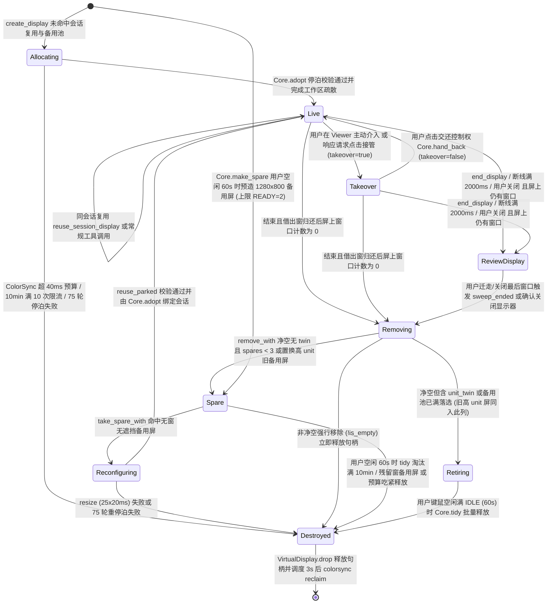

# SM-01. Agent Display 生命周期与备用池状态机

Agent Display 的生命周期跨越底层虚拟显示硬件封装 (`apps/macos/src/mac/display.rs`) 与领域模型 (`crates/model/src/model.rs`、`apps/macos/src/core.rs`)，受 `ADR 0002`、`ADR 0004` 与 `ADR 0016` 约束。领域结构 `Display<H>` 以布尔字段 `takeover: bool` 和可选结束原因 `ended: Option<EndReason>` 表达运行阶段，不另设 `Lifecycle` 枚举。核心不变量有三条：第一，未通过 `is_tucked` 停泊位置校验的屏幕绝不调用 `Core::adopt` 建表；第二，`takeover == true` 只能由用户点击交还控制权退回 `false`（或结束显示器），Agent 无接口打断接管；第三，显示器结束时立即归还用户借出窗口 (`Origin::HandedOver`)，但只要屏上仍有窗口，显示器就留在待查看状态 (`Review Display`)，净空移除后也优先转入备用池 (`SPARES = 3`) 或 `retiring` 队列等待用户键鼠空闲再释放。

---

## 状态迁移图

---

## 状态定义与不变量明细表

| 状态 ID | 内存承载结构与位置 | 核心不变量与准入条件 | Agent 调用响应规则 | 用户侧 UI 表现 | 验证证据 |
| :--- | :--- | :--- | :--- | :--- | :--- |
| `Allocating` | `display::create_parked` 局部变量 (`apps/macos/src/mac/display.rs:371-401`) | 尚未进入 `Core.displays`；在 `agent-screen-displays` 串行线程内执行最多 `3` 次 `unit_twin` 规避并运行 `0..75` x `20ms` (`1.5s`) `park_owned` 对角停泊 | `create_display` 异步等待 | 不展示 Peek 卡片，不阻塞主线程渲染 | 已验证：`apps/macos/src/mac/display.rs:171,371,442` `for _ in 0..3u32 {` / `pub async fn create_parked(` / `for attempt in 0..75 {` |
| `Reconfiguring` | `display::reuse_parked` 局部变量 (`apps/macos/src/mac/display.rs:405-426`) | 已从 `Core.spares` 取出，按需在 `agent-screen-displays` 线程执行 `VirtualDisplay::resize`（`settle_mode` `25 * 20ms`）与 `park_owned` 复核 | `create_display` 短暂等待；若返回 `None` 自动回退 `Allocating` (`agent.rs:2800-2802`) | 无重配置闪烁（同尺寸且已停泊时） | 已验证：`apps/macos/src/mac/display.rs:317,405` `for _ in 0..25 {` / `pub async fn reuse_parked(` |
| `Live` | `Core.displays.list` 中 `ended.is_none() && !takeover` (`crates/model/src/model.rs:286, 301, 350-352`) | 计入该 `sessionKey` 的 `MAX_LIVE = 4` 活跃配额 (`session.rs:21`)；`Forwarder` 允许后台输入；归属记录持久化于 `claims.json` | 全部 MCP 工具正常放行 | 菜单栏图标点亮，Peek 显示实时画面，可打开 Viewer 观察 | 已验证：`crates/model/src/model.rs:350-352` `pub fn is_live(&self) -> bool { self.ended.is_none() }`；`crates/model/src/session.rs:21` `pub const MAX_LIVE: usize = 4;` |
| `Takeover` | `Core.displays.list` 中 `ended.is_none() && takeover == true` (`crates/model/src/model.rs:301`) | `Core::stop_agent_input(id, true)` 暂停后台 `Forwarder` 并释放拖拽 `Hold` (`core.rs:1119-1133`)，`InputQueue::takeover(id, true)` 中止真实输入排队；仍占活跃槽位 | 输入类与动作类工具经 `input_display` 拦截返回错误码 `takeover` (`agent.rs:7272-7275`)；`wait_for_control`、`end_display`、`list_windows` 可调用 | Viewer 顶栏显示接管状态与交还按钮，本地键鼠与输入法直通目标窗口 | 已验证：`apps/macos/src/control/agent.rs:7272-7275` `if core.read_with(cx, \|c, _\| c.displays.get(id).is_some_and(\|d\| d.takeover)) { return Err(ControlError::takeover(...)); }` |
| `ReviewDisplay` | `Core.displays.list` 中 `ended.is_some()` 且屏上窗口数 `> 0` (`crates/model/src/model.rs:286, 962-986`, `core.rs:1274-1308`) | 已从 `Sessions` 活跃表摘除（不占 `4` 台上限），请求已由 `end_requests` 清结，`Origin::HandedOver` 窗口已在后台启动迁回 `Home`；因仍有残留窗口而保留供审阅 | `end_display` 幂等返回 `{"ended": true}`，`wait_for_control` 返回 `{"control": "none", ...}`，其余工具返回错误码 `ended` | Peek 显示待查看标签（非用户关闭时发审阅通知），用户可在 Viewer 查看、拖出窗口或关闭 | 已验证：`apps/macos/src/control/agent.rs:2707-2708` `if d.is_ended() && !matches!(method, "endDisplay" \| "waitForControl") { return Err(ended_error(...)); }` |
| `Removing` | `Core::remove_with` 执行瞬态 (`apps/macos/src/core.rs:1200-1270`, `model.rs:792-807`) | 屏上窗口已归零或用户已确认关闭；从 `Displays.list` 移除并将 `id` 写入 `Displays.retired`（用户关闭同步写入 `closed_by_user`） | 此后**所有**携带该 `display_id` 的工具（含 `end_display`）均命中 `retired` 返回错误码 `ended` (`agent.rs:7252-7254`) | Peek 卡片收起，系统通知清空 (`shell.rs:946-949`) | 已验证：`crates/model/src/model.rs:798-803` `if display.is_ended() { self.retired.insert(id); }`；`agent.rs:7252-7253` `None if c.displays.retired.contains(&id) => Err(ended_error(...))` |
| `Spare` | `Core.spares: Vec<Spare>` (`apps/macos/src/core.rs:24-25, 64-69, 120`) | 底层 `CGVirtualDisplay` 保持在线停泊，无会话绑定、无 `SCStream`；容量上限 `SPARES = 3`，单屏老化阈值 `SPARE_LIFE = 600s` (`10 min`) | 对 Agent 不可见，等待下次 `create_display` 领用（复用时 `Displays::add` 清除旧 `retired` 记录，`model.rs:753-754`） | 界面不可见 | 已验证：`apps/macos/src/core.rs:24-25,64` `const SPARES: usize = 3; const SPARE_LIFE: Duration = Duration::from_secs(10 * 60);` / `pub struct Spare` |
| `Retiring` | `Core.retiring: Vec<VirtualDisplay>` (`apps/macos/src/core.rs:122, 423-426, 1239, 1251`) | 已退出 `Displays` 且不入 `spares` 的净空虚拟屏句柄暂存队列，等待用户键鼠空闲满 `IDLE = 60s` 后再释放 | 已记入 `retired`，调用返回 `ended` | 界面不可见，避免在用户操作时触发全机停绘 | 已验证：`apps/macos/src/core.rs:122,423-424` `retiring: Vec<VirtualDisplay>,` / `for display in std::mem::take(&mut self.retiring) { crate::lifecycle::note("released", display.id, "ended, released while idle");` |
| `Destroyed` | `VirtualDisplay::drop` (`apps/macos/src/mac/display.rs:45-64`) | 释放 `CGVirtualDisplay` 对象句柄触发 `WindowServer` 移除屏幕，归还 `Serial` 租约 (`KEPT_SLOTS = 16`)，并由 `reclaim_soon` 在 `3s` 后运行 `colorsync reclaim` | 若 ID 曾入 `retired` 返回 `ended`，若从未 adopt 过返回 `not_found` | 触发一次 macOS 显示拓扑移除 | 已验证：`apps/macos/src/mac/display.rs:45-53,95` `impl Drop for VirtualDisplay` / `const KEPT_SLOTS: usize = 16;`；`core.rs:149` `const RECLAIM_DELAY: Duration = Duration::from_secs(3);` |

---

## 关键状态迁移守卫与副作用对照表

| 迁移边 | 触发函数与位置 | 守卫条件 | 原子副作用 | 验证证据 |
| :--- | :--- | :--- | :--- | :--- |
| `[*] -> Allocating` | `create_display` (`apps/macos/src/control/agent.rs:2747-2827`) | 录屏与辅助功能双权限就绪、`Sessions::may_add` `< 4`、`budget_allows` `<= 40.0 ms`、`may_make` `< 10 / 10min` | 记录一次 `count_made()`，租赁 `Serial` 并派发 `display::create_parked` | 已验证：`apps/macos/src/control/agent.rs:2803-2819` `c.budget_allows() ... c.may_make() ... c.count_made(); ... .spawn(crate::mac::display::create_parked(` |
| `Allocating -> Live` | `Core::adopt` (`apps/macos/src/core.rs:572-604`), `agent.rs:2833-2959` | `display::is_tucked(id, &virtual_ids)` 为真、无 `unit_twin`、会话连接未断且未超 `4` 台上限 | 登记 `Displays::add`、写 `identities.json`、等 AeroSpace 移出外来窗并疏散残留窗 (`#204`) | 已验证：`apps/macos/src/core.rs:583-595` `if !display::is_tucked(id, &virtual_ids) { ... return None; } ... colorsync::remember(serial, slot, id); self.displays.add(` |
| `Live -> Takeover` | `Core::take_over` (`apps/macos/src/core.rs:1049-1054`), `Displays::begin_takeover` | `display.is_live() && !display.takeover` | 产出 `Effect::Takeover { on: true }`：调 `input_queue.takeover`、`viewer_input::takeover_changed`、`forwarder.stop_agent(true)` 与 `release_hold` | 已验证：`apps/macos/src/core.rs:1049-1053,1097-1100` `let effects = self.displays.begin_takeover(id); self.apply(effects, cx);` / `Effect::Takeover { display, on } =>` |
| `Takeover -> Live` | `Core::hand_back` (`apps/macos/src/core.rs:1059-1064`), `Displays::end_takeover` | `display.takeover == true` 且由**用户侧**交互触发 | 产出 `Effect::Takeover { on: false }`：结束 Viewer 组合输入、恢复 `Forwarder`、唤醒挂起的 `wait_for_control` | 已验证：`apps/macos/src/core.rs:1059-1063` `pub fn hand_back(&mut self, id: DisplayId, cx: &mut Context<Self>) -> bool { let effects = self.displays.end_takeover(id); self.apply(effects, cx);` |
| `Live/Takeover -> ReviewDisplay/Removing` | `Core::end` / `Core::finished` (`apps/macos/src/core.rs:952-1044`) | `EndReason` 为 `Finished`、`Disconnected` (`2000ms` 宽限期满) 或 `ClosedByUser` | 停输入与录屏、结清请求、按需移交已启动进程、后台归还借出窗、`600ms` 后跑 `sweep_ended` | 已验证：`apps/macos/src/core.rs:953-954,989-993` `if self.displays.end(id, reason) { self.finished(&[id], cx); }` / `stop_recording(id, cx); self.return_handovers(id, cx); ... schedule_sweep(cx);` |
| `Removing -> Spare / Retiring` | `Core::remove_with` (`apps/macos/src/core.rs:1207-1252`), `spares::retire_instead` (`crates/model/src/spares.rs:73-90`) | `is_empty` 为真；若同时 `untwinned` 且池未满或 `unit` 小于池内最高 `unit` 无窗屏则入 `spares`，否则入 `retiring` | 入池或压入 `retiring`（被置换的高 `unit` 备用屏同步压入 `retiring`） | 已验证：`apps/macos/src/core.rs:1209,1230,1251` `if empty_untwinned && self.spares.len() < SPARES` / `retire_instead(&infos, SPARES, ...)` / `self.retiring.push(display.handle);` |
| `[*] -> Spare` | `Core::tidy` -> `Core::make_spare` (`apps/macos/src/core.rs:413, 482-535`) | `ime::user_idle() >= 60s`、`launching.is_empty()`、`warm` (`< 60min`)、`spares.len() < 2`、`!warming` 且 `budget_allows().is_ok()` | 在 `agent-screen-displays` 线程静默预造 `1280x800` 备用屏推入 `Core.spares`（不消耗 `MadeLimit`） | 已验证：`apps/macos/src/core.rs:482-488` `if warm && core.spares.len() < READY && !core.warming && core.budget_allows().is_ok() { core.make_spare(cx); }` |
