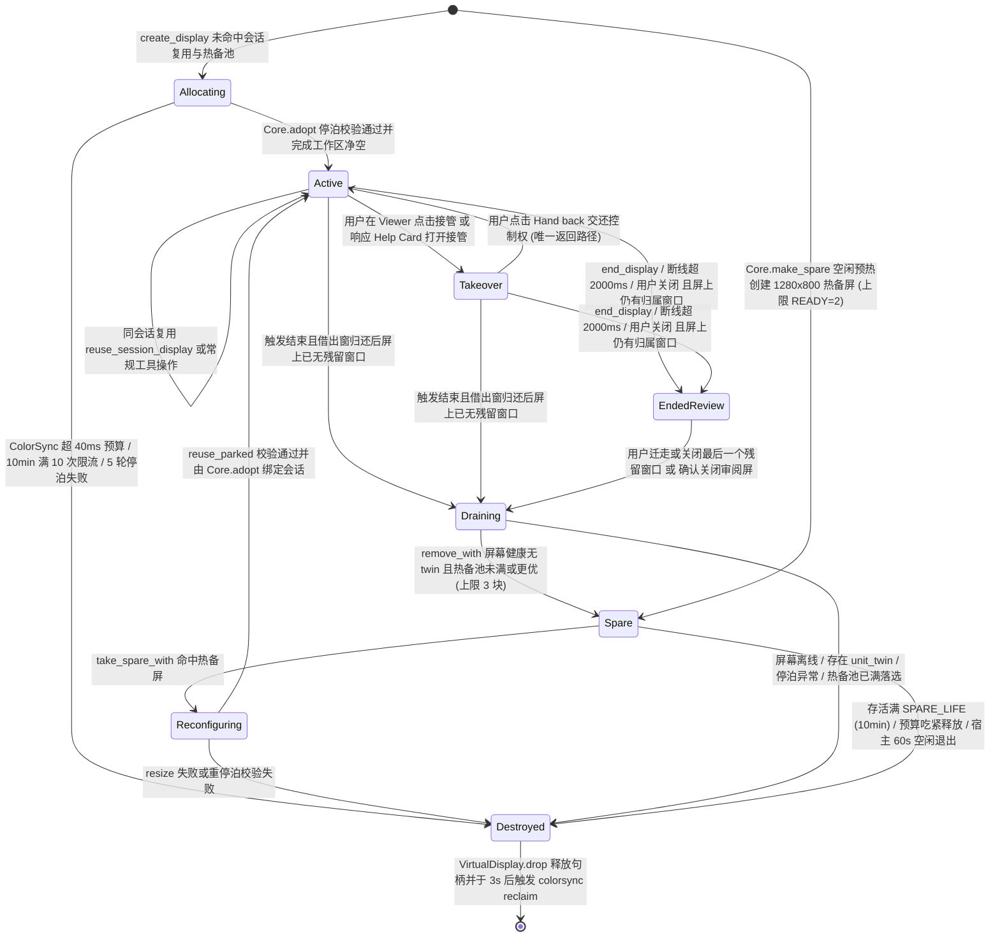

# SM-01. Agent Display 生命周期与热备池状态机

Agent Display 的完整生命周期横跨底层 `CGVirtualDisplay` 硬件模拟层 (`apps/macos/src/mac/display.rs`) 与纯领域模型层 (`crates/model/src/model.rs` + `apps/macos/src/core.rs`)，受 `ADR 0002`、`ADR 0004` 与 `ADR 0016` 严格约束。其核心不变量有三条：第一，未通过 `parked_safely` 对角停泊验证的屏幕绝不进入 `Active`；第二，`Takeover` 状态只能由用户本人点击“交还控制权”退回 `Active`（或关闭进入 `Ended`），Agent 没有任何 API 能强制打断接管；第三，屏幕进入 `Ended` 时先无条件归还用户借出窗口 (`HandedOver`)，但只要还留有 Agent 自己启动的应用窗口，屏幕就停留在 `Ended` 审阅态供用户查看，直至窗口清空后才回收到 `Spare` 热备池或彻底销毁。

---

## 状态迁移图

---

## 状态定义与不变量明细表

| 状态 ID | 内存承载结构与位置 | 核心不变量与准入条件 | Agent 调用响应规则 | 用户侧 UI 表现 | 验证来源 |
| :--- | :--- | :--- | :--- | :--- | :--- |
| `Allocating` | `display::create_parked` 局部变量 (`apps/macos/src/mac/display.rs:371-402`) | 尚未写入 `Core.displays`；在 `display-config` 串行线程构造 `CGVirtualDisplay`、规避 `unit_twin` 并跑最多 `5 * 50ms` `park_owned` 对角停泊 | `create_display` 调用阻塞等待（约 `300~500ms`） | 不显示 Peek 卡片，不阻塞主线程渲染 | [已验证: apps/macos/src/mac/display.rs:167-200, apps/macos/src/mac/display.rs:371-464] |
| `Reconfiguring` | `display::reuse_parked` 局部变量 (`apps/macos/src/mac/display.rs:405-426`) | 已从 `Core.spares` 弹出，按需在 `display-config` 线程执行 `VirtualDisplay::resize` (`20 * 10ms`) 与停泊复核 | `create_display` 调用短暂等待（同尺寸热备无需切模式，毫秒级完成） | 无闪烁切换 | [已验证: apps/macos/src/core.rs:355-389, apps/macos/src/mac/display.rs:405-426] |
| `Active` | `Core.displays` 内 `Lifecycle::Active` (`crates/model/src/model.rs:235-250`) | 计入该 `sessionKey` 的 `MAX_LIVE = 4` 配额 (`session.rs:21`)；`Forwarder::agent_stopped() == false`；窗口归属写入 `claims.json` | 全部 MCP 工具正常放行 | 菜单栏图标点亮，Peek 展示实时缩略图，可点开 Viewer 观察 | [已验证: crates/model/src/model.rs:235-250, crates/model/src/session.rs:21, apps/macos/src/core.rs:572-625] |
| `Takeover` | `Core.displays` 内 `Lifecycle::Takeover` (`crates/model/src/model.rs:235-250`) | `Core::stop_agent_input(id, true)` 冻结后台 `Forwarder`，`InputQueue::takeover` 清退该屏真实输入请求；仍占会话活跃槽位 | 除 `wait_for_control`、`end_display` 与只读 `list_windows` 外，一切动作工具均立即返回 `user_takeover` (`agent.rs:2703-2711`) | Viewer 自动打开聚焦，顶栏显示“你正在控制 / Hand back”横幅，本地键盘与 IME 直通远程窗口 | [已验证: apps/macos/src/core.rs:1049-1057, apps/macos/src/control/agent.rs:2703-2711, ADR 0004] |
| `EndedReview` | `Core.displays` 内 `Lifecycle::Ended { reason }` 且屏上窗口数 `> 0` (`apps/macos/src/core.rs:952-1047, 1274-1309`) | 已从 `Sessions` 活跃表移除（不再占 `4` 屏上限），`Access` 预授权已清空，所有 `Origin::HandedOver` 借出窗已在后台启动归还 `Home`；因仍有 Agent 启动窗口而保留屏幕 | `end_display` 幂等返回成功，`wait_for_control` 返回 `"ended"`，其余全部工具报 `display_ended` | Peek 卡片标记“已结束”，用户可点开 Viewer 审阅成果、拖出需要的窗口或点关闭销毁 | [已验证: apps/macos/src/core.rs:952-1047, apps/macos/src/core.rs:1274-1309, ADR 0004] |
| `Draining` | `sweep_ended` -> `Core::remove_with` 瞬态 (`apps/macos/src/core.rs:1200-1272`) | 屏上归属窗口已归零或用户已确认关闭；从 `Model`、`claims.json`、`repark`、`returns` 与 `Streams` 中彻底注销该 `displayId` | 此刻起任何携带该 `displayId` 的请求均返回 `not_found` | Peek 卡片收起消失 | [已验证: apps/macos/src/core.rs:1200-1272, apps/macos/src/control/agent.rs:2695] |
| `Spare` | `Core.spares: Vec<Spare>` (`apps/macos/src/core.rs:24-25, 64-69`) | 底层 `CGVirtualDisplay` 保持在线停泊在屏外，零会话绑定、零 `SCStream` 捕获；全机最多保留 `SPARES = 3` 块，每块最长存活 `SPARE_LIFE = 600s` (`10 min`) | 对 Agent 完全透明不可见，等待下次 `create_display` 秒级领用 | 用户界面完全不可见（菜单栏显示无活跃屏） | [已验证: apps/macos/src/core.rs:24-25, crates/model/src/spares.rs:53-155] |
| `Destroyed` | `VirtualDisplay::drop` (`apps/macos/src/mac/display.rs:45-64`) | 释放 `Retained<AnyObject>` 句柄通知 `WindowServer` 销毁虚拟屏，归还 `Serial` 槽位租约 (`KEPT_SLOTS = 16`)，写 `displays.log` `released` 行，调度 `RECLAIM_DELAY = 3s` 后运行 `colorsync reclaim` | 句柄永久作废 | 触发一次 macOS 显示拓扑清理 | [已验证: apps/macos/src/mac/display.rs:45-112, apps/macos/src/core.rs:149, ~/Library/Logs/Agent Screen/displays-e2e.log:1] |

---

## 关键状态迁移守卫与副作用对照表

| 迁移边 | 触发函数与位置 | 守卫条件 | 原子副作用 | 验证来源 |
| :--- | :--- | :--- | :--- | :--- |
| `[*] -> Allocating` | `create_display` (`apps/macos/src/control/agent.rs:2795-2822`) | 双权限通过、`Sessions::may_add` `< 4`、`budget_allows` `<= 40ms`、`may_make` `< 10/10min` | 扣减一次 `MadeLimit` 配额，分配 `Serial` 与 `"Agent Screen N"` 名称 | [已验证: apps/macos/src/control/agent.rs:2795-2822] |
| `Allocating -> Active` | `Core::adopt` (`apps/macos/src/core.rs:572-625`) | `parked_safely == true` 且连接未在造屏中途关闭 | 登记 `Model` 与 `claims.json`，等 AeroSpace 净空（最多 `3s`），疏散外来残留窗口 (`#204`) | [已验证: apps/macos/src/core.rs:572-625, apps/macos/src/control/agent.rs:2937-2972] |
| `Active -> Takeover` | `Core::take_over` (`apps/macos/src/core.rs:1049-1057`) | 屏幕处于 `Active` 且用户点击接管按钮或在 Viewer 主动介入 | 停止后台 `Forwarder`、清空该屏真实输入排队、撤回挂起 Help 通知、打开 Viewer | [已验证: apps/macos/src/core.rs:1049-1057] |
| `Takeover -> Active` | `Core::hand_back` (`apps/macos/src/core.rs:1059-1067`) | 屏幕处于 `Takeover` 且**用户本人**触发交还 | 松开 Viewer 残留按键 (`release_after_takeover`)、恢复 `Forwarder` 许可、唤醒 `wait_for_control` | [已验证: apps/macos/src/core.rs:1059-1067, apps/macos/src/mac/viewer_input.rs:296-314] |
| `Active/Takeover -> Ended*` | `Core::end` (`apps/macos/src/core.rs:952-1047`) | `EndReason` 为 `Finished`、`Disconnected` (`2000ms` 宽限期满) 或 `ClosedByUser` | 停流录制、取消全部挂起 `Request` 与 `InputQueue`、后台启动 `return_handovers` 归还借出窗 | [已验证: apps/macos/src/core.rs:952-1047, apps/macos/src/core.rs:1135-1198] |
| `Draining -> Spare` | `Core::remove_with` (`apps/macos/src/core.rs:1200-1272`) | `is_online && unit_twin.is_none() && parked_safely` 且 `spares::retire_instead` 入选 | 存入 `Core.spares`（若挤出次优旧热备则立即 `Drop` 旧热备） | [已验证: apps/macos/src/core.rs:1228-1266, crates/model/src/spares.rs:73-105] |
| `[*] -> Spare` | `Core::make_spare` (`apps/macos/src/core.rs:477-537`) | 距上次活跃 `< WARM (60min)`、当前 0 活跃屏、热备 `< READY (2)` 且预算允许 | `15s` `tidy` 周期在后台静默补齐预热屏 | [已验证: apps/macos/src/core.rs:37-38, apps/macos/src/core.rs:477-537] |
