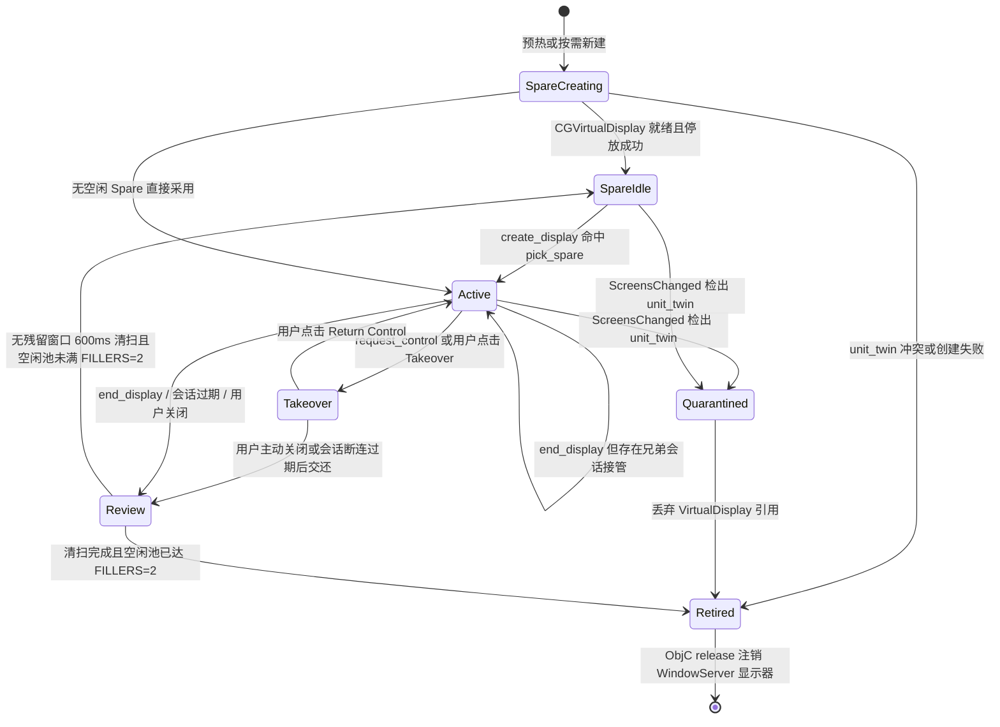

# 状态机 01：显示器生命周期

虚拟显示器在空闲备用池、活跃代理会话、用户接管、收尾检视与故障弃用五个核心阶段之间流转，受 ADR 0004 与 ADR 0016 约束。

## 状态图

## 状态与转换明细表

| 节点 | 我方代码 | macOS 组件与内部行为 | 限制与故障模式 | 关联问题 | 验证状态 |
| --- | --- | --- | --- | --- | --- |
| 1. `SpareCreating -> SpareIdle` | `apps/macos/src/mac/display.rs:42-215`、`apps/macos/src/mac/cg.rs:150-235`、`crates/model/src/spares.rs:19-83` | 实例化 `CGVirtualDisplay` 后调用 `CGConfigureDisplayOrigin` 与 `CGCompleteDisplayConfiguration` 停放到对角远端坐标，订阅 `1 fps` `warm` 捕获流后转入 `SpareIdle`。 | 受 `budget::within_budget` `40 ms` ColorSync 预算门控限制；新建或空闲期间 `WindowServer` 偶发将分辨率回退到 `800x500`，需 `hold_modes` 重刷 `applySettings`。 | `800x500`、`#204` | `[已验证]` `apps/macos/src/core.rs:285-412, 510-618` |
| 2. `SpareIdle -> Active` | `apps/macos/src/core.rs:285-365`、`crates/model/src/spares.rs:19-44` | `pick_spare` 按最小 `CGDisplayUnitNumber` 取出空闲虚拟屏，应用调用方请求的宽高与缩放比，绑定会话句柄并进入 `Active`。 | 若目标宽高变化，`SCStream` 需按 `needs_fresh_stream` 重建才能在静止画面下推送新尺寸首帧。 | `unit twin`、`#190` | `[已验证]` `crates/model/src/spares.rs:19-44`、`apps/macos/src/ui/stream.rs:240-345` |
| 3. `Active <-> Takeover` | `apps/macos/src/core.rs:380-440`、`apps/macos/src/control/agent.rs:357-410` | 进入 `Takeover` 时冻结代理侧一切输入与窗口变更调用，打开 `Viewer` 订阅 `60 fps` 全分辨率流；仅当用户主动点击归还控制权时才允许从 `Takeover` 退回 `Active`。 | 代理侧不能通过任何 MCP 调用自行退出 `Takeover`，防止在用户输入密码或验证码中途抢夺焦点。 | ADR 0004 | `[已验证]` `docs/adr/0004-takeover-and-review.md` |
| 4. `Active -> Active` 兄弟会话移交 | `apps/macos/src/core.rs:414-462`、`docs/adr/0016-sibling-display-handoff.md` | 当前主控会话结束时，若同屏仍有其他活跃会话持有窗口记录，显示器跳过 `Review` 直接切换主控会话继续保持 `Active`。 | 若接管的兄弟会话因上游管道未关而假活，显示器会停留在假活会话名下无法自动清扫。 | `#189`、ADR 0016 | `[已验证]` `apps/macos/src/core.rs:414-462` |
| 5. `Active -> Review` | `apps/macos/src/core.rs:445-508` | 记录 `EndReason` 为 `Finished`、`Disconnected` 或 `ClosedByUser`。若屏上无归属窗口，启动 `600 ms` `sweep_ended` 定时器；若有残留窗口，保持流预览等待用户迁回或关闭。 | 残留隐藏窗口或辅助子窗若未被过滤，会阻塞 `600 ms` 自动清扫。 | `#205`、ADR 0004 | `[已验证]` `apps/macos/src/core.rs:445-508` |
| 6. `Any -> Quarantined -> Retired` | `apps/macos/src/mac/cg.rs:112-148`、`apps/macos/src/core.rs:510-585` | `cg::unit_twin` 发现虚拟屏与物理屏或其他虚拟屏共享 `unitNumber` 时立即隔离，禁止截图并丢弃 `VirtualDisplay` 引用触发 ObjC `release`；`Review` 清扫后若空闲池已满 `FILLERS = 2` 同样转入 `Retired`。 | ObjC `release` 销毁 `CGVirtualDisplay` 会触发 `WindowServer` 全局屏幕重排与 ColorSync 配置注销。 | `unit twin`、`#204` | `[已验证]` `apps/macos/src/mac/cg.rs:112-148`、`crates/model/src/spares.rs:45-83` |
