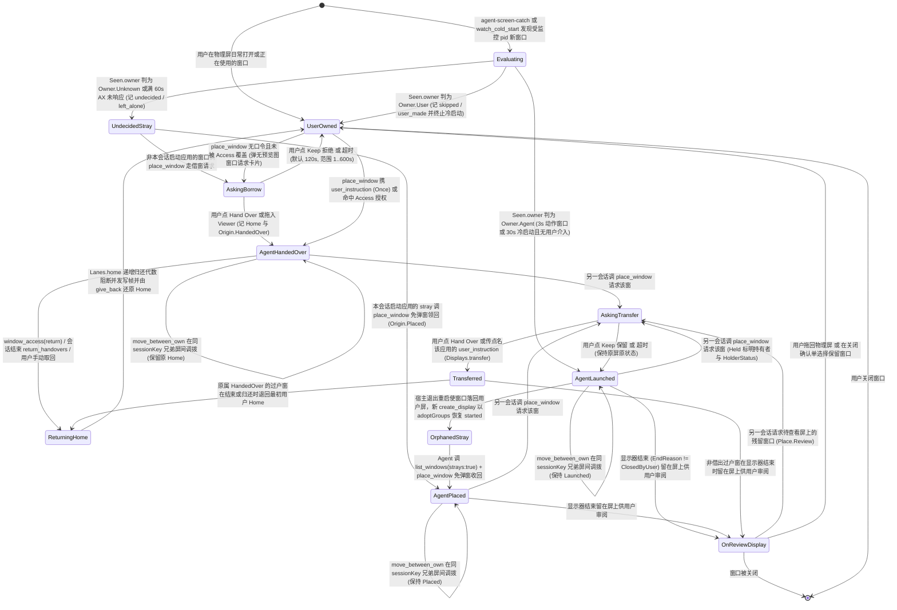

# SM-02. 窗口归属、借还与跨会话移交状态机

窗口归属状态机划定多会话桌面隔离边界：哪些窗口属于用户物理屏不可擅动，哪些窗口由 Agent 启动留作审阅，哪些窗口由用户借出（`Handover`）在用毕或结束时自动归还原位 `Home`，以及哪些窗口正由另一会话或待查看显示器持有需经用户许可才能跨会话过户 (`ADR 0004`, `ADR 0007`, `ADR 0016`, `ADR 0017`)。领域规则位于 `crates/model/src/{model,new_window,held,returns,access,placement}.rs`（`Origin` 枚举仅有四个变体：`Launched`、`Placed`、`HandedOver`、`Found`），平台侧由 `apps/macos/src/mac/{catch,windows,claims}.rs` 维护 `claims.json` 与每窗口 `Lanes` 归还世代屏障。

---

## 状态迁移图

---

## 状态定义与归属规则明细表

| 状态 ID | 模型表示与持久化 | 归属与坐标规则 | 显示器结束 (`Core::end`) 时的处置 | 关联边界与缺陷 | 验证证据 |
| :--- | :--- | :--- | :--- | :--- | :--- |
| `UserOwned` | 不在任何 `Display.records` 中（若曾从显示器取回则记入 `Display.returned` 与 `Access.excluded`），`claims.json` 无归属 | 位于用户物理显示器；对用户刚取回窗口的应用，后台经 `Returns::take_back` (`ReturnTicket`) 注册 `Catch::returning` 把该应用无 Agent 因果的自开子窗退回用户侧 | 完全不受显示器结束影响 | 新建或复用的虚拟屏若扫到外来窗口，立即由 `evacuate_window_to_user` 迁回主屏 (`#204`) | 已验证：`crates/model/src/model.rs:294-297` `pub returned: std::collections::BTreeSet<WindowId>, ... pub user_made: std::collections::BTreeSet<WindowId>,`；`crates/model/src/returns.rs:11,25` `pub struct ReturnTicket` / `pub fn take_back`；`apps/macos/src/mac/catch.rs:449` `pub async fn returning` |
| `Evaluating` | `Catch` 回调 (`apps/macos/src/mac/catch.rs:563-690`) 与 `watch_cold_start` (`agent.rs:6500-6690`) | 结合 `ACTION_WINDOW = 3s`、`COLD_START = 30s`、`user_acted_recently(3s)` 与 `only_here` 调用 `Seen::owner()` 输出 `Owner::Agent \| User \| Unknown` | 显示器结束时移除 `kept_catches`（`Finished` 时若同会话有活跃屏则随 `hand_on_apps` 转挂，`core.rs:978-988`） | 只要 `seen.user == true`，立即调用 `end_cold_start` 终止 `30s` 冷启动窗口期 | 已验证：`crates/model/src/new_window.rs:43-49` `pub enum Owner { Agent, User, ... Unknown, }`；`crates/model/src/new_window.rs:69-71` `pub fn ends_cold_start(self) -> bool { self.user }` |
| `UndecidedStray` | `Catch::undecided` (`apps/macos/src/mac/catch.rs:417, 527`) 与 `Core.left_alone` (`apps/macos/src/core.rs:118`) | 因果存疑或满 `RESOLVE_BY = 60s` AX 仍未响应 (`Step::GiveUp`) 的窗口；留在原处不搬动 | 随显示器移除清理 `Core.told` 与 `Core.left_alone` 记录 (`core.rs:1266-1267`) | 下次截图由 `add_strayed` 向 Agent 报告一次 `{windowId, app, placeable}` (`agent.rs:3176-3180`) | 已验证：`apps/macos/src/control/agent.rs:3139-3144` `.flat_map(\|(_, k)\| k.undecided()).chain(c.left_alone.iter()...)`；`apps/macos/src/control/agent.rs:3176-3180` `out.push(json!({ "windowId": window, "app": w.app, "placeable": d.is_stray(w.target, false), }));` |
| `AgentLaunched` | `Record { origin: Origin::Launched, .. }` + `Display.started` + `claims.json` (`crates/model/src/model.rs:159, 229-234, 288-291`) | 由 `launch_app` 或受控动作产生的新窗口，经 `settle` 迁入虚拟屏并绑定 AeroSpace 工作区 | 若 `reason == EndReason::Finished` 且同会话仍有活跃屏，进程 `pid` 移交最新活跃屏，但窗口本身留在原屏转入 `OnReviewDisplay` 供审阅 (`model.rs:988-1018`) | 用户主动关闭显示器时默认建议关闭 (`Fate::Close`)，但弹窗征求确认 (`dismissal.rs:40-99`) | 已验证：`crates/model/src/model.rs:156-166` `pub enum Origin { ... Launched, ... Placed, ... HandedOver, ... Found, }`；`apps/macos/src/control/agent.rs:6026` `claim(core, id, target, Origin::Launched, cx);` |
| `AgentPlaced` | `Record { origin: Origin::Placed, .. }` + `claims.json` (`crates/model/src/model.rs:161`, `agent.rs:1320`) | 本会话启动应用的 `stray` 窗口（含重启后由 `adopt_orphans` 恢复进 `Display.started` 的孤儿进程窗口）经 `place_window` 收回虚拟屏（代码中无 `Origin::Adopted` 变体） | 留在屏上转入 `OnReviewDisplay` 供用户审阅 | 关闭显示器确认单显示移进来的未指定去向提示 (`dismissal.rs:82-85`) | 已验证：`apps/macos/src/control/agent.rs:1320,3024` `claim(&core, id, window.target, Origin::Placed, cx);` / `d.started.insert(pid);` |
| `AskingBorrow` | `Ask::Window { window, held: None }` (`crates/model/src/request.rs`, `agent.rs:3723`) | 审批期间窗口留在用户物理屏不动，弹出无截图预览的窗口请求 Help Card | 请求屏结束时 `end_requests` 唤醒等待方返回 `failed` 并撤回卡片与通知 | 默认超时 `120.0s`，钳制范围 `1.0..=600.0s` (`agent.rs:3728`) | 已验证：`apps/macos/src/control/agent.rs:3723,3728` `c.displays.request_window(id, named, held.clone())` / `let seconds = timeout.unwrap_or(120.0).clamp(1.0, 600.0);` |
| `AgentHandedOver` | `Record { origin: Origin::HandedOver, home: Some(Home { frame, workspace }), .. }` (`crates/model/src/model.rs:163, 204-209, 229-234`) | 用户借给本会话的窗口；迁入前由 `dismissal::home_of` 保存全局 `frame: Rect` 与可选 AeroSpace `workspace: Option<String>` | `EndReason != ClosedByUser` 时由 `Core::return_handovers` **立即自动迁回 `Home`** (`ADR 0004`, `#161`)；用户关闭显示器时关闭单锁定为 `Fate::GiveBack` (`locked = true`) | 若被用户手动取回则记入 `Access.excluded`，不再被通配授权静默拉入 | 已验证：`crates/model/src/model.rs:204-209` `pub struct Home { ... pub frame: Rect, ... pub workspace: Option<String>, }`；`apps/macos/src/dismissal.rs:59` `locked: origin == Some(Origin::HandedOver),` |
| `AskingTransfer` | `Ask::Window { window, held: Some(Held) }` (`crates/model/src/held.rs:19-32`, `agent.rs:3723`) | 窗口位于另一会话活跃屏 (`Place::Display`)、待查看屏 (`Place::Review`) 或另一会话名下用户屏 (`Place::UserScreen`)；卡片展示持有者标签与 `HolderStatus` | 用户点同意瞬间由 `after_hand_over` 复核实时位置：若期间已换手第三会话则重新弹窗询问（最多 3 轮） | 解决 `#189`：暴露占窗会话的空闲/在途/断线状态，支持用户一键裁决过户 | 已验证：`crates/model/src/held.rs:19-32` `pub struct Held { ... pub display: DisplayId, ... pub label: String, ... pub agent: String, ... pub place: Place, ... pub status: Option<crate::session::HolderStatus>, }`；`crates/model/src/held.rs:556` `pub fn decide_after_hand_over` |
| `Transferred` | `Displays::transfer` 迁移后的 `Record` + 原屏 `Display.given: BTreeMap<WindowId, Given>` (`crates/model/src/model.rs:317`, `held.rs:58-62`) | 窗口迁入新会话屏并停止原屏上的拖拽与排队真实输入；若该窗最初来自用户借出，则保持 `Origin::HandedOver` 与最初的用户 `Home` | 若保持 `Origin::HandedOver`，结束时直接归还给**最初用户的物理屏 `Home`**，绝不退回中间过户会话屏 (`ADR 0017`) | 原会话下次调用收到 `"given"` 字段通知；若物理移入失败，`undo_transfer` 完整回滚 | 已验证：`apps/macos/src/control/agent.rs:3207,3926-3934` `result["given"] = json!(...)` / `c.displays.transfer(from, to, target, app)` / `c.displays.undo_transfer(moved);` |
| `ReturningHome` | `GivenBack` (`crates/model/src/model.rs:214-220`) + `Lanes::home` (`apps/macos/src/mac/windows.rs:579-635`) | 进入每窗口互斥 `Lane`，递增 `state.count[window]` 归还计数屏障使一切并发在途 Agent 写帧失效，随后调用 `dismissal::give_back` 恢复原 `frame` 与 `workspace` | 若归还失败未能离开虚拟屏，调用 `give_back_failed` 恢复 `HandedOver` 记录留待后续关闭流程处理 (`core.rs:1038`) | 根治归还途中被慢速在途 `place_window` 拽回虚拟屏的竞态 | 已验证：`apps/macos/src/mac/windows.rs:579-586` `pub fn home(&self, window: u32, home: impl FnOnce() -> bool) -> bool { self.in_lane(window, \|\| { ... *state.count.entry(window).or_default() += 1;` |
| `OrphanedStray` | `Control::orphans` (`crates/mcp/src/control.rs:180-202`) -> `adopt_orphans` (`apps/macos/src/control/agent.rs:3009-3027`) | 宿主退出后窗口被 macOS 移回用户屏，`mcp` 缓存曾启动的 `(display, pids)` 并在下次 `create_display` 通过 `adoptGroups` 传回新宿主，写入对应显示器的 `Display.started` | 已重入 `Display.started`，允许会话通过 `list_windows(strays: true)` + `place_window` 免审批收回 | 若进程已退出或已被其它屏持有则 `adopt_orphans` 自动过滤跳过 (`agent.rs:3017-3018`) | 已验证：`apps/macos/src/control/agent.rs:3016-3025` `agent_screen_model::session::adoption(orphans, &live, id, ...)` / `d.started.insert(pid);` |
| `OnReviewDisplay` | `Display.ended.is_some()` 显示器上的残留窗口 (`apps/macos/src/core.rs:1274-1308`) | 停留在待查看显示器上供用户通过 Viewer 交互检查、拖回物理屏或关闭；不再接受 Agent 工具输入 | 所有残留窗口移走或关闭后，`sweep_ended` 调用 `Core::remove_with` 回收显示器 | 另一会话若请求该窗口，仍须走 `AskingTransfer` (`Place::Review`) 由用户批准 | 已验证：`apps/macos/src/core.rs:1299-1302` `if snap.counts.get(&id).copied().unwrap_or(0) == 0 && core.displays.get(id).is_some_and(\|d\| d.is_ended()) { core.remove_with(id, &snap, cx); }` |
