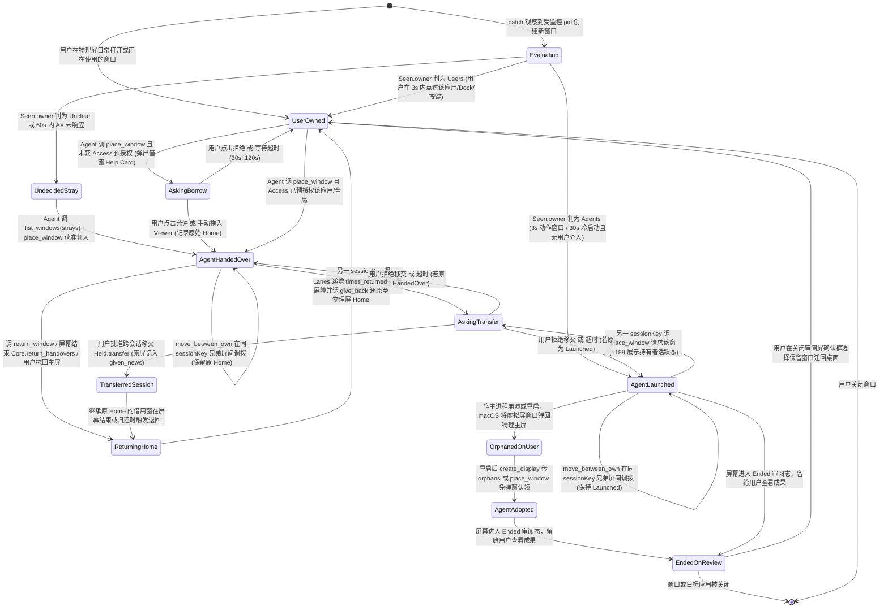

# SM-02. 窗口归属、借还与跨会话移交状态机

窗口归属状态机解决多智能体桌面隔离中最敏感的问题：**哪些窗口属于用户的私人桌面绝不可碰，哪些窗口由 Agent 启动可自由操作，哪些窗口是用户临时借给某个会话用完必须原样奉还，哪些窗口正被另一个 Agent 会话占用需要用户裁决过户** (`ADR 0004`, `ADR 0007`, `ADR 0016`, `ADR 0017`)。该状态机由纯模型层 `crates/model/src/{new_window,held,returns,placement}.rs` 与系统同步层 `apps/macos/src/mac/{catch,windows,claims}.rs` 共同驱动，在磁盘上通过 `claims.json` 持久化归属并在并发写帧时受每窗口 `Lanes` 归还世代锁保护。

---

## 状态迁移图

---

## 状态定义与归属规则明细表

| 状态 ID | 模型表示与持久化 | 归属与坐标规则 | 屏幕结束 (`Core::end`) 时的处置 | 关联边界与缺陷 | 验证来源 |
| :--- | :--- | :--- | :--- | :--- | :--- |
| `UserOwned` | 不在任何 `Display` 持有表中，`claims.json` 无记录 | 位于用户物理显示器（且非虚拟屏停泊坐标） | 完全不受 Agent 屏幕生灭影响 | 新建虚拟屏若在停泊处扫到此类外来残留窗，立即由 `evacuate_window_to_user` 疏散回主屏 (`#204`) | [已验证: crates/model/src/new_window.rs:43-67, apps/macos/src/control/agent.rs:2959-2972, Issue #204] |
| `Evaluating` | `catch::Catch` 回调瞬态 + `watch_cold_start` (`apps/macos/src/mac/catch.rs:560-660`, `agent.rs:6500-6692`) | 读取 `ACTION_WINDOW = 3s`、`COLD_START = 30s`、`user_acted_recently(3s)` 与 `only_on` 四项证据交 `Seen::owner()` 裁决 | 若评估中途屏幕关闭，`Catch::drop` 注销 `AXObserver` 停止拦截 | 只要 `user == true`，哪怕在 `30s` 冷启动期内也立即判归 `UserOwned` 并终止冷启动特权 (`ends_cold_start`) | [已验证: crates/model/src/new_window.rs:11-75, apps/macos/src/mac/catch.rs:242-255, ADR 0007] |
| `UndecidedStray` | `Display.undecided` 集合 (`apps/macos/src/control/agent.rs:3133-3195`) | 应用同时在多处有窗口且无明确因果，或 `RESOLVE_BY = 60s` 内 AX 始终未答；原地不动留在当前屏幕 | 随屏幕销毁清除记录，不搬动窗口 | 每次工具返回附带 `strayed` 字段提醒 Agent 用 `list_windows(strays: true)` 检查 | [已验证: crates/model/src/new_window.rs:22, apps/macos/src/control/agent.rs:3133-3195] |
| `AgentLaunched` | `Origin::Launched` + `Display.started` + `claims.json` (`crates/model/src/model.rs:156-178`, `apps/macos/src/mac/claims.rs:138-155`) | 由本会话 `launch_app` 或操作衍生弹出的窗口，物理迁入虚拟屏并同步 AeroSpace 监视器 | **不自动弹回打扰用户**，随屏幕转入 `EndedOnReview` 供用户在 Peek/Viewer 审阅 | 关闭审阅屏时若含未保存内容，`dismissal::needs_confirmation` 弹窗请用户选保留或退出 | [已验证: crates/model/src/model.rs:156-178, apps/macos/src/dismissal.rs:40-105, ADR 0004] |
| `AskingBorrow` | `Request::TakeWindow` (`held = None`) (`apps/macos/src/control/agent.rs:3706-3805`) | 审批期间窗口保持在用户物理屏原位不动，右上角展示含窗口缩略图的借窗 Help Card | 若等待期间请求屏关闭，自动撤回卡片与系统通知 | 默认超时 `30s`，上限 `120s` (`watch.rs:13-16`) | [已验证: apps/macos/src/control/agent.rs:3706-3805, crates/model/src/watch.rs:13-16] |
| `AgentHandedOver` | `Origin::HandedOver` + `Home { display, bounds, workspace }` (`crates/model/src/model.rs:156-230`) | 用户借给本会话的窗口；迁入虚拟屏前完整快照原物理显示器 ID、原 `Rect` 与原 AeroSpace 工作区名称 | **立即自动归还**：`EndReason::returns_handovers()` 触发 `Core::return_handovers` 迁回 `Home` | 支持 `chat_control` 在保留窗口的同时切换聊天发送控制权 (`agent.rs:4068-4111`) | [已验证: crates/model/src/model.rs:148-230, apps/macos/src/core.rs:1003-1047, ADR 0004] |
| `AskingTransfer` | `Request::TakeWindow` (`held = Some(Held)`) (`crates/model/src/held.rs:19-44`, `agent.rs:3706-3755`) | 窗口当前在另一会话虚拟屏上；Help Card 标明原持有会话标题及 `HolderStatus`（在途调用中或已空闲秒数） | 请求屏或持有屏任一方关闭均由 `after_hand_over` 重新核验实时位置安全收敛 | 修复 `#189`：即使旧会话因宿主未关 `stdin` 一直挂着，用户也能看清持有者并一键夺回过户 | [已验证: crates/model/src/held.rs:19-44, crates/model/src/session.rs:35-71, Issue #189, ADR 0017] |
| `TransferredSession` | `Held::transfer` 过户账本 (`crates/model/src/held.rs:244-438`) | 窗口从原会话屏迁入新会话屏；若该窗最初借自用户，原封不动继承最初的 `Home`；原屏写入 `given_news` 待通知条目 | 若带继承 `Home` 则结束时仍归还给最初的用户物理屏位置，绝不退回给中间过户屏！ (`held.rs:848-960`) | 若 AX 写帧移动失败，`Held::undo_transfer` 原子回滚账本不留悬空引用 | [已验证: crates/model/src/held.rs:244-438, crates/model/src/held.rs:848-960] |
| `ReturningHome` | `Returns::take_back` (`ReturnTicket`) + `Lanes::home` (`crates/model/src/returns.rs:11-55`, `apps/macos/src/mac/windows.rs:516-636`) | 递增 `Lanes::times_returned(wid)` 原子代数，锁死任何并发在途 `place_window` 写帧，后台执行 `dismissal::give_back` 恢复物理屏坐标与工作区 | 已经在归还途中，完成后触发 `schedule_sweep` 检查空屏回收 | 彻底杜绝并发 Agent 动作把正在归还用户的窗口又拽回虚拟屏 (`windows.rs:781`) | [已验证: crates/model/src/returns.rs:11-55, apps/macos/src/mac/windows.rs:516-636, apps/macos/src/mac/windows.rs:781] |
| `OrphanedOnUser` | `Control::orphans` (`crates/mcp/src/control.rs:180-202`) | 宿主意外退出导致虚拟屏消失，macOS WindowServer 自动将该屏窗口回退到用户主屏，但 `AgentScreen mcp` 仍记着会话曾启动的 `pid` 列表 | 宿主已重启，等待重连认领 | 若 `mcp` 也一并重启，仍可通过 `list_windows(strays: true)` + 用户审批领回 | [已验证: crates/mcp/src/control.rs:180-202, crates/mcp/src/tools.rs:740] |
| `AgentAdopted` | `Origin::Adopted` + `adopt_orphans` (`apps/macos/src/control/agent.rs:2908-2923, 3009-3030`) | 重启后新 `create_display` 认领回来的原会话启动进程窗口，重写 `claims.json` | 与 `AgentLaunched` 相同，结束时进入 `EndedOnReview` 审阅态 | 无 | [已验证: apps/macos/src/control/agent.rs:2908-2923, apps/macos/src/control/agent.rs:3009-3030] |
| `EndedOnReview` | `Lifecycle::Ended` 屏幕上的残留窗口 (`apps/macos/src/core.rs:1274-1309`) | 停留在虚拟屏供用户通过 Viewer 操作、复制内容或拖回主屏 | 已处于结束审阅期；窗口全部移走或关闭后屏幕自动转入 `Draining` 回收 | 不再接受任何 Agent 输入 | [已验证: apps/macos/src/core.rs:1274-1309] |
