# SM-03. MCP 会话身份、Unix 套接字连接与断线宽限状态机

Agent Screen 采用双进程架构 (`ADR 0005`, `ADR 0016`)：每个智能体客户端通过标准输入输出 (`stdio`) 启动独立的 `AgentScreen mcp` 进程，各 `mcp` 进程通过 Unix 域套接字 `control[-<instance>].sock` 连接图形宿主 `Agent Screen.app`。会话与连接状态机将易断的物理套接字连接 (`connection: u64`) 映射到逻辑会话键 (`sessionKey`)，支持单会话并发持有最多 `MAX_LIVE = 4` 台活跃显示器、重叠连接无缝迁移、`2000ms` 断线宽限期内任意带键请求自动重绑、在途调用排空守卫 (`CallGuard`)、宿主重启孤儿进程认领 (`adoptGroups`)，以及跨会话占用状态暴露 (`HolderStatus`，关联 `#189`)。

---

## 状态迁移图

```mermaid
stateDiagram-v2
    [*] --> Disconnected : AgentScreen mcp 启动并调用 greet 注册 2s 后台探活
    Disconnected --> ConnectedIdle : open_running 2s 探活或首次 call 命中已运行宿主并发送 agentReady
    Disconnected --> StartingApp : 首次调用工具且套接字未监听 (调用 start_app)
    StartingApp --> Disconnected : open -g 失败或 15s (75x200ms) 未连上 (返回 unavailable)
    StartingApp --> ConnectedIdle : 连上套接字并由 send_greeting 发送 agentReady
    ConnectedIdle --> InFlightCall : 发起非 debug RPC (CallGuard 调 begin_session_call 递增 in_flight)
    InFlightCall --> ConnectedIdle : RPC 正常返回 (CallGuard.finish 调 note_call_end)
    ConnectedIdle --> ConnectedIdle : 旧连接关闭但同 sessionKey 已有另一条连接 (立即迁移 owner.connection)
    ConnectedIdle --> GracePeriod : 唯一连接读到 EOF 触发 Event.Closed (置 disconnected_at_ms)
    InFlightCall --> GracePeriod : 调用中途连接断开 (CallGuard.drop 记入 dropped_calls 回收计数)
    GracePeriod --> ConnectedIdle : 2000ms 内同 sessionKey 新连接发起任意带键请求 (rebind_disconnected)
    GracePeriod --> SessionEnded : 2000ms 宽限期满无人接管 (expire_disconnected 置 Disconnected)
    ConnectedIdle --> AppRestarted : Agent Screen.app 退出或重启导致连接断开 (mcp 保留曾启动 pids)
    AppRestarted --> StartingApp : 旧 display_id 报 ended; 下次 create_display 携 adoptGroups 拉起宿主
    SessionEnded --> [*] : 名下显示器归还借出窗并转待查看或回收 (closed 保留最近 1024 条连接号)
```

---

## 状态定义与会话追踪明细表

| 状态 ID | 承载位置与关键结构 | 核心不变量与字段 | 对 `HolderStatus` (`#189`) 的表现 | 异常与边界约束 | 验证证据 |
| :--- | :--- | :--- | :--- | :--- | :--- |
| `Disconnected` | `Control` 内部 `Mutex<Option<Arc<Connection>>>` 为 `None` (`crates/mcp/src/control.rs:64-90, 246-275`) | `mcp` 启动时调用 `control.greet("agentReady", ...)` 启动每 `2s` 一次的 `open_running()` 静默探活（不拉起宿主）；`session::identify` 从 `CLAUDE_CODE_SESSION_ID`、`_meta["x-codex-turn-metadata"]` 或 `pid:<id>` 生成 `sessionKey` | 宿主侧尚无该会话活跃显示器，`holder_status_at` 返回 `None` | 仅 `create_display` 标记 `_meta["anthropic/alwaysLoad"] == true`，按需加载其余工具定义 (`tools.rs:2726-2733`) | 已验证：`crates/mcp/src/control.rs:251,262` `tokio::time::sleep(std::time::Duration::from_secs(2)).await;` / `let _ = control.open_running().await;`；`crates/mcp/src/session.rs:25,40,47` `"claude-code:{claude}"` / `"codex:{session_id}"` / `"pid:{}"` |
| `StartingApp` | `start_app` (`crates/mcp/src/control.rs:354-387`) | 执行 `/usr/bin/open -g <bundle>`（无外包 `.app` 时传 `-b app.agentscreen.AgentScreen`）后台启动宿主不抢焦点，每 `200ms` 重试连接共 `75` 次 (`15s`) | 宿主正在启动监听套接字 | 代码中**无**禁止自启动环境变量；超时或 `open` 非零退出返回错误码 `"unavailable"` | 已验证：`crates/mcp/src/control.rs:368-372,380-386` `let mut open = std::process::Command::new("/usr/bin/open"); open.arg("-g");` / `for _ in 0..75 { tokio::time::sleep(std::time::Duration::from_millis(200)).await; ... Err(unavailable("it did not answer within 15 s".into()))` |
| `ConnectedIdle` | `attach` (`crates/mcp/src/control.rs:335-348`) + 宿主 `Session` (`crates/model/src/session.rs:73-94`) | 长连接复用多轮 NDJSON 请求，连上即单向发送 `agentReady`；`Session` 维护最多 `MAX_LIVE = 4` 台活跃显示器列表，`Session::current()` 返回最新一台 `displays.last()` | `Liveness::Idle { idle_secs }`，摘要格式 `"session {key}, idle {elapsed}, connection open"` (`session.rs:53-57`) | **关联 `#189`**：若上层客户端未关闭 `mcp` 的 `stdin` 管道，连接长期停留在 `Idle`，其他会话借窗时靠 `idle_secs` 呈现闲置时长 | 已验证：`crates/model/src/session.rs:27,53-55` `Idle { idle_secs: u64 }` / `"session {}, idle {}, connection open"`；`crates/mcp/src/lib.rs:77` `control.greet("agentReady", ...)` |
| `InFlightCall` | `agent::CallGuard` (`apps/macos/src/control/agent.rs:37-68, 89-109`) + `Sessions::note_call_start` (`crates/model/src/session.rs:174-192`) | 进入非 `debug` 方法时调用 `begin_session_call` 递增 `in_flight` 并记录 `in_flight_since_ms`；正常完成调 `CallGuard::finish`，若异步任务中途被取消则由 `Drop` 推入 `Core.dropped_calls` 回收计数 | `Liveness::InFlight { busy_secs }`，摘要格式 `"session {key}, call in flight {elapsed}, connection open"` (`session.rs:58-62`) | 借助 `CallGuard::drop` 防止协程取消导致 `in_flight` 永久卡在 `> 0` | 已验证：`apps/macos/src/control/agent.rs:56-65` `impl Drop for CallGuard { fn drop(&mut self) { if !self.finished && !self.key.is_empty() ... g.push(...)`；`crates/model/src/session.rs:29,59` `InFlight { busy_secs: u64 }` / `"session {}, call in flight {}, connection open"` |
| `GracePeriod` | `Core::connection_closed` (`apps/macos/src/core.rs:40-51, 1135-1195`) + `Displays::connection_disconnected_with_migrated` (`crates/model/src/model.rs:1094-1175`) | 连接关闭记入 `closed`（上限 `MAX_CLOSED_CONNECTIONS = 1024`）；若同会话已有另一打开连接则当场迁移 `owner.connection`，否则设 `disconnected_at_ms = Some(now_ms)` 启动 `2000ms` 宽限（仅调试构建支持 `AGENTSCREEN_DISCONNECT_GRACE_MS`） | `Liveness::Disconnected { disconnected_secs }`，摘要格式 `"session {key}, disconnected {elapsed} ago, connection closed"` (`session.rs:63-67`) | `2000ms` 内同一 `sessionKey` 在新连接发起**任意**非 `debug` 请求，均由 `begin_session_call` -> `rebind_disconnected` 无缝续绑屏幕与 `InputQueue` | 已验证：`crates/model/src/session.rs:31,64` `Disconnected { disconnected_secs: u64 }` / `"session {}, disconnected {} ago, connection closed"`；`apps/macos/src/core.rs:661-665` `rebound = !Self::rebind_session_in(...)` |
| `SessionEnded` | `Displays::expire_disconnected` (`crates/model/src/model.rs:1180-1197`) + `Core::finished` (`apps/macos/src/core.rs:1161-1165`) | 宽限到期仍未续绑，名下超时显示器全部执行 `end(id, EndReason::Disconnected)`：离开 `Sessions` 活跃表（最后一台离开时清空 `access`）、启动借出窗口归还 `Home`，自启动窗口转待查看 | 显示器不再 `is_live()`，`Displays::holder_status_at` 返回 `None` (`model.rs:1050`)，跨会话借窗不再受活跃会话拦截 | 调试构建同步清理该连接绑定的 `clear_user_stage_connection` (`core.rs:1137-1138`) | 已验证：`crates/model/src/model.rs:1050` `let d = self.get(id).filter(\|d\| d.is_live())?;`；`apps/macos/src/core.rs:1161-1164` `let ended = core.displays.expire_disconnected(core.elapsed_ms(), grace_ms); core.finished(&ended, cx);` |
| `AppRestarted` | `receive` EOF (`crates/mcp/src/control.rs:389-434`) + `ended_with_app` / `orphans` (`crates/mcp/src/tools.rs:740-750, 780-808, 836-838`) | 宿主退出关闭套接字后，`mcp` 在旧 `display_id` 调用上直接返回 `ended` 错误 (`ended_with_app`)，并在下次 `create_display` 附带 `adopt` 与 `adoptGroups` 把曾启动的 `pids` 重新交由新宿主认领，同时附带 `RESTARTED` 说明 | 新宿主进程从空白 `Sessions` 表重新开始记录 | 宿主重启后旧窗口被 macOS 移回用户主屏，Agent 可凭 `list_windows(strays: true)` + `place_window` 收回 | 已验证：`crates/mcp/src/tools.rs:743-747,780,806` `pub fn ended_with_app(id: i64) -> ControlError { ControlError::new("ended", ...)` / `let orphans = control.orphans(&session.key);` / `"adoptGroups": groups` |
