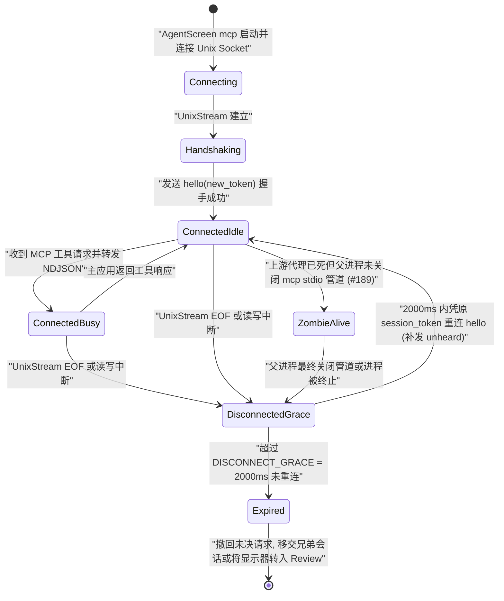

# 状态机 03：会话与控制连接生命周期

`AgentScreen mcp` 子进程与 macOS 主应用之间通过单实例 Unix 域套接字通信（ADR 0005）。连接层提供 `2000 ms` 闪断重连宽限与 `unheard` 答复重放，但受限于 MCP 标准输入输出管道的存活语义（`#189`）。

## 状态图

## 状态与转换明细表

| 节点 | 我方代码 | macOS 组件与内部行为 | 限制与故障模式 | 关联问题 | 验证状态 |
| --- | --- | --- | --- | --- | --- |
| 1. `Connecting -> Handshaking -> ConnectedIdle` | `crates/mcp/src/session.rs:35-125`、`apps/macos/src/control/server.rs:88-155` | 客户端根据 `AGENTSCREEN_INSTANCE` 定位应用支持目录下的 Unix 域套接字（`std::os::unix::net::UnixStream`），首包发送 `hello` 协商协议并绑定会话令牌。 | 主应用未启动或套接字权限不匹配时连接失败，MCP 层返回服务不可达错误。 | ADR 0005 | `[已验证]` `docs/adr/0005-control-socket.md`、`crates/mcp/src/session.rs:35-125` |
| 2. `ConnectedIdle <-> ConnectedBusy` | `crates/mcp/src/control.rs:15-140`、`apps/macos/src/control/server.rs:156-218` | 单行 NDJSON 请求与响应帧收发；长耗时请求（`wait_for_change`、`request_help`、`wait_for_control`、`InputQueue` 排队）期间会话处于挂起忙碌态，同步更新 `HolderStatus`。 | 客户端中途取消工具调用若未断开连接，需靠请求 token 去重或覆盖机制清理旧排队项。 | ADR 0005、`#206` | `[已验证]` `apps/macos/src/control/server.rs:156-218` |
| 3. `Connected* -> DisconnectedGrace` | `apps/macos/src/control/server.rs:160-190`、`crates/model/src/session.rs:45-105` | 内核在远端文件描述符全部关闭时向 `UnixStream` 投递 `EOF`（`read == 0`）。服务端标记会话离线但保留显示器句柄、窗口 `Held` 记录与 `unheard` 答复缓冲，启动 `DISCONNECT_GRACE = 2000 ms` 计时器。 | 若客户端进程陷入 `SIGSTOP` 暂停态，内核不会关闭套接字 FD，连接不会进入 `DisconnectedGrace`。 | `#189` | `[已验证]` `apps/macos/src/control/server.rs:160-190` |
| 4. `DisconnectedGrace -> ConnectedIdle` 重连恢复 | `crates/mcp/src/session.rs:126-195`、`crates/model/src/session.rs:70-120` | 客户端在 `2000 ms` 宽限期内新建 `UnixStream` 并携带原 `session_token` 发送 `hello`，服务端取消过期定时器，恢复原会话名下的全部显示器句柄并重放断连期间到达的用户 `Reply`（`unheard`）。 | 超过 `2000 ms` 后原 `session_token` 已失效，重连会被拒绝复用已清理的旧显示器。 | ADR 0015 | `[已验证]` `crates/model/src/session.rs:70-120` |
| 5. `ConnectedIdle -> ZombieAlive`（`#189` 假活） | `crates/mcp/src/session.rs:1-90`、`crates/model/src/access.rs:75-155` | macOS / POSIX 管道语义决定：只要宿主 IDE 或多代理调度器未关闭传给 `AgentScreen mcp` 的 `stdin` 写端，`mcp` 子进程阻塞在读标准输入上永不退出，与主应用之间的 `UnixStream` 也保持打开。 | **核心已知缺陷（`#189`）**：已死亡或被遗弃的上游代理会话长期占据 `ConnectedIdle`，阻止显示器自动进入 `Review` 回收，并在跨会话 `Window Request` 中持续报告持有者存活。 | `#189` | `[已验证]` `crates/mcp/src/session.rs:1-90`、`docs/adr/0017-cross-session-window-requests.md` |
| 6. `DisconnectedGrace -> Expired` | `crates/model/src/session.rs:106-140`、`apps/macos/src/core.rs:414-508` | 宽限期满仍未重连，自动撤回该会话在 `Request` 与 `InputQueue` 中的全部待决项（`Stop::Withdrawn`），对名下每块显示器执行 `end_display(EndReason::Disconnected)`（触发兄弟会话移交或转入 `Review`）。 | 过期清理顺序必须先撤回 `InputQueue` 待决项再释放窗口归属，防止刚过期的请求在最后一拍被借用执行器捞出。 | ADR 0013、ADR 0016 | `[已验证]` `crates/model/src/session.rs:106-140` |
