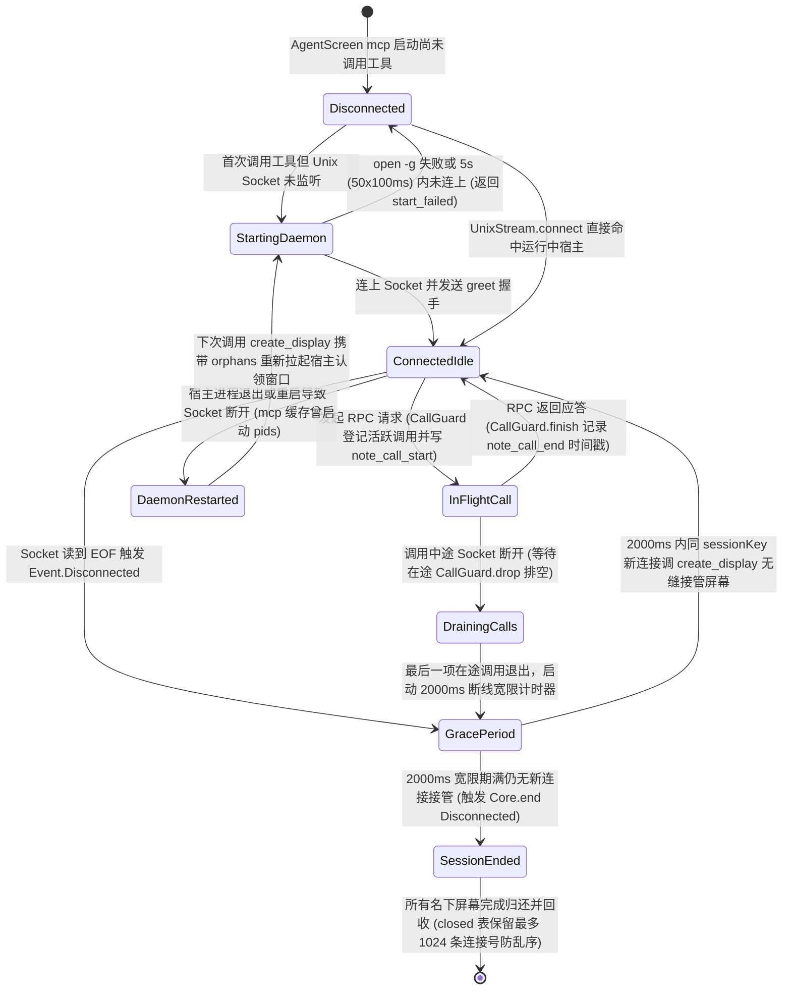

# SM-03. MCP 会话身份、Unix Socket 连接与断线宽限状态机

Agent Screen 采用双进程架构 (`ADR 0005`, `ADR 0016`)：每个智能体宿主（如 Claude Code、Codex、Cursor）通过标准输入输出 (`stdio`) 启动独立的轻量级桥接进程 `AgentScreen mcp`，再由各个 `mcp` 进程通过 Unix 域套接字连接唯一的图形守护进程 `Agent Screen.app`。会话与连接状态机负责将易断的物理 Socket 连接 (`connection: u64`) 映射到持久的逻辑会话键 (`sessionKey`)，支持单会话最多并发持有 `MAX_LIVE = 4` 块屏幕、瞬断 `2000ms` 无感重连、在途 RPC 排空保护 (`CallGuard`)、宿主重启后的孤儿进程自动认领 (`orphans`)，以及跨会话活跃度追踪 (`HolderStatus`，修复 `#189`)。

---

## 状态迁移图

---

## 状态定义与会话追踪明细表

| 状态 ID | 承载位置与关键结构 | 核心不变量与字段 | 对 `HolderStatus` (`#189`) 的表现 | 异常与边界约束 | 验证来源 |
| :--- | :--- | :--- | :--- | :--- | :--- |
| `Disconnected` | `crates/mcp/src/control.rs:60-90` (`Control` 内部 `Mutex<Option<Arc<Connection>>>` 为 `None`) | `mcp` 进程按需懒加载连接；`session::identify` 从 MCP `_meta`（如 `claudecode` / `codex_turn` / 工作目录）派生稳定 `sessionKey` | 宿主侧尚无该会话记录 | 仅 `create_display` 声明 `always_load` 预加载，节省未用屏幕会话的上下文 (`tools.rs:115, 2726`) | [已验证: crates/mcp/src/control.rs:60-90, crates/mcp/src/session.rs:18-62, crates/mcp/src/tools.rs:2726] |
| `StartingDaemon` | `Control::start_app` (`crates/mcp/src/control.rs:354-387`) | 调用 `/usr/bin/open -g -a <Agent Screen.app>` 后台静默启动，不激活前台，以 `100ms` 步长轮询连接最多 `50` 次 (`5.0 s`) | 宿主正在初始化 GPUI 与 Unix Listener | 设置环境变量 `AGENTSCREEN_NO_AUTOSTART=1` 时禁止自动拉起，直接返回 `start_failed` | [已验证: crates/mcp/src/control.rs:354-387] |
| `ConnectedIdle` | `Control::attach` (`control.rs:335-352`) + 宿主 `Core.sessions` (`apps/macos/src/core.rs:90-105`) | 单条长连接复用多轮 NDJSON 请求；`Session` 结构持有最多 `MAX_LIVE = 4` 块活跃 `DisplayId`，`Session::current()` 指向最近创建/复用的主屏幕 | `Liveness::Connected`，显示空闲秒数 `elapsed = now - last_call_end` | **关联缺陷 `#189`**：若上层编排器未关闭 `AgentScreen mcp` 的 `stdin` 管道，`mcp` 一直保持 `ConnectedIdle` 不断开，此时跨会话借窗靠 `HolderStatus` 暴露其已空闲时长供用户判断夺回 | [已验证: crates/mcp/src/control.rs:335-352, crates/model/src/session.rs:21, crates/model/src/session.rs:35-95, Issue #189] |
| `InFlightCall` | `agent::CallGuard` (`apps/macos/src/control/agent.rs:37-68`) + `Sessions::note_call_start` (`crates/model/src/session.rs:174-182`) | 进入 `handle` 时递增该会话 `in_flight` 计数并记下开始毫秒戳；正常返回调 `CallGuard::finish`，协程被取消则在 `Drop` 向 `dropped_calls` 压入回收通知 | `HolderStatus` 明确报告“正在执行调用 (active call in flight)”，警示用户此刻夺窗会打断对方正在跑的步骤 | 即使异步任务 panic 或被 `select` 丢弃，`CallGuard::drop` 也保证 `in_flight` 绝不泄漏卡在 `> 0` | [已验证: apps/macos/src/control/agent.rs:37-68, crates/model/src/session.rs:174-196, apps/macos/src/core.rs:194-201] |
| `DrainingCalls` | `Core::connection_closed` (`apps/macos/src/core.rs:1135-1165`) | Socket 已断，连接号立即记入 `Core.closed`（拦截该连接残留在队列里的新 `create_display`），等待已进入执行的收尾动作退出 | `Liveness::Disconnecting` | `Core.closed` 容量封顶 `MAX_CLOSED_CONNECTIONS = 1024` (`session.rs:22`)，超限淘汰最旧连接号防止内存无限增长 | [已验证: apps/macos/src/core.rs:1135-1165, crates/model/src/session.rs:22] |
| `GracePeriod` | `DISCONNECT_GRACE = 2000ms` (`apps/macos/src/core.rs:40-52, 1166-1198`) | 给客户端进程重启或网络代理闪断留出 `2.0 s` 缓冲（可通过 `AGENTSCREEN_DISCONNECT_GRACE_MS` 调整）；期间屏幕与窗口原地保持不动 | 显示连接刚断开等待重连 | 若 `2000ms` 内同一 `sessionKey` 建立新连接调用 `create_display`，`note_connection` 无缝变更 `owner.connection`，零窗口抖动 | [已验证: apps/macos/src/core.rs:40-52, apps/macos/src/core.rs:1166-1198, crates/model/src/session.rs:198-211] |
| `SessionEnded` | `Core::end(..., EndReason::Disconnected)` (`apps/macos/src/core.rs:1182-1190`) | 宽限到期无人接管，名下所有活跃屏幕统一进入 `Ended(Disconnected)`：借用窗口立即归还物理屏 `Home`，自启动窗口转入审阅态 | `Liveness::Ended`，允许其它会话直接免竞争申请借用其遗留窗口 | 清理该连接绑定的 `debug_user_stage` 测试桩 (`cg.rs:146-156`) | [已验证: apps/macos/src/core.rs:1182-1190, apps/macos/src/mac/cg.rs:146-156] |
| `DaemonRestarted` | `Control::receive` EOF 处理 + `Control::orphans` (`crates/mcp/src/control.rs:160-202, 389-438`) | 宿主 `Agent Screen.app` 退出或升级重启后，`mcp` 在旧 `displayId` 工具调用上返回 `RESTARTED` 指引 (`tools.rs:740`)，并在下次 `create_display` 自动附带 `adoptGroups` (`orphans`) 把先前启动的 `pid` 重新纳管 | 新宿主重建全新会话表 | 即使宿主升级替换，Agent 已打开的应用进程也不丢失归属 | [已验证: crates/mcp/src/control.rs:160-202, crates/mcp/src/tools.rs:740-755, apps/macos/src/control/agent.rs:2967-3030] |
