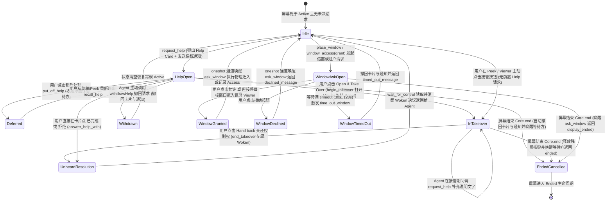

# SM-04. 人机交互请求 (`Request`) 与控制权交接状态机

每块 Agent Display 内部维护独立的请求协调器 `request::Requests` (`crates/model/src/request.rs:309-390`)，统一管理三类跨主体协作请求 (`Kind`)：**`Help`** (`request_help` 请求用户人工协助输入密码/过验证码)、**`Window`** (`place_window` / `window_access` 请求借用用户窗口或跨会话过户窗口)、以及 **`Control`** (`requestControl` 请求控制权交互) (`ADR 0004`, `ADR 0010`, `ADR 0017`)。该状态机还包含一个关键的**未听取决议暂存器 (`unheard: Option<Woken>`)**：由于 `request_help` 是立即返回的非阻塞调用，若用户在 Agent 紧接着发出 `wait_for_control` 之前的几十毫秒空档内就已经秒点了卡片按钮，决议会保存在 `unheard` 中，确保紧随其后的 `wait_for_control` 立即拿到准确结果而绝不会死锁挂起。

---

## 状态迁移图

---

## 状态定义与决议传递明细表

| 状态 ID | 模型结构与方法 (`crates/model/src/request.rs`) | 核心不变量与互斥规则 | UI 与系统通知副作用 (`Effect`) | `wait_for_control` / 调用方可见输出 | 验证来源 |
| :--- | :--- | :--- | :--- | :--- | :--- |
| `Idle` | `Requests` 无打开项且 `unheard.is_none()` (`request.rs:309-336`) | 屏幕处于 `Lifecycle::Active`，允许新发起任意 `Kind` 请求 | 右上角无该屏 Help Card，无挂起通知 | 此时若直接调 `wait_for_control`，`Wait::Ready` 立即返回 `resolution: "active"` | [已验证: crates/model/src/request.rs:302-336, crates/model/src/request.rs:761-783] |
| `HelpOpen` | `Requests` 含 `Ask::Help { instruction, steps }` (`request.rs:51-70, 474-501`) | 同一屏幕同一时刻最多一个打开的 `Help` 请求；重复调 `request_help` 更新或拒绝而不堆叠弹窗 | `HelpCard` 展示缩略图与说明，`notify::post` 推送系统横幅通知 (`Note::Help`) | `wait_for_control` 进入 `Wait::Pending` 异步挂起；超单轮等待时长返回 `"waiting"` 继续等 | [已验证: crates/model/src/request.rs:474-501, apps/macos/src/mac/notify.rs:60-105] |
| `Deferred` | `Model::put_off_help` (`request.rs:521-545`) | 请求仍未结案 (`is_open(Kind::Help) == true`)，仅暂时隐藏右上角浮动卡片免挡用户视线 | 收起 `HelpCard`，在 Peek 卡片保留待处理徽标供 `recall_help` 随时点开 | `wait_for_control` 仍保持 `waiting` 阻塞等待 | [已验证: crates/model/src/request.rs:521-545] |
| `InTakeover` | `Lifecycle::Takeover` + `begin_takeover` (`request.rs:601-619`) | 冻结 `Forwarder` 与 `InputQueue`；即使用户直接将目标窗口拖入屏幕响应借窗，也能自动联动满足挂起请求 (`request.rs:903`) | 收起右上角卡片，自动前置打开 Viewer 并在顶栏常驻接管控制条 | 其它工具调用报 `user_takeover`；`wait_for_control` 挂起并在超时提示中报告用户正在 Viewer 内操作 | [已验证: crates/model/src/request.rs:601-619, crates/mcp/src/tools.rs:1487-1518] |
| `UnheardResolution` | `unheard: Option<Woken>` (`request.rs:154-226, 419-444, 621-658`) | 保存最近一次已结案但尚未被 `wait_for_control` 取走的 `Woken { request, resolution }`（含可选用户回复文本，上限 `REPLY_CHARS = 2000`，`request.rs:22`） | 卡片与系统通知均已撤回 (`notify::retract`)，屏幕已恢复 `Active` | 下一次 `wait_for_control` 零延迟消费 `unheard`（`forget_unheard` 清空），返回 `"handed_back"` / `"completed"` / `"declined"` + 留言 + 最新窗口状态 | [已验证: crates/model/src/request.rs:22, crates/model/src/request.rs:154-226, crates/model/src/request.rs:743-783] |
| `Withdrawn` | `Model::withdraw_help` (`request.rs:503-519`) | Agent 自行取消尚未被用户接管的协助请求（若用户已进入 `InTakeover`，Agent **无权**通过 `withdrawHelp` 退出接管！） | 发出撤回通知与关闭卡片 `Effect` | 挂起的 `wait_for_control` 收到 `"withdrawn"` | [已验证: crates/model/src/request.rs:503-519, apps/macos/src/control/agent.rs:1689-1702] |
| `WindowAskOpen` | `Ask::Window` + `oneshot::Sender<Resolution>` (`request.rs:547-558`, `agent.rs:3706-3805`) | 与 `place_window` / `window_access(grant)` 的当次 RPC 生命周期直接通过 `oneshot` 绑定 | 弹出借窗/授权 `HelpCard`（若系跨会话占用则附加 `Held` 原持有者活跃状态 `#189`） | 当前 `place_window` / `window_access` 调用同步 `.await` 等待 | [已验证: crates/model/src/request.rs:547-558, apps/macos/src/control/agent.rs:3706-3805] |
| `WindowGranted` | `Model::answer(..., Answer::Allow)` (`request.rs:660-727`) | 触发 `oneshot::Sender` 传递允许决议并关闭 `Window` 请求槽 | 关闭借窗卡片并调用 `notify::retract` 撤回通知 | 唤醒 `ask_window` 执行物理迁入或记录 `Access` | [已验证: crates/model/src/request.rs:660-727] |
| `WindowDeclined` | `Model::answer(..., Answer::Decline)` (`request.rs:660-727`) | 触发 `oneshot::Sender` 传递拒绝决议 | 关闭借窗卡片并撤回系统通知 | `ask_window` 返回 `ControlError::failed(declined_message)` | [已验证: crates/model/src/request.rs:660-727, crates/model/src/held.rs:478-494] |
| `WindowTimedOut` | `Model::time_out_window` (`request.rs:560-573`) | 严格核对 `RequestId` 一致后作废超时请求，防止误杀新发起的请求 | 关闭借窗卡片并撤回系统通知 | `ask_window` 返回 `ControlError::failed(timed_out_message)` | [已验证: crates/model/src/request.rs:560-573, crates/model/src/held.rs:496-532] |
| `EndedCancelled` | `Model::end` 级联结算 (`crates/model/src/model.rs:1060-1125`) | 清空该屏幕全部打开的 `Requests`，向所有挂起通道广播 `Resolution::Ended` | 撤回该屏幕所有系统通知与桌面浮层 | `wait_for_control` 返回 `resolution: "ended"`（若系 `ClosedByUser` 则 `closedByUser: true`），借窗调用返回 `display_ended` | [已验证: crates/model/src/request.rs:189-226, crates/model/src/model.rs:1060-1125] |
