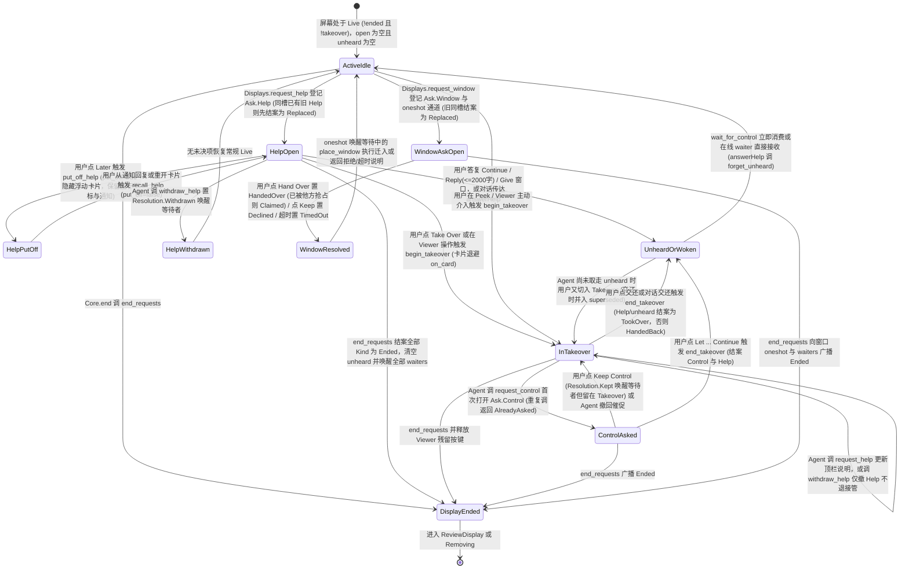

# SM-04. 人机交互请求 (`Requests`) 与控制权交接状态机

每块 Agent Display 在模型层拥有独立的请求协调器 `request::Requests` (`crates/model/src/request.rs:309-442`)，按类型各自维护最多一个打开槽位（共三类独立 `Kind`：**`Help`** 协助请求、**`Control`** 接管期请求归还控制权、**`Window`** 请求借用用户窗口或跨会话过户窗口，`ADR 0004`, `ADR 0013`, `ADR 0015`, `ADR 0017`）。同时，`Requests` 内置多等待者唤醒列表 `waiters: Vec<oneshot::Sender<Woken>>` 与未听取答复暂存器 `unheard: Option<Woken>`：当某次 `waitForControl` 超时或客户端刚发完 `requestHelp` 尚未进入等待时，用户对 `Help` 的答复（`Continue`、`Instructions`、`HandedOver`、`TookOver`）会保存在 `unheard` 中；若随后用户在 Agent 听取该答复前又主动进入 `Takeover` 并交还，`Woken::took_over` 还会把此前未听取的文字留言或赠予窗口装入 `superseded` 随交还一并交付，确保任何人工输入都不会在状态切换中丢失。

---

## 状态迁移图

---

## 状态、枚举变体 (`Ask` / `Resolution` / `Answer`) 与副作用明细表

| 状态 ID | 模型结构与方法 (`crates/model/src/request.rs`) | 核心守卫与容量常数 | UI、卡片优先级 (`on_card`) 与系统通知 | Agent 侧返回结果 | 验证证据 |
| :--- | :--- | :--- | :--- | :--- | :--- |
| `ActiveIdle` | `Display.is_live() && !takeover && !requests.any_open() && unheard.is_none()` (`request.rs:309-336, 761-775`) | 三类请求槽位均空；`!d.awaits_user()` 为真 | 无 Help Card，无挂起请求通知 | 调 `wait_for_control` 命中 `Wait::Now(Woken::of(None, Resolution::HandedBack))` 返回 `control: "agent"` | 已验证：`crates/model/src/request.rs:773-775` `if !d.awaits_user() { return Wait::Now(Woken::of(None, Resolution::HandedBack)); }` |
| `HelpOpen` | `Ask::Help { reason, steps, answers }` (`request.rs:56-60, 391-402, 474-498`) | `steps` 最多 `HELP_STEPS = 5` 条、每条 `<= HELP_STEP_CHARS` (`160`) 字 (`model.rs:544-545`)；新开同槽请求自动将旧 `Help` 结案为 `Resolution::Replaced` | `on_card` 展示协助卡片（优先级排在 `Window` 与 `Control` 之后，`request.rs:384-388`）；`notify::update` 发送带 `Take Over` / `Continue` / `Reply` 动作的通知 | `wait_for_control` 压入 `waiters` 异步等待；超时返回 `"timedOut"` -> MCP `control: "user"` | 已验证：`crates/model/src/request.rs:56-60` `Help { reason: String, steps: Vec<String>, answers: bool, }`；`crates/model/src/request.rs:384-388` `pub fn on_card(&self, takeover: bool) -> Option<&Request>` |
| `HelpPutOff` | `Request { put_off: true, .. }` (`request.rs:88, 521-541`) | 仅作用于已打开的 `Kind::Help`；Agent 若重发新 `request_help` 会生成新 `id` 且重置 `put_off = false` | 浮动 Help Card 收起让出屏幕视线，菜单栏图标徽标与通知中心条目保留；`recall_help` 恢复显示 | `d.awaits_user()` 仍为真，`wait_for_control` 保持等待 | 已验证：`crates/model/src/request.rs:88,521-539` `pub put_off: bool,` / `pub fn put_off_help(` / `pub fn recall_help(` |
| `InTakeover` | `Display.takeover == true` (`request.rs:601-612`) | 产出 `Effect::Takeover { on: true }`：冻结 `Forwarder` 后台投递并暂停该屏 `InputQueue`；即便 Agent 调 `withdraw_help` 也绝不退出 `Takeover` (`request.rs:513`) | `on_card` 自动隐藏该屏 `Help` 卡片（用户在 Viewer 内直接看步骤并操作）；动作工具报错误码 `"takeover"` | `wait_for_control` 在超时后附带 `userIdleSeconds`（`>= 15s` 提示询问用户是否忘点交还） | 已验证：`crates/model/src/request.rs:601-608` `pub fn begin_takeover(&mut self, id: DisplayId) -> Vec<Effect>`；`crates/mcp/src/tools.rs:1487` `const IDLE_HINT_SECONDS: u64 = 15;` |
| `ControlAsked` | `Display.takeover == true` 且含 `Ask::Control { reason }` (`request.rs:62, 575-597`) | 仅在 `d.takeover` 为真时可打开 (`ControlAsk::Asked`)，已打开时重调返回 `AlreadyAsked` 不发重复通知；用户选 `Answer::Keep` 结案为 `Resolution::Kept` 但保持 `Takeover` | `on_card` 在接管期仍可弹出归还控制权询问卡，`notify::update` 发 `Note::Control` 通知 | 点 `Keep Control` 返回 `control: "user", kept: true`；点 `Let ... Continue` 走 `end_takeover` 返回 `control: "agent"` | 已验证：`crates/model/src/request.rs:282-289` `pub enum ControlAsk { ... Asked, ... AlreadyAsked, ... NotNeeded, }`；`crates/model/src/request.rs:682-689` `(Kind::Control, Answer::Continue) => return Ok(self.end_takeover(id)), ... (Kind::Control, Answer::Keep) => Resolution::Kept,` |
| `UnheardOrWoken` | `Requests.wake` / `unheard: Option<Woken>` / `Woken::took_over` (`request.rs:154-183, 317, 419-432, 621-648, 681-727`) | 当 `waiters` 非空时直接向所有等待者广播 `Woken` (`heard = true`)；当 `waiters` 为空且属于 `Kind::Help` 有效人工答复（`TookOver`、`Continue`、`Instructions`、`HandedOver`，其中 `Reply` 限 `REPLY_CHARS = 2000` 字）时存入 `unheard`；若在消费前又经历 `Takeover` 交还，原留言或赠窗转入 `Woken.superseded` | `notify::withdraw_help` / `withdraw_control` 撤回已送达系统通知，卡片收起 | 在线或下一次 `wait_for_control`（或下一次非接管 `request_help`）拿到完整 `Woken` 决议 | 已验证：`crates/model/src/request.rs:154-161` `pub struct Woken { pub request: Option<Kind>, pub resolution: Resolution, ... pub superseded: Option<Resolution>, }`；`crates/model/src/request.rs:175` `fn took_over(`；`crates/model/src/request.rs:430` `self.unheard = (!heard).then_some(woken);` |
| `HelpWithdrawn` | `Resolution::Withdrawn` (`request.rs:123, 503-518`) | 撤回打开的 `Kind::Help`；不写入 `unheard` (`request.rs:427`) | `notify::withdraw_help` 移除通知并收起卡片 | 非接管期在线 `wait_for_control` 收到 `"withdrawn"` -> `control: "agent", withdrawn: true` | 已验证：`crates/model/src/request.rs:426-428,508` `Resolution::Withdrawn \| Resolution::Replaced \| Resolution::Ended` / `.resolve(Kind::Help, Resolution::Withdrawn)` |
| `WindowAskOpen` | `Ask::Window { window, held }` + `oneshot::Sender<Resolution>` (`request.rs:65-68, 89-90, 547-556`) | 与当次 `place_window` 请求调用通过专属 `oneshot` 通道一并创建；新借窗请求替换同屏旧借窗请求 (`Resolution::Replaced`) | `on_card` 最高优先级展示借窗卡片（若跨会话持有则展示 `Held` 占用详情，`ADR 0017`），`notify::update` 发 `Note::Window` | 当次 `place_window` 在 `ask_window` 内阻塞等待 `oneshot`（超时 `time_out_window` 校验 `r.id == request` 防误杀新请求） | 已验证：`crates/model/src/request.rs:385,547,564` `self.get(Kind::Window)` / `pub fn request_window(` / `if d.requests.get(Kind::Window).map(\|r\| r.id) != Some(request)` |
| `WindowResolved` | `Displays::answer(Kind::Window, ..)` (`request.rs:668-673, 690-714`) | 用户选 `Answer::Keep` -> `Resolution::Declined`；选 `Answer::Give` 时：若属用户窗且未被他方抢占则产出 `Effect::HandOver` 并发 `HandedOver`；若开卡期间被另一会话抢先占走则不移动并发 `Resolution::Claimed`；若原即跨会话持有 (`held.is_some()`) 则发 `HandedOver` 交由 `place_window` 执行过户 | `notify::withdraw_window` 撤回借窗通知并关闭卡片 | `place_window` 收到对应 `Resolution` 完成迁入，或返回拒绝/被抢占/超时错误码 `failed` | 已验证：`crates/model/src/request.rs:690-713` `(Kind::Window, Answer::Keep) => Resolution::Declined,` / `if claimed { d.requests.resolve(kind, Resolution::Claimed);` / `Effect::HandOver` |
| `DisplayEnded` | `Displays::end_requests` / `Requests::end` (`request.rs:435-441, 750-754`) | 遍历 `[Kind::Help, Kind::Control, Kind::Window]` 全部结案为 `Resolution::Ended`，清空 `unheard = None`，并向所有 `waiters` 广播 `Woken::of(None, Resolution::Ended)` | 撤回该屏幕全部通知并收起卡片 | `wait_for_control` 返回 `control: "none"`（用户关闭则 `resolution: "closedByUser"`），借窗 `place_window` 返回错误码 `ended` | 已验证：`crates/model/src/request.rs:435-441` `pub(crate) fn end(&mut self) { for kind in [Kind::Help, Kind::Control, Kind::Window] { self.resolve(kind, Resolution::Ended); } self.unheard = None; self.wake(Woken::of(None, Resolution::Ended)); }` |
