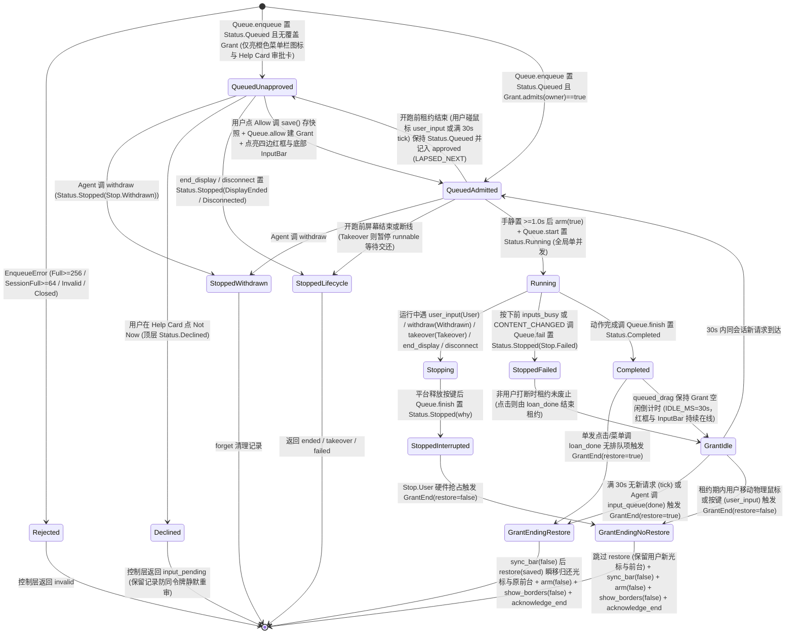

# SM-05. 真实输入队列 (`InputQueue`) 与租约授权 (`Grant`) 状态机

全局串行真实输入状态机 `input_queue::Queue` (`crates/model/src/input_queue.rs`) 协调所有会话借用物理指针的请求 (`ADR 0013`)，并与宿主 `Shell::drive_queue` (`apps/macos/src/ui/shell.rs:1258-1455`) 共同驱动物理屏幕四边发光红框 `native::show_borders` (`apps/macos/src/mac/native.rs:772`, `#206`) 与底部停止条 `InputBar` (`apps/macos/src/ui/input_bar.rs`)。模型层精确区分**单条请求状态 (`Status`: `Queued` / `Running` / `Stopping(Stop)` / `Stopped(Stop)` / `Completed` / `Declined`)** 与**跨请求临时授权租约 (`Grant` / `GrantEnd`)**。等待审批期 (`grant.is_none()`) **不显示红框也不显示 `InputBar`**，仅在菜单栏图标下方的 Help Card 显示琥珀色审批卡；用户点击允许后才保存光标快照并点亮红框与底部 `InputBar`。

---

## 状态迁移图

---

## 状态、枚举变体与屏幕指示器映射表

| 状态 ID | 代码枚举与结构 (`crates/model/src/input_queue.rs`) | 守卫条件与计时/容量常数 | 四边红框与底部 InputBar 状态 (`#206`) | Agent 侧返回结果 | 验证证据 |
| :--- | :--- | :--- | :--- | :--- | :--- |
| `Rejected` | `EnqueueError::{Full, SessionFull, Invalid, Closed}` (`input_queue.rs:10-13, 140-146`) | 全局记录数 `>= MAX_REQUESTS` (`256`)、单会话记录数 `>= MAX_SESSION_REQUESTS` (`64`)、空参数或已断线连接 | 不改变现有 UI 状态 | `submit` 映射返回错误码 `invalid` (`agent.rs:6760`) | 已验证：`crates/model/src/input_queue.rs:10-13,140-146` `MAX_REQUESTS = 256` / `MAX_SESSION_REQUESTS = 64` / `pub enum EnqueueError { Full, SessionFull, Invalid, Closed }` |
| `QueuedUnapproved` | `Status::Queued` 且 `grant.is_none()` (`input_queue.rs:48-57, 300-390`) | FIFO 排队等待用户批准当前 `approval` 代数；等待超过 `60s` 时 `detach` 暂停可运行性直至 Agent 再次 `wait` (`attach`) | **无红框、无底部 `InputBar`** (`show_borders(false)`, `sync_bar(false)`)；菜单栏图标变橙色并在下方弹出 Help Card 琥珀色请求卡 (`shell.rs:1298-1301`) | 60s 未批返回错误码 `input_pending` (`agent.rs:6935, 7086`) | 已验证：`crates/model/src/input_queue.rs:49` `pub enum Status { Queued,`；`apps/macos/src/ui/shell.rs:1298-1300` `if !granted { native::show_borders(false); self.sync_bar(false, cx);` |
| `QueuedAdmitted` | `Status::Queued` 且 `Grant::admits(&owner) == true` (`input_queue.rs:118-120, 392-424`) | 用户点击 Allow 建立 `Grant`（`answer_input` 已调 `real_input::save()` 保存快照），或同会话在 `Grant` 存续期提交新请求 | 点亮 `BORDER_LEVEL = 1000` 四边圆角/刘海裁切发光红框 (`EDGE = 2.0`, `GLOW_RADIUS = 7.0`, `GLOW_OPACITY = 0.45`) + 主屏底部居中 `InputBar` (`HEIGHT = 40.0`) | 排到队首且手静置满 `1.0s` 即转 `Running` | 已验证：`apps/macos/src/ui/shell.rs:1224,1316-1320` `let saved = crate::mac::real_input::save();` / `if !native::show_borders(true) { return; } self.sync_bar(true, cx);` |
| `QueuedUnapproved` (`LAPSED_NEXT` 回退) | `Status::Queued` 且 `id` 存在于宿主 `InputQueue.approved` (`crates/model/src/input_queue.rs:492-500`, `apps/macos/src/input_queue.rs:16, 40-43`) | 请求曾获批，但在排到它运行前租约因 `user_input` 或 `30s` 空闲到期而结束：模型层**保持 `Status::Queued`（无 `Stop::ApprovalEnded` 变体）**，宿主识别曾获批后立即停止等待并附加 `LAPSED_NEXT` 说明 | 原租约走完清理后熄灭红框与 `InputBar`，不自动重弹同一请求的系统打扰 | 返回 `input_pending` / 状态附带 `LAPSED_NEXT` 指引撤回后重提 | 已验证：`crates/model/src/input_queue.rs:492-494` `/// Physical input revokes the whole grant but leaves the other requests queued for a new approval.`；`apps/macos/src/input_queue.rs:16` `const LAPSED_NEXT: &str = "The user allowed this request, but the approval ended before it ran..."` |
| `StoppedWithdrawn` | `Status::Stopped(Stop::Withdrawn)` (`input_queue.rs:34-46, 267-297`) | 所属 `Owner` 对 `Queued` 请求调用 `withdraw` | 无租约时保持隐藏；有租约时按会话剩余状态刷新空闲计时 | `withdraw` 返回撤回后状态 | 已验证：`crates/model/src/input_queue.rs:274-275` `Status::Queued => { r.status = Status::Stopped(Stop::Withdrawn);` |
| `Declined` | `Status::Declined` (`input_queue.rs:56, 502-514`) | 用户在 Help Card 点击 Not Now：整批等待项置为顶层变体 `Status::Declined`（非 `Stopped` 子变体）；相同操作令牌重试直接返回该记录 | 审批卡收起，全程不亮红框 | 控制层返回错误码 `input_pending`（正文标明 `The user declined`） | 已验证：`crates/model/src/input_queue.rs:56,509` `Declined,` / `r.status = Status::Declined;`；`agent.rs:7079,7086` `if state_now == Some("declined")` / `code: "input_pending"` |
| `StoppedLifecycle` | `Status::Stopped(Stop::{DisplayEnded, Disconnected, Replaced})` (`input_queue.rs:35-40, 546-563`) | 屏幕结束、连接断开、或同会话提交新操作替换了旧未运行请求；注：`takeover(id, true)` 将屏幕记入 `takeovers` 暂停 `Queued` 项调度而不销毁排队项 | 若无其余活跃参与方则触发租约结束熄红框 | 返回 `ended` / `takeover` / `failed` | 已验证：`crates/model/src/input_queue.rs:35-41` `pub enum Stop { User, Disconnected, DisplayEnded, Replaced, Takeover, Withdrawn, Failed }` |
| `Running` | `Status::Running` (`input_queue.rs:50, 426-447`) | 全局最多 `1` 条 `active` 请求；首次启动前要求 `ime::user_idle() >= 1.0s` 并挂载 `real_input::arm(true)`，合成事件打标 `TAG = 0x4153_5121` | 四边红框持续发光，底部 `InputBar` 提示动鼠标即可收回 | 执行物理指针瞬移事务 | 已验证：`crates/model/src/input_queue.rs:50` `Running,`；`apps/macos/src/ui/shell.rs:1333-1350` `if idle < 1.0 { ... } real_input::arm(true);` |
| `Stopping` | `Status::Stopping(Stop)` (`input_queue.rs:52, 282-284, 499, 535`) | `Running` 途中遭遇 `user_input` (`Stop::User`)、`withdraw` (`Stop::Withdrawn`)、`takeover` (`Stop::Takeover`)、`end_display` 或 `disconnect`，等待后台任务松开鼠标键确认 | 保持红框直至后台释放按键并完成收尾 | `input_queue_action` 强制等待其转为 `Stopped` 后再返回 (`agent.rs:6816-6820`) | 已验证：`crates/model/src/input_queue.rs:51-52` `/// The platform still owns input until it acknowledges cleanup.` / `Stopping(Stop),` |
| `StoppedFailed` | `Status::Stopped(Stop::Failed)` (`input_queue.rs:45, 618-624`) | 后台执行器在按下前检测到 `inputs_busy` (`BEFORE_PRESS`)、窗口移位、或像素/控件复核未过 (`CONTENT_CHANGED`) 调用 `Queue::fail` | 点击/菜单随后由 `loan_done` 收尾；拖拽保留空闲租约 | 错误码 `failed` | 已验证：`crates/model/src/input_queue.rs:45` `Failed,`；`apps/macos/src/mac/real_input.rs:757` `const BEFORE_PRESS: &str = ...` |
| `StoppedInterrupted` | `Status::Stopped(Stop)` (`input_queue.rs:477-480`) | `Stopping(why)` 任务由 `Release::drop` 松开按键后调用 `Queue::finish` 落入终态 `Stopped(why)` | 转入对应 `GrantEnd` 清理阶段 | 错误码 `failed`（报告中途停止原因） | 已验证：`crates/model/src/input_queue.rs:478` `Status::Stopping(why) => Status::Stopped(why),` |
| `Completed` | `Status::Completed` (`input_queue.rs:55, 479`) | 后台动作全程未被真实键鼠打断，`Queue::finish` 记录结束时间戳 | 按单发点击/菜单或连续拖拽分流结算租约 | 返回 `{"route": "real_input", ...}` | 已验证：`crates/model/src/input_queue.rs:55,479` `Completed,` / `Status::Running => Status::Completed,` |
| `GrantIdle` | `Grant { idle_since_ms: Some(..) }` (`input_queue.rs:9, 108-114, 565-576`) | `queued_drag` 完成后保持 `Grant` 在线，最长空闲 `IDLE_MS = 30_000` (`30s`) | 四边红框与底部 `InputBar` (`30s` 倒计时 + 停止按钮) 保持显示 | 同会话后续真实输入免批放行 | 已验证：`crates/model/src/input_queue.rs:9,570` `pub const IDLE_MS: u64 = 30_000;` / `now.saturating_sub(idle) >= IDLE_MS` |
| `GrantEndingRestore` | `GrantEnd { id, restore: true }` (`input_queue.rs:134-138`, `shell.rs:1268-1296`) | 租约因 `loan_done` / `Queue::done` 或满 `30s` 正常结束且期间无用户触碰 (`!real_input::touched()`) | 先隐藏底部 `InputBar`，后台跑完 `real_input::restore(saved)` 归还光标与原前台后，调 `arm(false)` 与 `native::show_borders(false)` 熄灭红框并调 `acknowledge_end` | 已完成调用正常返回，后续请求需重新审批 | 已验证：`apps/macos/src/ui/shell.rs:1274-1290` `.filter(\|_\| end.restore && !real_input::touched())` / `real_input::restore(saved)` / `native::show_borders(false);` / `core.input_queue.ended(end);` |
| `GrantEndingNoRestore` | `GrantEnd { id, restore: false }` (`input_queue.rs:134-138, 492-500`, `shell.rs:1268-1296`) | 用户移动物理鼠标、敲击键盘或点击 `InputBar` 停止按钮主动收回控制权：**跳过 `restore(saved)`**，不覆盖用户当前光标与当前前台窗口 | 立即隐藏底部 `InputBar`、卸载 `arm(false)`、调 `native::show_borders(false)` 熄灭红框并 `acknowledge_end` | 运行中请求返回 `failed` | 已验证：`crates/model/src/input_queue.rs:495-497` `self.end_grant(false); if let Some(end) = self.pending_end.as_mut() { end.restore = false; }` |
