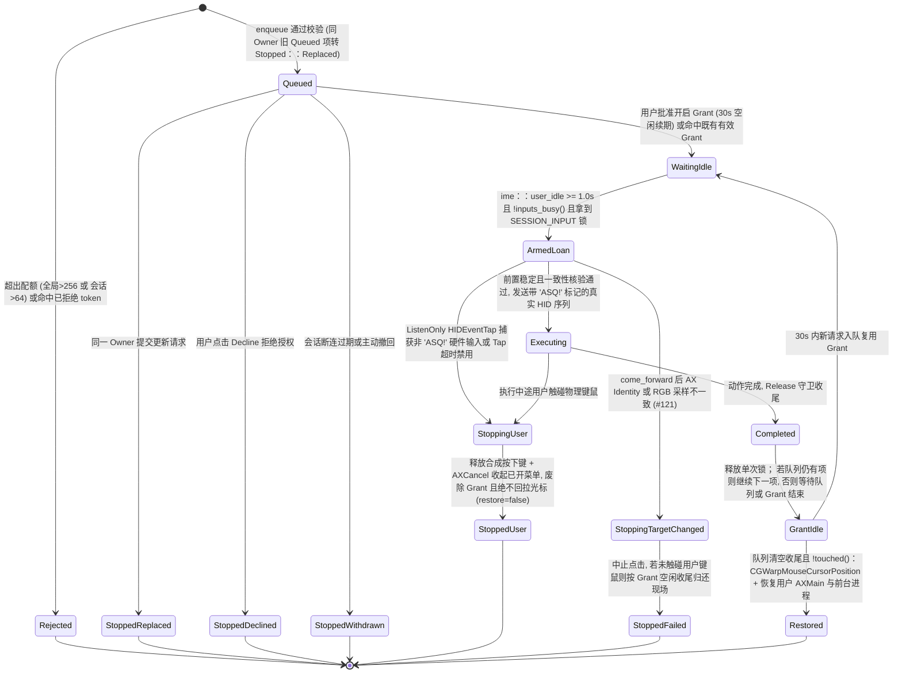

# 状态机 05：Input Queue 真实输入项与授权生命周期（ADR 0013）

`Input Queue` 严密管控每一次真实物理光标与前台焦点的借用。它将单条请求状态机与会话级 `30 s` 共享 `Grant` 解耦，保证队列等待期零视觉打扰（`#206`），并在真实硬件输入到达的第一时间无条件中止借用且不回拉用户光标。

## 状态图

## 状态与转换明细表

| 节点 | 我方代码 | macOS 组件与内部行为 | 限制与故障模式 | 关联问题 | 验证状态 |
| --- | --- | --- | --- | --- | --- |
| 1. `[*] -> Queued / StoppedReplaced` | `crates/model/src/input_queue.rs:1-210` | 检查 `MAX_REQUESTS = 256` 与 `MAX_SESSION_REQUESTS = 64`；校验 `token` 幂等表（若该 `token` 此前已被拒绝，原样返回 `Stopped::Declined` 防止重复弹窗）；若同一 `Owner` 已有 `Queued` 项，将其置为 `Stopped::Replaced`。排队态仅亮琥珀色徽标与通知，不画屏幕红框（`#206`）。 | 单会话短时间堆积超过 64 条未决请求时新请求直接被拒。 | `#206`、ADR 0013 | `[已验证]` `crates/model/src/input_queue.rs:1-210` |
| 2. `Queued -> WaitingIdle -> ArmedLoan` | `crates/model/src/input_queue.rs:211-340`、`apps/macos/src/ui/shell.rs:1330-1410` | 用户批准后生成 `IDLE_MS = 30_000 ms` 的会话共享 `Grant`。调度循环轮询 `ime::user_idle() >= 1.0 s`（利用 `ime::note_posted()` 排除 SkyLight `_CGSTickleActivityMonitor` 伪活跃）、`!IsSecureEventInputEnabled()`、无物理按键/修饰键按下，获取 `SESSION_INPUT` 与 `process_gate(pid)` 写锁，并置 `ARMED = true`。 | 终端或密码输入开启 `SecureEventInput`、或用户持续打字移动鼠标时，状态安全停留在 `WaitingIdle` 不抢控制权。 | ADR 0013 | `[已验证]` `apps/macos/src/mac/real_input.rs:300-415`、`apps/macos/src/mac/ime.rs:64-80` |
| 3. `ArmedLoan -> Executing / StoppingTargetChanged` | `apps/macos/src/mac/real_input.rs:420-545`、`crates/model/src/real_click.rs:1-210` | 采集前置前 AX `Identity` 与像素 RGB 样本，刷新 AeroSpace `claims/<pid>.json` `500 ms`，置目标 `AXMain` + `AXFrontmost` 等待几何稳定 `300 ms`（上限 `1500 ms`），再次采集并调用 `still()` 比对；不一致则转入 `StoppingTargetChanged`。 | 拦截激活瞬间弹窗顶替或 AeroSpace 强拉窗口造成的误点击（修复 `#121`）。 | `#121` | `[已验证]` `apps/macos/src/ui/shell.rs:1385-1500` |
| 4. `ArmedLoan / Executing -> StoppingUser -> StoppedUser` | `apps/macos/src/mac/real_input.rs:80-295, 1180-1240` | 主运行循环 `ListenOnly` `HIDEventTap` 发现不含 `kCGEventSourceUserData == 0x4153_5121`（`"ASQ!"`）的真实硬件事件，或收到 `kCGEventTapDisabledByTimeout`（`0xFFFFFFFE`），立即触发 `Native::UserTookInput -> revoke()`：`Release` 守卫松开合成鼠标键，菜单路径发送 `AXCancel` 关闭半开菜单，销毁当前 `Grant`，且强制 `restore = false` 绝不回跳光标或切走用户刚点中的前台窗口。 | 主线程若阻塞引发系统自动禁用 EventTap，会被保守当作用户抢占立即中止本次借用。 | ADR 0013、`CGEventTypes.h:130-131` | `[已验证]` `apps/macos/src/mac/real_input.rs:80-295` |
| 5. `Completed -> GrantIdle -> Restored` | `apps/macos/src/ui/shell.rs:1505-1560`、`apps/macos/src/mac/real_input.rs:550-640` | 单项执行完毕后若队列为空且全程 `!touched()`，执行 `GrantEnd { restore: true }`：`CGWarpMouseCursorPosition` 跳回原光标坐标、`CGAssociateMouseAndMouseCursorPosition(true)` 解除跳变冻结、写回用户原窗口 `AXMain` 与焦点元素 `AXFocused`、调用 `ime::return_front_unless` 恢复原前台应用；`Grant` 自身在 `30 s` 空闲期内仍可免弹窗服务同会话后续请求。 | 连续多项真实输入可在一次用户授权下批处理完成；超过 `30 s` 无后续请求则 `Grant` 自动失效，下次需重新确认。 | `#206`、ADR 0013 | `[已验证]` `apps/macos/src/ui/shell.rs:1505-1560`、`crates/model/src/input_queue.rs:280-380` |
