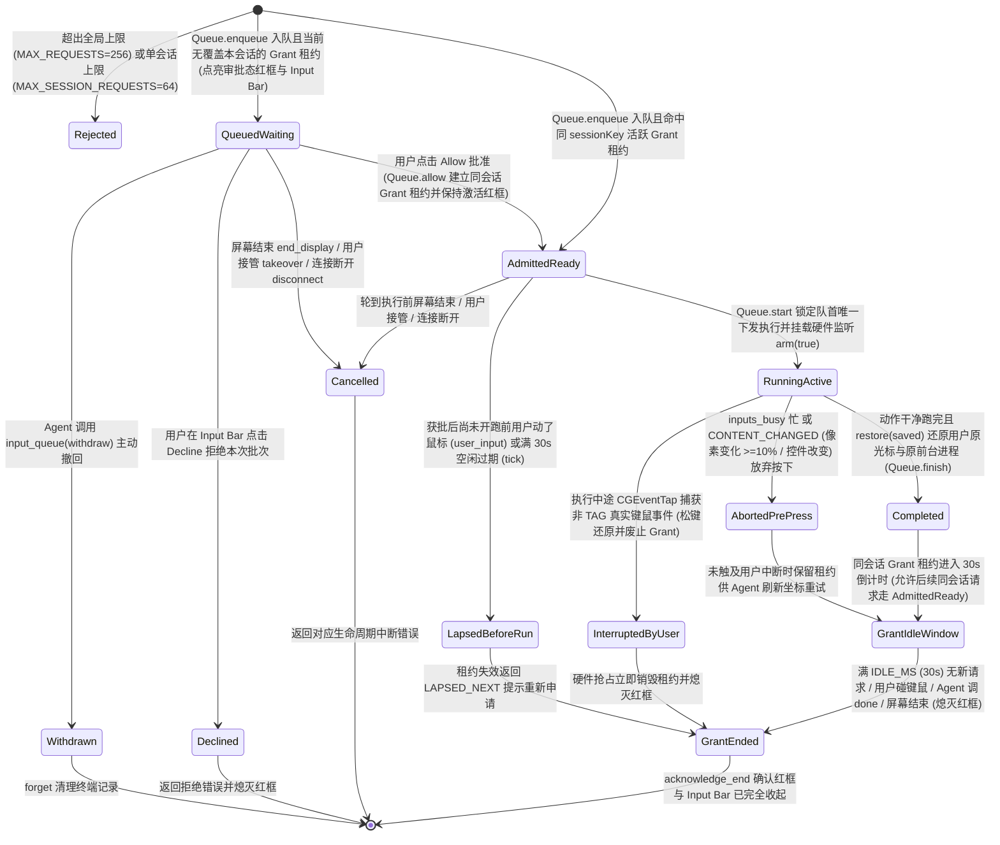

# SM-05. 真实输入队列 (`InputQueue`) 与租约授权 (`Grant`) 状态机

全局唯一的真实输入队列状态机 `input_queue::Queue` (`crates/model/src/input_queue.rs`) 负责协调多会话并发发起的物理指针借用请求 (`ADR 0013`)，并驱动用户物理屏幕四周的发光红框状态机 `screen_edge` (`crates/model/src/screen_edge.rs`, `#206`)。它同时维护两层状态：**单条请求状态 (`Status`)** 与 **会话级临时输入租约 (`Grant`)**。一次用户点击“允许”为当前会话建立 `Grant` 租约，使该会话紧接着的后续真实输入步骤在 `IDLE_MS = 30_000` (`30s`) 空闲期内免于重复弹窗；但只要用户移动物理鼠标、敲击物理键盘、进入 `Takeover`、Agent 主动调 `done`、或空闲满 `30s`，`Grant` 租约即刻废止并熄灭屏幕边缘红框。

---

## 状态迁移图

---

## 状态、停止原因 (`Stop`) 与发光红框 (`screen_edge`) 映射表

| 状态 ID | 模型表示 (`crates/model/src/input_queue.rs`) | 核心守卫与容量/计时常数 | 物理屏边缘红框与 Input Bar (`#206`) | Agent 侧返回结果 | 验证来源 |
| :--- | :--- | :--- | :--- | :--- | :--- |
| `Rejected` | `EnqueueError::QueueFull` / `SessionFull` (`input_queue.rs:10-13, 140-148`) | 全局未决请求 `>= 256` 或单 `sessionKey` 未决请求 `>= 64` | 不改变现有 UI 状态 | 错误码 `failed`（队列已满） | [已验证: crates/model/src/input_queue.rs:10-13, crates/model/src/input_queue.rs:140-148] |
| `QueuedWaiting` | `Status::Waiting` 且 `grant.is_none()` (`input_queue.rs:49-58, 299-390`) | 按 FIFO 排队等待用户批准当前 `approval` 批次号 | 点亮 `BORDER_LEVEL = 1000` 四周发光红框 (`EDGE = 2.0pt`, `GLOW_RADIUS = 7.0pt`, `GLOW_OPACITY = 0.45`) + 弹出顶部双语 `InputBar` 显示操作目标与原因 | 工具调用阻塞挂起等待审批 | [已验证: crates/model/src/input_queue.rs:299-390, apps/macos/src/mac/native.rs:143, apps/macos/src/mac/native.rs:765-950, Issue #206] |
| `AdmittedReady` | `Status::Waiting` 且 `Grant::admits(owner) == true` (`input_queue.rs:115-132, 392-424`) | `Grant` 的 `session_key` 与请求方一致且租约未失效 | 红框保持点亮警示指针随时会被借用，无需用户再次点按钮 | 排到队首即转 `RunningActive` | [已验证: crates/model/src/input_queue.rs:115-132, crates/model/src/input_queue.rs:392-424] |
| `Withdrawn` | `Status::Stopped(Stop::Withdrawn)` (`input_queue.rs:34-47, 267-297`) | 仅请求所属 `Owner` 可撤回尚未开始执行的 `Waiting` 请求 | 若无其余排队项且无租约，红框与 `InputBar` 收起 | `withdraw` 返回成功确认，原挂起调用返回已撤回 | [已验证: crates/model/src/input_queue.rs:34-47, crates/model/src/input_queue.rs:267-297] |
| `Declined` | `Status::Stopped(Stop::Declined)` (`input_queue.rs:502-515`) | 用户针对当前 `approval` 代数点击拒绝，同批次同会话等待项一并结案 | 红框与 `InputBar` 立即收起 | 错误码 `failed`：`the user declined the real-input request` | [已验证: crates/model/src/input_queue.rs:502-515, apps/macos/src/input_queue.rs:360-385] |
| `Cancelled` | `Status::Stopped(Stop::DisplayEnded \| UserTakeover \| Disconnected)` (`input_queue.rs:530-563`) | 归属屏幕关闭、用户在 Viewer 接管屏幕、或所属连接断开 | 若当前 `Grant` 属于该屏/连接则一并终止红框 | 返回 `display_ended` / `user_takeover` / `failed` | [已验证: crates/model/src/input_queue.rs:530-563] |
| `LapsedBeforeRun` | `Status::Stopped(Stop::ApprovalEnded)` (`input_queue.rs:492-500, 565-576`) | 请求曾获批，但在排到它开跑前用户动了鼠标 (`user_input`) 或租约空闲超 `30s` | 生成 `GrantEnd` 熄灭红框 | 错误码 `failed`：返回 `LAPSED_NEXT` 说明获批后在运行前租约已结束 (`apps/macos/src/input_queue.rs:16-19`) | [已验证: crates/model/src/input_queue.rs:492-500, apps/macos/src/input_queue.rs:16-19] |
| `RunningActive` | `Status::Active` (`input_queue.rs:426-447`) | 全局严格单并发（最多 `1` 个 `Active` 请求）；`real_input::arm(true)` 实时监测物理键鼠，合成事件携带 `TAG = 0x4153_5121` | 红框持续发光，`InputBar` 展示正在执行指示 | 后台执行约 `110ms` (点击) 或插值拖拽过程 | [已验证: crates/model/src/input_queue.rs:426-447, apps/macos/src/mac/real_input.rs:46, apps/macos/src/mac/real_input.rs:84-97] |
| `AbortedPrePress` | `Queue::fail` / `finish` (`input_queue.rs:618-624`, `real_input.rs:757`, `real_click.rs:73`) | 按下鼠标前发现用户正按着按键 (`inputs_busy`)，或审批期间页面变化 `>= 10%` (`CONTENT_CHANGED`) | 若因用户按着鼠标则废止租约熄红框；若仅因页面内容改变则保留租约供重发 | 错误码 `failed`（明确承诺 `nothing was pressed`） | [已验证: apps/macos/src/mac/real_input.rs:653-672, apps/macos/src/mac/real_input.rs:757-762, crates/model/src/real_click.rs:73-78] |
| `InterruptedByUser` | `real_input::touched() == true` + `Queue::user_input` (`real_input.rs:98-102, 618-635`, `input_queue.rs:492-500`) | 执行途中捕获任何非 `TAG` 硬件输入：`Release::drop` 强制补发 `MouseUp`，`restore(saved)` 归还前台并停止抢指针 | 立即废止 `Grant` 并熄灭屏幕红框 | 错误码 `failed`（报告用户移动鼠标/按键打断了执行） | [已验证: apps/macos/src/mac/real_input.rs:98-102, apps/macos/src/mac/real_input.rs:618-635, crates/model/src/input_queue.rs:492-500] |
| `Completed` | `Status::Done` (`input_queue.rs:49-58, 470-490`) | `restore(saved)` 已把物理光标瞬移回原坐标并恢复原前台窗口；`Times` 记录审批与执行毫秒耗时 | 动作执行指示结束，转入租约空闲保持 | 返回动作成功结果与耗时元数据 | [已验证: crates/model/src/input_queue.rs:84-113, crates/model/src/input_queue.rs:470-490] |
| `GrantIdleWindow` | `Grant` 刷新最后活跃时间 (`input_queue.rs:9, 115-132, 470-490`) | 同 `sessionKey` 后续真实输入请求在此窗口内直接走 `AdmittedReady` 免二次弹窗 | 红框维持在线最多 `IDLE_MS = 30_000` (`30s`) | 对同会话后续请求免批放行 | [已验证: crates/model/src/input_queue.rs:9, crates/model/src/input_queue.rs:115-132] |
| `GrantEnded` | `GrantEnd` / `acknowledge_end` (`input_queue.rs:134-138, 219-233, 517-528, 565-576`) | Agent 调 `input_queue(done)`、空闲满 `30s` `Queue::tick` 到期、或用户碰物理键鼠 | `native::hide_screen_edge` 彻底隐藏四边红框覆盖窗与 `InputBar` | 后续新请求需重新走用户点击批准 | [已验证: crates/model/src/input_queue.rs:134-138, crates/model/src/input_queue.rs:219-233, crates/model/src/input_queue.rs:517-528] |
